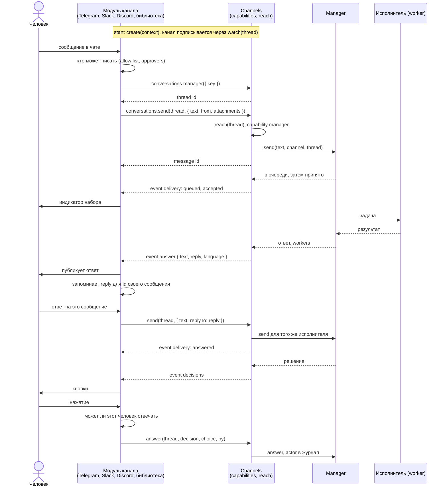

Latest correction (2026-11-15): all declared capabilities and Manager access are always enabled for bundled and installed libraries. The permission switches described in this historical proposal are removed; all configured project folders are available automatically and global Manager enablement remains. See specs/030-channel-contract-v2/spec.md FR-015 through FR-018.

# Общий контракт каналов

Реализовано в рабочей ветке `feat/channel-contract-v2`, 2026-11-14. Актуальный контракт: [руководство библиотек](channel-libraries.md), [типы](../client/src/main/channels/channel-api.ts), [UX](../specs/030-channel-contract-v2/ux.md).

Telegram, Slack, Discord и установленные библиотеки используют один `ChannelModule`. Настройки возвращаются модулем декларативно и отображаются общим renderer. Специальные Telegram UI, API телефона и разбор его старых полей в Manager удалены; миграция находится в модуле. Ниже сохранено исходное предложение как история решения; его исключения для Telegram UI, отдельного хранилища и phone compatibility отменены последним требованием пользователя.

Предложение: перевести все каналы, включая Telegram, на один контракт `ChannelModule` версии 2. Ядро перестаёт знать имена каналов, а возможности, которых сейчас нет у Slack и Discord, становятся частью контракта.

## Проблема

Сейчас в GeckIt два способа подключить место, где пишут люди.

| | Slack, Discord, внешние библиотеки | Telegram |
| --- | --- | --- |
| Код | `main/channels/slack.ts` (461 строка), `discord.ts` (640) | `main/telegram.ts` (965) и ещё 7 файлов `telegram-*.ts` (728) |
| Подключение | `ChannelModule.create(context)` через класс `Channels` | Класс `ManagerTelegram`, создаётся напрямую в `core/runtime.ts:224` |
| Доступ к Manager | `ChannelConversations` с проверкой `reach()` | Свой интерфейс `TelegramManager`: `submit`, `reply`, `pause`, `resume`, `decisions` и другие |
| Настройки и секреты | `ChannelSetting` и vault канала | Свой `TelegramVault` и своё состояние `KeptTelegram` |
| Права | Папки и флаг "может говорить с Manager" | Привязка аккаунта, командный режим с approvers |

Telegram протекает в ядро. Упоминания по файлам: `main/manager.ts` 69, `main/manager-operations.ts` 23, `service/application.ts` 13, `core/application.ts` 8. Примеры:

- `Message.source` содержит литерал `'telegram'` рядом с `'channel'`.
- В записи Manager хранятся `telegramReplies`, есть методы `telegramPending()` и `telegramTypingAllowed()`.
- `ChannelManager.send` в общем коде каналов принимает параметр `telegramRequests`, который нужен только Telegram.
- Общее хранилище вложений называется `TelegramAttachments`, а `ChannelFileSender` выведен из `TelegramFileSender`.

Последствия:

- Новая возможность в Telegram (кнопки, ответ на конкретное сообщение, индикатор набора) не достаётся Slack, Discord и внешним библиотекам.
- Исправление в общем пути (права, очередь, статус) приходится делать дважды.
- Внешняя библиотека не может повторить поведение Telegram, потому что ей не хватает API.
- `CLAUDE.md` называет Telegram встроенным каналом, хотя на контракте его нет.

## Цели и не-цели

Цели:

1. Один контракт для всех каналов: встроенных (Telegram, Slack, Discord) и внешних библиотек.
2. В ядре (`main/manager*.ts`, `core/`, `service/`) не остаётся ни одного имени конкретного канала. Проверяется командой `grep -i telegram`.
3. Возможности, которые сейчас есть только у Telegram, становятся необязательными частями контракта. Канал объявляет, какие из них он поддерживает.
4. Права проверяются в одном месте, в `Channels`, для всех каналов одинаково.
5. Сегодняшние внешние библиотеки на `apiVersion: 1` продолжают работать без изменений.

Не-цели:

- Sandbox для внешних библиотек. Они по-прежнему работают в процессе сервиса.
- Новые каналы и новое поведение для пользователя. Миграция ничего не меняет в том, как выглядит Telegram.
- Перенос на контракт телефона и CLI. Это не каналы, а клиенты с полным доступом.

## Предлагаемый контракт

Каркас сохраняется: `create(context)` возвращает `start/stop`, канал вызывает GeckIt через `context`, а GeckIt сообщает каналу о происходящем через `watch`. Новое в v2: канал объявляет в манифесте нужные ему возможности (capabilities), и соответствующие части `context` появляются только тогда, когда возможность выдана.

### Взаимодействие

Одно сообщение в тред Manager, ответ на него, ответ человека на конкретное сообщение и нажатие кнопки решения. Все вызовы канала проходят через `Channels`, который проверяет capabilities и `reach()`. Канал не обращается к Manager напрямую.



Граница ответственности: всё, что слева от `Channels`, делает канал (транспорт, разметка, права людей, индикатор набора, привязка аккаунта). Всё, что справа, делает ядро (очередь, исполнители, связь ref с исполнителем, журнал решений). `Channels` проверяет только то, что канал вправе вызывать.

### Возможности

| Возможность | Что даёт | Как выдаётся | Откуда взята |
| --- | --- | --- | --- |
| `conversations` | Разговоры в разрешённых папках | Папки в Settings, как сейчас | v1 |
| `manager` | Треды Manager, решения, статус | Флажок "может говорить с Manager" | v1 |
| `replies` | Ответ на конкретное сообщение уходит тому же исполнителю (worker) | Вместе с `manager` | Telegram `reply`, `telegramReplies` |
| `delivery` | Квитанции на сообщения: в очереди, принято, отвечено. На них строится индикатор набора | Вместе с `manager` | `telegramPending`, `telegramTypingAllowed` |
| `control` | Пауза и продолжение Manager из канала | Отдельная галочка в Settings | Telegram `pause/resume` |
| `files` | Вложения в Manager и отправка файлов из проекта | Отдельная галочка. Сейчас доступно только встроенным каналам | v1 `files` для Slack и Discord |
| `shares` | Кнопки "остановить" для открытых localhost-ссылок | Отдельная галочка | Telegram `shares` |

Неопасные возможности (`replies`, `delivery`) идут вместе с доступом к Manager. Для тех, что трогают файлы, сеть или работу Manager (`files`, `shares`, `control`), пользователь ставит галочку сам. Встроенные каналы получают те же галочки, но включёнными по умолчанию, потому что всё, что умеет Telegram, должно продолжить работать.

### Манифест

```json
{
  "apiVersion": 2,
  "kind": "channel",
  "entry": "index.mjs",
  "channel": { "id": "channel:telegram", "name": "Telegram", "icon": "chat" },
  "capabilities": ["conversations", "manager", "replies", "delivery", "control", "files", "shares"],
  "config": [{ "key": "botToken", "label": "Bot token", "type": "secret", "required": true }]
}
```

`apiVersion: 1` читается как `capabilities: ["conversations", "manager"]`. Поэтому внешние библиотеки v1 работают как работали.

### Интерфейс

Ниже только то, что меняется относительно `channel-api.ts`. Остальное остаётся как есть.

```ts
interface ChannelContext {
  readonly id: ChannelId
  readonly capabilities: ReadonlySet<ChannelCapability>
  // config, secret, store, status, log, projects, providers, employees: как в v1
  readonly conversations: ChannelConversations
  readonly files?: ChannelFiles        // capability 'files'
  readonly shares?: ChannelShares      // capability 'shares'
  readonly control?: ChannelControl    // capability 'control'
}

interface ChannelSend {
  readonly text: string
  readonly from?: string
  readonly images?: readonly SessionImage[]
  readonly attachments?: readonly ChannelAttachmentId[]
  readonly authorized?: () => boolean
  /** capability 'replies': ссылка канала на сообщение, на которое ответили */
  readonly replyTo?: string
}

interface ChannelConversations {
  // start, get, list, items, label, watch, answer, stop, manager: как в v1
  /** Возвращает id сообщения, по нему приходят события 'delivery'; replyTo требует capability 'replies' */
  send(id: string, message: ChannelSend): Promise<string>
  /** Ведёт ли ссылка ответа ещё к работе, за которой следит Manager */
  current?(reply: ManagerReplyOrigin): boolean
  /** Граница истории треда. В v1 уже есть, но не документирована */
  historyBoundary?(key: string): ManagerHistoryBoundary | undefined
  answer(id: string, card: string, answer: CardAnswer | string, by?: ChannelActor): Promise<boolean>
}

interface ChannelControl {
  /** Пауза общая для всего Manager, поэтому доступна только с 'control' */
  pause(): Promise<void>
  resume(): Promise<void>
}

type ChannelEvent =
  | /* history, items, state, notice, decisions, status: как в v1 */
  | { kind: 'answer'; text: string; reply?: ManagerReplyOrigin; language?: Speech }
  | { kind: 'delivery'; message: string; state: 'queued' | 'accepted' | 'answered' | 'refused' }
```

Решения, заложенные в интерфейс:

- У события `answer` есть `reply`: ссылка на работу, о которой этот ответ. Канал хранит её рядом с id своего опубликованного сообщения. Когда человек отвечает на это сообщение, канал передаёт `replyTo: reply`, и GeckIt направляет ответ нужному исполнителю. Канал не обязан знать, кто исполнитель, а `current(reply)` говорит, жива ли ещё эта работа.
- Индикатор набора строится на стороне канала из событий `delivery`. Ядро перестаёт знать про набор текста.
- `ChannelActor` (кто нажал кнопку: id и имя) нужен для журнала решений. Ядро только записывает его, а кто имеет право отвечать, решает канал.
- Привязка аккаунта (pairing) в контракт не входит. Канал делает её сам через `inspect`, `store` и `status`, так же как Discord проверяет свои настройки.

## Telegram на контракте

Telegram становится третьим встроенным модулем `main/channels/telegram.ts` рядом со Slack и Discord. В нём остаётся всё, что касается самого Telegram. В ядро уходит только то, что нужно любому каналу.

| Что сейчас в Telegram | Куда переходит |
| --- | --- |
| Bot API, long polling, `offset`, разметка (`telegram-bot.ts`, `telegram-render.ts`, `telegram-text.ts`) | Модуль канала |
| Привязка аккаунта, командный режим, approvers (`telegram-access.ts`, `telegram-team.ts`) | Модуль канала: `store` и `inspect` |
| Кнопки решений и `callbacks` | Модуль канала. Ответ идёт через `conversations.answer(..., by)` |
| Индикатор набора (`telegram-typing.ts`) | Модуль канала, по событиям `delivery` |
| Карта ответов `telegramReplies` в записи Manager | Ядро, под общим именем `channelReplies`, ключ по каналу и ref |
| `telegramRequests`, `telegramPending`, `telegramTypingAllowed` | Ядро, как события `delivery` |
| Хранилище вложений `TelegramAttachments` | Ядро, переименование в `ChannelAttachments` |
| Токен в `TelegramVault` | `ChannelSetting` и секреты канала (`<data>/channels/channel-telegram.secrets`) |
| Состояние `KeptTelegram` | `context.store` канала |
| `Message.source = 'telegram'` | `source: 'channel'` плюс `channel: 'channel:telegram'` |

На этом шаге ожидаю две сложности:

- **Несинхронные ответы (кнопка `late`).** Сейчас Telegram предлагает "отправить всё равно" для сообщения, которое пришло слишком поздно. Это становится событием `delivery: refused` с причиной. Повторная отправка делается обычным `send` с флагом. От ожидаемых причин отказа зависит, понадобится ли дополнительное поле в контракте.
- **Ответы, которые формулирует сам GeckIt** (например, сообщение о паузе), сейчас берут язык из `language()`. В v2 язык приходит в событии `answer`, а сами тексты переезжают в модуль канала.

## Изменения в ядре

У Manager остаётся один вход для всех каналов. Всё, что сейчас названо telegram*, переименовывается и привязывается к id канала.

| Файл | Изменение |
| --- | --- |
| `main/channels/channel-api.ts` | v2: capabilities, `replyTo`, `current`, событие `delivery`, `ChannelControl`, `ChannelShares`, `ChannelActor` |
| `main/channels/libraries.ts` | Чтение `apiVersion: 2` и `capabilities`. Для v1 подставляется набор по умолчанию |
| `main/channels/channels.ts` | Выдача частей context по capabilities вместо проверки `builtIn(id)`. Telegram добавляется в `BUILT_IN` |
| `main/manager.ts` | `source: 'telegram'` заменяется на `'channel'` с `channel`. `telegramReplies` становится `channelReplies`. `telegramPending` и `telegramTypingAllowed` становятся событиями `delivery`. Удаляется префикс `[Telegram]` |
| `main/manager-operations.ts` | `telegramFile` заменяется на `channelFile(thread)` для всех каналов |
| `main/telegram-attachments.ts` | Переезжает в `main/channels/attachments.ts`. Лимит 20 MiB становится общим |
| `core/runtime.ts` | Удаляются `ManagerTelegram`, `telegramThread`, `forTelegram` и `telegramProgress` |
| `core/application.ts`, `service/application.ts` | RPC `telegram:view` и `telegram:action` заменяются на `channels:view` и `channels:inspect`. На одну версию остаётся алиас, потому что их вызывает телефон (`renderer/src/phone.ts`) |
| `renderer/src/ui` | Привязка Telegram уже живёт в Settings, Channels и остаётся там; экран получает свой вид через `channels:request` и `channels:shown`. Заметное изменение одно: галочки "What it may do" у каналов |

Миграция данных при первом старте: токен из `TelegramVault` переносится в секреты канала, `KeptTelegram` в `store`, `telegramReplies` в `channelReplies`. Привязка аккаунта и треды Manager (`channel: 'telegram'`) сохраняются, если поменять `channel` на `'channel:telegram'` и не трогать `key`.

## План миграции

Пять шагов. После каждого приложение работает и может уйти в Development. Telegram переезжает только на четвёртом шаге, когда контракт уже проверен на Slack и Discord.

1. **Контракт v2 без переезда.** Типы в `channel-api.ts`, чтение `apiVersion: 2` и выдача частей context по capabilities. `files` отвязывается от `builtIn(id)`. Проверка: `examples/slack-channel` (v1) запускается без изменений, тесты `main/channels/test/` проходят.
2. **Общие механизмы в ядре.** `channelReplies`, события `delivery`, `ChannelControl`, `ChannelShares`. Telegram временно читает новые имена через тонкий адаптер. Проверка: тесты Manager на ответ на конкретное сообщение, паузу и очередь проходят без изменений в ожиданиях.
3. **Slack и Discord на v2.** Они получают `replies` и `delivery`. Это первая настоящая проверка контракта на каналах, которые не Telegram. Проверка: ответ в треде Slack на сообщение исполнителя доходит до этого исполнителя на живом workspace.
4. **Telegram на v2.** `main/telegram*.ts` переезжает в `main/channels/telegram/`, `ManagerTelegram` удаляется из `core/runtime.ts`, данные мигрируют при первом старте. Проверка: уже привязанный бот работает после обновления без повторной привязки. Личный чат и командный топик сохраняют историю, кнопки решений, индикатор набора, отправку файлов и кнопки остановки ссылок.
5. **Уборка.** Удалить алиасы `telegram:*` и адаптер из шага 2. `grep -ri telegram` по `core/`, `service/` и `main/manager*.ts` должен быть пустым. Обновить `docs/channel-libraries.md`, `CLAUDE.md` и `docs/features.md`.

## Открытые вопросы и риски

1. **Где живёт настройка Telegram.** Решено: она уже в Settings, Channels и там остаётся.
2. **Выдавать ли `files` и `shares` внешним библиотекам.** Сейчас `files` есть только у встроенных каналов, и это осознанное ограничение (`docs/channel-libraries.md`). Предлагаю разрешить через явную галочку. Если это слишком рискованно, capability остаётся только у встроенных, но контракт для них всё равно общий.
3. **Телефон.** Он вызывает `telegram:view` и `telegram:action`. Старые сборки на iPhone и Android будут ходить по старым именам, пока их не обновят. Нужен алиас минимум на один релиз, а то и дольше, если TestFlight-сборки живут долго.
4. **Риск: миграция данных Telegram.** `KeptTelegram` хранит offset, callbacks, ожидающие загрузки и журнал решений. Ошибка в переносе означает повторно обработанные или потерянные сообщения. Нужен тест на реальном сохранённом файле и откат: старый файл не удаляется, пока новый не прочитан успешно.
5. **Риск: размер изменения в `main/manager.ts`.** 69 упоминаний Telegram, в том числе в очереди и восстановлении после падения. Шаг 2 стоит делать отдельным PR с тестами только на переименование, без изменения поведения.
6. **Причины отказа в `delivery: refused`.** Нужен полный список причин, которые сейчас обрабатывает Telegram (поздно, пауза, нет прав, лимит очереди `TEAM_QUEUE_LIMIT`), чтобы зафиксировать их в контракте как перечисление.
