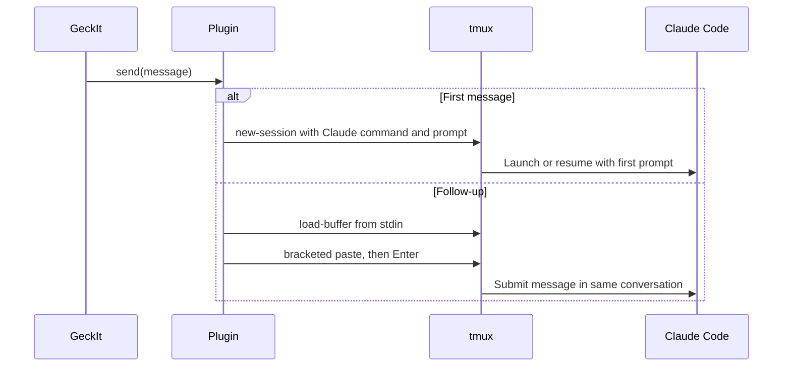
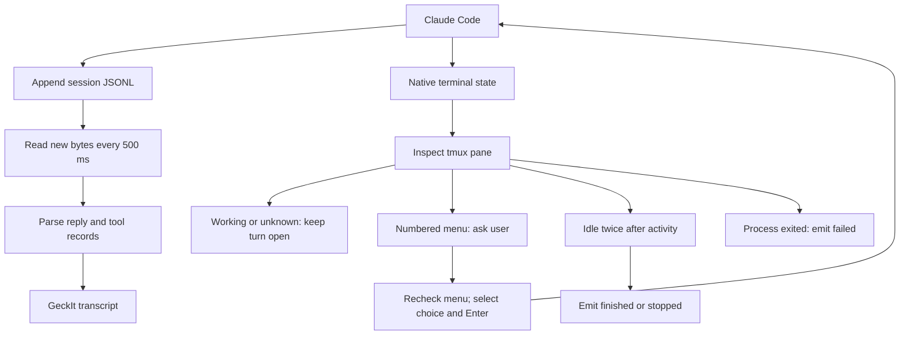

# How the Claude tmux plugin sends messages and reads replies

The updated plugin runs ordinary interactive Claude Code in a detached tmux terminal. **Input uses tmux; replies and tool progress use the session JSONL file; status and approvals use terminal inspection.** It adds no GeckIt HTTP hooks or system prompt.

Implementation: [src/provider.mjs](/Users/alex/Projects/mine/geckit-claude-tmux/src/provider.mjs). Reviewable change: [plugin patch](claude-tmux-passive.patch). The first passive version is installed. The non-error synthetic-record correction is installed. A one-hour idle-shutdown update is staged locally; apply it through Settings > Libraries > Apply update.

## Send a first message

`send(text, images, before)` joins instruction blocks, text and image paths into one prompt. The plugin launches:

```text
claude --permission-mode <mode> --settings <settings>
       [--model <model>]
       (--session-id <id> | --resume <id>)
       <prompt>
```

The prompt is shell-quoted as one argument. Settings exclude the global `GECKIT.md` file for this process; they contain no plugin hooks. Existing user hooks and project instructions remain active. On Claude's initial workspace-trust screen, the driver explicitly selects "Yes, I trust this folder".

## Send another message

The same running conversation receives the full message through:

```sh
tmux load-buffer -b <buffer> -
tmux paste-buffer -p -d -b <buffer> -t <session>
tmux send-keys -t <session> Enter
```

`load-buffer` receives text on stdin. Bracketed paste keeps multiline input together; Enter submits it. Comments, instructions and slash commands use this path.



[Send diagram](diagrams/claude-session-management/01-send.svg)

## Read replies and progress

Every 500 ms, the plugin reads new bytes from:

```text
~/.claude/projects/<project-slug>/<session-id>.jsonl
```

On resume it starts at the existing file's end. It buffers incomplete lines, parses complete records and passes them to GeckIt's `readClaude()` parser. Reply and tool items reach the app through `hear({ items, gone, signals })`. Reply text never comes from terminal output. Updates arrive as Claude writes message blocks, without the former token-level hook streaming.

## Know whether Claude finished

The same polling cycle inspects the tmux pane for these native states:

| State | Evidence | Result |
| --- | --- | --- |
| Working | Active spinner or interrupt hint | Keep the turn open |
| Waiting | Selected numbered menu and navigation hints | Show Claude's exact choices in an existing question card |
| Finished | Idle input prompt on two consecutive polls after observed activity | Emit `ended: done` |
| Stopped | Ctrl+C followed by confirmed idle prompt | Emit `ended: stopped` |
| Failed | Process exited or explicitly flagged API failure followed by idle | Emit `ended: failed` |
| Unknown | Layout is unrecognized | Keep working; do not guess completion |

An answer rechecks the current menu, navigates with Up/Down and presses Enter. Stale choices are rejected. Unsupported dialogs require native terminal interaction. Stop sends Ctrl+C. A process check also detects dead panes that tmux retains. GeckIt closes the tmux session after one hour idle following completion. New messages reset the timer; working turns, pending approvals and tracked background tasks prevent shutdown.



[Read and status diagram](diagrams/claude-session-management/02-read.svg)

File silence is not completion. `end_turn` ends a model response, but hooks may continue the conversation. "Finished" means the turn ended, not that the requested work succeeded.

Passive file reading adds nothing to Claude's context. Existing history, project instructions or other integrations may still reveal GeckIt; undetectability is not guaranteed.


## Startup MCP selections

The library source now recognizes Claude's "2 new MCP servers found in this project" checkbox screen before the first input prompt. The existing Chat question card mirrors native server selections and the warning. Its hint is "Choose servers, then enable selected or reject all." "Enable selected" is the primary action; "Reject all" is secondary. There is no custom text field because this native menu accepts server choices only. Desktop and phone use the shared Transcript component and existing styles.

Startup retains the original pending message while the person answers. Each toggle uses native Space; Enable selected uses Enter, and Reject all uses Escape. Questions suspend the readiness timeout; startup continues automatically after an explicit decision. Stop resolves the question and prevents later submission. A stale answer is ignored, and unrelated unknown startup failures retain the last 2,000 terminal characters in the existing expandable diagnostic. Server activation is never automatic. Missing native history still fails a resume explicitly.

This extends the existing native-question flow and recovery behavior; it does not add a new setting or renderer layout. Alex approved displaying and selecting the startup choices on 2026-10-21. Implementation and integration evidence live in the library's doc/ux/passive-terminal.md.

Verification on 2026-10-21: all 10 startup/recovery tests pass using fake Claude on isolated real tmux servers, including a 65-second question wait, explicit toggle/enable/reject, stale answers, Stop and exactly-once message submission. The complete provider suite passes 45/46; test/tmux.test.mjs:383's ignored-trust-navigation assertion also fails on unchanged source. The host full run passes 1,205/1,206; its Telegram attachment count test timed out under concurrent load, then its complete eight-test file passed alone. Typecheck, raw lint, desktop build and mobile build pass.

The actual shared Transcript, Composer and surrounding Chat components were reviewed in Chrome at desktop width and 390x844 phone width, both themes: checkbox click/Space, explicit submit/reject, visible Tab focus, long-history scrolling and overflow. The UI harness substitutes the native boundary; it does not establish a live account submission. Performance review: work stays within the existing question's choice list and memoized transcript; no new global scans, rows, animation or polling were added to the renderer.

Source changes are delivered through the GeckIt and Claude tmux library main branches. The tested bundle is staged at ~/Library/Application Support/geckit-local/provider-plugins/.ready-startup-mcp-01a15f10 for GeckIt Local's next restart. Existing installed libraries, active snapshots, native approval choices and running conversations remain intact; the current process still uses its prior library. No physical phone installation was performed.
