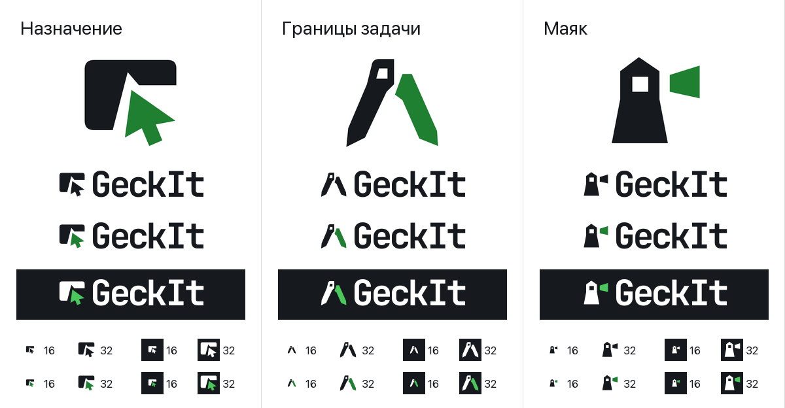

# GeckIt. Три новых логотипа

## Задача

GeckIt нужен знак для CEO стартапов, которые делегируют работу ИИ-сотрудникам и управляют ею из одного пространства с IDE. За исходную взял бесплатную версию продукта. Каждый знак показывает один момент работы руководителя. Зелёный выделяет ровно один элемент, который передаёт действие.

## Варианты

| Вариант | Идея | Двухцветный SVG | Монохромный SVG |
| --- | --- | --- | --- |
| Назначение | Курсор выбирает карточку, как руководитель назначает задачу ИИ-сотруднику | [Светлый фон](assign/logo-green-light.svg) · [Тёмный фон](assign/logo-green-dark.svg) | [Светлый фон](assign/logo-mono-light.svg) · [Тёмный фон](assign/logo-mono-dark.svg) |
| Границы задачи | Циркуль задаёт рабочий размах, как руководитель определяет рамки задачи | [Светлый фон](compass/logo-green-light.svg) · [Тёмный фон](compass/logo-green-dark.svg) | [Светлый фон](compass/logo-mono-light.svg) · [Тёмный фон](compass/logo-mono-dark.svg) |
| Маяк | Луч показывает, где работа ИИ-сотрудника требует внимания руководителя | [Светлый фон](beacon/logo-green-light.svg) · [Тёмный фон](beacon/logo-green-dark.svg) | [Светлый фон](beacon/logo-mono-light.svg) · [Тёмный фон](beacon/logo-mono-dark.svg) |

Отдельные знаки в SVG, по четыре версии на вариант. [Назначение](assign/) · [Границы задачи](compass/) · [Маяк](beacon/).

**Рекомендация: «Маяк».** Луч объясняет роль зелёного и остаётся видимым в 16 px. В этой метафоре руководитель видит, куда направить внимание, пока ИИ-сотрудники выполняют задачи.

Зелёный взят из текущей палитры GeckIt: `#1F8031` для светлого фона и `#4AC85C` для тёмного. Надпись GeckIt набрана заново на основе JetBrains Mono NL Bold с ручной настройкой межбуквенных интервалов. В SVG буквы переведены в кривые. [JetBrains Mono](https://www.jetbrains.com/lp/mono/)

## Проверки по стандарту lebedev-logo

Знаки просмотрены при 16, 32 и 512 px на обоих фонах в монохроме и в двух цветах. Полные логотипы просмотрены при высоте 512 px и на сравнительном листе. Первая версия «Назначения» была отброшена из-за слишком обычного контура, а измерительный знак был заменён циркулем после проверки в 16 px.

| Проверка | Результат |
| --- | --- |
| Читаемость | В надписи читается GeckIt, включая прописную I. |
| Малый размер | У всех трёх сохраняются два основных элемента. У «Границ задачи» отверстие в шарнире почти сливается в 16 px. |
| На что похоже | «Назначение» читается как курсор и карточка. Циркуль может читаться как A. У «Маяка» сохраняются башня и луч. |
| Смысл | У каждого варианта есть конкретное действие или рабочая ситуация CEO. |
| Одна идея | Каждый знак построен вокруг одного действия: назначить, очертить границы или направить внимание. |
| Лишние детали | У карточки одна выемка, у циркуля одно отверстие, у башни одно окно. Остальные детали убраны. |
| Самостоятельность | Стрелка курсора сама по себе типовая. Циркуль и маяк имеют тематические ассоциации с Android Studio и Chrome Lighthouse. Отличия в силуэтах видны в монохроме. |
| Типографика | Во всех вариантах одна надпись с ручной настройкой пяти межбуквенных интервалов. |
| Рисунок | Проверены просветы между деталями, силуэты и вес знаков рядом с надписью. |
| Соответствие рынку | Метафоры относятся к управлению работой. Зелёный продолжает палитру GeckIt, хотя зелёные есть и у продуктов из той же категории, в том числе у Tasklet. |

Сходство оценивалось визуально в пределах подборки. [Соседние логотипы](../round-11-symbol/geckit-competitors.png) · [Cursor](https://cursor.com/en-US/brand) · [Tasklet](https://tasklet.ai/brand) · [Android Studio](https://developer.android.com/studio) · [Chrome Lighthouse](https://developer.chrome.com/blog/lighthouse-dbw)
