# GeckIt browser detection report

Measured 2026-11-19. This report shows how GeckIt's new Camoufox test browsers look to bot-detection pages. It compares them with two other ways GeckIt drives a browser: the Chrome for Testing browsers they replaced, and GeckIt's Chrome extension in a person's own Chrome.

Two kinds of checks were run:

- Three public detection pages: bot.sannysoft.com, BrowserScan and CreepJS.
- A test page that records what GeckIt changes in it while it works.

Every number below was measured in this session. Screenshots are cropped to the result, so they leave out the IP address and location.

## Verdict

Camoufox matches the other browsers on fingerprint, and it is the only one that leaves no trace in the page. On a Linux server it is far ahead of the old headless Chrome for Testing.

- **Fingerprint on macOS:** all three browsers pass the hard checks:
  - CreepJS: 0% headless and 0% stealth;
  - BrowserScan: every bot row Normal, and 100% authenticity.

  These public pages do not tell the three apart on a Mac.
- **Linux server:** the two browsers differ sharply.
  - Camoufox runs on a virtual display and scores the same as on a Mac.
  - The old Chrome for Testing ran headless there and is caught: BrowserScan says Robot, and CreepJS gives 67% headless and 50% like headless. Sites see SwiftShader, Chrome's software renderer.
- **Page traces:** GeckIt read, typed, scrolled and clicked on the test page.
  - Chrome for Testing and the extension added a `geckit-pointer` element and `data-geckit-ref` attributes to the page, so a site that watches its own page can see them.
  - Camoufox added nothing.
- **Input:** only Camoufox scrolls with real wheel events (40 in the test). The old browser also inserted typed text without key presses.
- **Biggest gap:** these pages test the browser, not the network or behaviour over time.
  - Commercial checks such as Cloudflare, DataDome and Akamai also weigh IP reputation.
  - A server's datacenter address is a stronger signal than anything measured here.
  - This was not tested.

Confidence:

- **High** for the measured numbers and traces. Each browser was run once, on one Mac and in Linux containers.
- **Moderate** for what the numbers mean for real sites, since these pages only approximate real protection.

## Results

How to read the scores:

- **CreepJS "like headless": lower is better.** It is the share of about 16 headless-like traits the page found. Many of those traits are Chrome features that Firefox never has, so real browsers score above 0%. Your own Chrome scores 31%.
- **BrowserScan authenticity: higher is better.**

| Check | Camoufox, macOS (new) | Chrome for Testing, macOS (old) | Extension, your Chrome | Camoufox, Linux virtual display (new) | Chrome for Testing, Linux headless (old) |
|---|---|---|---|---|---|
| sannysoft failed rows | Chrome object (every Firefox fails it) | none | none | Chrome object (every Firefox fails it) | **User agent says HeadlessChrome; WebGL renderer is SwiftShader** |
| BrowserScan bot detection | Normal | Normal | Normal | Normal | **Robot** |
| BrowserScan authenticity | 100% | 100% | 100% | 100% (90% when the server's timezone did not match the IP) | 100% |
| CreepJS headless | 0% | 0% | 0% | 0% | **67%** |
| CreepJS stealth | 0% | 0% | 0% | 0% | 0% |
| CreepJS like headless | 6% | 31% | 31% | 13% | **50%** |
| WebGL renderer sites see | Apple M1, or similar | ANGLE Metal, Apple M4 Max | ANGLE Metal, Apple M4 Max | Intel(R) HD Graphics, or similar | **SwiftShader** (software) |

## Screenshots

### CreepJS, Headless section

| Camoufox, macOS | Chrome for Testing, macOS | Extension, your Chrome | Camoufox, Linux |
|---|---|---|---|
| 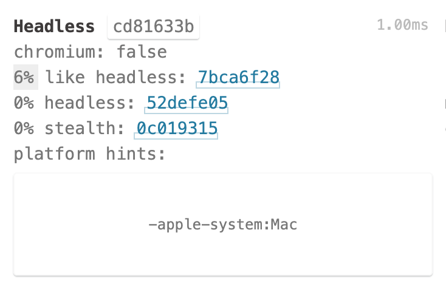 |  | 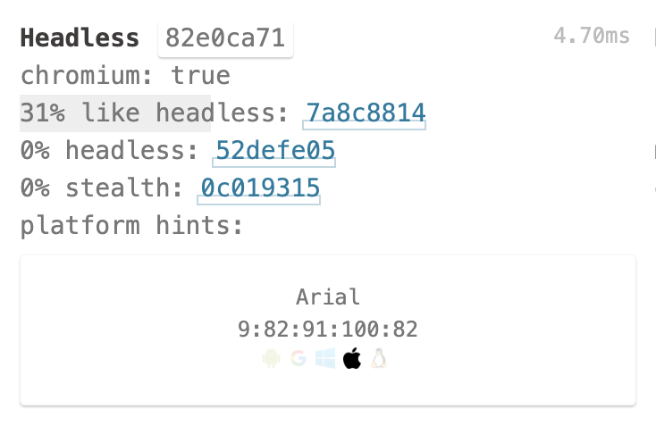 | 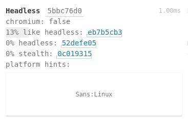 |

### BrowserScan, authenticity

Camoufox, macOS

Chrome for Testing, macOS

Extension, your Chrome

Camoufox, Linux

Chrome for Testing, Linux headless

### BrowserScan, bot detection

Camoufox, macOS
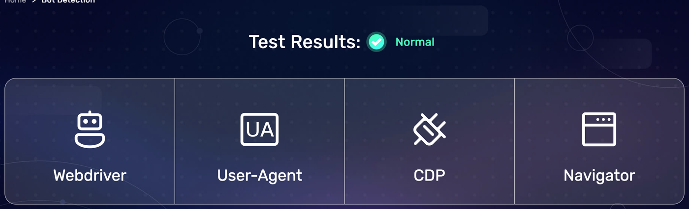

Chrome for Testing, macOS
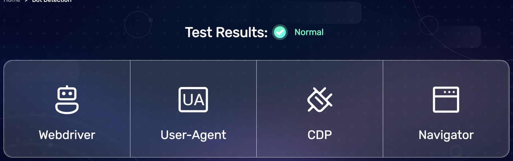

Extension, your Chrome
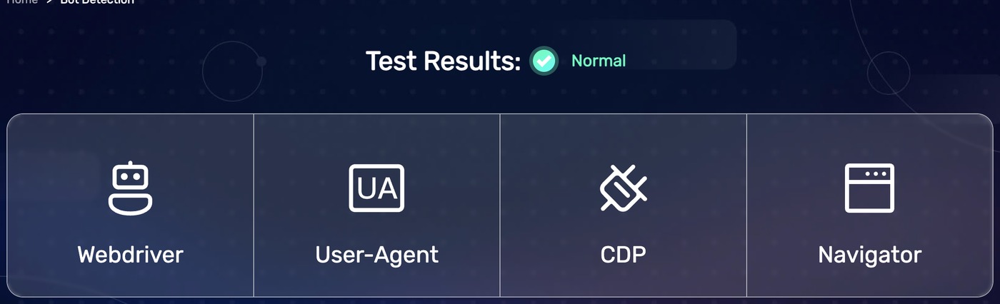

Camoufox, Linux
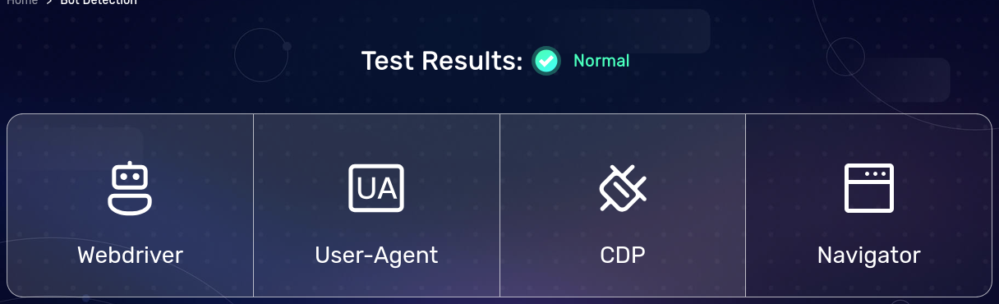

### bot.sannysoft.com, first table

| Camoufox, macOS | Chrome for Testing, macOS | Extension, your Chrome | Camoufox, Linux |
|---|---|---|---|
| 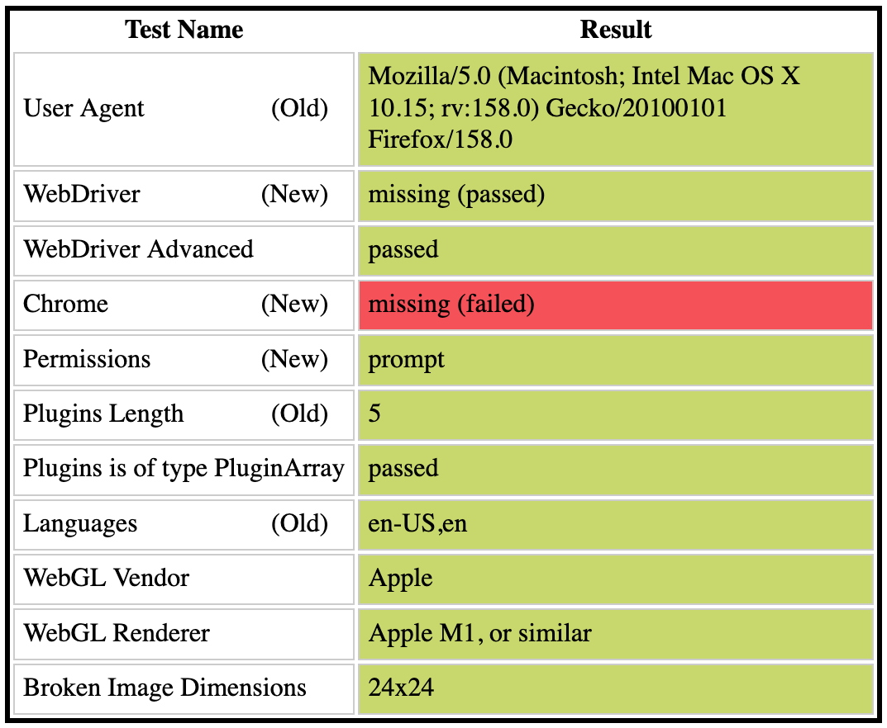 | 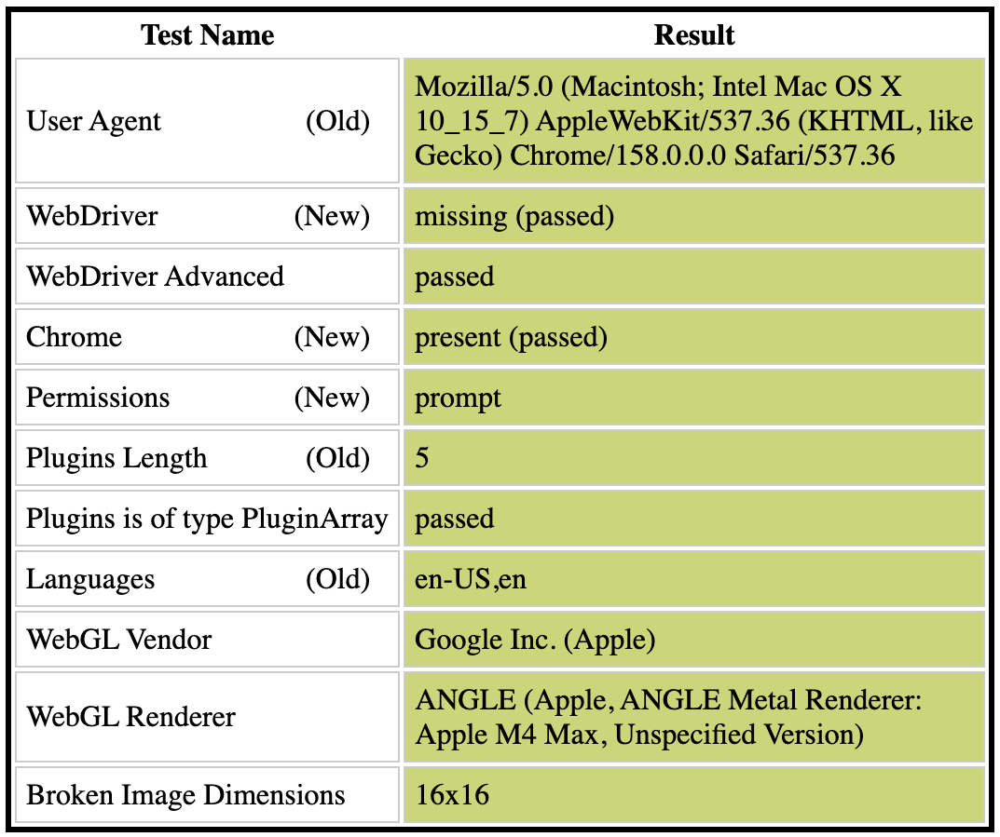 | 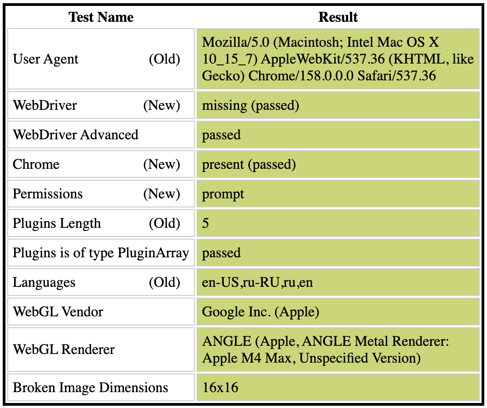 | 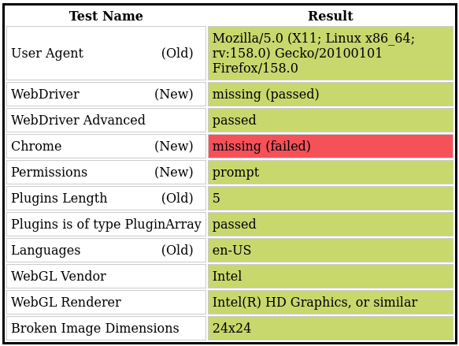 |

### Linux headless, old GeckIt code

Chrome for Testing ran as x86 under emulation, and most of its screenshots took longer than GeckIt's 70-second limit. These pictures come from the same old GeckIt code and flags driving Debian's native arm64 Chromium 156 headless. It got the same results as Chrome for Testing 158: Robot, 67% headless and 50% like headless, with the same CreepJS hashes. Its user agent also says HeadlessChrome, as Chrome for Testing's did (`HeadlessChrome/158.0.0.0`).

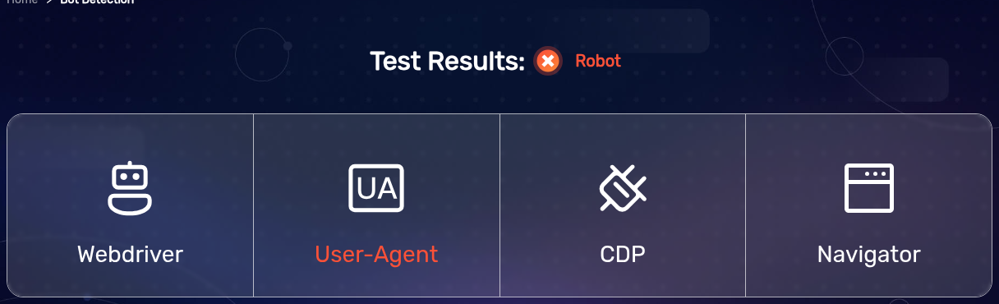

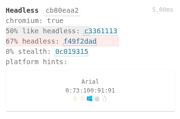

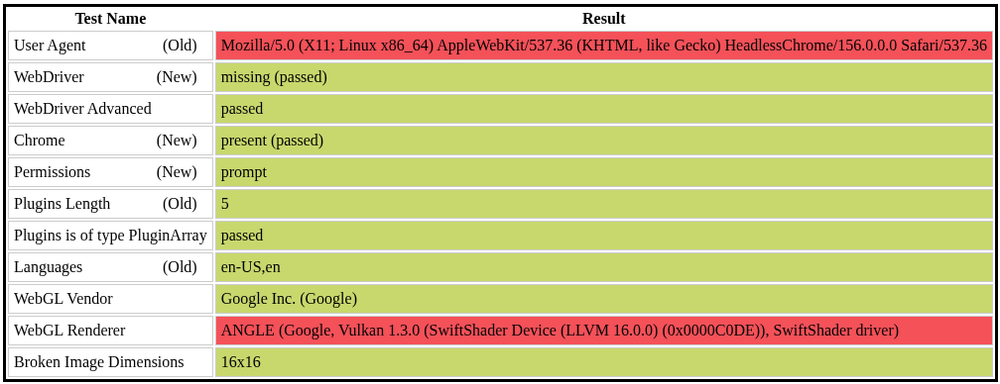

## What GeckIt leaves in the page

The test page `specs/036-real-person-browser/fixtures/traces.html` watches its own document from before GeckIt touches it, and counts input events. In each browser, GeckIt ran the same steps:

1. Read the page.
2. Type "Alex" into a field.
3. Scroll down.
4. Click two buttons.

| Recorded by the page | Camoufox (new) | Chrome for Testing (old) | Extension (your Chrome) |
|---|---|---|---|
| Elements GeckIt added | none | `geckit-pointer` | `geckit-pointer` |
| Attributes GeckIt set | none | 9: five `data-geckit-ref`, `data-geckit-next`, three pointer class changes | 6: five `data-geckit-ref`, `data-geckit-next` |
| Wheel events | 40 | 0 (scrolled by script) | 0 (scrolled by script) |
| Key presses | 5 trusted | 0 (text inserted without keys) | 4 trusted |
| Clicks | 3 trusted, including the click into the field | 2 trusted | 3 trusted |

The extension run also showed `cz-shortcut-listen` on the body. That comes from ColorZilla, another extension in that Chrome, not from GeckIt.

## How each browser is driven

### Camoufox (new test browsers)

- **Browser:** a Firefox 158 build that sets fingerprint values inside the browser engine, so pages find no patched JavaScript to detect.
- **Control:** driven through Firefox's own remote protocol, not the Chrome DevTools Protocol, so CDP detection has nothing to catch.
- **Input:** real mouse moves, clicks, key presses and wheel. A script steps in only where no person's action can do the step.
- **No page changes:**
  - refs are kept in GeckIt's isolated script world instead of attributes;
  - the pointer is drawn in the live view and on screenshots, not in the page;
  - password fields are masked on the picture, not styled in the page.
- **Ad blocking:** uBlock Origin is on in every profile.
- **On a Linux server:**
  - a headed browser on an Xvfb virtual display instead of headless;
  - one desktop identity per server: Ubuntu with Intel graphics, a common screen size, CPU cores, voices and media devices;
  - timezone and language from the server;
  - openbox as the window manager, so a popup does not take focus away from the page.

### Chrome for Testing (old test browsers)

- **Browser:** Google's Chrome for Testing 158, driven over the Chrome DevTools Protocol through a pipe.
- **Hiding automation:** `--disable-blink-features=AutomationControlled` hid `navigator.webdriver`.
- **On a Linux server with no display:** `--headless=new` at 1280x800. This is what CreepJS and BrowserScan caught.
- **Page changes:** it shared page functions with the extension, so refs were `data-geckit-ref` attributes and the pointer was a `geckit-pointer` element in the page.
- **Input:** scrolled by script and inserted typed text.

### Chrome extension (your Chrome, unchanged)

- **Browser:** your own Chrome with your own history, cookies and hardware, so its fingerprint is real by definition.
- **Input:** clicks and keys go through Chrome's debugger API. Chrome shows "started debugging this browser" while it is attached.
- **Page changes:** the same page functions as the old test browser, so `data-geckit-ref` attributes and the `geckit-pointer` element are written into the page.
- **Scrolling:** by script.

## Method

- **Versions:**
  - Camoufox 158.0.1-beta.41;
  - Chrome for Testing 158.0.8127.36, from GeckIt's last Chrome for Testing commit (53de8fda), built into a scratch folder with its own home folder;
  - Chrome 158 for the extension.
- **Machines:**
  - macOS on an Apple M4 Max;
  - Linux in Docker, Debian 12 arm64, for Camoufox, with Xvfb and openbox;
  - Linux in Docker, Debian 12 x86_64 under emulation, for Chrome for Testing, because Google ships no Linux arm64 build.

  Both containers used the New York timezone, to match the VPN address.
- **Pages:** bot.sannysoft.com, browserscan.net (the bot detection page and the main page) and abrahamjuliot.github.io/creepjs. Each page was read after a fixed wait for its checks to finish, once per browser.
- **Screenshots:** taken by GeckIt in each browser after the numbers were read, then cropped to the result. Fixed headers were hidden for the picture so they don't cover the result.
- **Not covered:**
  - commercial bot protection;
  - IP reputation;
  - behaviour over a long session;
  - Windows;
  - the extension on a server.
