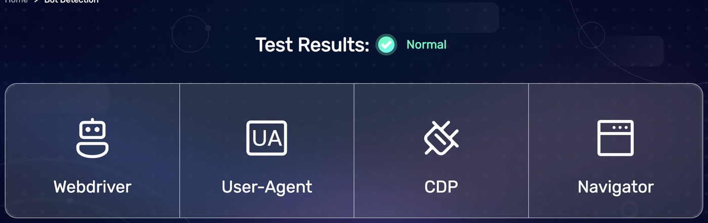
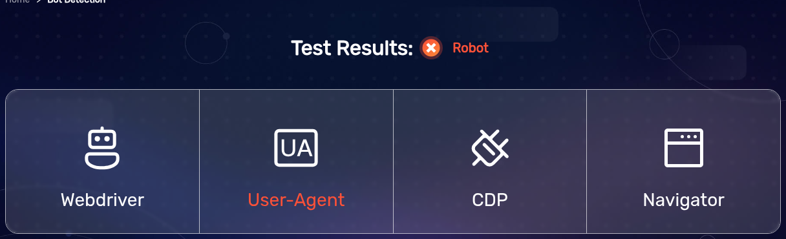
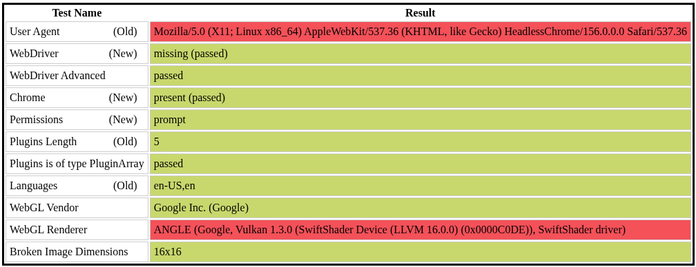
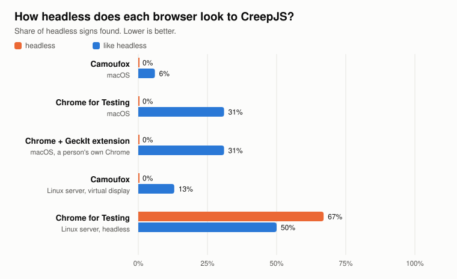
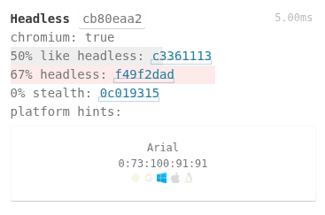
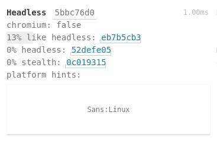
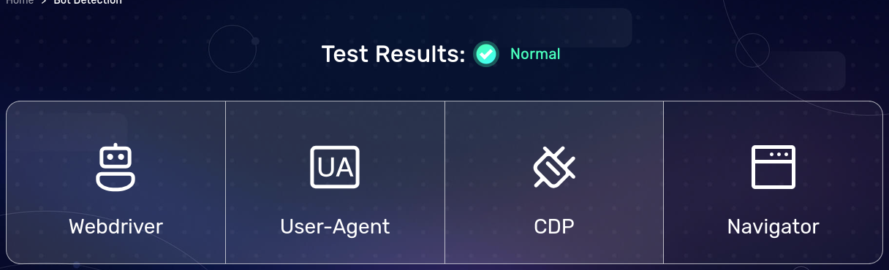
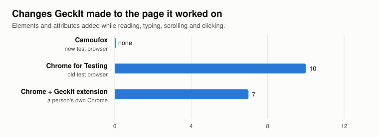

# Same browser, same code. On a Mac it's a person, on a server it's a robot.

We ran the same browser automation on a Mac and on a Linux server. On the Mac, BrowserScan looked at it and said "Normal". On the server, it said "Robot".

| On a Mac | On a Linux server |
|---|---|
|  |  |

Nothing in the code changed. Only the computer it ran on.

Server screenshots in this post come from Debian's Chromium 156 driven by the same code; Chrome for Testing 158 gave identical results, but under x86 emulation it was too slow to take pictures.

## Sites are asking one question

Every page your automation opens is quietly asking: is a person reading this, or a script? Sites look at the browser itself (what it says about its graphics card, fonts, screen and window), at how it moves (does it scroll with a wheel, does it press keys), and at whether something changes their page from the inside. Detection pages like CreepJS, BrowserScan and bot.sannysoft.com run the same kind of checks in the open, so you can see the verdict.

On your own computer, automation borrows a real machine. There's a real graphics card, real fonts, a real screen and a window, so most of these checks pass without any effort. A server has none of this. There's no screen, so the standard approach is to run Chrome headless, and headless Chrome gives itself away in the first line it sends: its user agent literally says `HeadlessChrome/158.0.0.0`. The graphics card it reports is SwiftShader, Chrome's software renderer, which no ordinary desktop has.

We build GeckIt, an app where AI agents work in a browser for a person, often on a server. So we needed to know how bad it is and what fixes it.

## The experiment

Five setups, the same checks for each:

| Setup | Where | How it's driven |
|---|---|---|
| Chrome for Testing | Mac | Chrome DevTools Protocol, how GeckIt worked before |
| Chrome + GeckIt extension | Mac | A person's own Chrome, through GeckIt's extension |
| Camoufox | Mac | GeckIt's new test browser |
| Chrome for Testing | Linux server, headless | The standard way to run a browser on a server |
| Camoufox | Linux server, virtual display | GeckIt's new test browser on a server |

Each one opened CreepJS, BrowserScan and bot.sannysoft.com. Then it worked on a page we wrote ourselves, one that watches its own document and counts every element and attribute added to it, every wheel event and every key press.

## What CreepJS saw

CreepJS gives two numbers. "Headless" is the share of clear headless signs. "Like headless" is the share of traits headless browsers often have but ordinary browsers can have too, and it's noisy: a person's own Chrome scored 31% there. So 0% headless is the number that matters, and 31% like headless is what a normal Chrome looks like.

On a Mac, every setup got 0% headless. On a Linux server, headless Chrome got 67%.

| Chrome for Testing, Linux, headless | Camoufox, Linux, virtual display |
|---|---|
|  |  |

Camoufox on the same kind of server got 0% headless and 13% like headless, lower than a real Chrome on a Mac. BrowserScan said Normal and gave it 100% fingerprint authenticity.

## What detection pages don't check: the page itself

All three detection pages look at the browser. None of them looks at what the automation does to the page. Our own page did.

The old way, GeckIt found elements by marking them with `data-geckit-ref` attributes and drew its pointer as a `geckit-pointer` element inside the page. That's 10 changes in a short session of reading, typing, scrolling and two clicks. A site needs a single `MutationObserver` to see every one of them. The extension does the same in a person's own Chrome, 7 changes.

Camoufox made none. It also scrolled the way a person does, with 40 wheel events, where the old browser scrolled by script and sent zero. And it typed every character as a key press, where the old browser inserted the text without pressing a key.

## How Camoufox gets there

Camoufox is a Firefox build that sets fingerprint values inside the browser engine, so a page finds no patched JavaScript to detect. On top of it, GeckIt:

- drives it through Firefox's own remote protocol, so there's no Chrome DevTools Protocol for a page to notice;
- moves the real mouse, clicks, presses keys and turns the wheel, and uses a script only for steps no person's action can do;
- keeps its element references in its own isolated script world, and draws the pointer in the live view and on screenshots, never in the page;
- runs uBlock Origin in every profile;
- on a server, starts a virtual display (Xvfb) and runs the browser with a window instead of headless, with a small window manager (openbox) so a popup doesn't take the focus;
- gives each server one stable desktop identity: Ubuntu with Intel graphics, a common screen size, a normal number of CPU cores, voices and a microphone, and the server's own timezone and language.

That last one taught us something. Our first server run scored 90% on BrowserScan, not 100%. The container thought it was in Berlin and the IP address was in New York. With the timezone matching the address, it scored 100%. Every detail has to agree with every other detail, including the ones you never think of as part of the browser.

## What this doesn't prove

These are public detection pages, not Cloudflare, DataDome or Akamai. Those also weigh where the traffic comes from, and a server's datacenter IP address can say "bot" louder than any browser. We didn't test that, and we ran each setup once.

Still, on a server the gap is huge. The standard setup is called a robot by every page we tried, and the same page sees Camoufox with a virtual display as a desktop computer.

If you run browser automation on servers, what gives you away first? And if you've tested against real bot protection, I'd like to compare results.
