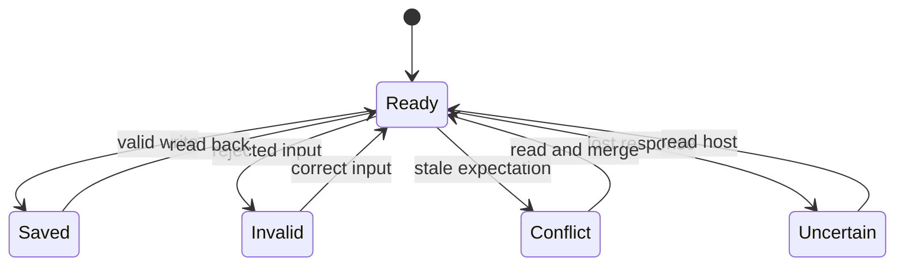

# UX: agent settings and saved shortcuts

## 1. Purpose and path to a usable result

Alex explicitly requested settings and shortcut changes without GeckIt's additional confirmation. A worker or authenticated Manager reads current values and the supported schema, changes only the requested fields, then reads the result. A saved shortcut is a prompt for a new task or Manager, with its project, optional goal, assistant choices and timetable. It is not a keyboard accelerator. Native keyboard shortcut availability is the separate `anywhereOff` preference.

The existing Settings and Shortcuts screens remain the place to inspect and manually edit these same saved values. No new form or wizard is needed. First use requires the running host; running a shortcut additionally requires its configured enabled assistant, project and, for Manager targets, configured Manager. Saving a preference is distinct from completing a native connection, provider turn or credential flow. Closing and reopening the screen reads persisted host state.

## 2. Surfaces

| Surface | Change | Visibility |
|---|---|---|
| Worker CLI | `settings schema`, `settings show`, `settings edit --patch ...` | On request |
| Authenticated Manager CLI | Same preference operations, Manager instructions and existing saved-shortcut commands | In capabilities and results |
| Conversation / Manager decisions | No extra Allow card for settings and shortcut operations | Automatic application after validation |
| Existing Settings / Shortcuts on desktop and phone | Same values and controls, host updates as before | When opened |

## 3. States

| State | Condition | What the user sees | Next action |
|---|---|---|---|
| Ready | Host reachable | Current preferences / shortcut list | Request a change |
| Saved | Valid change persisted | CLI saved values or shortcut result; existing screen updates | Read back or use shortcut |
| Invalid | Invalid field, value or timetable | Specific command error; no partial patch | Correct input |
| Conflict | Expected value changed | “Setting theme changed. Read settings show and merge before retrying.” | Read and merge |
| Uncertain | Connection ends before result | “GeckIt closed before answering. Read settings show before retrying.” | Read host state |
| Unavailable | Disabled assistant or unavailable Manager/project | Existing specific command/run error | Choose an available dependency |

## 4. Transitions

| From | Event | To | What the user sees |
|---|---|---|---|
| Ready | Agent submits valid patch/shortcut command; automatically, without user action | Saved | Result and updated existing controls; no Allow card |
| Ready | Host rejects input before saving | Invalid | Specific validation error |
| Ready | Host compares supplied expected values and finds conflict | Conflict | Read-and-merge instruction |
| Ready | CLI loses response | Uncertain | Readback instruction |
| Saved / Invalid / Conflict / Uncertain | Agent reads current state and corrects request | Ready | Authoritative current values |

## 5. Silent states

Validation, persistence and normal host event propagation do not create toasts, approval cards or new notifications. The command result and existing settings surfaces provide feedback. Unrelated team changes, native permissions and Manager delegation decisions keep their current behavior.

## 6. Timing and thresholds

No new product timer. CLI retains the existing 55-second response timeout and reports uncertainty rather than success. Existing schedule and start-window limits remain authoritative; no missed runs are caught up by a settings write.

## 7. Wording

Saved preference response uses `saved: true` with current readable settings. Shortcut operations retain “Added shortcut”, “Saved shortcut”, “Paused shortcut”, “Resumed shortcut”, “Started” and “Removed shortcut” results. Invalid fields say “Setting <field> is unavailable to agents. Run settings schema for supported fields and boundaries.” No success claim precedes persistence.

## 8. Edges

An empty patch is rejected. Arrays replace their named setting; maps merge entries. Unmentioned preferences and shortcut execution history survive. Optional expected values reject stale writes. Unknown fields, invalid enums, negative concurrency, disabled provider choices and invalid schedules fail before saving. Connection loss requires readback before retry. An archived employee keeps existing run restrictions. Manager-target shortcuts retain configured Manager provider and approvals.

## 9. Exclusions

No credential handling, provider enable/install, native permission approval, channel access grants, registration of hosts/projects through the settings patch, configuration import/restart, or new screens. These have dedicated interfaces and existing authority boundaries.

## 10. Decision

Earlier behavior asked Allow for every saved-shortcut change and Manager preference write. Apply the explicitly requested new rule only to settings and shortcuts. Preserve employee catalog/assignment approvals, file/project deletion decisions, worker native permissions and delegation policy.

## 11. Acceptance

Both worker and Manager paths advertise and execute the same preference schema. Real host handlers/CLI prove no confirmation, persistence and readback, atomic rejection, partial updates and shortcut execution. Integration fixtures are identified separately from the installed runtime. Existing desktop/phone light/dark interactions are reviewed without restarting the active app.
