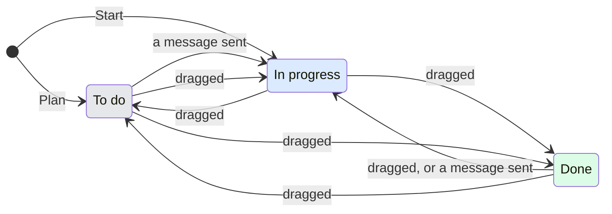

# UX: To do, In progress, Done

## 1. Why

The board had In progress, In review and Done, and a card went to In review by itself once its goal held. There was no place for work that is planned and not started, so a task waited as a note somewhere else or was started too early. In review sorted cards for the person, but the person decides what is finished, and a card moving by itself was one more thing to check. The columns are now To do, In progress and Done, and nothing moves a card between them except the person and their own message.

The columns are data, a list with an id, a title, the status its cards carry and how its cards are ordered, so a later build can let people make their own. This build does not.

## 2. What is added

| Surface | What appears | When seen |
|---|---|---|
| The board, existing | To do on the left of In progress; In review is gone | Always on the desktop board |
| View options, existing | Each column with a tick; any number of them ticked, and All columns | On the desktop board |
| New task, existing | A second button beside Start: Plan, which puts the card in To do and sends nothing | When the task is not a question |
| A card, existing | A green tick beside its goal, "Goal reached", once the goal held | Until a new goal is set |
| A card's menu and the conversation's status menu, existing | To do in place of In review | Always |
| The phone board, existing | The tabs To do, In progress, Done; swipes move one column left or right | On the phone |

## 3. States

| State | When it happens | What the person sees | What to do |
|---|---|---|---|
| To do | Planned from New task, or moved there by hand | The card in To do, in the order it was put | Open it and send, or drag it to In progress |
| In progress | Started, sent to, or moved there by hand | The card in In progress, in the order it has always had there: needs you, working, in the background, then their own order | Work with it |
| Done | Moved there by hand | The card under the day it was moved to Done, the newest day first; within a day, in the order it was put | Drag it back if it is not |
| Goal reached | The goal set with `/goal` or on New task held | The card stays where it is; a green tick before the goal and "Goal reached" in its tooltip | Look at it and move it to Done |
| Blocked | The goal was given up on | The card stays in In progress with its Blocked tag, as before | Unblock it |
| Some columns | One or more ticked in View options | Only those, each the same width; one alone spreads its cards as tiles | Tick another, or All columns |

## 4. Transitions

| From | Event | To | What the person sees |
|---|---|---|---|
| New task | Pressed Plan | To do | The dialog closes, the card on top of To do; nothing is sent |
| To do | A message sent from its composer, by the person | In progress, by itself | The card on top of In progress, working or waiting for a slot |
| To do, planned | Opened | To do | The conversation with the text planned in the composer, ready to send |
| Any column | Dragged to another, or marked from its menu | That column | The card where it was dropped |
| A manual column | A card dragged within it, or Move, To the top or To the bottom in its menu | Same column | The card before the one it was dropped above, or at the top or bottom; in Done, of its own day |
| In progress | The goal held, by itself | In progress | The tick appears on the card; nothing moves |
| Goal reached | A new goal set | Unchanged | The tick goes |
| Done | A message sent to it | In progress | The card on top of In progress, as before: a message takes any mark off |
| View: all | Ticked a column off | Some columns | The others stay, the one ticked off goes |
| Some columns | Ticked the last one off | All columns | Every column, as nothing shown is never a choice |

## 5. What stays quiet

| State | Why it is not shown |
|---|---|
| A card coming into To do from a planned task on another device | It is a card like any other; the column is enough |
| How many messages a To do card has had | It counts nothing until it is sent to |
| The tick on the phone's tab | The phone's card shows it, the tab says how many cards there are |
| A goal reached on a card in Done | Done already says it is over; the tick shows, nothing else |

## 6. Numbers and time

| Number | Value | Why |
|---|---|---|
| Columns | 3 | To do, In progress, Done: what is waiting to be started, what runs, what is over |
| A new card in a manual column | On top | The last one put there is the one being thought about |
| Done's days | Today, Yesterday, then the date | The day a card was moved to Done; a card with no recorded move goes by when it last changed |

## 7. Wording

| State | Text |
|---|---|
| Column titles | "To do", "In progress", "Done" |
| To do in the status menus | "To do", says "Planned and not started; a message to it moves it to In progress" |
| View options, tooltip | "View options: All columns", "View options: To do", "View options: To do, Done" |
| View options, All columns | "All columns", says "To do, In progress and Done side by side" |
| View options, a column | its title, says "Show To do" |
| New task, Plan | "Plan", its tooltip "Put it in To do without sending. Open it and send when it is time" |
| New task, the goal hint | "Claude keeps working until this holds, then the card shows Goal reached" |
| Card, goal reached | "Goal reached: <the goal>" |
| Phone To do empty | "Nothing planned." |

## 8. Edge cases

- **Typing or streamed conversation text:** the board keeps its existing cards until board data changes; opening cards, their menus, selection, drag ordering and Save as a shortcut continue to use current state. Incoming session snapshots with no changed rows leave the displayed lists in place.
- **An In review card from an earlier build:** read as In progress. The move it made stays in its history.
- **A view saved by an earlier build** (In review, or one column): In review shows every column; one column becomes that column ticked.
- **Planned with pictures:** Plan keeps the text and the goal only, so it is turned off while pictures or a recording are attached, with the tooltip "Pictures are sent at once; Start it, or plan without them".
- **Planned with a goal:** the goal is set when the planned message is sent.
- **A manual column's order with cards gone:** ids no longer on the board are skipped and dropped at the next move.
- **The manager marks a card:** it can mark To do, Blocked or Done, as before In review, Blocked or Done.

## 9. What is deliberately not done

| Not done | Why |
|---|---|
| Columns made by people | Asked for later; the columns are data so it does not need the board taken apart |
| Moving a goal-reached card by itself to Done | The person decides what is finished |
| A queued To do card taking a slot | A message sent to it moves it to In progress first, so the queue rule is the one In progress has |

## 10. Forks

| Fork | Verdict | Why |
|---|---|---|
| In review cards: In progress or Done | In progress | They are not accepted yet (Alex, 2026-10-29) |
| New task goes to To do or In progress | In progress, To do only with Plan | Alex, 2026-10-29 |
| Done by day or by hand | By the day it was closed, by hand within a day | "Для других колонок просто ручная сортировка", then "in Done, we still need to group by close date" (Alex, 2026-10-29) |
| Move to top and bottom | In every column | Alex asked where it is in To do (2026-10-29) |
