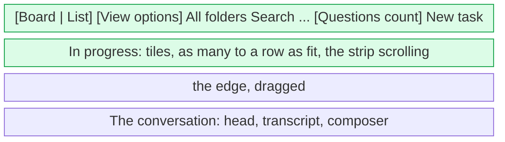

# UX: One column on its own, and a conversation below the board

## 1. Why

The board shows three columns side by side, and a conversation opened from it comes up over it as a popup, the board dimmed behind. Two things that are often wanted at once cannot both be had: the conversation being read, and the cards that say who is waiting. The popup covers them; putting it away loses the conversation. And on a wide window three columns of one card each are mostly empty, while the one column that matters, In progress with twenty cards or Done at the end of a day, is squeezed into a third of the width.

Both come from Anton, who works with many conversations at once on Windows and keeps the board open all day.

## 2. What is added

| Surface | What appears | When seen |
|---|---|---|
| Top bar, existing | View options, a compact icon grouped with Board/List; opens All columns or any set of To do, In progress and Done (since 2026-10-29, `board-columns.md`) | On the desktop board, not in the list |
| The board, existing | The columns chosen, each the same width; one on its own takes the whole board, its cards as tiles side by side, as many to a row as fit | When one column is chosen |
| An open conversation's head, existing | A button beside Back to the board: open conversations below the board, or over it again | When a conversation is open from the board |
| The window, new | With conversations below the board: the board as a strip across the top, the conversation under it, the strip's lower edge dragged to size | When a conversation is open and Below is chosen |

The conversation below the board is the same conversation as over it: the head with Back to the board, the transcript and the composer. Nothing is dimmed, so a card in the strip is pressed to switch, as a row in the list is.

## 3. States

| State | When it happens | What the person sees | What to do |
|---|---|---|---|
| All columns | The default; nothing chosen | Three columns; the View options icon has no indicator | Choose a column |
| One column | A column chosen | That column across the board, its cards as tiles; View options shows a small indicator and its tooltip names the column | Choose All columns |
| Over | The default; a conversation open from the board | The popup over the dimmed board, as before | Press the button in its head, or Esc |
| Below | Below chosen; a conversation open | The strip of board above, the conversation below, the button in its head showing the way back | Press the button, or Esc |
| Resize handle at rest | A conversation is below the board | A centered grip on the boundary between board and conversation | Grab anywhere along the boundary to resize |
| Resize handle hovered | The pointer enters the boundary's grab area | The resize cursor and boundary highlight appear immediately | Drag to resize, or double-click to reset |
| Dragging the edge | The strip's lower edge is held | The edge marked in the accent, the strip and the conversation sized as the pointer moves | Let go; double-click puts the strip back to its default height |
| Board alone | No conversation open, in either place | The whole board, as before | Press a card |

## 4. Transitions

| From | Event | To | What the person sees |
|---|---|---|---|
| All columns | Chose a column | One column | The others go; the cards of the one spread as tiles |
| One column | Chose All columns | All columns | The three columns, each a third again |
| Over | Pressed the button in the head | Below | The scrim goes, the board shrinks to a strip above the conversation |
| Below | Pressed the button in the head | Over | The board fills the window, the conversation comes up over it |
| Below | Pressed a card in the strip | Below | That conversation below the strip; the card marked open |
| Below | Esc, or Back to the board | Board alone | The conversation closes, the board fills the window |
| Board alone, Below chosen | Pressed a card | Below | The board shrinks to the strip, the conversation under it |
| Either place | Pressed List | List | The sidebar and the conversation beside it, as before; the board's choices wait for the board |

The choices are kept in settings (`boardColumn`, `conversationPlace`, `boardHeight`), so the board opens as it was last left. The two choices default to how the board was before, every column and conversations over it, and the height to 240 px.

## 5. What stays quiet

| State | Why it is not shown |
|---|---|
| Columns in the list | The list has no columns; the control is the board's, so the bar changes between the views by this one control (an exception to [views](views.md), noted there) |
| The strip's height as a number | It is dragged to what looks right; double-click brings the default back |
| Dragging a card between columns when one is shown | The other columns are not there to drop on; a card's menu marks it as before |
| The scrim below | Nothing to put away: the board is meant to be used while the conversation is open |

## 6. Numbers and time

| Number | Value | Why |
|---|---|---|
| Top bar height | 45 px, as before | The strip starts under it |
| Strip height | From 96 px to half the window, 240 by default | At 96 the column's head and the top of a card show and the strip scrolls, which is enough to see who waits; past half, the conversation has too little; 240 shows two rows of tiles |
| Tile width | At least 280 px, the row's width shared | A card's title and its project fit; a window of 1280 px shows four to a row |
| Tiles in the strip | Smaller gaps, 8 px between tiles and 6 within a column | The strip is small, so the cards sit closer |
| Resize grab area | 20 px tall across the full boundary, centered on it | The previous 6 px target was hard to catch; the larger area accepts an imprecise grab without moving the surrounding layout |

## 7. Wording

| State | Text |
|---|---|
| Columns control, accessible name | "View options" |
| Columns control, hover/focus tooltip | "View options: All columns", "View options: In progress", "View options: To do", "View options: Done" |
| Columns control, choices | "All columns", "To do", "In progress", "Done" |
| Columns control, what each says | "To do, In progress and Done side by side"; "Only In progress, across the whole board", and so for the others |
| Head button, over | "Open conversations below the board: the board stays as a strip across the top, as tall as you drag it" |
| Head button, below | "Open conversations over the board: a popup, the board dimmed behind it" |
| Head button, for a screen reader | "Open conversations below the board" / "Open conversations over the board" |
| Esc, in Keyboard shortcuts | "Stop the answer; on the board Esc puts the conversation away instead" |

## 8. Edge cases

- **Dragging among tiles:** where a card would land is said on the left edge of the tile it lands before, in the accent, rather than by a line between rows, which could not say where in the row. Past the last tile of a row the mark is on the first tile of the next, where the card would stand; after the last tile of all, the line as before.
- **A long word on a tile:** a path or a branch name does not widen the tile past its track; it is cut as in a column.
- **A small window:** the window is never under 520 px tall, and the strip never over half of it, so the conversation keeps at least its head, a few lines and the composer.
- **The edge dragged out of the window:** the strip stops at half the window; letting go there keeps that.
- **The edge grabbed above or below its center:** dragging keeps the initial pointer offset, so the strip does not jump when grabbed. Conversation-header actions remain reachable outside the grab area.
- **The pointer lost mid-drag**, Alt+Tab: the strip goes back to its kept height, as the sidebar's edge does.
- **A choice from a later build**, a column this build does not know: every column is shown rather than none.
- **The phone:** the phone has its own board and no room for both; neither control is there, and a conversation opens as it did.
- **The list:** the choices are kept, and hold again when Board is pressed.

## 9. What is deliberately not done

| Not done | Why |
|---|---|
| A two-part switch Over/Below in the head, as Board/List in the bar | The head is one row with the title, the project, its tags and a row of buttons, and the place of a conversation is seen the moment it opens; the one button says where it would go and the tooltip says what that means |
| Several columns picked at once | Reversed on 2026-10-29: Alex asked for one or several columns to be shown, see `board-columns.md` |
| The strip's height per column or per project | One height, dragged when it is wrong |
| Remembering Below per conversation | The place is how the window is used, not a fact about a conversation |
| Columns in the Settings dialog | It is changed often, with the board in view; Settings is for what is set once |

## 10. Forks

### Where the Over/Below choice is made

| Option | Verdict |
|---|---|
| Settings, General | no |
| A button in the open conversation's head | yes |
| A third part of the Board/List switch | no |

**Why:** it was in Settings first, and changing it meant opening the dialog while reading a conversation; in the head it stands next to Back to the board, the other button about where the conversation is. A third part of the view switch would say Below is a view, and it is not: the board and its columns are the same.

### How the cards of one column are laid

| Option | Verdict |
|---|---|
| One under another, the full width of the board | no |
| Tiles, as many to a row as fit | yes |

**Why:** one card 1600 px wide is a line of text with nothing after it; tiles show the same cards in a quarter of the height, which is what the strip above a conversation needs most.

## 11. Requirements check

| Requirement | Where it is covered |
|---|---|
| Read a conversation with the cards in view | Sections 2, 3 (Below) |
| See one column alone, across the board | Sections 2, 3 (One column) |
| Nothing changes for anyone who chooses nothing | Section 4, the defaults |

## Performance review against docs/performance.md

Nothing drawn per card changed its cost: `BoardCard` keeps its memo, with the landing mark as one more compared value, so a drag draws again only the tile the mark moves from and to. The column shown is one filter in a `useMemo` over the columns already worked out. The strip's edge is dragged on the element itself, the window drawn again once at the end, unlike the sidebar's edge, which has no board and no conversation under it. No formatter is made per call and nothing animates. Not measured in the running app on a board of hundreds: the drag lays the window out on every pointer move, as any resize does.

## Revision - 2026-10-28: compact view controls

Alex approved grouping column selection with Board/List. Enter from the existing desktop toolbar, open View options and choose a column; the board changes immediately and keeps the existing saved setting. Returning to Board restores that choice. Board/List and View options form one group, separated from folder selection and search. The existing choices are single-select: all columns or one column, with no additional submenu.

| From | Event | To | What the person sees |
|---|---|---|---|
| Closed | Click View options, or focus it and press Enter/Space | Choices open | Existing column menu with the current choice marked |
| Choices open | Choose a column | Closed, chosen column | Board updates; indicator shows that other columns are hidden |
| Choices open | Choose All columns | Closed, all columns | All three columns; indicator goes |
| Choices open | Escape or click outside | Closed | Same board and choice; keyboard dismissal returns focus to the trigger |
| Board | Choose List | List | Board/List remains; View options is absent and its saved choice is kept |

The tooltip appears on pointer hover and keyboard focus and names the current choice. The accessible name includes the current choice, such as "View options: All columns", and the button reports whether its menu is expanded. The menu is titled "Visible columns". All-columns state stays quiet: no badge or count. No new timing thresholds or persistence rules are introduced. The icon retains the toolbar hit area. Questions stays on the right as a separate action, described in [questions](questions.md).

The former always-visible selected-column label is replaced by an icon to reclaim toolbar width. Putting column selection in Settings or an extra submenu is rejected because it adds steps to a frequent board action.
