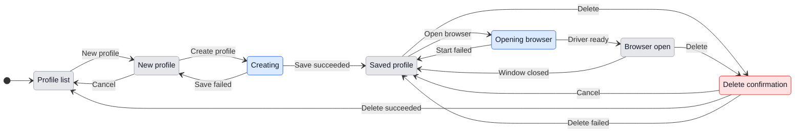

# UX: Manual browser profiles and profile transfer

Spec: [028-browser-profile-management](../../specs/028-browser-profile-management/spec.md). Extends [remote browser profiles](remote-browser-profiles.md) and [test browsers](chrome-testing.md). Alex explicitly requested the section label "Web Browser" and profiles as the primary content later in the same session. Alex approved implementation with "implement" in Codex session 01a1cfc9-730a-79f2-9338-01d850ff59a9 on 2026-11-12.

## 1. Why

The existing Settings list mixes profile identifiers, account notes and status in one wrapping sentence. Three equal actions consume the space needed to identify the profile, and the creation form compresses its inputs into a single row. Alex wants to create profiles himself, open their browsers and sign in, then reuse or back up those profiles.

### Path to a result

- **Entry and result:** Settings > Web Browser > Browser profiles. Press "New profile", enter a name and, if useful, a description, press "Create profile", then "Open browser" for that saved profile. Sign in manually in its Chrome for Testing window. Later tasks can use `geckit:<name>`.
- **Readiness:** A saved profile is available to open. "Open" reports a running browser, not successful authentication. GeckIt does not inspect or invent account sign-in status. Profile management remains visible when Chrome through GeckIt is off. Creation/deletion remain available; opening and live sign-in require enabling the connection below. The first browser launch may download Chrome for Testing, as today.
- **Decisions and order:** Choose a stable short name and identify the intended account. Open the saved profile, then sign in. Live "Sign in" remains available when viewing another computer or when the person prefers that view.
- **Shape:** Profile management leads the section; Chrome extension/connection setup follows below as secondary content. New profile is the prominent section action. One list and a disclosed creation form directly below the heading, because the name and the optional description are independent fields. Separate setup pages would make a small repeated operation longer. Profiles sit in one grouped list, macOS Settings style: each row has a letter badge, `geckit:<name>` with its open/closed dot, and its description, when there is one, on one line under it. Open browser is the row's only visible action; Sign in and Delete live in the row's More menu (the ellipsis button). The creation form opens as the first block inside the same group, with labels beside the fields.
- **First use and return:** The empty list leads to New profile. Cancelling the form saves nothing. Leaving Settings keeps saved profiles and sign-ins; unsaved form input is not promised across closing Settings. A closed profile can be opened again. If startup fails, show its reason and allow another attempt.
- **Transfer:** Close the source profile, run `geckit browser profiles export <name> --output <file>`, transfer that file yourself, then run `geckit browser profiles import <file> --name <new-name>` on the destination computer. Open the imported browser and check its accounts. Import completion means files restored, not signed in.

## 2. What is added

| Surface | What appears | When visible |
| --- | --- | --- |
| Existing Settings > Web Browser | "Browser profiles", short explanation and "New profile" | Supported platform, including when the connection is off |
| Existing profile list | Grouped list; badge, name, open/closed dot and description per row; Open browser plus a More menu with Sign in and Delete | Profiles exist |
| Creation form | Visible labels "Profile name" and "Description" (optional), naming hint, Cancel and Create profile | New profile pressed |
| Existing row actions | Busy wording and local error feedback | Operation pending or failed |
| CLI help and commands | Export/import syntax, result path and authentication limitation | Help or transfer command |

## 3. States

| State | When | What the person sees | What to do |
| --- | --- | --- | --- |
| Empty | No profiles | "No browser profiles yet. Create one, then open it to sign in." | New profile |
| Saved, closed | Profile exists without live browser | "Closed" | Open browser or Sign in |
| Connection off | Chrome through GeckIt is off | "Turn on Chrome through GeckIt below to open a browser or sign in."; opening/sign-in disabled | Enable the connection below |
| Open | Live driver reports the profile | "Open" | Use the browser; close its window when finished |
| Creating | Valid form submitted | "Creating..."; submission disabled | Wait for result |
| Opening | Open browser pressed | "Opening..." on that profile | Wait for result |
| Failed | Backend rejects an operation | Backend's reason in the relevant form or row | Correct input or retry the action |
| Delete confirmation | Delete pressed | "Delete geckit:<name>? Its sign-ins and history go with it." | Cancel or Delete |
| Exported | Archive written | "Exported geckit:<name> to <file>. Sign-ins and saved passwords may need to be set up again on another computer. This archive can contain sensitive website data." | Keep the file private; copy it to destination if needed |
| Imported | Valid archive restored | "Imported geckit:<name>. Open it with geckit browser start geckit:<name> and check your accounts. Sign-ins and saved passwords may need to be set up again on this computer." | Open browser and check accounts |
| Transfer refused | Busy profile, collision or invalid archive | Specific reason; no success message | Close source browser, choose another name/path or provide a valid archive |

## 4. Transitions

| From | Event | To | What the person sees |
| --- | --- | --- | --- |
| List | Press New profile | Draft | Labelled form; focus enters Profile name |
| Draft | Press Cancel or Escape in form | List | Form closes; focus returns to New profile; no saved change |
| Draft | Submit valid input with Create profile or Enter | Creating | Creating...; inputs and submit disabled |
| Creating | Save succeeds, automatically | Saved | Form closes, new profile appears; focus moves to its Open browser action |
| Creating | Save fails, automatically | Draft | Input retained; backend reason appears; controls enabled |
| Saved | Press Open browser | Opening | Opening... on that profile |
| Opening | Driver is ready, automatically | Open | Chrome window appears; status becomes Open after refresh |
| Opening | Startup fails, automatically | Saved | Reason appears beside the row; Open browser can retry |
| Open | Person closes its Chrome window | Saved | Closed after normal state refresh; sign-ins remain in profile |
| Saved or open | Choose Sign in in the row's More menu | Existing live view | Existing Opening, Live, Failed, Done behavior from feature 025; focus enters Done |
| Saved or open | Choose Delete in the row's More menu | Confirmation | Exact confirmation inside the row with Cancel and Delete; focus enters Cancel |
| Confirmation | Press Cancel or Escape | Previous row | Existing profile restored; focus returns to the row's More button |
| Confirmation | Press Delete, operation succeeds automatically | List | Profile row disappears; focus moves to New profile |
| Confirmation | Delete fails, automatically | Previous row | Reason remains visible; profile preserved where deletion did not succeed |
| Closed source | CLI export succeeds | Exported | File path and authentication limitation |
| Any source | CLI export fails | Same source | Failure reason; no completed archive |
| Unused name | CLI import succeeds | Saved destination | Imported message with opening command and authentication limitation |
| Unused name | CLI import fails | Unused name | Failure reason; partial destination removed |

## 5. What stays silent

| State or detail | Why |
| --- | --- |
| Browser process IDs, local paths, generated project hashes and Chrome encryption internals | They do not help choose the next Settings action; CLI retains the exact geckit:<name> identifier |
| Account authentication | The description says what a profile is for, not a verified login; no invented signed-in badge |
| Ordinary state polling | Open/closed status is sufficient feedback; do not announce every refresh |
| Successful deletion | Removing the row is feedback; no extra toast |

## 6. Thresholds and time

| Number | Meaning | Reason |
| --- | --- | --- |
| 1-40 characters | Existing lowercase profile name rule: letters, digits and hyphens, beginning with a letter or digit | Preserve names accepted by the existing CLI and browser store |
| 120 characters | Existing normalized account-note limit | Keep UI and CLI aligned with saved metadata |
| 2 seconds | Existing Settings state refresh | Reuse current polling; do not add profile-specific timers |
| 15 minutes | Existing one-time remote sign-in link lifetime | Unchanged feature 025 behavior |

No new time threshold is introduced by this change.

## 7. Wording

| Purpose | Exact text |
| --- | --- |
| Settings section | "Web Browser" |
| Connection off | "Turn on Chrome through GeckIt below to open a browser or sign in." |
| Heading | "Browser profiles" |
| Explanation | "Separate Chrome for Testing profiles for your accounts. Create a profile, open its browser and sign in yourself. Sign-ins stay on this computer." |
| Create entry | "New profile" |
| Name label and hint | "Profile name"; "Lowercase letters, numbers and hyphens. Used as geckit:<name> in conversations." |
| Description label, placeholder and hint | "Description"; "GitHub as alex@example.com"; "Optional. Assistants read it to pick the right profile for a task." Alex asked on 2026-11-12 for it not to be mandatory, and noted that assistants use it to choose a profile. |
| Creation | "Create profile"; "Creating..."; "Cancel" |
| Row actions | "Open browser"; "Opening..."; "Sign in"; "Delete" |
| Status | "Open"; "Closed" |
| Empty | "No browser profiles yet. Create one, then open it to sign in." |
| Duplicate | "A profile named <name> already exists. Choose another name." |
| Transfer busy | "Close geckit:<name> before exporting it. Its browser data is still in use." |
| Import collision | "geckit:<name> already exists. Import with a different --name." |
| Existing output | "The output file already exists. Choose another --output path." |

Existing download and live-view wording is retained. Backend errors preserve their reason, without a second generic banner. Exported and imported wording is recorded in section 3.

## 8. Edge cases

- **Empty:** One sentence plus New profile; no CLI command is required to begin.
- **Long content:** Long names and notes are cut with an ellipsis on one line each, the full note in its tooltip; actions stay on the row's right. The Settings body scrolls, with its footer reachable. Keep text selectable.
- **Disconnection:** Existing remote-computer boundary reports the failure; do not silently operate locally.
- **Repeated action:** Disable submission/actions while their operation runs. On error, retain the form and allow retry.
- **Stale state:** Backend checks uniqueness and busy state again. UI validation does not authorize overwriting a profile or archiving an active browser.
- **Deletion during use:** Existing stop rules remain; if another conversation owns the profile, show refusal and keep the profile.
- **Archive input:** Validate names, normalized relative paths, regular-file entries and metadata before publication; reject traversal and symbolic links. Import into staging and publish only a complete new profile.
- **Moved sessions:** Do not decrypt credentials or claim that copied cookies will be accepted by a site. Chrome version and operating-system differences can require reconfiguration.
- **Keyboard:** Tab reaches all controls, Enter submits the valid form, Escape cancels a local form/confirmation before closing Settings, and focus returns to the opener or the created row. Live sign-in moves focus into its dialog; Escape outside the remote page keyboard closes only that view and restores Sign in, while Escape typed into the remote page is forwarded there. Error messages are announced; normal state refresh must not steal focus.

## 9. What is deliberately absent

| Not added | Reason |
| --- | --- |
| Ordinary Chrome profile migration | The screenshot and managed lifecycle concern Chrome for Testing; personal Chrome keeps its own storage and windows |
| Automatic cookie extraction, decryption or operating-system key-store transfer | File backup must respect Chrome's credential protection |
| Guaranteed portable sign-in | OS encryption and site/device binding prevent that promise |
| Automatic archive delivery to paired computers | File transfer is separate from profile backup/restore and its path semantics |
| Export/import buttons in Settings | This request puts transfer in the CLI; keep the UI focused on manual creation and use |
| Search, filters or new navigation tabs | Not needed to resolve the screenshot's layout or requested flow |

## 10. Forks

### Local manual sign-in or live view by default

| Option | Verdict |
| --- | --- |
| Open browser is the primary row action; live Sign in remains secondary | Chosen: Alex explicitly wants to create profiles and sign in manually |
| Force every sign-in through live view | Rejected: unnecessary indirection when the computer is in front of the person |

### Transfer capability and prior scope

| Option | Verdict |
| --- | --- |
| Back up browser files and metadata, then restore under a new name; reauthenticate as needed | Proposed: useful backup/transfer without claiming portable authentication |
| Export only profile names and account notes | Rejected: does not back up the browser profile Alex asked to export |
| Copy decrypted sessions to guarantee sign-in on another machine | Rejected: conflicts with operating-system and site protection |

Feature 025 excluded all profile copying. This proposal changes that scope for explicit file backup/restore only. Its remote live sign-in and no-key-store-transfer decisions remain. Alex approved this document and implementation on 2026-11-12.

## 11. Reconciliation with requirements

| Requirement | Covered by |
| --- | --- |
| FR-001, FR-002 | Journey, separate row identity, manual Open browser action |
| FR-003, FR-004, FR-005 | States, transitions, errors, keyboard and existing live-view/delete behavior |
| FR-006, FR-007, FR-009 | Transfer journey, busy/collision refusal, staging and archive validation |
| FR-008, FR-010 | Transfer wording, exclusions and CLI help |

**Missing from the request:** Exact archive format and file-size limits belong to the implementation plan. Whether the user intends automatic remote file transfer is unspecified; this proposal uses manual transfer. Live authentication on a second machine remains a separate integration check and cannot be inferred from a synthetic round trip.
