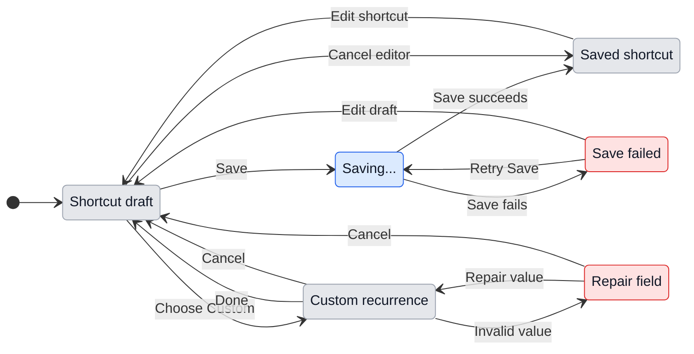

# UX: Calendar-style recurrence

## 1. Purpose

Saved prompts already run manually or on named/cron timetables. A person cannot select multiple weekdays, repeat every two weeks or stop a series after a date or number of occurrences using calendar controls. Add those controls to the existing shortcut editor on desktop and phone, following the grouping in Alex's supplied screenshot.

## 2. Surfaces

| Surface | Addition | When visible |
| --- | --- | --- |
| Desktop shortcut editor (`ShortcutList.tsx`) | "Custom..." in "Runs by itself"; readable custom summary | Editing a shortcut |
| Desktop custom recurrence dialog | Starts, At, Repeat every, conditional Repeat on, Ends, Cancel, Done | Choose "Custom..." |
| Phone shortcut editor (`PhoneShortcuts.tsx`) | "Custom..." in Repeats; same summary | Editing a shortcut |
| Phone custom recurrence sheet | Same fields and validation; Cancel and Done in sheet header | Choose "Custom..." |
| Desktop and phone shortcut list | Recurrence summary and next run; "Timetable ended" | Shortcut has custom recurrence |

Order: start date/time, interval/unit, weekday or monthly pattern, end condition, summary/validation, actions. Weekday buttons read M T W T F S S, have full accessible day names and expose pressed state. Inactive end-date/count inputs stay visible and disabled, matching the reference. Existing hourly/named/cron choices remain available.

On phone, use the existing grouped settings form: Starts and At are labeled rows with values at the trailing edge; Repeat every is a row with its editable number and unit together. Repeat on has its own section. Ends is one group of Never/On/After rows with a consistent selection mark and aligned labels; inactive date/count fields remain visible and disabled. Summary and connected-computer time-zone note read as group footnotes. Keep the approved field order, labels, validation and draft transitions. The previous standalone bordered desktop fields are replaced only on phone.

## 3. States

| State | Trigger | Exact visible message | Person's action |
| --- | --- | --- | --- |
| Editing | Opens custom recurrence | "Custom recurrence" | Change fields, Done or Cancel |
| Invalid interval | Blank, fractional or nonpositive interval | "Enter a whole number of 1 or more." | Repair interval |
| Invalid start | Missing/invalid start date or time | "Choose a start date and time." | Repair start |
| Empty weekly selection | Last weekday deselected | "Choose at least one day." | Select a weekday |
| Invalid end date | Missing/invalid date or before start | "Choose an end date on or after the start date." | Repair date |
| Invalid count | Blank, fractional, nonpositive or greater than 10,000 count | "Enter a whole number from 1 to 10,000." | Repair count |
| Date-domain overflow | Finite count needs a date beyond supported year 9999 | "This recurrence extends beyond year 9999." | Reduce count or interval |
| No eligible date | Rule ends before its first eligible date/time | "This recurrence has no occurrences." | Change start, days or end |
| Saving | Outer shortcut Save pressed | "Saving..." | Wait; duplicate Save disabled |
| Save failed | Save rejected or paired link unavailable | "Couldn't save the shortcut. Try again." | Retry Save or cancel with draft retained |
| Paused | Timetable switch off | "Timetable paused" | Turn timetable on or run manually |
| Ended | End date/count exhausted | "Timetable ended" | Edit recurrence or run manually |
| Scheduled | Valid active recurrence has a future date | "Next {date and time}" | No action required; optionally edit or run |

Show the first applicable error in field order. Put it beside the field and associate it with that input. Valid field changes clear it. "Done" is disabled while invalid. The local recurrence dialog does not write settings: it returns the rule to the outer shortcut draft; outer "Save" persists it.

Save succeeds only when the returned shortcut retains the requested recurrence. A resolved response that drops or changes the rule follows the existing Save failed state: keep the draft, show "Couldn't save the shortcut. Try again." and allow editing/retry. Equality ignores property order and weekday order. This enforces the approved save/persistence behavior when a newer editor talks to an older running backend.

If the connected backend does not advertise custom-schedule support, refuse custom Save before sending it. Follow that same failure state and preserve both the editor draft and the previously saved timetable. Named/raw/manual schedules remain saveable. Runtime support metadata stays silent; the editor does not display implementation versions or restart sessions.

## 4. Transitions

| From | Event | To | Visible result |
| --- | --- | --- | --- |
| Shortcut draft | Choose "Custom..." | Editing | "Custom recurrence" with copied current rule or defaults |
| Editing | Change unit | Editing | Relevant weekdays/monthly pattern appear; hidden choices retained within draft |
| Editing | Choose Never / On / After | Editing | Only the selected end input becomes enabled |
| Editing | Enter an invalid value | Invalid | Applicable inline message; Done disabled |
| Invalid | Repair the field | Editing | Error clears; summary and next date update |
| Editing | Press Done or Enter outside an open picker | Shortcut draft | Custom summary replaces schedule in outer draft; settings untouched |
| Editing / Invalid | Press Cancel or Escape | Shortcut draft | Original outer schedule retained; focus returns to Custom trigger |
| Shortcut draft | Press Save | Saving | "Saving..."; Save disabled |
| Saving | Save succeeds, automatically | Saved | Existing shortcut list with updated summary |
| Saving | Save fails, automatically | Save failed | Error above actions; draft retained |
| Save failed | Press Save | Saving | "Saving..." |
| Save failed | Change a field | Shortcut draft | Save error clears |
| Shortcut draft / Save failed | Cancel outer editor | Saved | Existing shortcut list; persisted rule unchanged |
| Scheduled | Switch timetable off | Paused | "Timetable paused" |
| Paused | Switch timetable on | Scheduled / Ended | Next future date or "Timetable ended"; original anchor/limit retained |
| Scheduled | End boundary passes, automatically | Ended | "Timetable ended" at next list refresh; no notice |
| Ended | Edit and save a future recurrence | Scheduled | New summary and next date |
| Saved / Paused / Ended | Press Run | Same timetable state | Existing conversation-opening workflow; recurrence unchanged |

On desktop, focus starts on the interval input. On phone, focus starts on the sheet itself without opening the keyboard; tapping interval or occurrence count starts editing with the numeric keypad. The active number has a rounded tinted highlight and a visible caret. Tab from the sheet reaches Cancel, then the remaining controls in visual order. Tab reaches every control; Space toggles weekday/end choices; native date/time/number keys work. Escape closes the innermost picker first, then custom editor, then outer editor. Trap focus within the active dialog/sheet and return focus to its opener. Background and outside taps do not discard the custom draft. The custom body scrolls when needed; actions remain reachable at 320 px phone width and with increased text size. When the iPhone keyboard opens, the sheet uses the space above it: Cancel and Done remain fixed in the header, and the body scrolls to every field and inline error. Closing the keyboard restores the full sheet without discarding the draft. Desktop/phone labels and rules are identical.

## 5. What stays silent

| Internal state | Reason |
| --- | --- |
| Scheduled occurrence passed while app closed, paused or preceding run busy | Existing scheduling behavior; no per-occurrence notification |
| Date missing in a month or nonexistent clock-change time | Summary describes rule; individual excluded dates need no alert |
| Scheduling checks and next-date calculation | Person needs the next date, not background mechanics |
| Series ending | List state is enough; no automatic modal or push |

## 6. Thresholds and time

| Value | Rule | Reason |
| --- | --- | --- |
| Default interval 1 | Repeat every one week | Familiar starting point from supplied screenshot |
| Default days | Starting date's weekday | Avoid an empty selection and align with start |
| Default start/time | Today, preserving existing schedule's time when possible, otherwise 09:00 | Preserve context; provide an editable morning default |
| Default end | Never; inactive On defaults to start date; inactive After defaults to 1 occurrence | No hidden expiry; inactive values do not affect rule |
| Interval minimum 1 | Positive safe whole numbers only | Zero/fractions do not define calendar recurrence |
| Occurrence count 1 to 10,000 | Positive whole numbers with an explicit upper limit | Bound calendar evaluation on desktop/phone; 10,000 daily occurrences span more than 27 years |
| Supported years 1 to 9999 | Finite count must fit within this date domain | Use four-digit date inputs consistently; reject overflow rather than silently truncate |
| Seven weekday choices | Monday through Sunday; Monday starts interval weeks | Matches supplied weekday order and provides deterministic multiweek alignment |
| End date | Inclusive through that computer's local day; no catch-up on later dates | "On" includes the selected date and prevents work after expiry |
| End-after count | Counts eligible scheduled dates, including misses/skips/failures, never manual runs | A calendar series has a fixed endpoint independent of execution success |
| Existing 20-second scheduler check | Retained | Avoid changing execution latency as part of recurrence editing |

Local date arithmetic is anchored to the chosen start, not elapsed milliseconds or last run. Monthly options are the same day number, ordinal weekday or last weekday derived from start. Missing day numbers, fifth weekdays and February 29 are skipped, not shifted. Nonexistent local times are skipped; duplicated local times count once. Weekly days before start are excluded. Future dates follow the scheduling computer's current local zone; phone editor says "Times use the connected computer's time zone."

When sleep/closure misses dates, at most one catch-up is eligible while the series is still open. Passed dates count toward After. The final occurrence is eligible through the end of its local day, so normal scheduler latency cannot suppress it; after that day no catch-up is allowed. Pausing/resuming preserves the anchor and endpoint and does not replay paused occurrences. Changing rule fields creates an edited series starting at the chosen date; changing name/prompt/assistant preserves schedule progress. Defaults are not silently persisted when opening or cancelling.

## 7. Exact wording

| Control | Text |
| --- | --- |
| Entry / title | "Custom..." / "Custom recurrence" |
| Start / time | "Starts" / "At" |
| Interval / units | "Repeat every"; "day", "week", "month", "year" with plurals |
| Weekday/month pattern | "Repeat on"; "Monthly on day {day}", "Monthly on the {ordinal} {weekday}", "Monthly on the last {weekday}" |
| End group | "Ends"; "Never", "On", "After", "occurrences" |
| Actions | "Cancel", "Done"; existing outer "Save" |
| Example summary | "Every 2 weeks on Tuesday and Thursday at 09:00, after 13 occurrences" |
| Date-ended summary | "Every week on Tuesday at 09:00, through Jan 5, 2027" |
| Phone zone explanation | "Times use the connected computer's time zone." |

Validation and status messages appear verbatim in section 3. Date/time summaries follow existing locale formatting.

## 8. Edge cases

- Count above 10,000 or finite series beyond year 9999: explicit inline repair message; no truncation.
- Empty selection or required input: inline repair message; never silently fill a cleared value.
- Several errors: report and mark the first invalid field in visual order; repair reveals the next issue without repeated banners.
- Connection lost while saving from phone: retain all draft fields and allow retry; no success state without acknowledgment.
- A running backend that does not support custom recurrence must not produce a false-success UI when its save response omits the rule. Retain the outer draft through the existing failure state. Updating an already-running backend is a separate application restart after active work finishes; the editor does not restart sessions.
- Repeated Done/Save: Done commits only to local draft; Save disabled until response.
- Existing arbitrary cron: opens in Cron, untouched. Opening Custom proposes new calendar values; Cancel retains cron; Done explicitly replaces it.
- Old settings without recurrence: retain existing schedule behavior. New custom rules must survive reads/writes and broadcasts without being dropped.
- Concurrent settings change: editing uses the latest persisted shortcut when saving and preserves scheduler-owned progress when the rule is unchanged; a deleted shortcut is not silently recreated.
- Ended shortcut remains editable, deletable and manually runnable; timetable toggle cannot extend a spent count/date.

## 9. Intentionally absent

| Excluded | Reason |
| --- | --- |
| Google account connection or calendar event syncing | Request is for recurrence interaction in existing jobs |
| OS cron installation or runs while GeckIt is closed | Existing execution owner stays GeckIt |
| Per-rule zone selector, reminders, exceptions or holiday calendars | Separate scope beyond supplied recurrence controls |
| Conversion of arbitrary cron into calendar intervals | Could change its meaning; preserve raw cron |
| Quota of successful conversations | A calendar occurrence count names dates; failed/missed work does not move endpoint |

## 10. Decisions

| Choice | Verdict | Reason |
| --- | --- | --- |
| Structured calendar recurrence alongside raw cron | Approved | Every N weeks, ordinal weekdays and count endpoints cannot be faithfully expressed by existing five-field cron |
| End-after counts scheduled dates | Approved | Match calendar series semantics and keep endpoints stable across downtime |
| Add explicit start date/time | Approved | Multiweek/month/year rules require a visible anchor; GeckIt has no calendar event start to inherit |
| Use GeckIt dialogs, pickers and phone sheets | Approved | Screenshot establishes grouping; GeckIt tokens establish appearance |
| Require outer Save | Approved | Consistent draft/cancel behavior with existing shortcut editor |

Alex approved implementation with "Implement UI and the feature itself" on 2026-10-11, after receiving this draft and the scheduled-occurrence count proposal.

## 11. Requirements check

| Requirement | Coverage |
| --- | --- |
| FR-001 | Sections 2, 8, 9 |
| FR-002 to FR-006 | Sections 2, 3, 6, 7 |
| FR-007, FR-011 | Sections 3, 4, 6 |
| FR-008, FR-010 | Sections 3, 4, 8 |
| FR-009, FR-012 | Sections 5, 6, 8 |

Specification: [010-calendar-recurrence](../../specs/010-calendar-recurrence/spec.md). Implementation and light/dark, keyboard, scrolling, desktop and phone reviews completed. Cosmetic follow-up on 2026-10-12 clarified disabled end fields, restored unclipped focus, aligned end rows and increased phone control targets to 44 px. Evidence and verification limits: [verification.md](../../specs/010-calendar-recurrence/verification.md).
