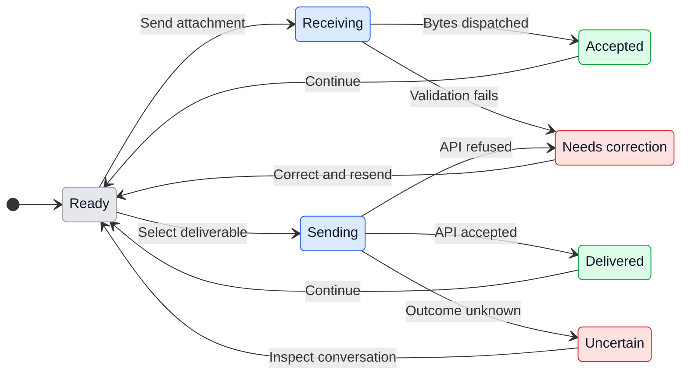

# Slack and Discord attachments

## 1. Why and user path

Alex needs files and photos in both directions in GeckIt's built-in Manager channels. This extends the existing [channel workflow](channels.md), [Discord flow](discord-channel.md) and [Telegram attachment contract](../../specs/014-telegram-attachments/ux.md). It does not extend a separate bot or a user Slack connector.

Use the existing bot in an allowed conversation. Send a file/photo, optionally with text, in a Slack mention/thread or DM, or a Discord mention/thread or DM. Manager receives actual retained bytes; supported images use the provider's image input. A Slack file link is resolved only when the bot verifies that file belongs to this authorized conversation. A link alone is no grant to another channel or file.

To return a result, ask Manager to send the deliverable. A managed local worker reports its exact project-relative path. Manager explicitly chooses that worker and path through the authenticated product command in the originating thread. A successful receipt names the destination, accepted native message/file ID and selected file; acceptance does not prove download by the user. No upload happens just because prose contains a path.

First use requires the existing channel setup, allowed person, enabled Manager, and native bot permissions. Saved credentials are not proof of readable files. If Slack refuses a file scope, the user opens the existing app's OAuth & Permissions, adds the named Bot Token Scope, and reinstalls that same app to the workspace, approving Slack's native prompt. Discord permissions are granted by the server owner for the existing bot; Message Content Intent is enabled in its existing Developer Portal entry. GeckIt never asks for tokens in conversation or substitutes a personal connector. Returning after interruption keeps the original thread identity and retained inputs; missing inputs require an explicit resend.

No renderer layout or new onboarding is needed: native channel composers and existing GeckIt settings own these controls. This incremental conversational path keeps setup and daily use in their existing places. No additional visual prototype applies unless implementation changes a renderer.

## 2. Surfaces

| Surface | Change | When visible |
| --- | --- | --- |
| Slack and Discord conversation | Receive actual attachments; actionable failures in the same place | Allowed person sends file/photo |
| Manager input and worker attachment handoff | Shared retained attachment IDs, readable files and native image bytes | Accepted input |
| Authenticated Manager CLI/capabilities | Explicit same-thread deliverable send with worker and exact path | Manager requests delivery |
| Native Slack/Discord output | File/photo and caption; receipt returned to Manager | API accepts upload |
| Existing channel help/docs | Required file scopes/permissions and recovery | Setup or refused operation |

## 3. States and wording

| State | Trigger | Visible result | Next action |
| --- | --- | --- | --- |
| Ready | Channel and Manager available | Existing conversation | Send file/photo |
| Receiving | Authorized file selected | Nothing while download runs | Wait |
| Accepted | Retained bytes dispatched | Normal Manager response | Continue or wait |
| Rejected | Size, access, storage or download failure | "Could not receive this attachment: <safe reason>. Correct the issue and resend." | Correct cause and resend |
| Sending | Explicit selected deliverable | Nothing until API result | Wait |
| Delivered | Native API accepts file | Native file/photo; command receipt with IDs | Open/download or reply |
| Delivery failed | Definite rejection | "File delivery failed: <safe reason>. Correct the issue before sending again." | Correct cause; deliberately retry |
| Delivery uncertain | Upload outcome unknown | "File delivery is uncertain. Check this conversation before requesting another send; the upload was not retried." | Inspect native conversation before a fresh request |
| Decision with attachment | File accompanies approval choice | "A file cannot answer an approval or question. Use its buttons or a text reply, then send the file as a new message." | Use bound decision controls |

Specific validation errors retain their concrete limit, permission or path cause; no credential or token-bearing URL appears in the reason. Implementation wording is reconciled with this document before delivery.

## 4. Transitions

| From | Event | To | What user sees |
| --- | --- | --- | --- |
| Ready | Allowed person sends supported attachment | Receiving, automatically | Nothing while bounded download runs |
| Receiving | Bytes retained and Manager accepts input | Accepted, automatically | Normal Manager response, including native image understanding when supported |
| Receiving | Access, validation or download fails | Rejected, automatically | Safe concrete failure and resend action |
| Ready | Unauthorized person or unrelated conversation supplies file/link | Ready, automatically | Existing access refusal or silence; no bytes fetched |
| Ready | Attachment is offered as approval | Rejected, automatically | Use bound controls; no approval granted |
| Ready | Authenticated Manager selects originating worker/path | Sending | Nothing yet |
| Sending | API returns native receipt | Delivered, automatically | File/photo in the same thread/DM |
| Sending | API rejects upload | Rejected, automatically | Safe concrete delivery failure |
| Sending | Connection fails after upload may have begun | Uncertain, automatically | Uncertainty exposed to Manager; no replay |
| Uncertain | User checks native conversation then deliberately requests new send | Ready | Fresh explicit selection |
| Rejected | Person corrects permissions, file or path and retries | Ready | Existing flow resumes |
| Any | Thread cleared/deleted, access revoked or channel stopped | Ready or Rejected, automatically | Existing closed/unavailable state; pending operations do not switch destinations |

## 5. Silent behavior

Drop duplicate events and irrelevant messages under existing rules. Reject unauthorized people before network downloads. Do not fetch arbitrary URLs, follow credential-bearing redirects, scan projects, execute attachments, approve permissions from file text, or transfer across thread/project boundaries. Cache maintenance and pins stay silent. Logs contain safe operation outcomes, not tokens or downloaded contents.

## 6. Limits and time

Reuse the Telegram attachment store's protected storage and lifecycle: 20 MiB per incoming file, 200 MiB retained bytes, 256 files and 24 hours for unpinned content. These are GeckIt bounds even where the platform permits more. Queued inputs stay pinned and count toward limits. Supported raster signatures determine native image handoff; MIME claims alone do not. UTF-8 previews remain bounded to 64 KiB; other files remain real files and no format extraction is claimed. Shared outgoing local-root validation, symlink checks and existing limits apply; platform rejection remains visible. Network requests have bounded duration/observed size and no automatic upload retries.

## 7. Wording

State wording is listed verbatim in section 3. Permission errors identify the exact missing Slack scope or Discord permission and the existing native setup surface. Receipts distinguish confirmed API acceptance from uncertain delivery; a log line, HTTP success without native ID, or inferred filename is not a receipt.

## 8. Edge cases

- No caption still delivers attachment data, without inventing a task or approval.
- Multiple files preserve identity and order; a partial failure names the failed input and never claims all files arrived.
- A file link from another Slack thread/channel is refused even if the bot can access it elsewhere.
- Reset, stop, permission change or replacement credentials during download/upload revalidates the originating route before dispatch; no local/other-thread fallback.
- Replayed gateway/socket events do not repeat tasks; uncertain uploads are never replayed automatically.
- Remote worker paths fail explicitly. No similarly named local file is substituted.
- Traversal, symlink, secret and over-limit inputs keep existing rejection boundaries.

## 9. Deliberately absent

| Excluded | Reason |
| --- | --- |
| New apps, tokens in chat, personal Slack connector | Existing native bot app owns this workflow |
| Automatic sends inferred from result prose | Exact selection and authorization must be explicit |
| Cross-thread or arbitrary URL fetch | Conversation access is not global file authority |
| Approval via attachment contents | Contents are untrusted data |
| Separate Slack/Discord attachment storage system | Shared Telegram approach/types preserve security and worker handoff |

## 10. Decisions

Use the existing shared attachment contract for retained input and worker import. Extend the channel boundary for bytes and same-thread output; avoid a second Manager or unauthenticated worker sender. Keep bot-native metadata/access checks and transport-specific upload APIs inside the channel adapters. The user explicitly authorized these behaviors and implementation; this document records that scope before code changes without a new approval pause.

## 11. Requirement coverage

| Requirement | Required evidence |
| --- | --- |
| Slack incoming/outgoing | Byte/image assertions and same-thread native upload receipt |
| Discord incoming/outgoing | Byte/image assertions and same-thread native upload receipt |
| Slack links | Bot metadata plus current conversation membership tests |
| Isolation/refusal | Allowlist, stale/reset route, worker ownership, path/secret and bounded-download tests |
| Product contract | CLI capabilities, exact command docs, actionable native setup |
| Release/install | Integrated SHA, green CI, published version and installed/runtime evidence, or exact external dependency delivered to Manager |

Controlled fake API checks and authorized real test-thread checks are recorded separately in the verification report. No real send is authorized to anyone except Alex's corresponding test thread/DM. Shared 1.210 promote/restart remains with its existing owner; remote update remains with its existing owner.

## Native permissions and API references

Verified against official documentation on 2026-11-11:

- Slack [`files.info`](https://docs.slack.dev/reference/methods/files.info/) needs bot `files:read`; a bot can inspect files in conversations it belongs to. Its `shares` carries channel IDs and `ts`/`thread_ts`; incomplete or missing matching shares do not prove this conversation's authority.
- Slack [file object](https://docs.slack.dev/reference/objects/file-object/) requires Bearer authorization for Slack-hosted `url_private`/`url_private_download`. Externally hosted files can return arbitrary URLs: never send bot credentials to them.
- Slack [`files.getUploadURLExternal`](https://docs.slack.dev/reference/methods/files.getUploadURLExternal/) needs `files:write` and form arguments; upload bytes to its approved Slack upload URL, then call [`files.completeUploadExternal`](https://docs.slack.dev/reference/methods/files.completeUploadExternal/) with the same file ID, destination `channel_id` and root `thread_ts`. Only completion proves sharing; the upload URL's HTTP 200 alone does not.
- Discord [message resource](https://docs.discord.com/developers/resources/message) documents native attachment fields and `files[n]`/`payload_json` multipart upload. The API returns a message object. Message Content Intent gates attachment contents. Its maximum message request size is 25 MiB; GeckIt's selected outgoing-file cap is 10 MiB and the native account/server may refuse smaller limits.
- Discord [permissions](https://docs.discord.com/developers/topics/permissions) requires `ATTACH_FILES` (`1 << 15`) for image/file uploads, plus existing View Channel, Send Messages/Send Messages in Threads and history/thread-creation permissions as applicable. Threads inherit parent permissions except that sending requires Send Messages in Threads.

Concrete recovery for Slack `missing_scope`: open the **existing app** in Slack API > OAuth & Permissions > Scopes > Bot Token Scopes; add `files:read` and `files:write`, then **Reinstall to Workspace** and answer Slack's native authorization. If workspace policy requires an administrator, that administrator's approval is the dependency. Do not create another app, extract a token, or grant through a user connector.

Concrete recovery for Discord file permission refusal: server owner opens **Server Settings > Roles > the existing bot role > Permissions > Text Channel Permissions > Attach Files**; inspect the intended parent channel's permission overrides too. Keep existing View Channel and Send Messages in Threads. For missing message contents, open the existing app's **Developer Portal > Bot > Privileged Gateway Intents > Message Content Intent**, save and use the existing GeckIt setup to recheck. Native rejection is final until the authorized user changes it.

UX transition diagram rendered successfully in the task-owned GeckIt test-browser tab: one SVG, no Mermaid syntax error, 2026-11-11.
