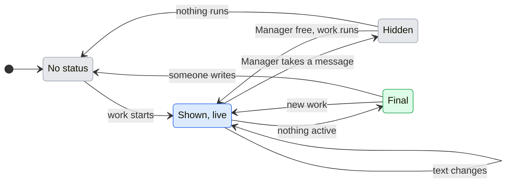

# UX: Manager status in Telegram and Slack

## 1. Why

Alex writes to Manager from Telegram and Slack and then sees nothing until an answer arrives. Telegram shows "typing" only while Manager itself answers; Slack shows nothing at all. When Manager hands the work to workers, nobody in the chat or thread can tell whether anything is running, waiting for an answer, stuck for a slot or finished. Alex asked on 2026-11-06 for a status message in the channel conversation that says what Manager and its workers are doing now. On 2026-11-10 he narrowed it: the status is for the time Manager is not answering and not waiting for him while its workers run, says what each worker is doing and its background jobs, so he knows work is in progress; when he writes to the bot it goes away and comes back after the reply. Later on 2026-11-10 he asked for it to read like a person: Manager speaks in the first person, in the language he wrote in, never as "Manager is ...", and a worker line says in words what the worker is doing, without raw commands.

## 2. The path

- **Entry and result:** a worker tracked by a Telegram chat or a Slack thread is working while Manager is free. One status message appears at the bottom of that conversation and is edited in place as the workers change. When someone writes and Manager takes the message, the status is deleted; when Manager has answered (or finished without a word), it is posted again below the answer if work still runs. When nothing runs any more, it is edited a last time to say how it ended, and that message is deleted as soon as Manager or the person writes next.
- **Readiness:** the channel is connected and allowed to talk to Manager, as for any message. Nothing to set up.
- **Decisions:** none for Alex.
- **Form:** one message at the bottom of the conversation, edited, never a new message per change; moved below Manager's messages by deleting and posting it again.

## 3. What is added

| Surface | What appears | When |
|---|---|---|
| Telegram chat paired with Manager | One status message, sent silently (no notification), edited as state changes | A worker the Telegram thread tracks is active and Manager is not working on a message |
| Slack thread with the bot | One status message in the thread, edited as state changes | A worker the Slack thread tracks is active and Manager is not working on a message |
| Slack message Manager took | An :eyes: reaction on it | From the moment Manager takes it until Manager answers or finishes |
| Slack thread with the bot | "Preparing the answer: <what>", edited as Manager works | While Manager works on a message, until its answer is posted |

Telegram's native "typing" stays as it is and is what shows while Manager answers. In Slack, each message Manager takes gets an :eyes: reaction from the bot at once, and it is taken off when Manager answers or finishes without a word, so the thread shows the bot is on it (asked by Alex on 2026-11-12, after the bot looked offline while it was replying). While Manager prepares the answer, one more message in the thread says what it is doing, "Preparing the answer: <what>" / "Готовлю ответ, сейчас: <what>", with <what> worded as for a worker ("thinking it through" when nothing is known, "starting on the message" before it starts); it is edited in place at most every 3 s and deleted when the answer is posted or Manager stops working (asked by Alex on 2026-11-12). It needs the `reactions:write` scope; without it the reaction is skipped and logged. Discord shows nothing while Manager answers.

## 4. The message

Every line is in the language of the last message a person wrote in this thread (`docs/ux/manager-voice.md`): Russian when it was Russian, English otherwise. Manager speaks of itself in the first person. Shown here in English, then Russian.

First line: what Manager is doing. Then one block per worker of this conversation that was active during this stretch, in the order they became active, at most 8; past 8, "and 3 more" / "и ещё 3".

| First line | Russian | When |
|---|---|---|
| "While I wait, here is what is going on:" | "Пока жду, вот что сейчас идёт:" | Manager is free and workers run |
| "Waiting for your answer above." | "Жду ответа выше." | A decision for this thread is open |
| "I can't go on: <reason>" | "Не могу продолжить: <reason>" | This thread's Manager session failed; reason as GeckIt shows it, first line, at most 200 characters |

A worker block is its line "• <title>: <what it is doing>", then up to 3 of its running background jobs as "  - <what it is>: running" / "идёт" or "waiting for an answer" / "ждёт ответа", and "  - and 2 more in the background" / "и ещё 2 в фоне" past 3.

While the worker works, "<what it is doing>" is the activity GeckIt already reads from its conversation (the `Working - ...` line of its card, from Claude Code over stream or tmux, and from Codex), said in words:

| The worker | English | Russian |
|---|---|---|
| reads a file | "reading src/app.ts" | "читает src/app.ts" |
| changes a file | "editing src/app.ts" | "правит src/app.ts" |
| runs tests (vitest, jest, pytest, npm test ...) | "running the tests" | "запускает тесты" |
| runs a type check or a linter | "checking the code" | "проверяет код" |
| builds | "building the project" | "собирает проект" |
| runs git or gh | "working with git" | "работает с git" |
| installs packages | "installing packages" | "ставит пакеты" |
| fetches with curl or wget | "fetching from the network" | "обращается к сети" |
| runs any other command | "running a command" | "выполняет команду" |
| starts one of these in the background | "... in the background" | "... в фоне" |
| searches the code | "searching the code" | "ищет по коду" |
| searches the web | "searching the web: <query>" | "ищет в интернете: <query>" |
| opens a site | "opening <host>" | "открывает <host>" |
| hands off to a helper | "handing off to a helper: <what>" | "поручает помощнику: <what>" |
| uses a skill or another tool | "using the <skill> skill", "using <tool>" | "использует навык <skill>", "использует <tool>" |
| has the message typed into Claude Code (tmux) | "starting on the message" | "берётся за сообщение" |
| is thinking (tmux, between tools) | "thinking it through" | "обдумывает задачу" |

A working worker with no known activity says "working" / "в работе". The other states:

| Worker state | Russian | When |
|---|---|---|
| "waiting for an answer in GeckIt" | "ждёт ответа в GeckIt" | It asks a question or a permission |
| "waiting for a free slot" | "ждёт свободного слота" | Its message waits for a working slot |
| "message sent, not started yet" | "сообщение передано, ещё не начато" | Its last delivery is pending at the host |
| "paused by the plan's usage limit" | "на паузе: лимит плана" | It hit the plan limit |
| "stopped with an error" | "остановлено с ошибкой" | It failed |
| "running in the background" | "работает в фоне" | Its turn is over and a background job (a command, a watch, a helper) still runs; this keeps the status live |
| "finished" | "готово" | It stopped working and nothing of it runs in the background |

A background job shows by its description; a command job with no description of its own shows as what the command does, as in the table above.

```text
Пока жду, вот что сейчас идёт:
• Ответы менеджера: запускает тесты
• Следить за CI #71: работает в фоне
  - CI run 42: идёт
```

The final edit, when nothing is active: the first line becomes "Done." / "Готово." (or the "I can't go on" line, or "Waiting for your answer above."), and the worker blocks keep their last state. It stays until Manager sends something into the conversation or the person writes, and then it is deleted.

## 5. States



| From | Event | To | What the person sees |
|---|---|---|---|
| No status | A worker of this thread becomes active while Manager is free, by itself | Shown, live | A new status message at the bottom |
| Shown, live | Manager takes a message in this thread, by the person writing | Hidden | The status message is deleted |
| Hidden | Manager is free again and workers still run | Shown, live | A new status message below Manager's answer, posted only once the answer is there |
| Hidden | Manager is free and nothing runs | No status | Nothing; Manager's answer says how it went |
| Shown, live | Manager sends something into the conversation (an answer or a question) | Shown, live | The status message is deleted and posted again below it |
| Shown, live | Manager or a worker of this thread changes state so that the text changes, by itself | Shown, live | The same message edited, no sooner than 3 s after the last edit |
| Shown, live | Same text after a change elsewhere | Shown, live | Nothing |
| Shown, live | Nothing is active: Manager idle, waiting for an answer or stopped, and every worker of this stretch idle, failed or waiting for an answer | Final | Last edit with the ending line |
| Final | Manager sends something, or Manager takes a message the person wrote | No status | The final status message is deleted |
| Final | New worker activity | Shown, live | The final one is deleted and a new status message is posted at the bottom |
| Shown, live | Posting or editing fails at Slack or Telegram | Shown, live | Nothing new; the next change tries again, a failed post starts over with a new message |

A worker waiting for an answer counts as not active for the final edit: the stretch ends with that line visible, and the question itself arrives the usual way.

## 6. What stays silent

- Workers of other conversations, and every worker this conversation does not track.
- Commands, prompts and Manager's operations: a command is said as what it does ("running the tests"), never as the command itself; a background job shows by its description.
- Activity GeckIt cannot put into words: the worker says only "working", rather than showing a raw line.
- A worker's last words and system stand lines ("Ready to send", "Did not finish"): the state word already says it, and the answer comes from Manager.
- A worker title that looks like it holds a token or key shows as "a task", such a job description as "a background task", and such an activity is left at "working".
- Changes that do not change the text.
- The main GeckIt thread's work in Telegram: Telegram's status covers the Telegram thread only.

## 7. Numbers

- 3 s between edits: Slack's `chat.update` and Telegram's `editMessageText` both rate-limit per chat; three seconds keeps a busy stretch to about 20 edits a minute and still reads as live.
- 8 worker lines: a status should fit a phone screen; more goes into "and N more".
- 200 characters for a reason: one line of an error, not a stack.

## 8. Edge cases

- **Restart of GeckIt:** the message being edited is not remembered; the next change posts a new one.
- **Two messages quickly:** the status stays away until Manager is free after both.
- **Manager answers with no text** (a quiet turn): the status comes back when Manager is free, below the person's message.
- **Deleting the status fails** (an old message or a missing right): the old one stays, and a new one is posted below the answer.
- **A thread that took over tracking:** once Telegram unfollows a worker it started and a Slack thread follows it, the worker shows in the Slack thread's status and leaves Telegram's.
- **Channel off or thread closed:** no status is posted.

## 9. Not done on purpose

- A new message per change: floods the chat. Rejected.
- Showing the commands a worker runs, or the card's raw stand line: can leak commands and paths and reads as telemetry. Rejected; the activity is said in words instead (Alex, 2026-11-10).
- Asking a model to describe each worker's progress: costs plan usage on every change and can invent progress. Rejected; the words come from what the worker's conversation already records.
- A message per tool step: floods the chat. Rejected; the one status message is edited, no more often than every 3 s.
- A status while Manager answers: Alex, 2026-11-10, wants it gone while he talks to the bot. Telegram's typing remains.
- Keeping the final status in the conversation: Alex, 2026-11-11, wants it to read like talking with a person, so it is deleted once anyone writes next; Manager's own answer says how it went.
- A clock line ("Updated 14:32 UTC"): reads as a machine. Removed, Alex, 2026-11-11.

## 10. Forks

| Question | Verdict | Why |
|---|---|---|
| Edit one message or post new ones | Edit one per stretch | Alex: avoid a stream of identical messages |
| Accepted vs started | Separate lines; since 2026-11-10 neither is shown, the status being away while Manager works | Alex: do not present the host's acceptance as the model starting |
| Status while the person talks to the bot | Deleted when Manager takes a message, posted again below its answer | Alex, 2026-11-10 |
| What a worker line says | What it is doing, in words, and its background jobs | Alex, 2026-11-10: so he knows work is in progress; later the same day, without raw commands and in his language |
| Russian forms of address | "ты" in imperatives, no gendered past forms for Manager | Alex writes to Manager with "ты"; Manager has no set gender |
| Telegram notification for the status | Silent | The answer itself notifies; the status should not buzz the phone each stretch |
