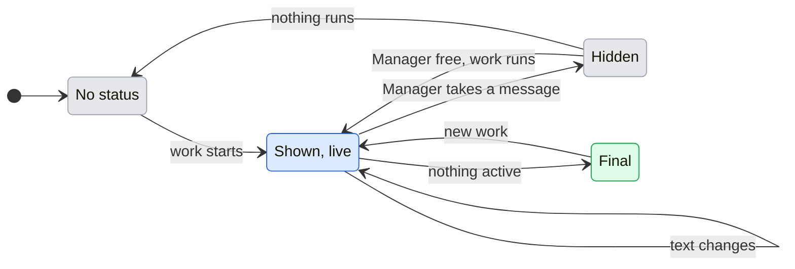

# UX: Manager status in Telegram and Slack

## 1. Why

Alex writes to Manager from Telegram and Slack and then sees nothing until an answer arrives. Telegram shows "typing" only while Manager itself answers; Slack shows nothing at all. When Manager hands the work to workers, nobody in the chat or thread can tell whether anything is running, waiting for an answer, stuck for a slot or finished. Alex asked on 2026-11-06 for a status message in the channel conversation that says what Manager and its workers are doing now. On 2026-11-10 he narrowed it: the status is for the time Manager is not answering and not waiting for him while its workers run, says what each worker is doing and its background jobs, so he knows work is in progress; when he writes to the bot it goes away and comes back after the reply.

## 2. The path

- **Entry and result:** a worker tracked by a Telegram chat or a Slack thread is working while Manager is free. One status message appears at the bottom of that conversation and is edited in place as the workers change. When someone writes and Manager takes the message, the status is deleted; when Manager has answered (or finished without a word), it is posted again below the answer if work still runs. When nothing runs any more, it is edited a last time to say how it ended.
- **Readiness:** the channel is connected and allowed to talk to Manager, as for any message. Nothing to set up.
- **Decisions:** none for Alex.
- **Form:** one message at the bottom of the conversation, edited, never a new message per change; moved below Manager's messages by deleting and posting it again.

## 3. What is added

| Surface | What appears | When |
|---|---|---|
| Telegram chat paired with Manager | One status message, sent silently (no notification), edited as state changes | A worker the Telegram thread tracks is active and Manager is not working on a message |
| Slack thread with the bot | One status message in the thread, edited as state changes | A worker the Slack thread tracks is active and Manager is not working on a message |

Telegram's native "typing" stays as it is and is what shows while Manager answers. Slack shows nothing while Manager answers. Discord follows Slack.

## 4. The message

First line: what Manager is doing. Then one block per worker of this conversation that was active during this stretch, in the order they became active, at most 8; past 8, "and 3 more". Last line: "Updated 14:32 UTC".

| First line | When |
|---|---|
| "Work in progress" | Manager is free and workers run |
| "Manager is waiting for your answer above." | A decision for this thread is open |
| "Manager stopped: <reason>" | This thread's Manager session failed; reason as GeckIt shows it, first line, at most 200 characters |

A worker block is its line "• <title>: <state>", then where it stands (the card's second line, first line only, at most 120 characters), then up to 3 of its running background jobs as "  - <what it is>: running" or "waiting for an answer", and "  - and 2 more in the background" past 3.

| Worker state | When |
|---|---|
| "working" | The worker is working |
| "waiting for an answer in GeckIt" | It asks a question or a permission |
| "waiting for a free slot" | Its message waits for a working slot |
| "message sent, not started yet" | Its last delivery is pending at the host |
| "paused by the plan's usage limit" | It hit the plan limit |
| "stopped with an error" | It failed |
| "running in the background" | Its turn is over and a background job (a command, a watch, a helper) still runs; this keeps the status live |
| "finished" | It stopped working and nothing of it runs in the background |

```text
Work in progress
• Fix login redirect: working
  Running the redirect tests after the fix
• Watch CI for #71: running in the background
  CI is running; I will report when it finishes
  - CI run 42: running
Updated 14:32 UTC
```

The final edit, when nothing is active: the first line becomes "Done." (or "Manager stopped: <reason>" / "Waiting for your answer above."), the worker blocks keep their last state, and the time is updated.

## 5. States



| From | Event | To | What the person sees |
|---|---|---|---|
| No status | A worker of this thread becomes active while Manager is free, by itself | Shown, live | A new status message at the bottom |
| Shown, live | Manager takes a message in this thread, by the person writing | Hidden | The status message is deleted |
| Hidden | Manager is free again and workers still run | Shown, live | A new status message below Manager's answer, posted only once the answer is there |
| Hidden | Manager is free and nothing runs | No status | Nothing; Manager's answer says how it went |
| Shown, live | Manager sends something into the conversation (an answer or a question) | Shown, live | The status message is deleted and posted again below it |
| Shown, live | Manager or a worker of this thread changes state so that the text changes, by itself | Shown, live | The same message edited, no sooner than 3 s after the last edit |
| Shown, live | Same text after a change elsewhere | Shown, live | Nothing |
| Shown, live | Nothing is active: Manager idle, waiting for an answer or stopped, and every worker of this stretch idle, failed or waiting for an answer | Final | Last edit with the ending line and time |
| Final | New worker activity | Shown, live | A new status message below, so it is under the latest messages; the old one keeps its final text |
| Shown, live | Posting or editing fails at Slack or Telegram | Shown, live | Nothing new; the next change tries again, a failed post starts over with a new message |

A worker waiting for an answer counts as not active for the final edit: the stretch ends with that line visible, and the question itself arrives the usual way.

## 6. What stays silent

- Workers of other conversations, and every worker this conversation does not track.
- Commands, tool names, prompts and Manager's operations: a background job shows by its description, never by the command it runs.
- A worker title that looks like it holds a token or key shows as "a task", such a job description as "a background task", and such a stand line is left out.
- Changes that do not change the text.
- The main GeckIt thread's work in Telegram: Telegram's status covers the Telegram thread only.

## 7. Numbers

- 3 s between edits: Slack's `chat.update` and Telegram's `editMessageText` both rate-limit per chat; three seconds keeps a busy stretch to about 20 edits a minute and still reads as live.
- 8 worker lines: a status should fit a phone screen; more goes into "and N more".
- 200 characters for a reason: one line of an error, not a stack.

## 8. Edge cases

- **Restart of GeckIt:** the message being edited is not remembered; the next change posts a new one.
- **Two messages quickly:** the status stays away until Manager is free after both.
- **Manager answers with no text** (a quiet turn): the status comes back when Manager is free, below the person's message.
- **Deleting the status fails** (an old message or a missing right): the old one stays, and a new one is posted below the answer.
- **A thread that took over tracking:** once Telegram unfollows a worker it started and a Slack thread follows it, the worker shows in the Slack thread's status and leaves Telegram's.
- **Channel off or thread closed:** no status is posted.

## 9. Not done on purpose

- A new message per change: floods the chat. Rejected.
- Showing the commands a worker runs: can leak commands and paths. Rejected; the stand line and job descriptions are shown instead (Alex, 2026-11-10).
- A status while Manager answers: Alex, 2026-11-10, wants it gone while he talks to the bot. Telegram's typing remains.
- Deleting the status at the end: the person loses the outcome. Rejected; it is kept with its final text.

## 10. Forks

| Question | Verdict | Why |
|---|---|---|
| Edit one message or post new ones | Edit one per stretch | Alex: avoid a stream of identical messages |
| Accepted vs started | Separate lines; since 2026-11-10 neither is shown, the status being away while Manager works | Alex: do not present the host's acceptance as the model starting |
| Status while the person talks to the bot | Deleted when Manager takes a message, posted again below its answer | Alex, 2026-11-10 |
| What a worker line says | State, where it stands and its background jobs | Alex, 2026-11-10: so he knows work is in progress |
| Telegram notification for the status | Silent | The answer itself notifies; the status should not buzz the phone each stretch |
