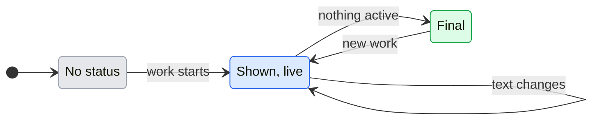

# UX: Manager status in Telegram and Slack

## 1. Why

Alex writes to Manager from Telegram and Slack and then sees nothing until an answer arrives. Telegram shows "typing" only while Manager itself answers; Slack shows nothing at all. When Manager hands the work to workers, nobody in the chat or thread can tell whether anything is running, waiting for an answer, stuck for a slot or finished. Alex asked on 2026-11-06 for a status message in the channel conversation that says what Manager and its workers are doing now.

## 2. The path

- **Entry and result:** someone writes to Manager in a Telegram chat or a Slack thread. One status message appears there under their message as soon as the host has it, and is edited in place as Manager and the workers this conversation started or follows change state. When nothing is running any more, it is edited a last time to say how it ended.
- **Readiness:** the channel is connected and allowed to talk to Manager, as for any message. Nothing to set up.
- **Decisions:** none for Alex.
- **Form:** one message per stretch of work, edited, never a new message per change.

## 3. What is added

| Surface | What appears | When |
|---|---|---|
| Telegram chat paired with Manager | One status message, sent silently (no notification), edited as state changes | The Telegram thread or a worker it started or follows is active |
| Slack thread with the bot | One status message in the thread, edited as state changes | The Slack thread or a worker it started or follows is active |

Telegram's native "typing" stays as it is.

## 4. The message

First line: Manager. Then one line per worker of this conversation that was active during this stretch, in the order they became active, at most 8; past 8, "and 3 more".

| Manager line | When |
|---|---|
| "Manager has your message and has not started yet." | The host accepted a message for this thread; Manager's model is not working on it yet |
| "Manager is working on it." | Manager's own session is working |
| "Manager is waiting for your answer above." | A decision for this thread is open |
| "Manager stopped: <reason>" | This thread's Manager session failed; reason as GeckIt shows it, first line, at most 200 characters |
| "Manager is done for now." | Manager is idle, workers still active |

| Worker line ("• <title>: ...") | When |
|---|---|
| "working" | The worker is working |
| "waiting for an answer in GeckIt" | It asks a question or a permission |
| "waiting for a free slot" | Its message waits for a working slot |
| "message sent, not started yet" | Its last delivery is pending at the host |
| "paused by the plan's usage limit" | It hit the plan limit |
| "stopped with an error" | It failed |
| "finished" | It stopped working (idle, unread or goal met) |

The final edit, when nothing is active: the Manager line becomes "Done." (or "Manager stopped: <reason>" / "Waiting for your answer above."), the worker lines keep their last state, and a last line says "Updated 14:32 UTC".

## 5. States

| From | Event | To | What the person sees |
|---|---|---|---|
| No status | A message is accepted for this thread, or a worker of this thread becomes active, by itself | Shown, live | A new status message |
| Shown, live | Manager or a worker of this thread changes state so that the text changes, by itself | Shown, live | The same message edited, no sooner than 3 s after the last edit |
| Shown, live | Same text after a change elsewhere | Shown, live | Nothing |
| Shown, live | Nothing is active: Manager idle, waiting for an answer or stopped, and every worker of this stretch idle, failed or waiting for an answer | Final | Last edit with the ending line and time |
| Final | New message or new worker activity | Shown, live | A new status message below, so it is under the latest messages; the old one keeps its final text |
| Shown, live | Posting or editing fails at Slack or Telegram | Shown, live | Nothing new; the next change tries again, a failed post starts over with a new message |

A worker waiting for an answer counts as not active for the final edit: the stretch ends with that line visible, and the question itself arrives the usual way.

## 6. What stays silent

- Workers of other conversations, and every worker this conversation neither started nor follows.
- Commands, tool names, files, prompts and Manager's operations: the status says states, never what a command was.
- A worker title that looks like it holds a token or key shows as "a task".
- Changes that do not change the text.
- The main GeckIt thread's work in Telegram: Telegram's status covers the Telegram thread only.

## 7. Numbers

- 3 s between edits: Slack's `chat.update` and Telegram's `editMessageText` both rate-limit per chat; three seconds keeps a busy stretch to about 20 edits a minute and still reads as live.
- 8 worker lines: a status should fit a phone screen; more goes into "and N more".
- 200 characters for a reason: one line of an error, not a stack.

## 8. Edge cases

- **Restart of GeckIt:** the message being edited is not remembered; the next change posts a new one.
- **Two messages quickly:** one status covers both.
- **A thread that took over tracking:** once Telegram unfollows a worker it started and a Slack thread follows it, the worker shows in the Slack thread's status and leaves Telegram's.
- **Channel off or thread closed:** no status is posted.

## 9. Not done on purpose

- A new message per change: floods the chat. Rejected.
- Showing what a worker runs: can leak commands and paths. Rejected.
- Deleting the status at the end: the person loses the outcome. Rejected; it is kept with its final text.

## 10. Forks

| Question | Verdict | Why |
|---|---|---|
| Edit one message or post new ones | Edit one per stretch | Alex: avoid a stream of identical messages |
| Accepted vs started | Separate lines | Alex: do not present the host's acceptance as the model starting |
| Telegram notification for the status | Silent | The answer itself notifies; the status should not buzz the phone each stretch |
