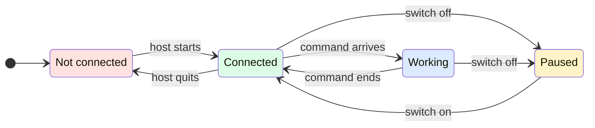

# Chrome extension panel

The person lets GeckIt work in their own Chrome, but until now the only sign of it was a pointer in the tab and a dot on the toolbar icon. They could not tell whether the extension reached GeckIt at all, which tabs a conversation had been in, what it did there, or stop it without going to GeckIt. Pressing the GeckIt Browser button in the toolbar now opens a panel that answers those four questions.

## What is added

| Surface | What appears |
| --- | --- |
| Chrome Web Store style name, description and icon (`manifest.json`) | GeckIt's gecko at 16, 32, 48 and 128 px; the description "Lets GeckIt conversations read, check and use your Chrome tabs. Click the icon to see which tabs they used and what they did." |
| Toolbar button | Opens the panel; the green dot of a tab GeckIt worked in stays |
| Panel, header | Gecko, "GeckIt Browser", the connection line, the version |
| Panel, Now | What GeckIt is doing this moment and in which tab, while it does it |
| Panel, Tabs | Every open tab GeckIt read or acted in since Chrome started, the newest first: favicon, title, site, the last thing done and how long ago, "Changed view" with Reset where `view` still holds |
| Panel, Activity | The last 30 commands, newest first, a failed one with its reason |
| Panel, footer | The switch "Let GeckIt use Chrome" |

## States

| State | When | What the person sees | What to do |
| --- | --- | --- | --- |
| Connected | Chrome started GeckIt's host and it stayed up | "Connected to GeckIt", green dot | Nothing |
| Not connected | Chrome could not start the host, or it quit | "Not connected", grey dot, and under it "Turn on Chrome through GeckIt in GeckIt Settings > Assistants." | Turn on the switch in GeckIt |
| Paused | The person turned off "Let GeckIt use Chrome" | "Paused", amber dot; Now is gone | Turn the switch back on |
| Working | A command is running | Now: "Clicking "Sign in"" and the tab title under it | Nothing; press it to go to the tab |
| Idle | No command is running | Now is not shown | Nothing |
| No tabs yet | GeckIt has not been in a tab since Chrome started | "No tabs yet. Tabs GeckIt opens go into the green GeckIt group." | Nothing |

## Transitions

| From | Event | To | What the person sees |
| --- | --- | --- | --- |
| Not connected | Chrome starts the host, by itself every 30 s, and it is still up 1 s later | Connected | The line turns green |
| Connected | The host quits: the switch in GeckIt was turned off, or GeckIt was removed | Not connected | The line turns grey with the hint |
| Connected | A conversation sends a command | Working | Now appears with what it does |
| Working | The command answers or fails | Connected | Now goes; the tab and the Activity row update |
| Connected, Working | The person turns off "Let GeckIt use Chrome" | Paused | Amber "Paused"; the running command finishes, every next one is refused |
| Paused | The person turns it on | Connected | Green again |
| Any | The person presses a tab row or Now | Same | Chrome shows that tab and its window; the panel closes |
| Any | The person presses Reset on "Changed view" | Same | The tab goes back to its own size, colour scheme and motion; the chip goes |

## What stays silent

- `ping`, which the host sends to check the extension, is not activity.
- A tab that closed leaves the Tabs list; its Activity rows stay, so what happened is still there.
- Typed text is never shown: a field may hold a password. The row says "Typed into a field".
- The panel is not a log for later: it is kept by Chrome for the session and is empty after Chrome restarts.

## Thresholds and time

- 1 s before Connected: Chrome starts the host and it may quit at once when the switch is off; without the wait the line would flash green every 30 s.
- 30 rows of Activity: enough to read back one task, small enough to keep in session storage.
- "Just now" under 10 s, then minutes, then hours: the person reads how fresh it is, not a clock.

## Wording

- Connected: "Connected to GeckIt"
- Not connected: "Not connected" and "Turn on Chrome through GeckIt in GeckIt Settings > Assistants."
- Paused: "Paused" and "GeckIt cannot read or use your tabs until you turn this back on."
- Refused while paused, shown in Activity as "Refused: paused" and said to the conversation as: "The person paused GeckIt in Chrome. Ask them to turn on Let GeckIt use Chrome in the GeckIt Browser button."
- Empty Tabs: "No tabs yet. Tabs GeckIt opens go into the green GeckIt group."
- Empty Activity: "Nothing yet."
- Activity rows: "Opened example.com", "Went to example.com", "Read the page", "Read the text", "Clicked "Sign in"", "Hovered "Menu"", "Typed into a field", "Scrolled", "Pressed Enter", "Ran a script", "Took a screenshot", "Read the style", "Changed the view", "Reset the view", "Recorded 1.5 s", "Closed the tab", "Listed tabs"; a failure: the same row and the reason under it.

## Edge cases

- Two conversations at once: Now shows the latest command; both land in Activity.
- A command to a tab that is gone: the Activity row fails with Chrome's reason; no tab row appears.
- The panel open while things happen: it redraws as they happen.
- Paused while `view` holds a tab: Reset still works, since it gives the page back to the person.

## What is deliberately not there

- A Stop button for one running command: a command takes a second or two; pausing covers stopping the next ones.
- Which conversation sent a command: the host does not know it, and guessing would mislead.
- Settings for the model or the folder: they live in GeckIt, where they work.
