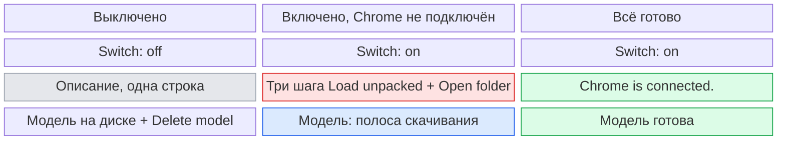
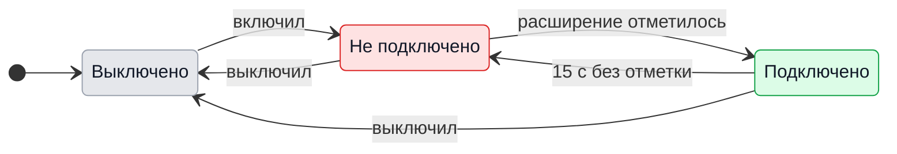
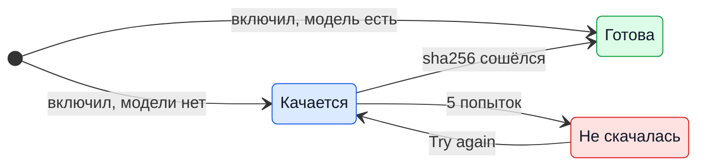

# UX: switch for Chrome through GeckIt

## 1. Зачем

Сейчас GeckIt при каждом старте ставит всем мост к Chrome: пишет расширение, регистрирует native host, добавляет раздел про `geckit browser` в инструкции Codex и Claude и даёт Codex право писать в `~/.geckit/browser`. Кто Chrome через GeckIt не использует, получает лишний текст в каждой инструкции и открытый мост, о котором не просил. Кто использует, не видит, подключено ли расширение и скачана ли модель для `find`: узнаёт об этом, только когда агент пишет "not connected".

### Путь до результата

- **Вход и результат:** Settings > Integrations, блок "Chrome through GeckIt". В конце Codex и Claude работают в Chrome человека через `geckit browser`, а `find` отвечает моделью.
- **Готовность:** три независимых признака. Переключатель включён (мост и инструкции на месте). Расширение подключено (оно отметилось меньше 15 с назад). Модель скачана (размер и sha256 сошлись). Без модели всё работает, `find` ищет по словам.
- **Решения и порядок:** человек решает одно: включить. Дальше один шаг руками, Load unpacked в Chrome; модель качается сама.
- **Форма пути:** переключатель и под ним то, что ещё не готово. Постепенное раскрытие: выключенный блок занимает две строки, включённый показывает только недостающее. Мастер не нужен: шаг один, порядок очевиден.
- **Первый запуск и возврат:** закрыл Settings посреди скачивания: оно продолжается, при возврате видна полоса. Выключил и включил: модель не качается заново, расширение в Chrome подключается само.

## 2. Что добавляется

| Поверхность | Что появляется | Когда видно |
|---|---|---|
| Settings > Integrations, новый раздел после Assistants; пока в нём только этот блок | Блок "Chrome through GeckIt": переключатель и описание | Всегда на компьютере; на телефоне блока нет |
| Тот же блок | Шаги подключения расширения и кнопка "Open folder" | Включено, расширение не подключено |
| Тот же блок | Строка о модели: полоса скачивания, "Try again" или "Search model ready" | Включено |
| Тот же блок | "Delete model" | Выключено, модель на диске |
| `geckit browser` | Ответ "Chrome through GeckIt is off..." | Выключено |

## 3. Состояния

| Состояние | Когда наступает | Что видит пользователь | Что ему делать |
|---|---|---|---|
| Выключено | По умолчанию, или выключил | Переключатель и описание | Включить, если нужен Chrome |
| Не подключено | Включено, расширение не отмечалось 15 с | Шаги Load unpacked и "Open folder" | Загрузить расширение в Chrome |
| Подключено | Отметка расширения свежее 15 с | "Chrome is connected." | Ничего |
| Модель качается | Включено, модели нет, скачивание идёт | Полоса и "Downloading the search model, 1.2 of 2.5 GB." | Ничего, пройдёт само |
| Модель не скачалась | Пять попыток подряд не дали файла с верным sha256 | Текст ошибки и "Try again" | Нажать "Try again" |
| Модель готова | Включено, файл на месте | "Search model ready." | Ничего |
| Модель осталась | Выключено, файл на месте | "The search model stays on this computer, 2.5 GB." и "Delete model" | Удалить, если место нужно |
| Модели не будет | Нет `llama-server` в этой сборке | "find matches words: this build has no search model." | Ничего |
| Не на этой системе | Windows | Переключатель недоступен, "Not on Windows yet." | Ничего |

## 4. Переходы

| Из | Событие | В | Что видит пользователь |
|---|---|---|---|
| Выключено | Включил переключатель | Не подключено | Шаги Load unpacked; строка модели |
| Не подключено | Расширение отметилось (сам, без него) | Подключено | "Chrome is connected." вместо шагов, в течение 2 с |
| Подключено | Chrome закрыт, 15 с без отметки (сам) | Не подключено | Шаги снова |
| Не подключено / Подключено | Выключил переключатель | Выключено | Блок сворачивается до описания; модель на диске, "Delete model" остаётся видна |
| Модель качается | Файл сошёлся по sha256 (сам) | Модель готова | "Search model ready." |
| Модель качается | Пять неудачных попыток (сам) | Модель не скачалась | Ошибка и "Try again" |
| Модель не скачалась | Нажал "Try again" | Модель качается | Полоса с того байта, где остановилась |
| Модель осталась | Нажал "Delete model" | Выключено | "Search model deleted.", через 3 с строки нет |
| Модель осталась | Включил переключатель | Модель готова | "Search model ready." |

## 5. Что молчит

| Состояние | Почему не показываем |
|---|---|
| Работает ли `llama-server` сейчас | Он сам запускается при первом `find` и сам гаснет; человеку тут нечего делать |
| Сколько раз агент вызвал `geckit browser` | Это видно в самом разговоре |
| Какие из Chrome-профилей зарегистрированы | Регистрация одна на все, разницы для человека нет |
| Расширение в Chrome осталось после выключения | Без native host оно молчит; удалить его GeckIt не может, только человек |

## 6. Пороги и время

| Число | Значение | Почему столько |
|---|---|---|
| Отметка расширения считается свежей | 15 с | Расширение отмечается каждые 5 с; три пропуска подряд значат, что Chrome закрыт или расширение выключено |
| Обновление блока, пока он открыт | 2 с | Человек только что нажал Load unpacked и ждёт ответа; дольше выглядит как "не сработало" |
| Попытки скачать модель | 5 | Так уже работает `fetchModel`; обрыв сети переживается, неверный файл нет |
| "Search model deleted." | 3 с | Подтверждение действия, не состояние |

## 7. Формулировки

| Состояние | Текст |
|---|---|
| Название | «Chrome through GeckIt» |
| Описание | «Codex and Claude work in your own Chrome, in the tabs you are signed in to, through the GeckIt Browser extension. Turning this off removes the bridge and the Chrome part of their instructions.» |
| Не подключено | «Connect Chrome once: open chrome://extensions, turn on Developer mode, press Load unpacked and choose the folder below.» и кнопка «Open folder» |
| Подключено | «Chrome is connected.» |
| Модель качается | «Downloading the search model, 1.2 of 2.5 GB. Until it is here, find matches words.» |
| Модель не скачалась | «The search model did not download: <ошибка>.» и кнопка «Try again» |
| Модель готова | «Search model ready.» |
| Модель осталась | «The search model stays on this computer, 2.5 GB.» и кнопка «Delete model» |
| Модели не будет | «find matches words: this build has no search model.» |
| Удалена | «Search model deleted.» |
| Windows | «Not on Windows yet.» |
| CLI, выключено | «Chrome through GeckIt is off. Turn it on in GeckIt Settings > Integrations.» |

## 8. Краевые случаи

- **Пусто:** первый запуск, всё выключено: две строки, ничего не качается.
- **Всё сразу:** Chrome не подключён и модель качается: обе строки видны, шаги выше модели, потому что без расширения модель бесполезна.
- **Обрыв:** сеть пропала посреди скачивания: попытки продолжаются с того же байта; после пятой "Try again".
- **Повтор:** выключил и включил: модель не качается заново, расширение подключается само в течение 0.5 мин (его будильник переподключения).
- **Устаревшая копия:** обновление GeckIt меняет файлы расширения в папке; Chrome подхватывает их при следующем перезапуске расширения, человек ничего не делает.
- **Выключено посреди скачивания:** скачивание продолжается до конца, `.part` не выбрасывается; после этого "Delete model" доступна.
- **Удалить во время работы:** "Delete model" есть только при выключенном мосте, поэтому `find` в этот момент модель не держит.

## 9. Чего намеренно нет

| Не делаем | Почему |
|---|---|
| Включать по умолчанию | Chrome с аккаунтами человека открываем агентам только по его решению |
| Отдельные переключатели для Codex и Claude | Мост один; Claude и так берёт его, только когда Claude in Chrome не подключён |
| Ставить расширение в Chrome за человека | Chrome разрешает распакованное расширение только руками в Developer mode |
| Блок на телефоне | Load unpacked и папка есть только на компьютере |
| Скачивание модели при первом `find` | Тогда качались бы два процесса сразу (host и сервис); теперь качает только GeckIt, при включении |

## 10. Развилки

### Где переключатель

| Вариант | Вердикт |
|---|---|
| Settings > Integrations | да |
| Свой раздел Settings > Chrome | нет |

**Почему:** он меняет инструкции ассистентов, а они настраиваются там же.

### Модель качать при включении или при первом поиске

| Вариант | Вердикт |
|---|---|
| При включении | да |
| При первом `find` | нет |

**Почему:** включение и есть согласие на 2.5 ГБ, размер назван рядом; первый поиск иначе часами шёл бы по словам без объяснения.

## 11. Сверка с требованиями

| Требование | Где закрыто |
|---|---|
| Alex 2026-11-04: «настройку, которая активирует работу с браузером через GeckIt», предложение принято («Делай») | Разделы 2-7 |

**Чего не хватает в требованиях:** запись в `docs/features.md` про Chrome надо дополнить: включается в Settings > Integrations.

## Развилка: где стоит переключатель

Сначала блок стоял в Settings > Assistants, после списка ассистентов. Алекс 2026-11-04: в ассистентах его не найти. Вердикт: отдельный раздел Integrations сразу после Assistants, где будут и следующие связи GeckIt с внешними инструментами; пока в нём одно расширение Chrome. На телефоне раздела нет, как не было блока.
