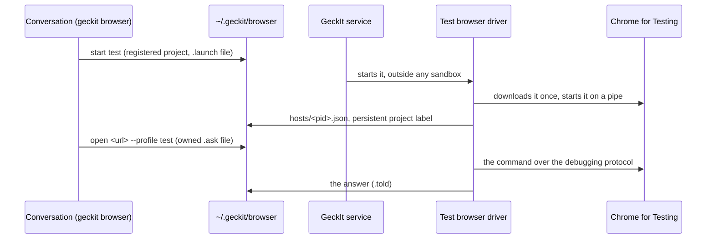
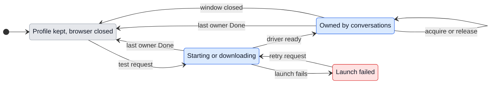

# Test browsers: Chrome for Testing under geckit browser

## Why

Through the extension a conversation works only where Chrome lets an extension work. The Chrome Web Store, `chrome://` pages and other extensions' pages are closed to every extension, the debugging bar shows over the person's own window while a click is real, and every tab a conversation opens lands among the person's own. On 2026-11-04 filling the Web Store listing could not be done through GeckIt at all and needed a hand-driven Chrome for Testing.

A test browser is Chrome for Testing that GeckIt starts and drives itself. The normal test-page command uses one persistent profile derived from the conversation's registered project folder. Conversations in that project share one browser and own separate tabs. Moving a conversation card to Done releases and closes its tabs; the last owner closes the browser, keeping cookies and sign-ins for the next task. Alex approved this lifecycle on 2026-11-05.

### Path to a result

- **Entry and result:** ask a conversation to check a page; it runs `geckit browser start test`, then `open <url> --profile test`. GeckIt chooses the registered project profile. The command returns a tab owned by that conversation.
- **Readiness:** Chrome through GeckIt is enabled and Chrome for Testing is available or downloads successfully. A launch request alone is not a ready browser: readiness is a responding driver and a returned owned tab.
- **Choices:** ordinary project tests need no name. A person can explicitly configure named profiles for separate accounts in `~/.geckit/browser-state/test-project-profiles.json`, mapping a registered project folder to an array of allowed profile names (a single string also overrides that project's default); this remains an exception, not a naming decision delegated to the assistant.
- **Shape:** existing conversation commands and the existing Done action form the whole path. No new screen or setup wizard is needed because project registration already supplies the default.
- **First use and return:** first use opens the project window; another conversation reuses it with its own tabs. Moving one card to Done leaves other owners working. Returning a card from Done does not reopen anything by itself; a new test request acquires ownership again and reuses the saved sign-ins. If Chrome closes or fails to start, retry the test request. Existing windows with unknown ownership remain untouched.

## Who does what

The conversation never starts Chrome itself: Codex runs with the network off, and a Chrome started from inside its sandbox would have none either. The service starts the driver; the driver owns Chrome through a pipe, so no port is open for any other program on the computer.

## What is added

| Surface | What appears |
| --- | --- |
| `geckit browser profiles` | test profiles under the Chrome ones: `test:<name>   Chrome for Testing   open, 2 tabs` or `closed: start opens it` |
| `geckit browser start test` | atomically starts or reuses this registered project's browser; simultaneous requests share one launch |
| `geckit browser stop test` in a conversation | explains that moving its card to Done releases its tabs; it cannot close another owner's browser |
| Conversation card moves to Done | automatically releases its owned test tabs, without another assistant decision |
| Explicit named profile configuration | keeps separate account profiles possible; ordinary project commands need no name |
| `pages` | only this conversation's managed test tabs; ordinary Chrome routing stays as before |
| every tab command | rejects access to another conversation's managed test tab, including across projects |
| Settings > Integrations, under Chrome through GeckIt | Test browsers: Chrome for Testing's version or download, each profile with Open or not, and Delete |
| the browser skill | when to use a test browser and when the person's Chrome |

## States of a test profile

| State | When | What the person sees | What to do |
| --- | --- | --- | --- |
| No Chrome for Testing | nothing downloaded and none found | Settings: "Chrome for Testing downloads the first time a test browser starts, about 200 MB." | nothing |
| Downloading | the first start | CLI: "Downloading Chrome for Testing, 40%. Run start again in a minute." Settings: the same with a bar | wait |
| Closed | profile folder exists, no driver | `closed: start opens it`; Settings: the name and Delete | start it, or delete it |
| Open | its driver says who it is within 15 s | one project Chrome for Testing window; each conversation sees its own tabs | work in the conversation |
| Shared | another conversation in the same project acquires it | the existing window, with separate tabs | nothing, sharing is automatic |
| Released | a card moves to Done | that conversation's tabs close; other owners' tabs stay | nothing |
| Ownership unavailable | an old browser or request lacks registered ownership | no automatic takeover or cleanup | use a registered conversation; preserve the existing browser |
| Failed to start | Chrome exited at once or the download failed | CLI: the reason, as Chrome or the download gave it | start again |

## Transitions

| From | Event | To | What the person sees |
| --- | --- | --- | --- |
| Closed | conversation runs `start test` | Starting | one project window opens; a download may be reported |
| Starting | another conversation in the same project requests a test, automatically | Starting | nothing extra; one launch is in progress |
| Starting | driver responds, automatically | Owned | commands return owned tabs |
| Starting | final owning card moves to Done, automatically | Closed | pending ownership is cancelled; no browser is left running for a completed task |
| Starting | download or launch fails, automatically | Failed | the command prints the reason |
| Failed | conversation retries the test request | Starting | a fresh attempt; no need to invent a profile name |
| Owned | another conversation in the project acquires the browser, automatically | Owned | its new tabs appear in the existing window |
| Owned | one card moves to Done while another still owns the browser, automatically | Owned | only the completed conversation's tabs close |
| Owned | last owning card moves to Done, automatically | Closed | the test window closes; profile and sign-ins remain |
| Owned | conversation runs `stop test` | Owned | "Move this conversation card to Done to release its test tabs; other conversations keep their browser." |
| Owned | person closes the browser window | Closed | commands report the closed browser; retry starts it with the same profile |
| Closed | a card leaves Done | Closed | nothing; a new test request is needed to reopen the browser |
| Closed | person deletes the profile in Settings | Gone | the profile row and its saved sign-ins disappear |
| Any | ordinary Chrome command runs | Same | existing ordinary Chrome behavior |

## What stays silent

- Project identity, ownership records and launch locks live in `~/.geckit/browser-state`, outside the conversation-writable request folder: backend policy, not choices for the assistant. `--profile test` resolves the conversation's registered project; the current working directory and assistant-invented names do not select another project. Ordinary Chrome remains the default when it is connected.
- Releasing one owner while others remain: no notification; closing only that owner's tabs is sufficient feedback.
- Old profiles without ownership: no migration or inferred owner; automatic cleanup cannot safely decide whose window to close.
- Tab groups and the green dot: a test browser is all GeckIt's, nothing in it needs marking.
- The extension's pause switch: closing the window is the pause.

## Thresholds

- 15 s: a driver that has not said it is alive for 15 s is gone, the same as a Chrome profile's host.
- 60 s: `start` waits this long for the window; a download that takes longer is reported with its percent, because a conversation's command has a time limit of its own.
- 1 s: the driver reconciles Done ownership on its heartbeat, serialized with commands so a completed card cannot race another conversation's command.
- 2 s: a waiting start can requeue a consumed launch when its first owner finishes before the driver is ready; this keeps another waiting owner from being stranded.
- Tab ids from 900000000 up: Chrome's own ids are small counters, so a test browser's tab ids never meet the person's.

## Words

- Settings heading: "Test browsers"
- Settings line: "Chrome for Testing, started and driven by GeckIt, for pages Chrome closes to extensions and for work away from your own tabs. Each profile keeps its sign-ins."
- Normal command: "geckit browser start test".
- Normal page command: "geckit browser open <url> --profile test".
- Ready: "test:<project-profile> is open. Use open <url> --profile test; GeckIt closes your tabs when this card reaches Done."
- Foreign conversation tab: "This tab belongs to another conversation. Open a separate tab with --profile test."
- Foreign project or unowned legacy tab: "This test tab belongs to another project or an unowned legacy browser."
- Completed conversation: "This conversation is Done. Move its card back to In progress before using test browsers."
- Conversation missing from registry: "This conversation is not registered with GeckIt. Open its project in GeckIt before starting a test browser."
- Shared stop request: "Move this conversation card to Done to release its test tabs; other conversations keep their browser."
- Download and startup failures retain their existing reason text; no new board notification is added.
- Delete confirmation: "Delete test:<name>? Its sign-ins and history go with it."

## Edges

- Two conversations start the same project at once: atomic launch ownership creates exactly one driver, including requests arriving before its host card exists.
- Two projects with the same folder basename: full registered folder identities keep their profiles separate.
- A working directory inside a worktree or subfolder does not change the registered project identity.
- A card reaches Done while launching or running a command: ownership is revoked; late requests cannot reacquire for a completed card.
- A page opens another tab: ownership follows its opener; another conversation cannot read or close it.
- A conversation guesses a tab id or profile label: the driver checks registered ownership before executing.
- An old test window is already open: do not close or claim it when ownership is unknown.
- A process crashes: retry uses saved profile data and stale launch ownership is recoverable without deleting the profile.
- The window is closed by hand while a command runs: the command fails with "The test browser closed."
- Delete while open: the browser is stopped first.
- The person's Chrome is not running at all: test browsers still work; `ask` no longer needs the extension's host to be alive.
- Windows: not yet, as with the extension.

## Deliberately not

- No port. A `--remote-debugging-port` lets any program on the computer drive a browser holding the person's sign-ins.
- No Delete from the CLI. A conversation can make and close a test profile but cannot throw away sign-ins the person made by hand.
- No second copy of the page code. The driver runs the extension's own page functions, read from `background.js`, in an isolated world of the page, so `read`, refs, the pointer and recordings are one implementation.
- No headless mode in this step: the person signs in by hand in a window, and a design check wants what a person sees.

## Decisions

- Driver in the CLI process, started by the service: chosen over the CLI starting Chrome itself, which fails inside Codex's sandbox.
- **2026-11-05 reversal:** assistant-chosen `test:<name>` was the default and created Dock clutter. `test` now means the backend-selected persistent project profile. Explicit user-controlled named account profiles remain available; arbitrary new assistant-chosen profiles are not the normal path.
- Shared project browser over one browser per conversation: fewer windows while per-conversation tab ownership prevents cross-task control.
- Done triggers cleanup over asking the assistant to stop: the board is the lifecycle authority.
- Keep existing unknown windows over inferred migration: preserves running sessions and sign-ins.
- Chrome for Testing from Google's own "last known good" list, or a copy already in Puppeteer's cache: chosen over bundling 200 MB into GeckIt.

## Requirements and verification

| Approved requirement | Behavior above |
| --- | --- |
| One persistent profile per registered project | Path to a result; project identity |
| Concurrent start deduplication | Transitions; simultaneous requests edge |
| Conversation tab ownership | Surfaces; foreign-tab and opener checks |
| Done releases tabs; final owner closes browser | States and transitions |
| Preserve cookies, ordinary Chrome and unknown existing windows | Closed state; silent states and edges |
| Explicit separate account profiles | User-controlled named configuration exception |
| No unrelated UI or session restart | Existing command and card surfaces only |

This updates the existing test-browser feature rather than adding a new screen. Real lifecycle checks must use newly owned verification browsers and separate temporary profile data; no current unknown browser is a cleanup fixture. Verification uses the changed source bundled separately in `/tmp/geckit-browser-real/`; it does not load changes into the installed app or restart any conversation.

- **Real Chrome for Testing:** four simultaneous CLI starts in two fixture conversations produce one host; separate projects with the same basename produce separate hosts. Each conversation sees only its own tabs. CLI and direct driver requests reject foreign tabs, missing identities and other-project identities. Popup ownership follows the opener.
- **Real Done lifecycle:** the same `notesStore().set(id, { status: 'done' })` transition used by the board closes that conversation's tabs while another owner remains usable. Final-owner Done closes its browser while the other project's browser remains open. A synthetic persistent cookie survives graceful shutdown and reopening the same profile. The fixture uses a mock macOS keychain because its temporary HOME has no login keychain; this verifies actual Chrome cookie storage, not a real account sign-in.
- **Additional real scenarios:** Done during simultaneous startup cancels the completed owner while the surviving owner opens a page; an explicit allowlist permits two separate account profiles in the same project at the same time. All owned fixture browsers are released afterward; profile folders remain.
- **Ordinary Chrome:** the changed CLI reads the existing ENTech profile's 17 tabs without opening, switching or modifying them. Existing Gmail and legacy named test windows are preserved.
- **Automated regression boundaries:** root registration, configured account names, ownership and launch locks have filesystem tests. Central `notesStore.set/replace` Done publication and mixed ordinary/manual/test routing have isolated fixtures; these do not claim live UI card interactions.
- **Repository checks:** typecheck and lint pass. The full suite passes with file parallelism disabled: 1,551 passed and one skipped. The parallel run hit the unrelated settings-file watcher timeout, which passed alone and in the serial suite. The production build passes in a temporary source copy, leaving the active app's output untouched.
- **Unavailable in the running copy:** installed service, currently active conversations and existing test drivers still run their loaded code and instructions. No restart, publication or deployment was performed. The lifecycle applies when a later authorized app/service load picks up this source.

No library entry matched this backend lifecycle task.
