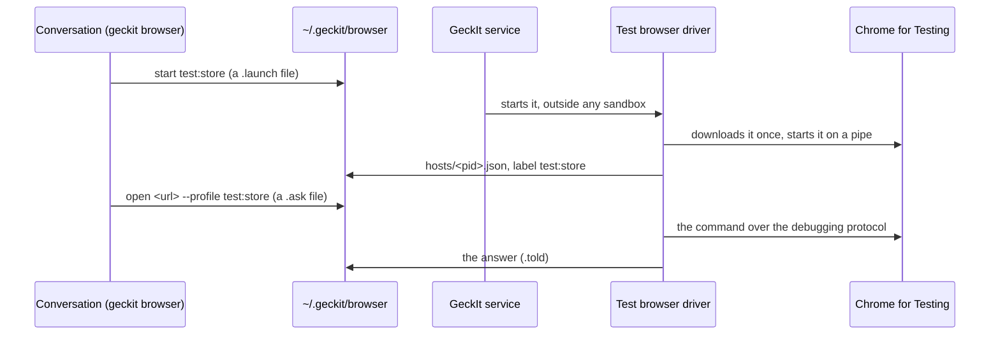
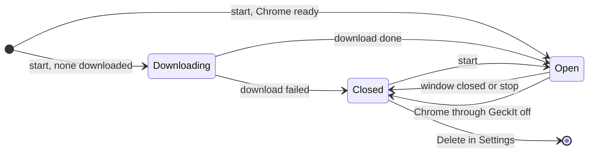

# Test browsers: Chrome for Testing under geckit browser

## Why

Through the extension a conversation works only where Chrome lets an extension work. The Chrome Web Store, `chrome://` pages and other extensions' pages are closed to every extension, the debugging bar shows over the person's own window while a click is real, and every tab a conversation opens lands among the person's own. On 2026-11-04 filling the Web Store listing could not be done through GeckIt at all and needed a hand-driven Chrome for Testing.

A test browser is a Chrome for Testing that GeckIt starts and drives itself, with a profile kept by name, so a sign-in made once is there next time.

## Who does what

The conversation never starts Chrome itself: Codex runs with the network off, and a Chrome started from inside its sandbox would have none either. The service starts the driver; the driver owns Chrome through a pipe, so no port is open for any other program on the computer.

## What is added

| Surface | What appears |
| --- | --- |
| `geckit browser profiles` | test profiles under the Chrome ones: `test:<name>   Chrome for Testing   open, 2 tabs` or `closed: start opens it` |
| `geckit browser start test:<name>` | starts that test browser, making the profile if it is new |
| `geckit browser stop test:<name>` | closes it; the profile stays |
| `pages` | test browsers' tabs under their label, as Chrome profiles' are |
| every tab command | works in a test browser's tab the same as in Chrome, routed by the tab id |
| Settings > Integrations, under Chrome through GeckIt | Test browsers: Chrome for Testing's version or download, each profile with Open or not, and Delete |
| the browser skill | when to use a test browser and when the person's Chrome |

## States of a test profile

| State | When | What the person sees | What to do |
| --- | --- | --- | --- |
| No Chrome for Testing | nothing downloaded and none found | Settings: "Chrome for Testing downloads the first time a test browser starts, about 200 MB." | nothing |
| Downloading | the first start | CLI: "Downloading Chrome for Testing, 40%. Run start again in a minute." Settings: the same with a bar | wait |
| Closed | profile folder exists, no driver | `closed: start opens it`; Settings: the name and Delete | start it, or delete it |
| Open | its driver says who it is within 15 s | a Chrome for Testing window; `open, N tabs` | work in it; close the window or `stop` |
| Failed to start | Chrome exited at once or the download failed | CLI: the reason, as Chrome or the download gave it | start again |

## Transitions

| From | Event | To | What the person sees |
| --- | --- | --- | --- |
| none | conversation runs `start test:x`, nothing downloaded | Downloading | Settings shows the download; the conversation is told to run start again |
| Downloading | download done, by itself | Open | a Chrome for Testing window opens |
| Downloading | download failed, by itself | Closed | Settings: "Chrome for Testing did not download: <reason>." |
| Closed | `start test:x` | Open | a window opens |
| Open | the person closes the window | Closed | nothing more |
| Open | `stop test:x` | Closed | the window closes |
| Open | Chrome through GeckIt turned off | Closed | the window closes, as the bridge goes |
| Closed | Delete in Settings | gone | the row goes; its sign-ins with it |

## What stays silent

- Which test browser was used last: a conversation names its test profile with `--profile test:<name>` every time. Without `--profile` a command goes to the person's own Chrome, never to a test browser, unless a test browser is all there is.
- Tab groups and the green dot: a test browser is all GeckIt's, nothing in it needs marking.
- The extension's pause switch: closing the window is the pause.

## Thresholds

- 15 s: a driver that has not said it is alive for 15 s is gone, the same as a Chrome profile's host.
- 60 s: `start` waits this long for the window; a download that takes longer is reported with its percent, because a conversation's command has a time limit of its own.
- Tab ids from 900000000 up: Chrome's own ids are small counters, so a test browser's tab ids never meet the person's.

## Words

- Settings heading: "Test browsers"
- Settings line: "Chrome for Testing, started and driven by GeckIt, for pages Chrome closes to extensions and for work away from your own tabs. Each profile keeps its sign-ins."
- No profile yet: "None yet. A conversation makes one with geckit browser start test:<name>."
- Delete confirmation: "Delete test:<name>? Its sign-ins and history go with it."

## Edges

- Two conversations start the same profile at once: the second finds the first's driver and is told it is open.
- The window is closed by hand while a command runs: the command fails with "The test browser closed."
- Delete while open: the browser is stopped first.
- The person's Chrome is not running at all: test browsers still work; `ask` no longer needs the extension's host to be alive.
- Windows: not yet, as with the extension.

## Deliberately not

- No port. A `--remote-debugging-port` lets any program on the computer drive a browser holding the person's sign-ins.
- No Delete from the CLI. A conversation can make and close a test profile but cannot throw away sign-ins the person made by hand.
- No second copy of the page code. The driver runs the extension's own page functions, read from `background.js`, in an isolated world of the page, so `read`, refs, the pointer and recordings are one implementation.
- No headless mode in this step: the person signs in by hand in a window, and a design check wants what a person sees.

## Decisions

- Driver in the CLI process, started by the service: chosen over the CLI starting Chrome itself, which fails inside Codex's sandbox.
- Labels `test:<name>`: chosen over a separate `--test` flag, so `--profile`, `pages` and routing stay one mechanism.
- Chrome for Testing from Google's own "last known good" list, or a copy already in Puppeteer's cache: chosen over bundling 200 MB into GeckIt.
