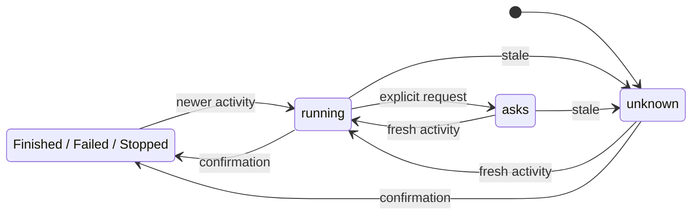

# Claude child activity

## Purpose and journey
Opening the board or asking Manager for sessions must reveal work delegated by Claude after its own answer ended. Open the existing parent card, then Background to see each helper, its identifier, confirmed status and latest observed tool. No independent child sessions are created. The existing parent remains the place to send messages; a queued stop is only a queued message.

## Surfaces
| Surface | Behavior |
|---|---|
| Provider discovery | Read parent launches/notifications and the associated helper telemetry without starting Claude. |
| Sessions list/show, Desktop and Manager | Share the same aggregate state and tasks. Active helpers prevent idle; canInject remains a foreground driver capability. |
| Card and Background | Existing helper count and rows show relationship, status, latest tool and browser/computer activity when known. |

## States and wording
| Child state | Text | Next action |
|---|---|---|
| running | "Running" | Read current activity; await a new event. |
| asks | "Waiting for input or permission" | Open the parent to inspect the native request; no fabricated approval control. |
| unknown | "Activity unconfirmed" | Inspect the parent/native runtime; await fresh telemetry. |
| completed | "Finished" | Read or clear. |
| failed | "Failed" | Inspect failure in parent. |
| stopped | "Stopped" | Read or clear; requires confirmation, never merely a sent command. |

## Transitions

| From | Event | To | What the user sees |
|---|---|---|---|
| unknown/asks | New confirmed helper event, automatically | running | Running and latest known tool. |
| running | Explicit pending question/permission, automatically | asks | Waiting for input or permission. |
| running/asks | No fresh telemetry within observation window, automatically | unknown | Activity unconfirmed; no eternal working. |
| any nonterminal | Native completion/error/stop confirmation, automatically | terminal | Finished/Failed/Stopped. |
| terminal | Replayed launch or old tool event | same terminal | Nothing changes. |
| any | Parent answer ends, service restarts or stop is queued | independently reconciled | Child state is not inferred from parent or queue. |

## Silent details
Transcript bodies, tool arguments, browser page contents, provider caches and process implementation details stay out of activity labels. Only tool names and identifiers are exposed. No assertion about access or guaranteed stopping is inferred.

## Time
A two-minute observation window bounds a claim of current work from transcript activity. Expiration means unknown, not stopped. Terminal confirmation wins over older or equally timed evidence; a newer observation can resume the same helper. Future tool observations beyond five seconds are unconfirmed. Polling uses bounded helper tails and cached parent parsing; no per-card timers or per-card provider requests.

## Edges and decisions
Multiple helpers aggregate independently; completion of one leaves others active. Parent approvals outrank helper working. A real foreground error remains visible alongside tasks. Restart re-reads evidence instead of marking old launches running or stopped. Partial JSON lines wait for completion. Missing files produce unknown. Replayed old events do not resurrect terminal helpers; newer activity does. Request stop is enabled only for a live driver with task control; a request remains nonterminal until confirmation. Known browser/computer tool names may label latest activity; absence of such a tool proves nothing about access. Keep one parent card and the existing Background view to avoid duplicate plain/plugin cards and fictitious independent sessions.

## Requirements
Covers idle parent with active helpers, several helpers, finish/error/stop, restart, stale events and truthful injection capability across API/CLI/Desktop. Real account integration and fixture tests must be reported separately. No runtime restart, provider enablement or release is part of this change.
