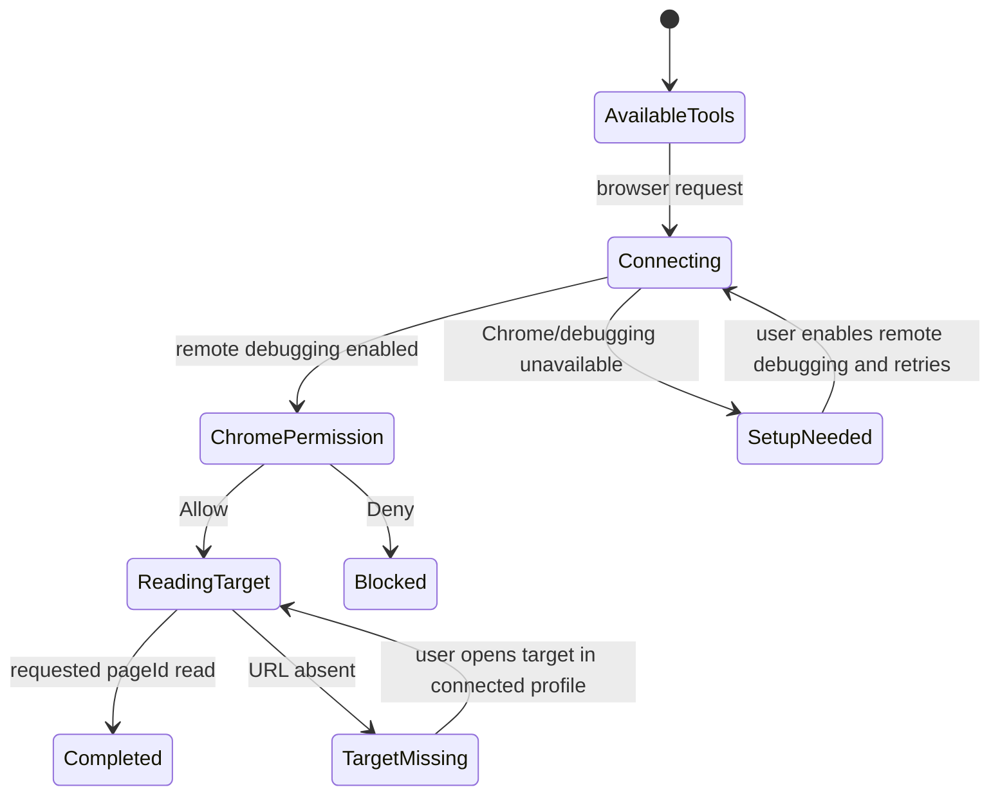

# Codex Chrome access

The person asks Codex to read or work in a specific Chrome tab. GeckIt supplies the official Chrome DevTools MCP without manual Codex setup. It connects to Chrome on the service's machine. Chrome 144+ and explicit browser permission are required.

Entry: ordinary Codex chat, new/resumed/forked. No upfront browser connection or setup dialog on unrelated work. On connection failure explain the returned error and ask the user to open `chrome://inspect/#remote-debugging` in the intended profile, enable remote debugging, and accept Chrome's **Allow** prompt. Do not attempt native control to enable it. Explain that permission covers the connected profile's open windows. Do not promise tab-only access isolation; target-scoped operation is the model's instruction.

On success identify the URL from page listing and read using that pageId; do not bring the page forward or change profiles. Missing target: ask the user to open it in the connected profile, never search unrelated profiles. Denial/cancel: report the blocker and stop dependent browser work; unrelated chat continues. Chrome owns prompt labels, focus and keyboard behavior. GeckIt introduces no new UI, focus changes, scrolling, empty state, notifications or theme differences. Cancel follows existing turn interruption; it does not revoke Chrome permission. Users revoke remote debugging in Chrome.

Validation: tools alone are not a successful connection. Read the actual authorized page through the bundled MCP via app-server, record returned URL and pageId, and distinguish this from mocks. Desktop/standalone launch paths and absent Chrome are covered separately. Platform availability is bounded by official Chrome support; only tested platforms may be called verified.
