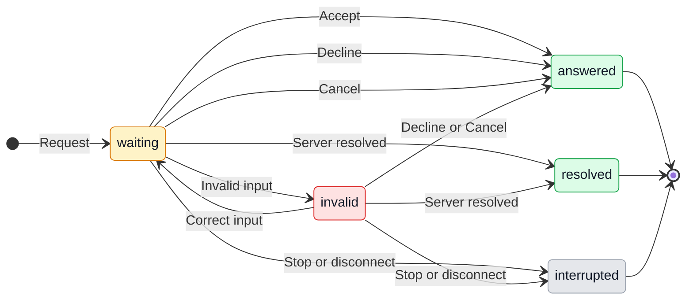

# Codex app permission prompts

## 1. Purpose

GeckIt rejects Codex MCP permission and input requests it does not recognize. The user never sees the requested app approval, even after authorizing the task in chat. Show the request in the conversation and return the user's explicit choice to Codex. Alex requested this implementation after approving the accept, decline and cancel flow.

## 2. Surfaces

| Surface | What appears | When |
|---|---|---|
| Existing conversation approval card, desktop and phone | Request message, requesting server, labeled form fields, Accept, Decline and Cancel | Codex asks for MCP input or approval |
| URL request card | Request message, destination link, Open link, Accept, Decline and Cancel | Approval must be completed at a URL |
| Board and attention state | Existing waiting-for-answer state | A request is unresolved |

Reuse GeckIt's approval cards, controls and theme tokens. This is an addition to the [Codex conversation workflow](codex.md), not a new settings screen.

## 3. States

| State | When | What the user sees | Action |
|---|---|---|---|
| Waiting for form | A supported form arrives | Original request message and labeled fields | Complete fields and choose Accept, Decline or Cancel |
| Invalid form | Required input is missing or invalid | Field constraint; Accept unavailable | Correct input, Decline or Cancel |
| Waiting for URL | A URL request arrives | Original request message and destination | Open link deliberately; choose Accept only after completing the external flow |
| Unsupported form | The form cannot be rendered faithfully | "This form is not supported yet."; Accept unavailable | Decline or Cancel |
| Answered | User sends a valid answer | Existing card resolution behavior | Continue reading |
| Resolved elsewhere | Codex says the request was resolved | Card disappears, automatically | Nothing |
| Interrupted | User stops the turn or the connection closes | Existing interrupted/error state; no actionable stale card | Continue the conversation deliberately |

## 4. Transitions

| From | Event | To | What is shown |
|---|---|---|---|
| Working | Codex sends a request | Waiting | Approval card; existing attention state |
| Waiting | User edits an invalid value | Invalid | Constraint and disabled Accept |
| Invalid | User supplies valid input | Waiting | Accept becomes available |
| Waiting | User chooses Accept | Answered | Card resolves; typed values are returned |
| Waiting or invalid | User chooses Decline | Answered | Card resolves; no form content is returned |
| Waiting or invalid | User chooses Cancel | Answered | Card resolves; no form content is returned |
| Waiting | User chooses Open link | Waiting | Explicit external navigation; no approval is sent |
| Waiting or invalid | Server resolves request, automatically | Resolved | Card disappears; no additional answer is sent |
| Waiting or invalid | Stop or disconnect | Interrupted | Stale prompt stops accepting answers |

## 5. Silence

Transport IDs, JSON schemas, protocol mode names and metadata remain hidden. No JSON editor or toast is added. Opening a link, selecting Auto mode, or writing consent in chat does not automatically submit the form. No persistent app permission is manufactured by GeckIt.

## 6. Timing

No timer or automatic acceptance is added. The server owns the request lifetime. Duplicate input must produce at most one response for the request. Separate simultaneous requests retain separate choices.

## 7. Wording

| Element | Text |
|---|---|
| Request | Server-supplied message, verbatim |
| Server attribution | "Requested by <server name>" |
| Form labels and choices | Supplied title, description and choice labels; property name only when no title exists |
| Positive response | "Accept" |
| Refusal | "Decline" |
| Abandon request | "Cancel" |
| External action | "Open link" |
| Unsupported form | "This form is not supported yet." |
| Empty choice | "Choose..." |
| Boolean choices | "Yes", "No" |
| Invalid submission | "Check the required fields and their limits." |
| Resolved response | "Accepted", "Declined", "Cancelled" |

## 8. Edge cases

- Empty forms are explicit confirmations: Accept returns an empty object.
- Flat text, number, integer, boolean and single/multiple-choice values keep their protocol types. Required fields, defaults and declared constraints must not be silently discarded.
- A shape or constraint the client cannot represent safely makes the form unsupported. Accept stays disabled; the user can still Decline or Cancel.
- Long messages, URLs and many fields wrap and scroll in the existing conversation surface; buttons remain reachable on desktop and phone.
- Tab reaches every control. Labels identify each input. Enter follows ordinary form behavior without granting approval on initial focus; Escape can cancel the active request, never accept it.
- Duplicate responses and late responses after server resolution are ignored. Reloaded transcript history does not recreate a live permission request.
- A URL is never opened automatically. The displayed destination matches the opened destination. Unsupported or unsafe URL schemes have no navigation action.
- Form content is sent only on Accept. Decline and Cancel return no content and preserve their distinct protocol actions.

## 9. Deliberate exclusions

| Excluded | Reason |
|---|---|
| Automatic or persistent app approval | The permission belongs to the user and host, not GeckIt |
| General JSON form editor | Users should answer the request without interpreting schemas |
| App restart or live permission bypass | Existing conversations and host security decisions must be preserved |
| Claim that this fixes every localhost block | The browser failure may have a separate cause |

## 10. Decisions

| Option | Verdict | Reason |
|---|---|---|
| Existing approval card with typed inputs | Use | Keeps questions in the conversation and supports desktop/phone |
| Unsupported request silently rejected | Replace | Hides the decision from the user |
| Generic Accept for unrenderable schemas | Reject | The user cannot inspect what would be submitted |
| External URL opened by explicit action | Use | Opening a page and accepting the request are separate choices |

## 11. Verification

Protocol tests cover supported forms, empty confirmations, typed values, defaults, invalid and unsupported forms, URL requests, accept/decline/cancel, duplicate/late answers and server resolution. Confirm generated protocol types against the installed Codex CLI. Review rendered cards in light/dark at desktop and phone widths, including focus, keyboard, long content and scrolling. Rebuild desktop and phone; report unavailable live access without claiming a successful native app review.

### Source verification, 2026-10-12

Installed Codex CLI 0.159.3 generated types confirm the request modes and response structure. Typecheck, lint, focused protocol/form tests, example-provider tests and desktop/phone builds pass. The exported runtime keeps its existing plugin usage logging.

Rendered desktop light/dark approval cards were inspected in the real Sidebar/Transcript/Composer preview at the browser's default 1690 x 775 viewport. Explicit form acceptance, disabled unsupported-form acceptance, Tab focus and Escape cancellation were checked. Evidence: `/private/tmp/geckit-mcp-approval-review/desktop-light.jpg`.

Phone light/dark forms and URL prompts were reviewed at a measured CSS viewport of 390 x 844. The temporary extension blocker cleared on retry; no popup was visible. Enlarged checkbox labels, fields and Open link to 44 px touch targets after measuring smaller targets. Approval buttons remain 50 px high. Eighteen-field forms scroll to their actions without horizontal overflow. Evidence: `/private/tmp/geckit-mcp-approval-review/phone-dark.jpg` and `phone-light.jpg`. Native GeckIt access still uses the unchanged running backend; no active conversation or app was restarted. Native app integration remains unverified until the backend is rebuilt/reloaded.

Performance review: no new per-conversation scanning, formatter, timer or animation. Existing Transcript/Turn and board memoization remain unchanged; input updates are local to one request. The phone build passed. No additional profiling is required for these local prompt controls.
