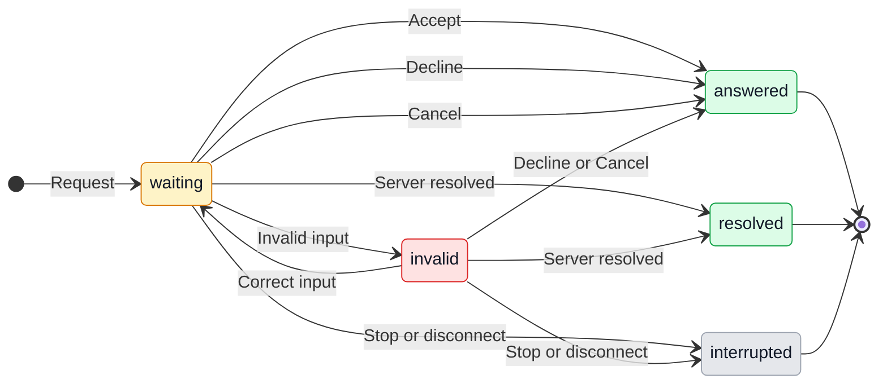
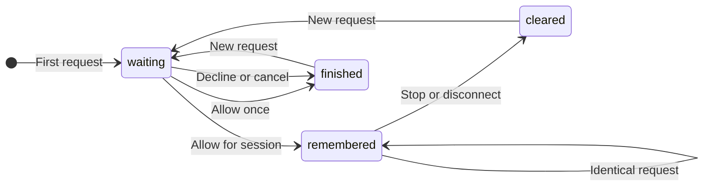

# Codex app permission prompts

## 1. Purpose

GeckIt rejects Codex MCP permission and input requests it does not recognize. The user never sees the requested app approval, even after authorizing the task in chat. Show the request in the conversation and return the user's explicit choice to Codex. Alex requested this implementation after approving the accept, decline and cancel flow.

## 2. Surfaces

| Surface | What appears | When |
|---|---|---|
| Existing conversation approval card, desktop and phone | Request message, requesting server, labeled form fields, Accept, Decline and Cancel | Codex asks for MCP input or approval |
| URL request card | Request message, destination link, Open link, Accept, Decline and Cancel | Approval must be completed at a URL |
| Board and attention state | Existing waiting-for-answer state | A request is unresolved |

Reuse GeckIt's approval cards, controls and theme tokens. This is an addition to the [Codex conversation workflow](codex.md), not a new settings screen.

## 3. States

| State | When | What the user sees | Action |
|---|---|---|---|
| Waiting for form | A supported form arrives | Original request message and labeled fields | Complete fields and choose Accept, Decline or Cancel |
| Invalid form | Required input is missing or invalid | Field constraint; Accept unavailable | Correct input, Decline or Cancel |
| Waiting for URL | A URL request arrives | Original request message and destination | Open link deliberately; choose Accept only after completing the external flow |
| Unsupported form | The form cannot be rendered faithfully | "This form is not supported yet."; Accept unavailable | Decline or Cancel |
| Answered | User sends a valid answer | Existing card resolution behavior | Continue reading |
| Resolved elsewhere | Codex says the request was resolved | Card disappears, automatically | Nothing |
| Interrupted | User stops the turn or the connection closes | Existing interrupted/error state; no actionable stale card | Continue the conversation deliberately |

## 4. Transitions

| From | Event | To | What is shown |
|---|---|---|---|
| Working | Codex sends a request | Waiting | Approval card; existing attention state |
| Waiting | User edits an invalid value | Invalid | Constraint and disabled Accept |
| Invalid | User supplies valid input | Waiting | Accept becomes available |
| Waiting | User chooses Accept | Answered | Card resolves; typed values are returned |
| Waiting or invalid | User chooses Decline | Answered | Card resolves; no form content is returned |
| Waiting or invalid | User chooses Cancel | Answered | Card resolves; no form content is returned |
| Waiting | User chooses Open link | Waiting | Explicit external navigation; no approval is sent |
| Waiting or invalid | Server resolves request, automatically | Resolved | Card disappears; no additional answer is sent |
| Waiting or invalid | Stop or disconnect | Interrupted | Stale prompt stops accepting answers |

## 5. Silence

Transport IDs, JSON schemas, protocol mode names and metadata remain hidden. No JSON editor or toast is added. Opening a link, selecting Auto mode, or writing consent in chat does not automatically submit the form. Cross-conversation app permissions are not persisted. Recognized Computer Use confirmations can be remembered explicitly for one live conversation, as described below.

## 6. Timing

No timer is added. The server owns the request lifetime. Remembered identical Computer Use confirmations are answered automatically for the approved conversation scope below. Duplicate input must produce at most one response for the request. Separate simultaneous requests retain separate choices.

## 7. Wording

| Element | Text |
|---|---|
| Request | Server-supplied message, verbatim |
| Server attribution | "Requested by <server name>" |
| Form labels and choices | Supplied title, description and choice labels; property name only when no title exists |
| Positive response | "Accept" |
| Refusal | "Decline" |
| Abandon request | "Cancel" |
| External action | "Open link" |
| Unsupported form | "This form is not supported yet." |
| Empty choice | "Choose..." |
| Boolean choices | "Yes", "No" |
| Invalid submission | "Check the required fields and their limits." |
| Resolved response | "Accepted", "Declined", "Cancelled" |

## 8. Edge cases

- Empty forms are explicit confirmations: Accept returns an empty object.
- Flat text, number, integer, boolean and single/multiple-choice values keep their protocol types. Required fields, defaults and declared constraints must not be silently discarded.
- A shape or constraint the client cannot represent safely makes the form unsupported. Accept stays disabled; the user can still Decline or Cancel.
- Long messages, URLs and many fields wrap and scroll in the existing conversation surface; buttons remain reachable on desktop and phone.
- Tab reaches every control. Labels identify each input. Enter follows ordinary form behavior without granting approval on initial focus; Escape can cancel the active request, never accept it.
- Duplicate responses and late responses after server resolution are ignored. Reloaded transcript history does not recreate a live permission request.
- A URL is never opened automatically. The displayed destination matches the opened destination. Unsupported or unsafe URL schemes have no navigation action.
- Form content is sent only on Accept. Decline and Cancel return no content and preserve their distinct protocol actions.

## 9. Deliberate exclusions

| Excluded | Reason |
|---|---|
| Automatic approval without an explicit remembered choice, or persistence across conversations | Broader access requires a separate user choice and revocation design |
| General JSON form editor | Users should answer the request without interpreting schemas |
| App restart or live permission bypass | Existing conversations and host security decisions must be preserved |
| Claim that this fixes every localhost block | The browser failure may have a separate cause |

## 10. Decisions

| Option | Verdict | Reason |
|---|---|---|
| Existing approval card with typed inputs | Use | Keeps questions in the conversation and supports desktop/phone |
| Unsupported request silently rejected | Replace | Hides the decision from the user |
| Generic Accept for unrenderable schemas | Reject | The user cannot inspect what would be submitted |
| External URL opened by explicit action | Use | Opening a page and accepting the request are separate choices |

## 11. Verification

Protocol tests cover supported forms, empty confirmations, typed values, defaults, invalid and unsupported forms, URL requests, accept/decline/cancel, duplicate/late answers and server resolution. Confirm generated protocol types against the installed Codex CLI. Review rendered cards in light/dark at desktop and phone widths, including focus, keyboard, long content and scrolling. Rebuild desktop and phone; report unavailable live access without claiming a successful native app review.

### Source verification, 2026-10-12

Installed Codex CLI 0.159.3 generated types confirm the request modes and response structure. Typecheck, lint, focused protocol/form tests, example-provider tests and desktop/phone builds pass. The exported runtime keeps its existing plugin usage logging.

Rendered desktop light/dark approval cards were inspected in the real Sidebar/Transcript/Composer preview at the browser's default 1690 x 775 viewport. Explicit form acceptance, disabled unsupported-form acceptance, Tab focus and Escape cancellation were checked. Evidence: `/private/tmp/geckit-mcp-approval-review/desktop-light.jpg`.

Phone light/dark forms and URL prompts were reviewed at a measured CSS viewport of 390 x 844. The temporary extension blocker cleared on retry; no popup was visible. Enlarged checkbox labels, fields and Open link to 44 px touch targets after measuring smaller targets. Approval buttons remain 50 px high. Eighteen-field forms scroll to their actions without horizontal overflow. Evidence: `/private/tmp/geckit-mcp-approval-review/phone-dark.jpg` and `phone-light.jpg`. Native GeckIt access still uses the unchanged running backend; no active conversation or app was restarted. Native app integration remains unverified until the backend is rebuilt/reloaded.

Performance review: no new per-conversation scanning, formatter, timer or animation. Existing Transcript/Turn and board memoization remain unchanged; input updates are local to one request. The phone build passed. No additional profiling is required for these local prompt controls.

## Revision: remember Computer Use access

Status: implemented in the working tree. Alex approved this conversation-scoped revision on October 14 with "Implement it". Not released or loaded into active conversation drivers.

### Purpose and surfaces

Alex reports more than 100 approval clicks in one session. Computer Use sends repeated app-access confirmations; GeckIt returns one-time acceptance. Auto mode does not remember MCP acceptance. Alex refined the approved design to a direct third action. Recognized Computer Use app-access confirmations show three buttons on desktop and phone: "Decline", "Allow once" and "Allow for this session". The session action grants the existing conversation-scoped remembered choice in one click. Escape still returns Cancel. Other MCP forms retain Cancel, Decline and Accept.

### States and transitions

| State | Trigger | What the user sees | Action |
|---|---|---|---|
| Waiting | First recognized app-access confirmation | Original request and three buttons | Allow once, Allow for this session, Decline or Escape to cancel |
| Remembered | User chooses Allow for this session | Resolved card: "Accepted for this conversation: <request message>" | Continue; Stop clears remembered access |
| Repeated | Identical confirmation arrives with remembered access | Nothing; GeckIt replies automatically | Nothing |
| Cleared | Stop, disconnect, driver replacement or app restart | Existing stopped/error state, or nothing on restart | Approve again when requested |

| From | Event | To | What is shown |
|---|---|---|---|
| Waiting | User chooses Allow for this session | Remembered | "Accepted for this conversation: <request message>" |
| Waiting | User chooses Allow once | Finished | Existing "Accepted: <request message>" |
| Waiting | User chooses Decline or presses Escape | Finished | Existing "Declined" or "Cancelled" resolution |
| Remembered | Identical request arrives, automatically | Remembered | Nothing |
| Remembered | Different app, server, schema or metadata arrives | Waiting for separate request | Separate approval card |
| Remembered | User stops, transport disconnects or driver ends | Cleared | Existing stopped/error state where applicable |
| Cleared | Another confirmation arrives | Waiting | Approval card |

### Silence and lifetime

Remembered repeats produce no card, toast or attention notification. Remembering lasts across turns in one live conversation driver. It expires on Stop, disconnect, driver replacement or app restart; no clock timer or disk persistence is needed. Requests in other conversations require their own approval.

### Wording and edge cases

Use "Decline", "Allow once" and "Allow for this session" for recognized confirmations. Resolved session acceptance remains "Accepted for this conversation: <request message>". All three buttons are reachable by Tab with visible focus; Enter/Space activates only the focused button. Escape cancels without remembering. Generic MCP forms retain Cancel, Decline and Accept. Phone targets follow the existing approval buttons.

Only recognize empty, supported form confirmations from `cua_repl` matching the app-access message shown in Alex's screenshot: `Allow Computer Use to use "<app>"?`. Match the exact server, mode, message, schema and metadata for reuse. Do not infer equivalence from an app name alone. Any changed request asks again. Forms with input, URL authorization, unsupported forms and other MCP servers keep their existing behavior. Decline and Cancel never create a remembered grant. Double-clicks and late answers still produce at most one reply. An already-visible simultaneous request remains independently answerable; remembering applies to subsequent requests.

### Exclusions and decisions

The previous exclusion of persistent app approval remains for cross-conversation and disk persistence. This approved revision changes the exclusion of automatic approval only after a user explicitly remembers one recognized confirmation. It does not disable Codex's action reviewer or grant access to another app.

| Option | Verdict | Reason |
|---|---|---|
| Explicit conversation remembering | Use | Removes identical repeated app-access clicks with a bounded lifetime |
| Remember every Accept automatically | Reject | Accept does not describe a lasting choice |
| Persist across conversations | Exclude from this revision | Requires a revocation surface and storage design |
| Automatically answer arbitrary MCP forms | Reject | Forms can request different decisions or data |

### Requirements and verification

This revision addresses repeated app-access prompts reported on October 14. It is an extension of the existing permission flow. Installed Codex CLI 0.159.3 generated types expose `action`, `content` and `_meta`; they expose no MCP session-accept action. Remembering is owned by GeckIt; the internal remember value is never sent as protocol metadata.

Protocol and form tests verify repeated identical requests, changed apps/server/mode/schema/metadata, conversation isolation, ordinary Accept, Decline/Cancel, Stop/disconnect/end and duplicate responses. The initial review was blocked by browser policy loading failures and cancelled native access. Chrome browser automation recovered for the button refinement. The real renderer preview was then reviewed on desktop and phone in light/dark, including keyboard focus and scrolling; no native app access was requested again. Native repeated Computer Use access remains unverified until the implementation is loaded deliberately without restarting active work.

### Performance review, October 14

No performance problems found in this change. The session button uses the existing controls/CSS and removes checkbox state. Transcript and Turn memoization, unchanged object identity, history pagination and content visibility remain intact. Request matching and serialization run once per incoming permission request, outside renderer keystrokes; remembered lookups use a driver-local Set. No formatter, conversation scan, hover handler, timer or animation was added. No new repeated list, row, hover or animation requires profiling for this control replacement. The phone build is checked because it bundles the shared Chat sources.

Verification results, October 14: 926 tests across 71 files pass, including 105 focused Codex/elicitation cases. Typecheck, direct `eslint src test`, desktop build, phone build and `git diff --check` pass. The new UX Mermaid diagram renders successfully to `/private/tmp/geckit-remember-review/flow.svg`. The initial UI review blockage was resolved for the button refinement; native integration remains unverified.

Button refinement: Alex requested "Maybe 3rd button, allow for this session?". The direct session action replaces the checkbox and preserves the remembered scope, one-time alternative and explicit refusal; cancellation remains available through Escape. This supersedes the earlier checkbox presentation.

Final button verification: the actual ElicitationForm inside the Transcript/Sidebar/Composer preview was inspected in full context in Chrome on desktop (1690 x 775 CSS pixels) and phone (390 x 844), light/dark. All three phone buttons are 50 px high and there is no page horizontal overflow. Session approval then Repeat request increments responses without another card; Allow once and Decline then Repeat request each show a fresh card. Escape cancels, Tab follows Decline -> Allow once -> Allow for this session with visible focus, and a 390 x 400 short viewport scrolls the session action into view. Generic forms retain their original buttons and invalid acceptance stays disabled. Provider/native APIs are preview fixtures; live driver behavior is covered by the protocol tests, and real Mail integration is unverified. Evidence: `/private/tmp/geckit-remember-review/desktop-button-dark.png`, `phone-button-dark.png`, `phone-button-light.png`. Viewport overrides were reset. After refinement, typecheck, changed-file lint, 105 focused tests and desktop/phone builds pass.

Main delivery verification, October 14: isolated snapshot contains only this task's nine files. All 921 tests across 71 files, typecheck, direct source/test lint and desktop/phone builds pass. One initial settings file-watch timeout passed separately and on the full-suite rerun. Earlier 926-test verification included unrelated concurrent checkout changes, excluded from this delivery.

### Correction: match remembered app access, October 17

Alex reports repeatedly choosing "Allow for this session" for GeckIt Local. Live host inspection confirms the answers were accepted: eight remembered keys for the same app differ by per-call identifiers and Computer Use operation names. Exact metadata matching made the existing session action ineffective across operations.

For the recognized Computer Use app-access envelope only, subsequent requests match the same server, mode, original message, supported empty schema, app identifier, risk level and remaining scope metadata. Per-call `callId`, per-turn `x-codex-turn-metadata`, operation `tool_name` and presentation `tool_params_display` do not define app-access scope. This normalization requires the Computer Use connector and MCP approval-kind markers, advertised session persistence, and `tool_params` containing only a nonempty app identifier. Unrecognized envelopes retain exact matching. A changed app identifier, risk level, schema, extra tool parameter or other metadata still requires a separate choice.

This deliberately revises the earlier exact-metadata decision: an operation's diagnostic identity is not a new app-access permission. It preserves the current explicit session action and conversation lifetime; it does not skip the action reviewer, remember Allow once, resolve an already-visible simultaneous request, or persist grants to disk. Requests that match a prior explicit session choice remain silent; materially changed requests show their existing approval card. No new wording, timer or control is introduced.

Verification, October 17: the two regressions fail before the correction and pass after it. The provider test uses recorded Computer Use metadata with a simulated MCP server; it verifies reuse across calls and turns while changed app, risk, schema and scope still ask. All 969 tests across 72 files passed at this snapshot, along with typecheck, focused lint and desktop/mobile builds. No visible controls changed; the prior full-context approval UI review remains applicable.

Runtime delivery: the original live host received only the corrected helper, and its eight existing explicit grants for the reported conversation were normalized to one equivalent app grant without answering pending requests or restarting conversations. A subsequent host restart occurred outside this delivery. Read-only inspection confirms the new host loads the corrected function; this follow-up conversation has no remembered grants or pending requests after the interrupted native check. Session grants intentionally do not survive host restart. Repeated native operation and physical phone confirmation remain unverified; source/protocol checks do not establish that result. No additional phone install, commit or push was performed for this host-side correction.

Main delivery snapshot, October 17: isolated from concurrent mobile-form changes onto current remote main. All 951 tests across 72 files, typecheck, full source/test lint, desktop/mobile builds and whitespace checks pass. This delivery contains only the permission-matching correction, its two test files and this UX record; earlier 969-test results included concurrent work excluded here.
