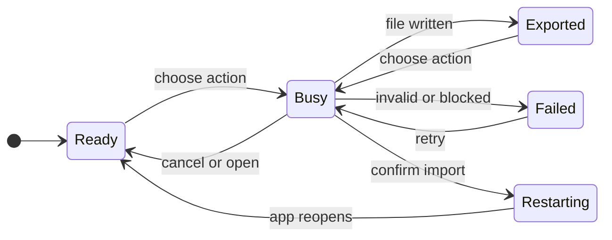

# Configuration access and transfer

## 1. Purpose and journey

Open Settings > General > Configuration to find the shared file, save a portable copy, or restore a copy from another GeckIt installation. The existing Settings layout contains one small action group; no wizard or new navigation section is needed for three independent actions. First use and later transfers follow the same path. A cancelled picker returns to Settings unchanged.

Export is ready when the selected file has been written. Import is ready after GeckIt restarts and loads the replacement configuration. Libraries and assistant programs must already be installed and signed in; imported registrations do not install software or transfer accounts. Active or queued work blocks import so a transfer cannot interrupt accepted work.

## 2. Surfaces

| Surface | Addition | Visibility |
| --- | --- | --- |
| Desktop Settings > General | Configuration heading, scope explanation and three actions | Always |
| System file manager | Select the active settings.json | Open configuration |
| System save/open dialogs | Export destination / JSON source | Export / Import |
| System confirmation | Replacement, backup and restart explanation | Valid import selected |
| Settings status line | Progress, completion or actionable error | After an action |

Phone Settings has no local-file actions: these operate on the host's filesystem and restart its desktop/service. Desktop controls are hidden in phone contexts.

## 3. States

| State | Condition | Visible text | Next action |
| --- | --- | --- | --- |
| Ready | Open General | "Configuration" and action buttons | Choose an action |
| Busy | Native operation pending | "Opening configuration…", "Exporting configuration…" or "Importing configuration…" | Wait; actions disabled |
| Exported | File write completed | "Configuration exported." | Continue or choose another action |
| Cancelled | Picker or confirmation cancelled | No success or error | Choose an action |
| Blocked | Active/queued work | "Finish or stop active and queued work before importing configuration." | Finish work, retry |
| Invalid | Invalid/version-incompatible input | "This file is not a supported GeckIt configuration. Choose an exported settings file." | Choose another file |
| Failed | File/service operation failed | Action-specific error with its reason | Resolve the cause, retry |
| Restarting | Valid replacement accepted and service stopped | "Restarting GeckIt…" until desktop closes | Reopened app loads new settings |

## 4. Transitions

| From | Event | To | Visible result |
| --- | --- | --- | --- |
| Ready/Exported/Failed | Click Open configuration | Busy then Ready automatically | File selected in system file manager |
| Ready/Exported/Failed | Click Export… | Busy | Save dialog |
| Busy | Cancel save/open/confirmation | Ready automatically | No replacement; no success message |
| Busy | Export write succeeds | Exported automatically | "Configuration exported." |
| Ready/Exported/Failed | Click Import… | Busy | Open dialog |
| Busy | Validation fails or work is active | Failed automatically | Reason; existing configuration unchanged |
| Busy | Valid file selected | Busy | Native Import and restart / Cancel confirmation |
| Busy | Confirm Import and restart | Restarting | Original backed up; service stops; desktop relaunches |
| Restarting | Service starts | Ready automatically | New settings, employees and Manager configuration loaded together |

Escape cancels native dialogs. Tab reaches each action with the existing focus treatment; Enter activates the focused action. Settings scrolling and Done/Escape behavior remain unchanged. The busy operation continues safely if Settings is dismissed; duplicate operations are refused in the native adapter.

## 5. Silent states

No message for picker cancellation, internal validation steps, backup creation or ordinary file-manager launch. Success is shown only after the promised write. The existing service connection surface reports startup failures.

## 6. Thresholds and time

No timer or automatic dismissal. Status remains until the next action or the dialog closes. Existing service shutdown timeout is reused rather than adding another restart deadline. No new polling or idle animation.

## 7. Wording

- "Configuration"
- "Preferences, shortcuts, employees, libraries and enabled assistants in one file. Accounts and conversation history stay on this installation."
- "Open configuration", "Export…", "Import…"
- "Export GeckIt configuration", default filename "geckit-settings.json"
- "Import GeckIt configuration"
- "Import configuration and restart GeckIt?"
- "This replaces preferences, shortcuts, employees, library registrations and Manager configuration. A backup of your current configuration will be kept. Accounts and conversation history stay on this installation. Referenced libraries must already be installed and signed in."
- "Import and restart", "Cancel"
- Progress, success and failure wording is listed in section 3.

## 8. Edge cases

Empty and malformed input, wrong format/version or invalid field shapes are rejected before staging. Known installation-only fields are rejected in imported portable files. Missing optional sections use defaults. Exporting into GeckIt’s data folder is refused, including through a symlinked parent folder. Backup or write failures preserve the active original. Cancelling never stages a replacement. A selected file's validated contents are captured for confirmation, so later external edits cannot swap the import. The service rechecks work immediately before accepting import. A pending import is installed only during the next owned service startup, after old owners have exited, preserving local state and backup bytes. Repeated native operations are serialized. Long errors wrap inside the settings page.

## 9. Deliberate omissions

No phone-file transfer, partial-section merge, account transfer, automatic library installation or embedded JSON editor. Users asked to locate/export/import the single configuration; those are separate jobs.

## 10. Decisions

Reveal the active file rather than launch an arbitrary JSON editor, because the request includes finding it and a file manager always exists. Use native pickers and confirmation rather than a custom multi-step flow. Replace and restart rather than updating selected caches in a running service, so every configuration owner sees the same file. This extends the original storage-only design, which deliberately had no controls.

## 11. Requirements

FR-008: find/export from desktop General. FR-009: validate, confirm, back up and import through controlled restart. FR-010: cancel/error/busy feedback, keyboard and light/dark review. Existing FR-001 through FR-007 remain in force. User authorization: "add", following the explicit list of Open configuration, Export and Import controls. Alex approved this flow in the conversation with "approved" on 2026-11-05.

## Prototype and review

[Interactive prototype](../design/configuration-transfer.html) mounts the production Settings dialog and stylesheet with fixture native boundaries. From `client`, run `npx vite --config configuration-review.vite.config.mjs` and open `/docs/design/configuration-transfer.html`. `window.fixture.outcome` selects `success`, `cancel`, `busy`, `blocked`, `invalid` or `error`; `window.fixture.release(true)` finishes a held operation. These fixtures verify renderer interaction and feedback, not native dialog or restart integration. The Mermaid state diagram was rendered successfully with the installed Mermaid CLI on 2026-11-05.
