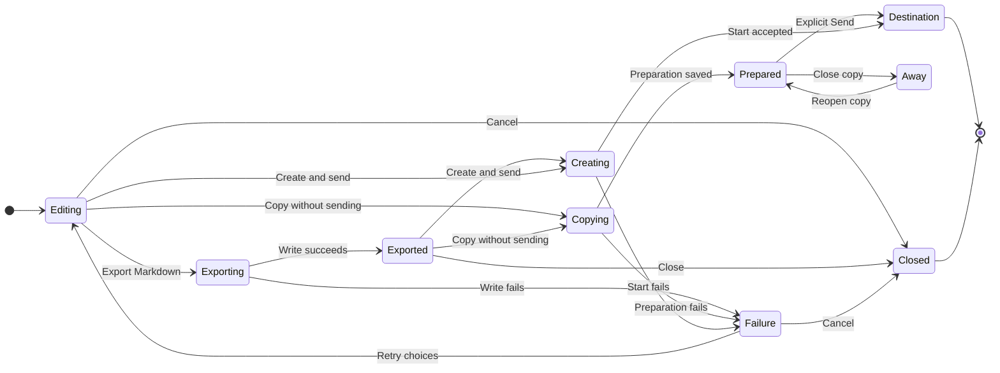

# UX: Conversation export and continuation

## 1. Purpose and journey

From an open conversation, choose "Continue with another model" on desktop or in the phone conversation menu. One dialog explains what is carried forward. Choose assistant, then its model, optionally add the next instruction, and press "Copy without sending". A separate destination opens with an editable initial context draft; no message is sent to the source or destination, no work is queued and no inference starts. Review/edit the draft and explicitly Send when ready. "Create and send" remains an explicit immediate continuation action. "Export Markdown" saves an inspectable file without creating a chat. "Show export" opens that result.

For a prepared copy, ready means a readable snapshot and persistent destination/context draft exist; it does not mean work has started. Closing/reopening or restarting retains the unsent destination, target/model and context. For "Create and send", ready means the existing session service accepted the first message; ordinary queue/guard-blocked status remains visible. Enabled assistants and available models are reused; authentication and VPN rules apply when actually starting work. One independent form fits these choices. Reopening the transfer dialog starts a fresh snapshot; cancellation preserves the source and its draft.

## 2. Surfaces

| Surface | Addition | Visibility |
| --- | --- | --- |
| Desktop composer actions, next to microphone and Send | Branch icon with accessible name and tooltip "Continue with another model" | Existing conversation |
| Phone conversation menu | Same entry | Existing conversation |
| Continuation dialog | Assistant, Model, optional next instruction; export, copy without sending and create-and-send actions | After entry |
| Export result | "Show export" and saved path | After file write |

## 3. States

| State | Condition | Visible content | Action |
| --- | --- | --- | --- |
| Editing | Opened | "Continue with another model" | Choose target or export |
| Loading models | Catalog pending | "Loading models..." | Wait or cancel |
| Exporting | Write pending | "Exporting..." | Wait |
| Exported | Write succeeds | "Show export" | Open file, create or close |
| Creating | Start pending | "Creating conversation..." | Wait |
| Copying | Preparation pending | "Copying conversation..." | Wait |
| Prepared copy | Persistent preparation succeeds | New conversation with editable initial draft | Review/edit and explicitly Send, close, or remove |
| Failure | Read/write/start fails | Actionable error from existing boundary | Retry or cancel |
| Unavailable target | Unsupported host/provider | Explain unsupported target; create disabled | Choose another assistant or export |
| Destination | Session service accepts | New conversation | Continue there |

## 4. Transitions

| From | Event | To | What user sees |
| --- | --- | --- | --- |
| Source | Press entry | Editing | Target form |
| Editing/exported | Press export | Exporting | Pending label; duplicate actions disabled |
| Exporting | Write succeeds, automatically | Exported | Saved file action |
| Editing/exported | Press create | Creating | Pending label; duplicate actions disabled |
| Editing/exported | Press "Copy without sending" | Copying | Pending label; duplicate actions disabled |
| Copying | Persistent preparation succeeds, automatically | Prepared copy | Editable initial draft, selected target/model; no work starts |
| Prepared copy | Close/reopen or restart, automatically | Prepared copy | Same unsent copy and draft; no work starts |
| Prepared copy | Explicitly Send draft | Destination | Existing send/queue/guard state |
| Creating | Service accepts, automatically | Destination | New conversation with context message |
| Pending | Service fails, automatically | Failure | Error with retained choices |
| Failure | Change choices or retry | Editing/pending | Same form |
| Editing/exported/failure | Escape, Cancel or close | Closed | Source chat, focus restored |

During pending work dismissal is held until completion so an invisible operation cannot create an unexpected chat. Phone Back obeys the same rule. Focus enters the dialog, Tab stays within, Escape closes when idle, and closing restores the opener. Long content scrolls within viewport. A focused textarea keeps multiline Enter behavior; form submission uses its button.

## 5. Silent states

Internal snapshot identifiers and remote upload details stay in the export/prompt, not as extra UI status. Source work continues without notifications. No inference request is made to compose the overview.

## 6. Thresholds and time

No new timing thresholds or transcript-length limit. Full available export is never clipped; only the inline overview is bounded. The snapshot is taken at export/copy/create time. A prepared copy retains that snapshot until explicitly sent or removed; later source messages are not silently added. No automatic retries of destination creation, avoiding duplicate chats.

## 7. Exact wording

- Entry/title: "Continue with another model"
- Explanation: "Copy the available history into a new chat. Nothing is sent until you press Send."
- Labels: "Assistant", "Model", "Next instruction (optional)"
- Actions: "Export Markdown", "Copy without sending", "Create and send", "Cancel", "Show export"
- Pending: "Exporting...", "Copying conversation...", "Creating conversation...", "Loading models..."
- Availability note in export: "This export contains history available to GeckIt. Earlier compacted content, hidden model state and unavailable attachment files may be missing."
- Context heading: "Context overview (metadata and excerpts)"

## 8. Edge cases

Empty or unreadable history reports failure rather than inventing a transcript. A streaming conversation is a point-in-time copy; later output remains in the source. Export includes all normalized item kinds, upstream truncation notes, Markdown-safe blocks and available image data/references. Missing originals remain identified references. SSH continuation uploads the snapshot to a host-readable location; failure prevents destination creation. Repeated submit is disabled until settlement. A failure after file writing leaves the export available. Source drafts, queues, active tools and goals are never copied as runnable state.

## 9. Intentionally absent

No raw provider session conversion, hidden reasoning export, active tool replay, goal activation or model-generated summary. Attachment references do not promise copied external files. No account setup or provider installation in this dialog.

## 10. Decisions

Use the same Markdown transfer across providers and models: inspectable and predictable. Existing native queue forks remain available. Choose deterministic overview over an extra inference request: no invented decisions or invisible cost. Use app-owned storage plus existing remote upload over writing project files. User's "Супер. Сделай это" approves the described export/continuation scope; routine UI details use existing patterns.

Follow-up decision, 2026-10-29: copying is a separate preparation action, with no message to either chat and no automatic startup. Keep "Create and send" for the previous immediate behavior; make "Copy without sending" the primary action. This lets the person review the context before starting a model. Preparation must survive restart without joining the work queue. Both action rows wrap on narrow screens; no action may leave the scrollable dialog viewport.

Placement correction, 2026-10-29: Alex marked the right edge of the desktop message composer beside microphone and Send. Move the existing entry out of the header into that action group as a compact branch icon with the same tooltip and accessible name. It opens the same dialog without submitting or changing the draft; dismissing returns focus to this icon. No entry appears for a new unsaved conversation. The phone retains its existing conversation-menu entry.

Dialog design correction, 2026-10-29: the supplied screenshot shows a long explanation, an oversized optional instruction field and four equal-weight footer actions that push the primary button onto another line. Keep the same workflow and labels, shorten the explanation to the exact wording above, and group Assistant/Model before the optional instruction. Show Export Markdown and Create and send as quiet text actions in a separate utility row. Keep Cancel and Copy without sending together in the final action row at desktop and phone widths. The shorter instruction field expands by resizing or scrolling; long errors and saved paths wrap inside the dialog. Keyboard focus uses one clear ring rather than a highlighted border plus a second ring. Pending locks, dismissal, error/retry and focus restoration retain their existing behavior.

## 11. Requirements

FR-001/004/009/010/011/012: sections 1-4/7/10. FR-002/003/005: sections 7-8. FR-006/007: sections 4/8. FR-008: sections 1/5/9. No unresolved scope decisions.
