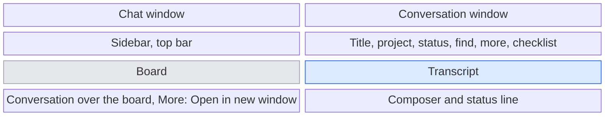
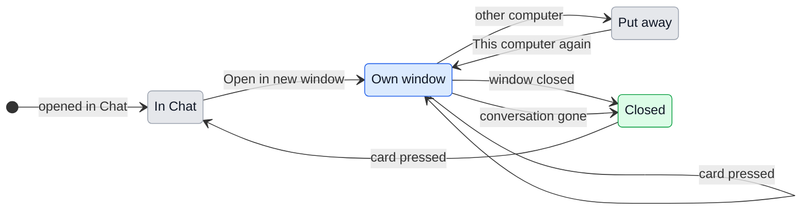

# UX: A conversation in its own window

## 1. Why

Today a conversation can only be read inside the Chat window, over or below the board. A person who keeps a side task on another desktop (or beside an editor) has to bring the whole Chat window there and lose the board they were using. The request came from a user who works with several desktops: "open one conversation in its own window, for a side task".

### Path to the result

- **Entry and result:** from a conversation open in Chat, or from its card on the board, the person chooses "Open in new window". The result is a window holding only that conversation: its header, transcript, composer and status line, which can be moved to any desktop and used as in Chat.
- **Readiness:** nothing to set up. The conversation must be on This computer; on another computer's workspace the item is not offered (section 9).
- **Decisions and order:** one choice, which conversation. Size and place are remembered per window after the person moves it.
- **Shape of the path:** a menu item, as in Safari and Mail ("Open in New Window"). A drag of the card out of the window was considered and rejected (section 10).
- **First launch and return:** windows that were open stay open across a restart of GeckIt and come back where they were. Switching the Chat window to another computer closes them; returning to This computer opens them again where they were.

## 2. What is added

| Surface | What appears | When visible |
|---|---|---|
| Conversation header, More menu (existing) | "Open in new window" | A conversation on This computer is open in Chat |
| Conversation header, icon button (existing header) | "Open in new window" button beside Find, the same action as the More item | The conversation is at least 900 px wide; narrower, only More has it |
| Conversation header, narrow (existing) | As in a macOS toolbar: the title shortens first and the controls keep their size; below 720 px the employee shows only its picture; below 560 px the project and work tags leave the head | Always, by the conversation's width |
| Board card and list row context menu (existing) | "Open in new window" | One card on This computer is targeted (not several) |
| Conversation window (new) | The conversation's header, transcript, composer and status line; no sidebar, board or top bar; no "Back to the board" button | Opened from either item, or reopened by itself |
| Board card (existing) | Pressed while its conversation has its own window: that window comes to the front instead of opening the conversation in Chat | Always while the window exists |

The header in the conversation window is the Chat header without the close button; its More menu keeps "Copy terminal command" and "Refresh" and drops the board items (move in In progress, over or below the board) and "Open in new window".

## 3. States

| State | When it occurs | What the user sees | What to do |
|---|---|---|---|
| In Chat | The conversation is open in the Chat window | Today's conversation over or below the board | Work, or choose "Open in new window" |
| Own window | Chosen "Open in new window" | A new window with the conversation, titled with its name; the Chat window returns to the board | Work in it; close it with the window's close button or Cmd+W |
| Own window, in front again | Pressed its card, chose the item again, or clicked its notification | The existing window comes to the front | Work in it |
| Put away | The Chat window switched to another computer | The conversation windows close | Nothing; they come back on return |
| Reopened | The Chat window shows This computer again, or GeckIt started with windows remembered | The windows open where they were | Work in them |
| Gone | The conversation was deleted, or its folder removed from GeckIt | Its window closes | Nothing |

## 4. Transitions

| From | Event | To | What the user sees |
|---|---|---|---|
| In Chat | Chose "Open in new window" in More | Own window | A new window with the conversation in front; Chat shows the board |
| Board | Chose "Open in new window" on a card | Own window | A new window with the conversation in front; Chat stays on the board |
| Own window | Pressed its card, or chose the item again | Own window | That window comes to the front; nothing opens in Chat |
| Own window | Clicked a system notification of that conversation | Own window | That window comes to the front |
| Own window | Chose another computer in the computer switch, by itself once its workspace shows | Put away | The conversation windows close |
| Put away | Chose This computer, or the Chat window opened again on This computer | Own window | The windows open where they were, behind the Chat window |
| Own window | Closed the window (close button, Cmd+W) | Closed | The window closes; it is not reopened later |
| Own window | Conversation deleted or its folder removed, by itself | Closed | The window closes |
| Own window | Quit GeckIt | Put away | Nothing; at the next start the windows open where they were once Chat shows This computer |
| Own window | The Chat window was closed | Own window | Nothing; the conversation windows stay |
| Closed | Pressed its card | In Chat | The conversation opens in Chat as today |

## 5. What stays silent

| State | Why it is not shown |
|---|---|
| Put away | The person chose the other computer; the windows return by themselves, and a notice would only repeat what they did |
| Reopened | The windows are where they were left; nothing to confirm |
| Gone | The deletion was the person's own action in Chat or the CLI; the board already shows it |
| Which conversations have their own window, on the board | Pressing the card answers it by bringing the window forward; a mark on every card would add noise for a rare state |

## 6. Thresholds and time

Not applicable, because nothing waits or counts: windows open, close and come back on the person's own actions. Default size of a new conversation window is 760 by 760: the Chat window's minimum width, so the header fits without wrapping, and square enough for a side column on a laptop screen.

| Number | Value | Why |
|---|---|---|
| New window size | 760 x 760 | Chat's minimum width keeps the header on one line |
| Windows at once | No limit | Each is a conversation the person opened; the conversation queue already limits what works at once |
| Pop-out button shown from | 900 px | Below it the head has no room left beside Status, Find, More and Checklist without shortening the title to a few letters |
| Employee label hidden below | 720 px | The width at which the title would drop below about 20 characters |
| Project and tags hidden below | 560 px | Below it the title and the controls alone fill the head |

## 7. Wording

| State | Text |
|---|---|
| Menu item, More and card menu | "Open in new window" |
| Window title | The conversation's name, as on its card |

## 8. Edge cases

- **Empty:** a conversation with no messages yet (unborn) still opens; its window shows today's empty conversation.
- **Everything at once:** many windows put away and reopened together; each comes back in its own place. Several cards picked: the item is not in the menu for several, as Rename is not.
- **Connection lost:** the service disconnects; each window shows the same notice the Chat window shows and recovers with it.
- **Repeat:** choosing the item twice, or for a conversation that already has a window, brings that window forward; there is never a second window for one conversation, so two composers never write to one conversation.
- **Stale copy:** a window reopened after a restart reads the conversation afresh, as Chat does.
- **Off screen:** a remembered place on a screen no longer attached is dropped and the window opens at the default place, as the Chat window does.
- **Profile switch:** a conversation whose project the profile no longer shows is treated as Gone and its window closes; pressing it later from another profile opens it in Chat.

## 9. What is deliberately absent

| Not doing | Why |
|---|---|
| Conversation windows for another computer's conversations | Alex chose This computer first (2026-11-23). Each such window would need its own connection to that computer; a later step |
| A board or sidebar in the conversation window | Its point is one conversation on another desktop; the board stays in Chat |
| A mark on cards whose conversation has its own window | See section 5 |
| A keyboard shortcut | Rare action; the menu item is enough until asked |
| An overflow (>>) menu for header items that do not fit | The items that go are information (project, tags) or keep their control (employee picture); the window title and Chat still show the project |
| Opening the conversation in Chat and its window at the same time | Two composers and two read marks for one conversation |

## 10. Forks

### What the Chat window shows after "Open in new window"

| Option | Verdict |
|---|---|
| Returns to the board | Yes |
| Keeps showing the conversation | No |

**Why:** the conversation moved; keeping it in both places makes two composers for one conversation.

### Switching computer: close or hide the windows

| Option | Verdict |
|---|---|
| Close them and reopen on return | Yes |
| Hide them and show them on return | No |
| Leave them open | No |

**Why:** Alex asked for them to close and come back on return. Closing frees their memory while another computer is in use; reopening reads the conversation afresh, so nothing is stale.

### How a conversation gets its window

| Option | Verdict |
|---|---|
| Menu item in More and the card menu | Yes |
| Drag the card out of the window | No |

**Why:** a menu item is the macOS convention (Safari, Mail, Finder) and is found in the menus people already open; dragging out has no visible hint and Electron cannot tell a drag outside its window from a dropped one reliably.

## 11. Reconciliation with requirements

| Requirement | Where closed |
|---|---|
| Open a conversation in a separate window | Sections 2, 3 |
| Switching computer closes the extra windows | Sections 3, 4 (Put away) |
| Returning reopens them | Sections 3, 4 (Reopened) |

**What the requirements lack:** that windows survive a restart (decided yes, section 4), and what happens to a deleted conversation's window (closes, section 3).

### Apple design standard

- Menu item named for its result, in the existing sentence case of GeckIt's menus: met.
- Standard window controls: the window has its own close, minimize and full screen; Cmd+W closes it: met.
- No modal or confirmation for a reversible action: met; closing a window loses nothing.
- Restoring windows where they were left: met.
- Accessibility: the window title is the conversation's name, so VoiceOver and the window switcher read it: met.
