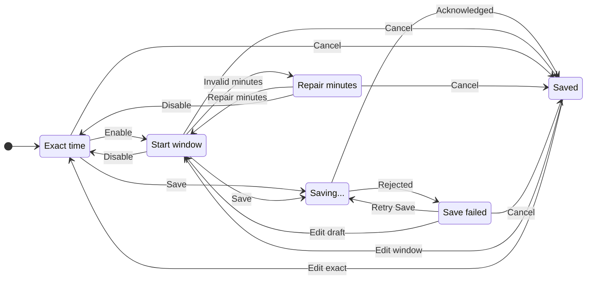

# UX: Random start window for CRON shortcuts

## 1. Purpose and journey

Scheduled shortcuts currently start at the same minute on each occurrence. Let the person choose a window in which each occurrence starts once at a different, randomly selected time.

Open Shortcuts on desktop or phone, edit a scheduled shortcut, enable "Vary start time", enter the window in minutes and press Save. The existing schedule supplies the start of the window: 09:00 with 60 minutes means one start between 09:00 and 10:00. Opening or cancelling the editor does not change the saved schedule. Reopening retains the chosen window; changing it requires Save. Keep these independent controls in the existing schedule group, without another dialog or setup step.

Saving means the host acknowledged the window and it is retained with the shortcut. Running still requires GeckIt to be open, the assistant to be available, the employee to be active and capacity in the existing conversation queue. Phone times use the scheduling computer's local time. Existing schedules keep exact timing until explicitly changed.

## 2. Surfaces and layout

| Surface | Addition | Visibility |
| --- | --- | --- |
| Desktop shortcut editor | "Vary start time" checkbox, then "Within" numeric input and "minutes after scheduled time" | CRON or named CRON schedule selected |
| Phone shortcut editor | Same setting using existing grouped rows and switch | CRON or named CRON schedule selected |
| Desktop and phone shortcut list | Window summary beside the schedule, and next chosen start | Saved window enabled |
| Existing schedule group | Schedule, start window, timetable switch, summary | Existing editor entry point |

Layout uses the existing editors and their controls. A separate layout diagram is unnecessary for two controls inside the existing schedule group; [calendar recurrence design](../design/calendar-recurrence.html) remains the surrounding layout reference.

## 3. States

| State | Trigger | Visible wording | Person's action |
| --- | --- | --- | --- |
| Exact | Window disabled | "Vary start time" unchecked | Enable or leave exact timing |
| Window | Window enabled | "Within {N} minutes after scheduled time" | Edit N or Save |
| Invalid | Empty, fractional or out-of-range N | "Enter a whole number from 1 to 1,440." | Repair N; Save disabled |
| Saving | Press Save | "Saving..." | Wait |
| Failed | Host rejects or does not retain window | "Couldn't save the shortcut. Try again." | Retry or cancel; draft retained |
| Saved | Host acknowledges | "Random start within {N} minutes"; "Next {date and time}" | Optionally edit, pause or run manually |

## 4. Transitions

| From | Event | To | Visible result |
| --- | --- | --- | --- |
| Exact | Enable "Vary start time" | Window | Editable default of 30 minutes |
| Window | Clear minutes or enter invalid value | Invalid | Inline repair message; Save disabled |
| Invalid | Enter valid minutes | Window | Error clears |
| Window / Invalid | Disable setting | Exact | Numeric control disappears; exact timing restored in draft |
| Exact / Window | Press Save | Saving | "Saving..." |
| Saving | Host acknowledges automatically | Saved | Updated schedule and next start |
| Saving | Host rejects automatically | Failed | Existing error; all draft fields retained |
| Failed | Press Save | Saving | "Saving..." |
| Failed | Edit draft | Window / Exact | Error clears |
| Any draft | Cancel or Escape | Saved | Prior saved configuration retained |
| Saved | Chosen time arrives automatically | Saved | Existing run/queue state; next occurrence receives another chosen time |
| Saved | Pause, resume, manual Run or employee archive | Saved | Existing shortcut semantics retained |

Tab reaches switch and numeric input in visual order, Space toggles the switch, existing Save shortcut submits a valid draft and Escape cancels. Controls remain reachable in the existing scrolling editor on narrow viewports.

## 5. What stays silent

| Internal event | Reason |
| --- | --- |
| Choosing the next random time | Show the resulting next time instead of a new notification |
| Scheduler poll | Existing 20-second polling behavior |
| Coincidentally repeated random minute | Random selection can repeat; no uniqueness promise |

## 6. Thresholds and time

| Value | Rule | Reason |
| --- | --- | --- |
| Default off | Preserve exact timing for every existing shortcut | Avoid silently changing working schedules |
| Default 30 minutes | Proposed when enabled; editable before Save | Useful visible variation without shifting a morning task by hours |
| 1–1,440 minutes | Positive whole minutes; maximum one day | Cover hourly/daily windows while bounding schedule lookups |
| One run per occurrence | Choose a minute within the window; do not reroll on polling, editing unrelated fields or app restart | Prevent drift and repeated launches |
| Next CRON occurrence | End a window before the next occurrence if it comes sooner | Prevent adjacent occurrences from overlapping or running out of order |
| Poll up to 20 seconds | Retain existing scheduling tolerance after the chosen minute | Avoid a new timer subsystem |

For an active open app, chosen minutes are inside the window; normal polling and the existing conversation queue may delay execution. Closing/sleeping retains existing one-run catch-up behavior: a missed window can run once on return. Pausing/resuming or changing the timetable starts from future occurrences; manual runs do not consume the scheduled occurrence. Calendar Custom recurrence keeps its existing exact-time behavior in this change.

## 7. Exact wording

| Element | Text |
| --- | --- |
| Setting | "Vary start time" |
| Minutes | "Within" / "minutes after scheduled time" |
| Explanation | "One random start per occurrence, before the next scheduled time." |
| List summary | "Random start within {N} minutes" |
| Validation | "Enter a whole number from 1 to 1,440." |
| Save failure | "Couldn't save the shortcut. Try again." |

## 8. Edge cases

- Invalid/empty input remains editable; do not silently replace it with a default.
- The host validates the incoming window and refuses malformed stored windows for automatic execution.
- A host that does not support the window must not silently save an exact schedule: refuse before sending when support is absent and verify the returned window after sending.
- Unrelated edits preserve the pending chosen time and schedule progress; deleted shortcuts are not recreated by stale saves.
- Every-minute and overlapping schedules stay within the available interval before the next occurrence; variation may be limited by that interval.
- Daylight-saving and local-time handling retain the existing CRON rules. A window may pass midnight; changing the time zone follows existing local scheduling behavior.
- Switching to manual or Custom recurrence removes the CRON-only window from the saved draft. Cancelling restores the prior saved window.
- Assistant unavailable, busy previous conversation, archived employee, save failure and queue capacity retain existing behavior. A timed occurrence is consumed before launching, as today.

## 9. Intentionally absent

| Excluded | Reason |
| --- | --- |
| Runs while GeckIt is closed | Existing scheduler remains the owner |
| Automatic modification of existing schedules | Person chooses which shortcuts vary |
| Guaranteed unique minute on consecutive runs | Random choices can coincide |
| Random calendar recurrence | Request concerns CRON schedules |

## 10. Decisions

| Alternative | Verdict |
| --- | --- |
| Window after each CRON time | Approved: keep existing CRON dates and add one duration |
| Separate start/end wall-clock times | Not included: the approved duration uses the existing CRON time as the start |

Alex instructed "Реализуй" on 2026-11-01 after receiving the duration-window proposal. Implementation is authorized with the existing CRON time as the beginning of the window.

## 11. Requirements check

| Request | Coverage |
| --- | --- |
| Start within a specified range | Sections 1, 3, 6 |
| Vary start time between occurrences | Sections 3, 5, 6 |
| Preserve existing CRON work | Sections 6, 8, 9 |
| Desktop/phone behavior and save acknowledgment | Sections 2, 4, 8 |

This extends [calendar recurrence](calendar-recurrence.md). No new calendar rule or provider behavior is introduced.
