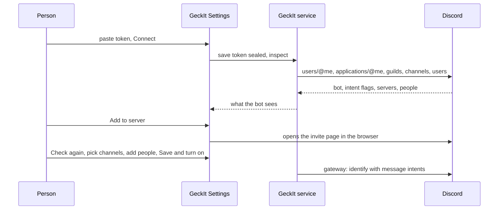
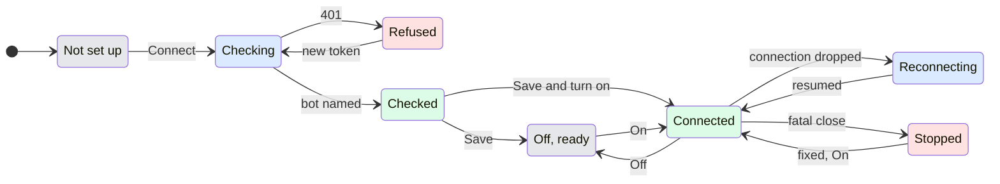

# Discord channel

## Why

People who work in Discord could not reach GeckIt's Manager from there. Telegram and Slack could; Discord had no channel, and a channel library from GitHub would have to reinvent the token storage, allow list, threads and questions that Slack already has. Discord now comes with GeckIt, on the same channel contract as Slack, with a guided setup because a Discord bot needs four things in the right order: a token, a server, the people allowed, and Manager.

## The path

The result the person came for: write to the bot in Discord and get Manager's answer in the same thread.

Ready means all of these are true, and Set up says which are not:

1. The token is checked, not only saved: Discord answered with the bot's name. A pasted token is checked first and saved only when Discord accepts it, so a refused one never replaces a working token; a saved one that stops working shows the refused state until a new one is pasted.
2. Message Content Intent is on for the bot. Without it Discord sends the bot only mentions and direct messages, so follow-ups in its threads would be lost.
3. The bot is in at least one server, or direct messages are on.
4. At least one person is allowed, and each allowed ID is a real Discord user.
5. The channel may talk to Manager.

The form is four steps on one rail, inside the Discord row's Set up. A wizard of pages was rejected: the steps are short and a person changing a working setup must see everything at once. Plain fields were rejected too: steps 2 and 3 depend on the token, and a list of fields would not say why a server list is empty.

| Step | Main question | Next action | Waits for |
| --- | --- | --- | --- |
| 1 Connect the bot | Which bot? | Paste the token, Connect | nothing |
| 2 Choose where it answers | Which servers and channels? | Add to server, or pick channels | a checked token |
| 3 Choose who may write | Who may use it? | Add a Discord user ID | nothing; names show once the token is checked |
| 4 Choose what it may reach | May it talk to Manager? | Tick May talk to Manager | nothing |

The footer's main button is "Save and turn on" when Discord is off and everything above is ready, otherwise "Save". Saving never turns it on by itself.

## What is added

| Surface | What appears |
| --- | --- |
| Settings, Channels, list | A Discord row after Slack, with the Discord icon, its state line, "On" and "Set up". No Remove: it is built in. |
| Settings, Channels, intro | "Telegram, Slack and Discord come with GeckIt; add others from GitHub." |
| Discord row, Set up | The four steps, then Cancel and Save or Save and turn on. |
| Discord | The bot's thread per mention, its answers, one status message per stretch of work, questions with buttons. |
| `client/src/main/channels/discord.ts` | The channel; `client/src/renderer/src/ui/DiscordSetup.tsx` is the setup. |

## States

### The row

| State | When | Line | What to do |
| --- | --- | --- | --- |
| Not set up | no token saved | "Not set up" | Set up |
| Off | token saved, off | "Off" and the thread count | turn On |
| Unfinished | on, a required setting empty | "Finish setting up: People who may write." | Set up |
| Connecting | starting | "Connecting…" | wait |
| Reconnecting | the connection dropped | "Reconnecting to Discord…" | wait; it resumes by itself |
| Connected | Discord said Ready | "Connected as GeckIt Bot · 2 threads" | nothing |
| Stopped | Discord refused for good | "Stopped: " and the first sentence of the reason, in the danger colour; Set up opens with the whole reason and its fix above step 1 | fix what it says, turn On again |

### Step 1

| State | When | Shows | What to do |
| --- | --- | --- | --- |
| Empty | no token | the lead, "Open Developer Portal", the token field and Connect | paste the token |
| Checking a new token | after Connect | "Checking…" on the button | wait |
| Refused | Discord answered 401 | "Discord did not accept this token. Reset it in the Developer Portal and paste the new one." A pasted token is not saved; a saved one that worked stays until a new one is accepted. | paste a new one |
| Checking the saved token | Set up opened with a saved token | "Checking the saved token…" with Replace token | wait |
| Unreachable | the check failed | "Could not check with Discord: " the reason, and Try again | Try again |
| Checked | Discord named the bot | the bot's picture or initial, its name, "Token checked", Replace token | nothing |
| Intent off | checked, Message Content Intent off | a warning: "Message Content Intent is off, so the bot cannot read follow-ups in its threads. Turn it on under Bot, Privileged Gateway Intents." with Open Bot settings and Check again | turn it on, Check again |

The step mark is a tick only when the token is checked and the intent is on.

### Step 2

| State | When | Shows | What to do |
| --- | --- | --- | --- |
| Waiting | token not checked | "Connect the bot first." greyed | step 1 |
| No server | the bot is in none | "The bot is not in a server yet. Add it to one you manage; Discord asks which." with Add to server and Check again | Add to server, then Check again |
| Every channel | default | the servers, "Every channel it can see" chosen | nothing |
| Chosen channels | "Only the channels I choose" | each server's text, announcement and forum channels as ticks | tick at least one |
| A server it cannot read | Discord refused its channel list | "Cannot list its channels" beside the server | give the bot View Channels |

Answer direct messages is a tick under the servers, on at first.

### Step 3

| State | When | Shows |
| --- | --- | --- |
| Nobody | no IDs | "Nobody yet. The bot answers only the people listed here." |
| Found | Discord knows the ID | picture or initial, name, @handle, a remove button |
| A bot | the ID is a bot | "A bot. Bots are never answered." |
| Unknown | Discord has no such user | the ID and "Discord has no user with this ID" in the danger colour |
| Not checked | no checked token | the ID and "Not checked yet" |
| Not an ID | typed text is not 15 to 22 digits | "That is not a Discord user ID. It is a long number, such as 301234567890123456." |

A pasted mention such as `<@301234567890123456>` is read as its ID.

### Step 4

May talk to Manager, and under More the folders and the token check. With it off: "Without it the bot only says Manager is not available."

## Transitions

| From | Event | To | What the person sees |
| --- | --- | --- | --- |
| Not set up | pressed Connect with a token | Checking | "Checking…" on the button |
| Checking | Discord answered 401 | Refused | the refused message; the field empties for a new token |
| Checking | Discord named the bot | Checked | the bot's name; steps 2 and 3 fill in |
| Checking | network or Discord error | Not set up | "Could not check with Discord: " and Try again |
| Checked | pressed Replace token | Not set up | the token field, with Cancel back to Checked |
| Checked | pressed Save | Off, ready | Set up closes, the row says "Off" |
| Checked | pressed Save and turn on | Connected | Set up closes, the row says "Connecting…" then "Connected as …" |
| Off, ready | ticked On | Connected | "Connecting…", then "Connected as …" |
| Connected | the gateway closed with a code Discord allows to resume, by itself | Reconnecting | "Reconnecting to Discord…" |
| Reconnecting | Discord said Resumed, by itself | Connected | "Connected as …"; missed messages arrive once |
| Connected | the gateway closed with 4004, 4010 to 4014, by itself | Stopped | "Stopped: " and the fix |
| Stopped | the person fixed it and ticked On again | Connected | as above |
| Connected | unticked On | Off, ready | "Off" |
| any open Set up | Escape or Cancel | the row | Set up closes, nothing saved, focus back on Set up |

## In Discord

- A mention of the bot in a channel starts a Discord thread on that message, named after its first line, and that thread is its own Manager thread. Later messages in the thread need no mention.
- A mention inside a thread the bot did not start makes that thread its own Manager thread, and Manager first reads what was written there before.
- Each direct message channel is its own Manager thread.
- Manager's answers, the status message and questions go to the thread or direct message they belong to. No mention in them notifies anyone: every message is sent with mentions off.
- A question with up to 25 choices comes with buttons, the first one primary; it also says the values that can be typed instead. A button works only for someone allowed, only on the message that asked it, only in its thread and only while it is open. Anyone else gets "This question is no longer open." or "You are not on the list of people who may use this bot.", seen only by them. After an answer the buttons are removed and the message says who chose what. A question answered in GeckIt loses its buttons in Discord and says "Answered."
- File/photo handling is extended by [channel attachments](channel-attachments.md): retained bytes and native image input, shared worker handoff, and explicit same-thread artifact delivery with a receipt. See that document for the implementation and verification boundary.

## What stays silent

- Messages in channels without a mention, and in threads the bot has not joined, are not answered and not read.
- People not allowed who write in a known thread without a mention are not answered; their words reach Manager only as earlier context when an allowed person writes next.
- Other bots and webhooks are never answered, to avoid loops.
- A repeated or replayed gateway event, and a message older than the last one passed on in that thread, are dropped without a word.
- The bot's ID, application ID and invite link are not shown: Add to server and Open Bot settings use them.
- Reconnecting is shown on the row only; Discord itself shows the bot offline.

## Numbers

| Number | Why |
| --- | --- |
| 2000 characters per message | Discord's limit; longer answers are cut at a line break into several messages. |
| 25 buttons | Discord allows 5 rows of 5. More choices are offered as typed values only. |
| 80 characters per button label | Discord's limit. |
| Thread names up to 90 characters | Discord allows 100; the cut leaves room and reads as a title. |
| Threads archive after 1 day of quiet | Discord's 1440 minutes, the default people know. |
| 100 earlier messages | one page of Discord's history; more would slow every first reply. |
| 30 000 characters of earlier context | the same as Slack, so Manager is not flooded. |
| Reconnect after 1 s, doubling to 30 s | fast after a blip, gentle when Discord is down. |
| Up to 3 waits on a rate limit, each up to 60 s | Discord says how long to wait; a longer wait is reported instead. |
| 25 servers and 50 people checked in Set up | keeps a check under a few seconds. |

## Edge cases

- Saved token revoked in the Developer Portal: Set up shows the refused state and asks for a new one; the row shows Stopped after the next connect.
- Bot removed from every server: step 2 shows No server; direct messages still work if on.
- The bot cannot create threads in a channel: it answers the mention there with "I could not start a thread for this: " Discord's reason, and which permissions to give.
- Chosen channels exclude the place of a mention: "This bot does not answer in this channel. Choose it in GeckIt, Settings, Channels, Discord."
- Direct messages off: "Direct messages are off for this bot. Mention it in a server channel instead."
- A token pasted into a message: refused, and Manager never sees it.
- Manager off or not allowed: "Manager is not available to Discord. Allow it in GeckIt, Settings, Channels, Discord."
- History cleared or the thread deleted in GeckIt: open questions there lose their buttons and say "This question was cleared in GeckIt."; older Discord messages are not sent again.
- Restart of GeckIt: known threads, open questions and the last message seen are kept, so nothing is answered twice.

## What is deliberately not there

- No slash commands and no second Manager: Discord talks to the same Manager threads as Slack, through the same channel contract.
- File contents and explicit output now follow the shared [channel attachment contract](channel-attachments.md); no separate Discord attachment system.
- No member picker: listing a server's members needs the privileged Server Members Intent; IDs are pasted instead.
- No setting of server permissions or roles from GeckIt: the invite asks Discord for View Channels, Send Messages, Read Message History, Create Public Threads, Send Messages in Threads and Attach Files, and the server's owner decides.
- No Discord on the phone: channels are set up on the computer that runs them, as Slack.

## Decisions

| Question | Verdict | Why |
| --- | --- | --- |
| Built in, or a channel library from GitHub | Built in | Slack is built in; Discord needs the same sealed secret, allow list and Manager threads, and a setup flow libraries cannot draw. |
| One Manager thread per Discord channel, or per thread | Per thread and per direct message | the same as Slack threads; a busy channel would mix unrelated work. |
| Buttons or typed answers | Both | buttons are native and bound to the message; typed values keep working where buttons cannot be shown. |
| Check the token before saving | Checked first, saved sealed only when accepted | saving first and forgetting a refused token would wipe a working token when a replacement is mistyped. The pasted token goes to the service once, with the check, the same way Save sends it, is used for that one check and is never stored or sent back to the window. |

## Requirements

Covers Alex's request of 2026-11-07: Discord as a place to talk to Manager and worker sessions with Telegram and Slack parity, and the addendum asking for a designed setup with onboarding, server and channel choice, allowed people and visible connection states. Not covered: live Discord, which needs Alex's own bot and server.
