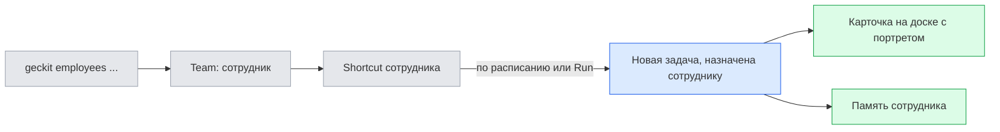
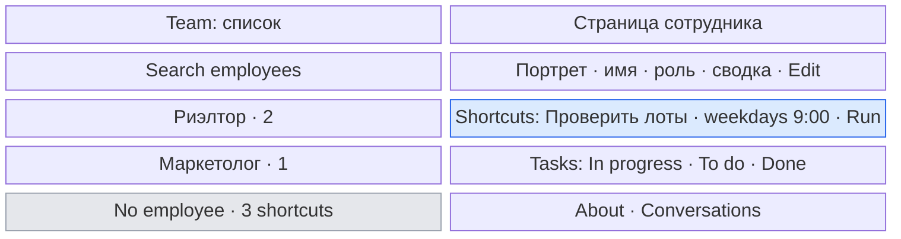
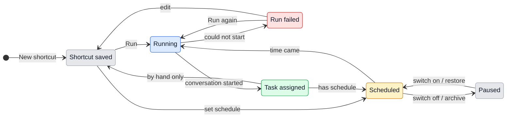

# UX: команда, обязанности сотрудников и назначение с карточки

Продолжение [UX сотрудников](employees.md). Английские строки ниже - текст интерфейса GeckIt, русский объясняет поведение. Запрос Alex от 2026-11-01: проверить, как карточка показывает сотрудника, дать выбирать назначение с карточки, найти лучшее место назначения в открытом чате, привязать к сотрудникам Shortcuts (быстрые задачи и задачи по расписанию), вынести сотрудников из Settings и сделать всё это доступным через CLI.

## 1. Зачем

Сотрудник сейчас - это роль в Settings и портрет на карточке. Его постоянная работа (что он делает по расписанию и что ему поручают одной кнопкой) живёт отдельно, общим списком Shortcuts под молнией, где задачи риэлтора, маркетолога и архитектора перемешаны. Нельзя открыть сотрудника и увидеть «этим он занимается, это он делает по утрам, вот его текущие задачи». Назначение с доски невозможно: карточка показывает портрет, но не даёт его сменить, а в открытом чате выбор сотрудника занимает два элемента (выбор и отдельная иконка просмотра). Ассистент через CLI может только читать сотрудников, но не может завести сотрудника, назначить задачу или добавить обязанность.

### Путь до результата

- **Вход и результат:** кнопка Team в верхней панели доски открывает страницу команды. Alex создаёт «Риэлтор» с описанием работы, добавляет ему обязанности: «Проверить новые лоты» каждый будний день в 9:00 и «Разобрать лот» по кнопке. В 9:00 появляется задача, уже назначенная риэлтору, с его портретом на карточке. Открыв риэлтора, Alex видит обязанности, ближайший запуск и все задачи.
- **Готовность:** сотрудник готов после сохранения имени. Обязанность готова после сохранения названия, папки и текста; расписание необязательно. Обязанность по расписанию работает, пока GeckIt открыт, как и сейчас; это написано у расписания.
- **Решения и порядок:** имя и роль; описание; обязанности - по одной, каждая со своим расписанием или без. Ассистент, модель и режим обязанности выбираются так же, как у Shortcut сейчас; по умолчанию - как в папке.
- **Форма пути:** одна страница сотрудника, разделы друг под другом в порядке важности: Shortcuts, Tasks, About, Conversations. Мастер не нужен: поля независимы, обязанности добавляются по одной в любой момент. Вкладки отклонены: обязанности и задачи нужно видеть одновременно, чтобы понять, чем сотрудник занят.
- **Первый запуск и возврат:** пустая команда объясняет, что такое сотрудник, и предлагает New employee. Существующие Shortcuts без владельца не теряются: они в строке No employee той же страницы, и любой можно передать сотруднику. Закрытие страницы с несохранёнными правками спрашивает Discard changes / Keep editing.
- **Изменение работающей настройки:** смена расписания или владельца обязанности действует со следующего запуска; уже запущенная задача остаётся у того, кому была назначена. Архивирование сотрудника ставит его расписания на паузу, восстановление их возобновляет.



## 2. Что добавляется

| Поверхность | Что появляется | Когда видно |
| --- | --- | --- |
| Верхняя панель доски и списка | Кнопка Team рядом с молнией Shortcuts | Всегда |
| Страница Team (вместо доски в окне Chat) | Слева: поиск, сотрудники с портретом, ролью, числом открытых задач и отметкой работы; внизу No employee и Show archived. Справа: страница выбранного; New employee вверху. Back возвращает доску | Team открыта |
| Страница сотрудника | Шапка: портрет, имя, роль, сводка ("1 working · 2 in progress · 3 shortcuts"), Edit, меню More (Archive / Restore). Разделы: Shortcuts, Tasks, About, Conversations | Выбран сотрудник |
| Раздел Shortcuts сотрудника | Строки: название, расписание или "By hand", "Next ..." / "Paused", Run, переключатель расписания; нажатие на строку редактирует. New shortcut с этим сотрудником | Всегда; пустой - с объяснением |
| Строка No employee | Shortcuts без владельца; у каждого действие Give to... | Есть такие Shortcuts |
| Редактор Shortcut (существующий) | Поле Employee рядом с папкой; None - без владельца | Всегда |
| Меню молнии и меню в строке меню macOS | Shortcuts сгруппированы по сотрудникам: заголовок с портретом и именем, затем No employee | Есть Shortcuts |
| Карточка задачи на доске | Портрет внизу справа становится кнопкой: меню назначения. У неназначенной карточки место пустое и при наведении показывает бледный значок "Assign employee" | Обычные задачи; не Manager и не вопросы |
| Строка списка задач | То же меню по нажатию на портрет | Как у карточки |
| Заголовок открытого чата | Один элемент вместо двух: портрет и имя (или бледное "No employee"), меню: сотрудники с поиском, None, "Open <имя> in Team" (без сотрудника - "Open Team") | Обычные сессии |
| Телефон | Карточка: Employee... в меню долгого нажатия. Заголовок чата: та же строка, что сейчас, открывает лист выбора. Settings > Team: страница команды только для чтения и Run | Всегда |
| Settings | Раздел Employees убран. Manage employees во всех выборах открывает Team | - |
| CLI `geckit employees` | Запись: create, edit, archive, restore, assign; обязанности: shortcuts, shortcut add / edit / pause / resume / remove / give / run; чтение: tasks | Всегда |



### Почему назначение в чате в заголовке

Сотрудник - свойство задачи целиком, как папка и статус, поэтому он стоит в заголовке рядом с названием и папкой, а не в строке под полем ввода: там настройки следующего сообщения (ассистент, режим, модель), которые меняются от хода к ходу. Два элемента (выбор и иконка просмотра) сливаются в один: портрет с именем открывает меню, где и выбор, и View employee.

## 3. Состояния

| Состояние | Когда наступает | Что видит пользователь | Что ему делать |
| --- | --- | --- | --- |
| Team empty | Нет сотрудников | "No employees yet" и "An employee is a role with its own rules and shortcuts. Tasks given to it build its memory." | New employee |
| Employee ready | Сотрудник выбран | Страница сотрудника | Run, New shortcut, Edit, открыть задачу |
| Editing | Нажал Edit или New employee | Поля Name, Role, Description в шапке и About; Save, Cancel | Save или Cancel |
| No shortcuts | У сотрудника нет обязанностей | "No shortcuts yet. Add what this employee does by hand or on a schedule." | New shortcut |
| Shortcut scheduled | Есть расписание и оно включено | "Every weekday at 9:00 · Next today at 9:00" | Ничего; Run, чтобы раньше |
| Shortcut paused | Расписание выключено | "Every weekday at 9:00 · Paused" | Включить переключатель |
| Paused while archived | Сотрудник архивирован | "Paused while archived" у каждого расписания | Restore |
| Shortcut running | Последний запуск ещё работает | "Running" со ссылкой на задачу | Открыть задачу |
| Run failed | Запуск не начался (нет ассистента, папка недоступна) | "Could not run. Check the assistant and folder." | Изменить Shortcut или повторить |
| Assigning | Выбран сотрудник в меню карточки или чата | Меню закрыто, портрет прежний до подтверждения | Ждать |
| Assign failed | Запись назначения не удалась | "Could not change employee. Try again." у карточки или в заголовке | Повторить |
| CLI request waiting | Ассистент в чате попросил изменить команду | Карточка в чате: что именно изменится, Allow / Decline | Ответить |

## 4. Переходы



| Из | Событие | В | Что видит пользователь |
| --- | --- | --- | --- |
| Доска / список | Нажал Team | Team | Страница команды, выбран последний открытый сотрудник или первый |
| Team | Back, Escape | Доска / список | Прежний вид, фильтры и прокрутка сохранены |
| Team | Выбрал сотрудника с несохранёнными правками | Подтверждение | "Discard changes?" Discard changes / Keep editing |
| Сотрудник | New shortcut | Редактор Shortcut | Employee уже выбран, папка - последняя у этого сотрудника или текущая |
| Shortcut | Run | Running | "Running", новая задача на доске с портретом сотрудника |
| Scheduled | Пришло время, сам, без него | Running | Новая задача на доске; на странице "Last run 9:00" |
| Scheduled | Пришло время, прошлый запуск ещё работает, сам | Scheduled | Ничего; запуск пропущен, как сейчас |
| Running | Не удалось начать, сам | Run failed | "Could not run. Check the assistant and folder." |
| Shortcut No employee | Give to... и выбор сотрудника | У сотрудника | Строка переезжает в раздел сотрудника |
| Сотрудник | More > Archive | Archived | "Archive Риэлтор? 2 scheduled shortcuts will pause." Archive / Cancel; затем "Paused while archived" |
| Archived | Restore | Ready | Расписания снова идут, ближайший запуск пересчитан от текущего времени |
| Карточка | Нажал портрет / пустое место при наведении | Меню назначения | Сотрудники с поиском, None, "Open <имя> in Team" |
| Меню назначения | Выбрал сотрудника | Assigning | Ничего до подтверждения |
| Assigning | Запись подтверждена, сам | Назначено | Новый портрет на карточке, в чате, в Team |
| Assigning | Запись не удалась, сам | Assign failed | "Could not change employee. Try again."; портрет прежний |
| Меню назначения | Escape, нажатие вне меню | Карточка | Ничего не изменилось, фокус на портрете |
| Чат | `geckit employees ...` с изменением каталога/назначения (не настроек и Shortcuts), из сессии | CLI request waiting | Карточка запроса в чате с описанием изменения |
| CLI request waiting | Allow | Применено | Изменение в Team; CLI печатает результат |
| CLI request waiting | Decline | Отклонено | CLI печатает отказ и заметку человека |
| Терминал | `geckit employees ...` вне сессии | Применено | Изменение сразу; CLI печатает результат |

Назначение и любые записи показываются только после подтверждения. Повтор Run во время Running не создаёт второй задачи: кнопка показывает Running, пока задача работает.

## 5. Что молчит

| Состояние | Почему не показываем |
| --- | --- |
| Пропущенный запуск по расписанию, пока прошлый работает | Так работает сейчас; задача на доске уже говорит, что работа идёт |
| Успешное назначение | Видно по портрету; отдельный тост лишний |
| Неназначенная карточка в покое | Метка "Unassigned" на каждой карточке шумит; значок назначения появляется только при наведении |
| Shortcuts без владельца на странице сотрудника | Они в строке No employee, не в каждом сотруднике |
| Запись CLI из терминала | Человек сам набрал команду, результат печатает CLI |

## 6. Пороги и время

| Число / момент | Значение | Почему столько |
| --- | --- | --- |
| Проверка расписания | Каждые 20 с, как сейчас | Не меняется; запуск в пределах минуты |
| Владельцев у Shortcut | Не больше одного | Одна задача - один сотрудник, как у сессии |
| Пауза при архивировании | До Restore | Архив снимает с новой работы; молча работающий архивный сотрудник непонятен |
| Пропущенные запуски за время архива | Не догоняются | Пачка задач после Restore хуже пропуска; так же ведёт себя выключенное расписание |
| Сколько сотрудников без поиска в меню | Поиск всегда | Меню одно и то же на доске, в чате и в New task |

## 7. Формулировки

| Назначение | Текст |
| --- | --- |
| Кнопка и страница | "Team" |
| Пустая команда | "No employees yet", "An employee is a role with its own rules and shortcuts. Tasks given to it build its memory." |
| Разделы | "Shortcuts", "Tasks", "About", "Conversations" |
| Пустые Shortcuts | "No shortcuts yet. Add what this employee does by hand or on a schedule." |
| Строка без владельца | "No employee" |
| Действия | "New employee", "New shortcut", "Run", "Edit", "Give to...", "Archive", "Restore", "Back" |
| Расписание | "By hand", "Next today at 9:00", "Paused", "Paused while archived", "Last run 9:00", "Running" |
| Ошибка запуска | "Could not run. Check the assistant and folder." |
| Архив | "Archive Риэлтор? 2 scheduled shortcuts will pause." |
| Назначение | "Assign employee", "No employee", "None", "Open <имя> in Team", "Open Team", "Search employees" |
| Ошибка назначения | "Could not change employee. Try again." |
| Сводка | "1 working", "2 in progress", "3 shortcuts" |
| Запрос CLI в чате | "Wants to change the team:" и список изменений, "Allow", "Decline" |

## 8. Краевые случаи

- **Пусто:** нет сотрудников, но есть Shortcuts - Team показывает пустое состояние и под ним No employee с этими Shortcuts.
- **Всё сразу:** у сотрудника много Shortcuts и задач - Shortcuts показываются все (их немного по природе), Tasks - с фильтром по колонкам, как сейчас.
- **Обрыв:** GeckIt закрыт во время расписания - запуск не наверстывается, как сейчас; на странице "Next ..." пересчитан.
- **Повтор:** двойной Run или двойной `shortcut run` - вторая попытка видит Running и не запускает.
- **Устаревшая копия:** Shortcut изменили в другом окне или через CLI - страница перечитывает; несохранённая форма получает "Shortcut changed in another window. Reload before saving."
- **Две причины:** расписание выключено и сотрудник архивирован - показывается "Paused while archived"; Restore не включает выключенное вручную.
- **Профили:** Shortcut из папки другого профиля по-прежнему скрыт в списках и работает; на странице сотрудника он показан с пометкой профиля, чтобы обязанности не терялись.
- **Удалённый хост:** обязанность в папке на хосте ведёт себя как Shortcut сейчас; недоступный хост даёт Run failed.
- **Manager:** специальный Manager не получает сотрудника и не появляется в Team.

## 9. Чего намеренно нет

| Не делаем | Почему |
| --- | --- |
| Отдельный объект «обязанность» помимо Shortcut | Это тот же сохранённый промпт с расписанием; второй объект раздвоит меню молнии, строку меню и CLI |
| Вкладки на странице сотрудника | Обязанности и задачи нужны одновременно |
| Колонки доски по сотрудникам | Доска уже делится по статусу; по людям есть фильтр Employees |
| Догонять пропущенные запуски | Пачка задач после паузы хуже пропуска |
| Редактор команды на телефоне | Как и раньше: телефон читает, запускает и назначает; каталог - на компьютере |
| Сотрудники в Settings | Это рабочие роли, а не настройки приложения |

## 10. Развилки

### Назначение с карточки

| Вариант | Вердикт |
| --- | --- |
| Только портрет, без действия (решение 2026-11-01 в [employees.md](employees.md)) | Отменено 2026-11-01 по просьбе Alex |
| Портрет - кнопка меню; у неназначенной карточки значок при наведении | Да |

### Где сотрудники

| Вариант | Вердикт |
| --- | --- |
| Раздел Settings | Нет: это не настройка приложения |
| Третий вид рядом с Board / List | Нет: те виды показывают задачи, Team - людей и их обязанности |
| Отдельная страница Team из верхней панели | Да |

### Название обязанностей

| Вариант | Вердикт |
| --- | --- |
| Новое слово (Duties) на странице сотрудника | Нет: два имени у одного объекта |
| "Shortcuts", как в меню молнии и строке меню | Да |

### Записи через CLI изнутри чата

| Вариант | Вердикт |
| --- | --- |
| Применять сразу | С 2026-11-05 да для настроек и Shortcuts по прямому запросу Alex; см. [agent settings and shortcuts](agent-settings-shortcuts.md) |
| Карточка Allow / Decline в чате, как у `geckit start` | Сохранена только для остальных изменений команды; из терминала без сессии - сразу |

## 11. Сверка с требованиями

| Запрос | Где закрыто |
| --- | --- |
| Как карточка показывает сотрудника, выбор с карточки | 2, 3, 4, 10 |
| Где назначать в открытом чате | 2 (Почему назначение в заголовке), 4 |
| Shortcuts и расписания по сотрудникам, понятная страница работы | 1, 2, 3, 4, 8 |
| Всё через CLI | 2, 3, 4, 10 |
| Сотрудники не в Settings | 2, 9, 10 |

CLI целиком:

```
geckit employees list|current|show <id>|memory <id> [--cursor <next>]
geckit employees tasks <id> [--json]
geckit employees create --name <name> [--role <role>] [--description <text>|--description-file <file>]
geckit employees edit <id> [--name ...] [--role ...] [--description ...|--description-file ...]
geckit employees archive|restore <id>
geckit employees assign <session-id> <id|none>
geckit employees shortcuts [<id>|none] [--json]
geckit employees shortcut add <id|none> --name <name> --project <name> (--prompt <text>|--prompt-file <file>) [--every "hour|hour 15|day 9:00|weekdays 9:00|week monday 9:00"|--cron "<expr>"] [--provider ...] [--model ...] [--mode manual|auto|plan]
geckit employees shortcut edit <shortcut-id> [те же поля; --every none - только вручную]
geckit employees shortcut pause|resume|remove <shortcut-id>
geckit employees shortcut give <shortcut-id> <id|none>
geckit employees shortcut run <shortcut-id>
```

Не хватает решения: нужен ли Team в нижней навигации телефона отдельной вкладкой. Предложение - нет, Settings > Team, пока каталог редактируется только на компьютере.

## 12. Что изменилось при сборке

- В меню назначения был и "View employee", и "Open in Team": оба открывали одну и ту же страницу. Остался один пункт, "Open <имя> in Team", а без сотрудника - "Open Team".
- "Give to..." есть только в строке No employee. У сотрудника владелец меняется полем Employee в редакторе Shortcut: в строке и так стоят Run и переключатель расписания, третья кнопка их теснила.
- В режиме списка (не доски) у строки нет меню назначения: строка сама кнопка, вложенную кнопку в неё не поставить. Назначение там - в заголовке открытого чата.
- На телефоне пустой "+" на карточке не показывается: наведения нет, а "+" на каждой строке - шум. Назначение на телефоне - в заголовке чата.
- CLI принимает сотрудника и Shortcut и по id, и по точному уникальному имени без учёта регистра.
- `pause` и `resume` отказывают Shortcut, который запускается только вручную: ставить на паузу нечего.
- Для изменений каталога/назначения запись из разговора, который GeckIt не показывает, не ждёт карточку, а сразу отвечает "GeckIt does not show this conversation, so it cannot ask the person here. Run the command in a terminal."
- Пока карточка Allow / Decline ждёт, разговор в состоянии "спрашивает" с подписью "Wants to change the team".

## 13. Сотрудник в каждой строке Shortcuts - 2026-11-02

Alex попросил видеть назначение непосредственно в списке Shortcuts. Вход - существующая молния Shortcuts на компьютере или Settings > Shortcuts на телефоне. Результат - видно, кому достанется следующий запуск, без открытия редактора. Назначение меняется существующим полем Employee в редакторе; новая настройка или отдельное действие в строке не нужны.

| Состояние | Что видно в строке | Что делать |
| --- | --- | --- |
| Назначен доступный сотрудник | Существующий EmployeeBadge: портрет и имя рядом с папкой и ассистентом | Открыть редактор для изменения |
| Сотрудник архивирован | Тот же портрет и имя с "Archived"; Run недоступен | Restore через Team или выбрать другого сотрудника |
| Нет employeeId | Ничего о сотруднике | При необходимости выбрать Employee в редакторе |
| employeeId есть, каталога или записи нет | "Employee unavailable" | Дождаться обновления каталога или проверить назначение в редакторе |

| Из | Событие | В | Что видит пользователь |
| --- | --- | --- | --- |
| Список | Сохранено другое значение Employee, автоматически после ответа | Список | Новое имя и портрет в строке; desktop-группа соответствует сотруднику |
| Список | Сохранено None, автоматически после ответа | Без назначения | Подпись сотрудника исчезла |
| Редактор | Cancel | Прежний список | Прежнее назначение |
| Неизвестный сотрудник | Пришёл каталог, автоматически | Назначенный сотрудник | Реальное имя вместо "Employee unavailable" |

Тихие состояния: успешное сохранение видно в строке без тоста; неназначенным строкам не добавляется повторяющаяся подпись. Длинное имя ограничено шириной доступной строки, полное имя доступно через title. Кнопки Run и редактирования остаются доступны при узком окне и прокрутке. Обновления каталога отражают переименование и архивирование без смены employeeId. Расписания, профили и назначения живых задач не меняются. Новых числовых порогов, таймеров, диалогов и анимаций нет; существующие группы сотрудников сохраняются. Смешанная группа неназначенных и неизвестных сотрудников называется "Other shortcuts"; "No employee" остаётся для группы только без назначения.

Это дополняет строки поверхности Shortcuts и требования назначения из разделов 2, 8 и 11. Проверка - настоящие desktop/phone компоненты с тестовой native-границей: назначение, отсутствие, архив, неизвестный ID, длинное имя, сохранение/отмена и повторное открытие, обе темы и размеры экранов. Тестовые данные не доказывают сохранение в реальном аккаунте и не меняют личные Shortcuts.
