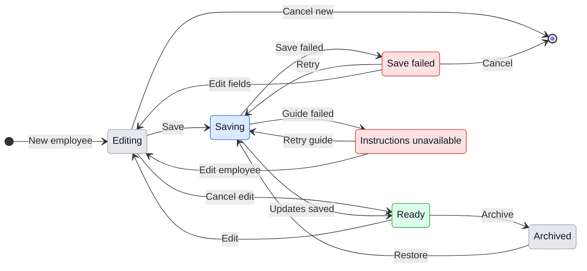

# UX: сотрудники, назначения и память

Поведение по [спецификации](../../specs/018-employees/spec.md). Alex одобрил UX и реализацию 2026-11-01 словом «делай». Английские строки ниже — текст интерфейса GeckIt, русский текст объясняет поведение. Проверки реализации записываются отдельно в [verification.md](../../specs/018-employees/verification.md).

> 2026-11-01: раздел Employees в Settings и выбор сотрудника полем на карточке заменены страницей Team и меню на портрете карточки. Как устроено теперь - в [employees-team.md](employees-team.md); упоминания Settings > Employees ниже описывают прежнее решение.

## 1. Зачем

Alex хочет один раз описать постоянную роль и дальше поручать ей работу, не повторяя решения из прошлых чатов. Сотрудник объединяет описание работы и назначенные сессии, через которые ассистент получает память. Менеджер распределяет задачи между этими ролями.

### Путь до результата

- **Вход и результат:** Settings > Employees > New employee. Alex создаёт Татьяну с ролью «Продвижение» и описанием, сохраняет, выбирает её в New task и отправляет задачу. На карточке и в чате видны имя и портрет. В следующей задаче Татьяны ассистент может найти предыдущую работу через GeckIt.
- **Готовность:** сотрудник сохранён, доступен для назначения, а управляемая часть общих инструкций обновлена. Сохранённый сотрудник с ошибкой записи инструкций остаётся доступен, но Settings явно предлагает Retry. Память становится полезной после появления первого назначенного чата; отдельного подключения аккаунта сотрудника нет.
- **Решения и порядок:** имя, необязательное обозначение роли, свободное описание работы; аватарка подбирается автоматически и может быть заменена действием Change avatar. В задаче выбирается Employee; None оставляет обычную сессию. Провайдер, модель и разрешения выбираются существующим способом.
- **Форма пути:** список сотрудников и одна форма выбранного сотрудника в Settings. Поля независимы, поэтому пошаговый мастер не нужен. В ежедневной работе достаточно выбора сотрудника рядом с папкой и ассистентом в существующей форме New task.
- **Первый запуск и возврат:** пустой каталог предлагает New employee. Закрытие несохранённой формы возвращает к последней сохранённой версии; несохранённые изменения требуют Discard changes / Keep editing. После сохранения перезапуск сохраняет сотрудника, аватарку и назначения. Ошибка записи оставляет введённые поля для Retry.
- **Изменение работающей настройки:** редактирование роли меняет будущие запросы к GeckIt. Текущий ход не перезапускается. Смена сотрудника в существующем чате меняет связь, но не переписывает сообщения и не обещает стереть старый контекст модели.
- **Недоступная зависимость:** память недоступного хоста отмечена как частичная или недоступная; пользователь может подключить хост либо продолжить работу с доступным контекстом.

## 2. Что добавляется

| Поверхность | Что появляется | Когда видно |
| --- | --- | --- |
| Desktop Settings, существующий диалог | Раздел Employees в две колонки: слева поиск, список с портретом, ролью и числом открытых задач, Show archived; справа профиль выбранного (портрет с Change avatar, имя, роль, сводка задач), Name и Role в одной строке, Description, Tasks, внизу View employee, Archive / Restore, Cancel, Save. Без выбора открыт первый сотрудник. Пустой каталог: "No employees yet" с New employee по центру | Всегда |
| Desktop New task, существующая форма | Employee с портретом, именем и ролью; None первым; Manage employees открывает Settings | Всегда, включая пустой каталог |
| Desktop карточка задачи | Только аватарка назначенного сотрудника внизу справа; имя доступно в подсказке | Если назначен |
| Строка списка задач desktop | Портрет и имя назначенного сотрудника | Если назначен |
| Карточка задачи на телефоне | Только аватарка назначенного сотрудника внизу справа | Если назначен |
| Заголовок открытого чата, desktop и телефон | Employee; выбор/смена назначения; View employee с описанием и Conversations | В обычных сессиях; специальный Manager не получает сотрудника |
| Верхние фильтры доски и списка, desktop и телефон | Employees: All employees / Unassigned / активные сотрудники / назначенные архивные сотрудники | Каталог или назначения непусты |
| Телефон New task | Тот же выбор Employee, без редактора каталога | Всегда; пустой каталог объясняет настройку на компьютере |
| Карточка сотрудника, desktop и телефон | Крупный портрет, имя, роль, сводка ("1 working", "2 in progress", "2 to do"...), описание; Tasks: назначенные задачи по колонкам доски (In progress, To do, Done, Archived) с фильтром All / колонка, у каждой проект, время и состояние, нажатие открывает задачу; Conversations: что ассистент может прочитать из прошлых задач | View employee |
| Settings Employees, статус инструкций | Ошибка обновления общих инструкций и Retry | Только при ошибке |
| Существующая передача задачи менеджером, включая Telegram | Имя выбранного сотрудника в предложении при требуемом одобрении и в подтверждённом результате | Делегируется назначенная задача |

На карточке показана только аватарка выбранного сотрудника внизу справа. Она не открывает выбор и не меняет назначение; имя и признак Archived доступны в подсказке и доступном описании. Неназначенные задачи не получают аватарку или подпись Unassigned. Аватарка не перекрывает модель, ссылки или текст. Назначение остаётся в New task и заголовке чата. Вопросы и специальный Manager не получают аватарку сотрудника. Уточнение Alex от 2026-11-01: «Не надо давать возможность менять, просто иконку снизу справа выбранного сотрудника».

Каталог редактируется на desktop. Телефон разделяет назначения и фильтр с компьютером, использует существующие листы выбора и не получает отдельную копию сотрудников. На телефоне фильтр находится над переключателем колонок; активный выбор остаётся видимым. Назначение в заголовке чата занимает отдельную строку, чтобы длинное имя не вытесняло навигацию.

## 3. Состояния

| Состояние | Когда наступает | Что видит пользователь | Что ему делать |
| --- | --- | --- | --- |
| Empty | Нет сотрудников | "No employees yet" | New employee; на телефоне — настроить на компьютере |
| Editing | Новая или изменённая роль | "New employee" / имя; Name, Role, Description | Заполнить и Save либо Cancel |
| Invalid | Сохранение без имени | "Enter a name" у поля | Ввести имя |
| Saving | Сохранение ещё не подтверждено | "Saving..."; повторное Save недоступно | Дождаться результата |
| Save failed | Не сохранён каталог | "Could not save employee. Try again." | Retry или Cancel |
| Ready | Сотрудник сохранён, инструкции обновлены | Имя, роль, портрет | Назначить задачу или редактировать |
| Guide failed | Каталог сохранён, инструкции не обновлены | "Employee saved. Assistant instructions could not be updated." | Retry |
| Archived | Сотрудник архивирован | "Archived" рядом с именем | Restore или читать старые задачи |
| Unassigned | У сессии нет сотрудника | "None" в выборе | Выбрать или оставить |
| No matches | Фильтры не оставили задач | "No tasks match these filters" | Clear employee filter либо изменить другие фильтры |
| No tasks | Сотруднику ничего не назначено | "No tasks yet. Pick this employee in New task." | Выбрать сотрудника в New task |
| Memory empty | Нет прошлых доступных чатов | "No conversations yet" | Создать первую задачу или вернуться |
| Memory partial | Доступна лишь часть истории | "Some conversations are unavailable" | Читать доступные, подключить хост или повторить |
| Memory unavailable | Историю сейчас прочитать нельзя | "Conversations are unavailable. Try again." | Retry либо закрыть карточку |

Обязательность имени — проверка идентификации сотрудника. Role и Description можно оставить пустыми; это не блокирует назначение, но без описания менеджеру может потребоваться уточнение. Портрет доступен до сохранения; ошибка изображения показывает инициалы без отдельной аварии.

## 4. Переходы

| Из | Событие | В | Что видит пользователь |
| --- | --- | --- | --- |
| Empty / Ready | New employee / Edit | Editing | Форма, фокус Name |
| Editing | Save с пустым именем | Invalid | "Enter a name", фокус Name, введённое сохранено в форме |
| Invalid | Вводит имя | Editing | Ошибка исчезает |
| Editing | Save с именем | Saving | "Saving..." |
| Saving | Каталог и инструкции записаны, автоматически | Ready | Форма с сохранёнными значениями; новый сотрудник в списке |
| Saving | Запись каталога не удалась, автоматически | Save failed | Ошибка, Retry и введённые значения |
| Save failed | Retry / редактирует поле | Saving / Editing | Повтор сохранения / редактируемая форма |
| Saving | Каталог записан, инструкции нет, автоматически | Guide failed | Отдельная ошибка инструкций; сохранённый сотрудник в списке |
| Guide failed | Retry | Saving | Повтор только обновления инструкций, без второго сотрудника |
| Guide failed | Edit | Editing | Сохранённая роль, ошибка подключения остаётся до успешного обновления |
| Editing / Save failed | Cancel / закрывает форму | Ready / Empty | Последняя сохранённая версия; при изменённых полях сначала Discard changes / Keep editing |
| Ready | Archive | Archived | Сотрудник под Show archived; старые задачи сохраняют имя |
| Archived | Restore | Saving | Тот же сотрудник возвращается после записи; при ошибке остаётся архивным |
| Unassigned / назначенная сессия | Выбирает сотрудника / None | Новое назначение | После подтверждённого сохранения обновлены имя и портрет на всех подключённых экранах |
| Назначенная сессия | Сохранение назначения не удалось | Прежнее назначение | "Could not change employee. Try again."; повтор доступен |
| Любой набор задач | Выбирает фильтр сотрудника | Набор / No matches | Пересечение с остальными фильтрами; работа не останавливается |
| No matches | Clear employee filter | Набор / No matches | Снят только фильтр сотрудника |
| Карточка сотрудника | Conversations | История / Memory empty / partial / unavailable | Доступные источники или точная строка состояния |
| Memory partial / unavailable | Retry / подключён хост и повторено чтение | История / partial / unavailable | Новый результат; неподтверждённая полнота не обещается |
| Любая карточка/выбор | Escape / Back / Close | Предыдущий экран | Закрыт верхний слой, фокус возвращён к открывшему элементу |

Нажатие Save не закрывает форму до результата. Для назначения показывается изменение только после подтверждения записи. Повтор запроса не создаёт сотрудника заново. Во время записи закрытие не отменяет подтверждённый результат; при возврате читается актуальное состояние.

### Клавиатура, прокрутка и темы

Используются существующие компоненты диалога, списка и выбора, их семантика и токены GeckIt. Tab проходит по полям и действиям; Enter в выборе подтверждает, стрелки меняют выбранную строку, Escape закрывает верхний слой. Enter в многострочном Description добавляет строку. В списках есть текстовый поиск; длинные имена не вытесняют действия. Форма и Conversations прокручиваются внутри существующего окна/листа; Save остаётся достижимым при экранной клавиатуре телефона. Светлая и тёмная темы, видимый фокус и полное окно проверяются на этапе прототипа и реализации. Аватарка не заменяет текстовое имя; кнопки имеют текстовую доступную подпись.

## 5. Что молчит

| Состояние | Почему не показываем |
| --- | --- |
| Успешная перезапись общих инструкций | Обычная часть сохранения; отдельный тост не помогает работе |
| Получение сотрудника через GeckIt | Ответ читается ассистентом; собственный статус приложения не дублирует ход чата |
| Внутренняя выдача страниц истории | Пользователю нужны источники и результат, а не число технических запросов |
| Отсутствие назначения на карточке | Не заполняем каждую старую карточку меткой Unassigned; она остаётся в выборе и фильтре |
| Резервные инициалы вместо недоступного портрета | Назначение остаётся понятным по имени; работа не блокируется |

Ошибки сохранения и неполная история не скрываются. Отдельного индикатора «сотрудник уже вспомнил всё» нет: чтение источников не гарантирует их использование моделью.

## 6. Пороги и время

| Число / момент | Значение | Почему столько |
| --- | --- | --- |
| Сотрудников на сессию | Не более одного | Одна роль определяет назначение и выборку памяти; для совместной работы есть несколько сессий |
| Обновление справочника | После каждого сохранённого изменения каталога | Следующий запрос должен получать текущую роль; периодическая отложенная запись создаёт устаревший контекст |
| История | Все доступные назначенные чаты, без нового ограничения по возрасту | Завершённая старая работа — часть заявленной памяти |
| Объём одного ответа истории | До 20 000 символов сообщений и десяти источников, с явным продолжением; Manager использует меньшую страницу в пределах своего контекста | Нельзя перегрузить контекст модели, но нельзя молча потерять старые чаты |

Новых таймеров, автоматического удаления памяти и обещаний мгновенного перечитывания файла работающей моделью нет. Диаграмма времени не применяется: порогов ожидания и истечения в этой функции нет.

## 7. Формулировки

| Назначение | Текст |
| --- | --- |
| Раздел / фильтр | "Employees" |
| Поле задачи | "Employee" |
| Новая роль | "New employee" |
| Поля | "Name", "Role", "Description" |
| Описание | "What this employee does and the rules they should follow" |
| Каталог пуст | "No employees yet" |
| Пустой каталог на телефоне | "Create employees in Settings on your computer" |
| Действия | "Save", "Cancel", "Change avatar", "Archive", "Restore", "Show archived", "Retry" |
| Просмотр роли / управление | "View employee", "Manage employees", "Conversations" |
| Нет назначения | "None" |
| Загрузка каталога | "Reading employees..." |
| Ошибка загрузки каталога | "Could not load employees." |
| Поиск сотрудников | "Search employees" |
| Недоступное назначение | "Choose an active employee or None.", "Employee unavailable" |
| Конфликт редактора | "Employee changed in another window. Reload before saving.", "Reload employee" |
| Чтение и поиск истории | "Reading conversations...", "Search conversations", "Refresh conversations" |
| Продолжение истории | "Load more", "More of this conversation is available with Load more." |
| Закрыть просмотр | "Close" (крестик в углу карточки) |
| Задачи сотрудника | "Tasks", "All", "No tasks yet. Pick this employee in New task.", "No tasks yet", "Working", "Blocked" |
| Пояснения | "Describe a role once, then pick it in New task. Its earlier tasks become its memory.", "What the assistant can read back from this employee's earlier tasks" |
| Фильтр | "All employees", "Unassigned", "Clear employee filter" |
| Невалидное имя | "Enter a name" |
| Сохранение | "Saving..." |
| Ошибка каталога | "Could not save employee. Try again." |
| Ошибка инструкций | "Employee saved. Assistant instructions could not be updated." |
| Ошибка назначения | "Could not change employee. Try again." |
| Пустой результат фильтров | "No tasks match these filters" |
| Архивный сотрудник | "Archived" |
| Скрытый чат в истории сотрудника | "Hidden" |
| Пустая память | "No conversations yet" |
| Частичная память | "Some conversations are unavailable" |
| Недоступная память | "Conversations are unavailable. Try again." |
| Отмена изменений | "Discard changes?", "Discard changes", "Keep editing" |

Менеджер сообщает выбор естественным языком пользователя, например «Поручил Татьяне: рилс для Instagram», только после подтверждения создания. Это пример ответа, а не жёсткий шаблон менеджера.

## 8. Краевые случаи

- **Пусто:** первая задача сотрудника работает без памяти; роль всё равно читается. Существующие неназначенные чаты не распределяются автоматически.
- **Всё сразу:** фильтры пересекаются; счётчики и группировка используют получившийся набор. Архивный сотрудник доступен в фильтре, если у него есть задачи. Одинаковые имена различаются ролью и аватаркой, операции привязаны к постоянной идентичности.
- **Обрыв:** отключение телефона не считается подтверждённой записью; при повторном открытии запрашивается текущее назначение. После каждого нового соединения телефон заново читает каталог сотрудников вместе со списком бесед, поэтому каталог, не загруженный при открытии или изменённый за время обрыва, не превращает назначенного сотрудника в "No employee". Недоступная история хоста не выдаётся за пустую память.
- **Беседа в другом провайдере:** команды Claude Code, запущенного библиотекой (например Claude tmux), несут собственный ID сессии Claude, а GeckIt хранит беседу под ID библиотеки (`plugin:claude-tmux:<id>`). `employees current` и `geckit start` сопоставляют их по этому ID независимо от того, общие ли у библиотеки инструкции; иначе worker видит "employee": null при назначенном сотруднике.
- **Повтор:** двойное Save и повтор после ошибки не создают копию сотрудника; интерфейс блокирует одновременную отправку одной формы.
- **Устаревшая копия:** архивирование сотрудника в другом окне перед сохранением задачи требует повторного выбора; роль не назначается молча. При внешнем изменении открытой формы пользователь получает актуальные данные перед новой записью, без незаметной потери введённого описания.
- **Переназначение:** вся доступная история чата относится к текущему сотруднику. Старый сотрудник больше не получает этот чат через собственную выборку; ранее прочитанный контекст не стирается.
- **Скрытые чаты:** включены в память сотрудника с пометкой "Hidden", если доступны по обычным правилам доступа. Чтение не возвращает карточку на доску и не меняет скрытое состояние. Завершённые и архивные чаты также входят в память.
- **Провайдеры:** сотрудник не даёт Claude, Codex или библиотеке дополнительных полномочий. Для провайдера/хоста, который не читает общие инструкции или не достигает GeckIt, поддержка памяти не заявляется без отдельной проверки.
- **Менеджер:** явный выбор пользователя имеет приоритет; несколько подходящих ролей допускают уточнение. Архивная роль не выбирается для новой задачи без восстановления. Если роли не подходят, менеджер сообщает об отсутствии назначения.

## 9. Чего намеренно нет

| Не делаем | Почему |
| --- | --- |
| Автоматическая подстановка описания и всех чатов в каждое задание | Alex просит получение через общие инструкции и запрос к GeckIt |
| Отдельный AI-провайдер или подписка у сотрудника | Сотрудник организует роль и историю; выбор исполнения уже существует |
| Отдельный обязательный чат «Татьяна» вместо доски | Обычные задачи остаются самостоятельными сессиями и объединяются назначением |
| Скрытый автоматический запуск субагента при выборе роли | Сотрудник назначается на обычную сессию; оркестрация остаётся у менеджера |
| Автоматически сочинённая долговременная память без источников | Запрошена память из прошлых назначенных чатов |
| Удаление сотрудника вместе с историей | Архивирование достаточно для снятия с новых назначений и сохраняет работу |
| Редактор каталога на телефоне в первой версии | Предложенная граница: ежедневное назначение, просмотр и фильтрация есть; каталог настраивается на компьютере |

## 10. Развилки

### Где находятся роль и память

| Вариант | Вердикт |
| --- | --- |
| Общие инструкции объясняют правило, GeckIt возвращает роль и историю по запросу | Да, прямо следует из диктовки |
| GeckIt дописывает роль и историю в пользовательское задание | Нет |

**Почему:** Alex отдельно ограничил инжекцию в промпт. Справочник актуален в общей инструкции; подробный контекст читается по потребности.

### Что происходит с памятью при переназначении

| Вариант | Вердикт |
| --- | --- |
| История следует за текущим назначением | Одобрено 2026-11-01 |
| Чат навсегда остаётся в памяти каждого прежнего сотрудника | Не выбрано |

**Почему:** модель памяти совпадает с группировкой задач и не создаёт невидимых копий. Это допущение, не явное требование диктовки.

### Каталог и аватарки

| Вариант | Вердикт |
| --- | --- |
| Общий каталог по зарегистрированным папкам | Одобрено 2026-11-01; сотрудники ведут задачи в разных проектах |
| Отдельные сотрудники на каждый профиль | Не выбрано: профиль сейчас фильтрует проекты |
| Сохраняемые сгенерированные портреты людей | Двенадцать встроенных DiceBear Avataaars; источник и лицензия записаны рядом с SVG. Сеть при выборе не нужна |
| Генерация на платном сервисе при каждом создании | Не выбрано: не требуется запросом, добавляет аккаунт и зависимость |

## 11. Сверка с требованиями

| Требование | Где закрыто |
| --- | --- |
| FR-001–003, каталог, портрет, архив | 1–4, 7–10 |
| FR-004–005, назначение и сохранение | 1–4, 8 |
| FR-006–007, отображение и фильтры | 2–4, 7–8 |
| FR-008–010, роль и память | 1–3, 5–6, 8–10 |
| FR-011–013, общие инструкции без подстановки в задание | 1, 3–5, 9–10 |
| FR-014–015, менеджер и провайдеры | 1–2, 7–9 |
| FR-016, desktop и телефон | 1–4, 7–9 |
| FR-017–018, актуальность и границы истории | 1, 5, 8–10 |

**Границы реализации:** установленные встроенные Claude Code и Codex получают каталог в управляемом GECKIT.md при включённых инструкциях. Версия из исходников пишет отдельные файлы для Claude и Codex в данных этой копии, сохраняя глобальные настройки установленного приложения. Codex получает общую ссылку на файл в настройках сессии вместе с действующими инструкциями проекта; выключение возвращает исходные инструкции. Роль и история по-прежнему запрашиваются через GeckIt. Изменение основного процесса требует безопасного перезапуска приложения; уже работающий ход не перечитывает инструкции автоматически. Удалённому хосту нужен доступ к CLI GeckIt; поддержку инструкций сторонней библиотеки нельзя предполагать по наличию назначения. Чтение истории и использование её моделью проверяются отдельно.
