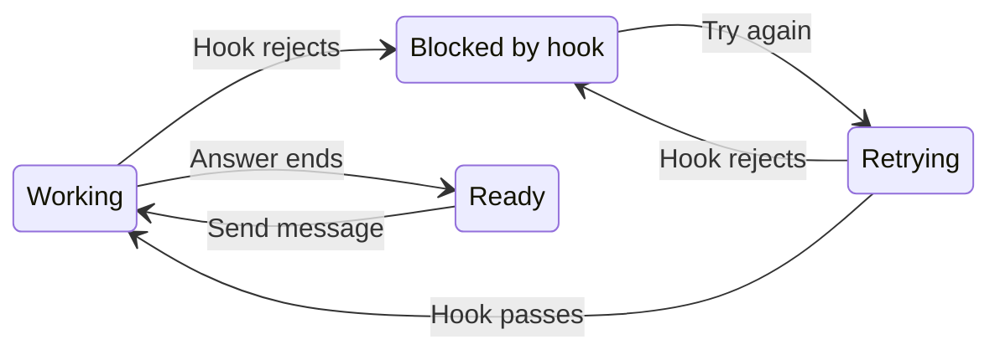

# UX: Show hook blocks in Chat

## 1. Why

When a UserPromptSubmit hook rejects a message, Chat shows neither the rejection nor its cause. The terminal can explain that VPN verification failed while GeckIt appears to have gone quiet. Alex's bug report and request to continue authorize this repair.

## 2. Surfaces

| Existing surface | Visible result | When |
| --- | --- | --- |
| Desktop and phone transcript | "Blocked by hook." and the hook's output under "What it said" | A prompt hook rejects submission |
| Transcript end action | "Try again" | Work is blocked |
| Submitted message | Existing unsent treatment and "Send again" | The prompt never reached the assistant |
| Board/list status | "Blocked by hook" with existing error attention | A live submission is rejected |

Use existing failure notes and recovery controls. No new dialog or component.

## 3. States

| State | Trigger | Visible result | Action |
| --- | --- | --- | --- |
| Working | Prompt submitted | Existing working state | Wait or Stop |
| Blocked | UserPromptSubmit rejects the prompt | "Blocked by hook."; selectable details; unsent message | Fix the reported cause, then Try again or Send again |
| Retrying | Retry accepted | Existing pending recovery state | Wait |
| Ready | Retry succeeds | Existing response | Continue chatting |

## 4. Transitions

| From | Event | To | Visible result |
| --- | --- | --- | --- |
| Working | Hook rejects, automatically | Blocked | Spinner ends; rejection note and recovery actions appear |
| Blocked | Press Try again or Send again | Retrying | The exact rejected text and attachments are resubmitted; unrelated draft stays intact |
| Retrying | Hook rejects, automatically | Blocked | Updated reason; no duplicate submitted message |
| Retrying | Hook accepts, automatically | Working | Unsent treatment ends; normal work resumes |
| Working | Assistant finishes, automatically | Ready | Normal answer |
| Blocked | Close and reopen | Blocked | Retained rejection and known unsent prompt |

## 5. What stays quiet

Successful hooks and routine hook progress stay silent. Non-blocking hook errors do not end a turn. Stop-hook feedback that sends the assistant back to work keeps its existing behavior.

## 6. Timing

No new delay. The tmux driver uses its existing 500 ms read cadence and two idle observations to settle a rejected turn. A saved rejection appears immediately when replayed.

## 7. Wording

"Blocked by hook." in the transcript; "Blocked by hook" on the row. Existing "What it said", "Hide what it said", "Try again" and "Send again" labels remain. The detail is Claude's rejection, including the hook/plugin identity and reason, without repeating "Original prompt".

## 8. Edge cases

Empty output still produces the rejection label. Wrapped terminal diagnostics remain readable. Multiple rejections update the current failure. A later successful turn cannot inherit an old terminal rejection. Stop wins if Alex explicitly interrupts. Queued follow-ups stay held after rejection. Saved informational hook warnings must replay instead of being discarded. JSON result errors retain their diagnostic text.

## 9. Deliberate omissions

No automatic retry, hook bypass, plugin settings editor or success notice. A hook owns its policy; GeckIt reports its outcome.

## 10. Decisions

Reuse the existing error and unsent workflow. A rejected prompt is retried verbatim; "continue" would lose a prompt erased by Claude's hook. Non-blocking Stop-hook errors stay distinct because they do not reject submission.

## 11. Coverage

Repairs Alex's reported missing hook state for builtin Claude, saved terminal transcripts and the Claude tmux library. Browser verification uses real Transcript, Composer and Sidebar components with a fixture provider boundary; native hook detection and retry are checked separately.

## Verification - 2026-10-14

Reviewed the actual shared Chat components in Chrome at 1352x676, 390x844 and 320x844, light/dark. Checked the full conversation, sidebar status, unsent message, collapsed and expanded hook output, diagnostic wrapping and scrolling, keyboard disclosure/retry, pending retry disablement, successful recovery and retained unrelated draft/photo. Provider calls were fixtures. The isolated tmux fake-Claude integration covers a terminal-only block without assistant activity, JSON continuation rejection and a subsequent successful turn. Reader/session tests cover zero/nonzero hook exits, ordinary Stop-hook errors, saved warnings, exact prompt whitespace, preserved attachments, reopen deduplication and a single stream completion. The state diagram renders successfully.

All 930 GeckIt tests, typecheck, scoped ESLint, desktop/mobile builds and diff checks pass. Full ESLint still reports two existing no-undef errors in scripts/dev-bundle.js. The provider's trust-navigation assertion fails on unchanged HEAD as well; it is outside this fix. The installed app and provider were not restarted or updated, so the fix is local and native installed-app verification remains unavailable.

Performance review against docs/performance.md: no problems found. Production Transcript, Composer, Sidebar, row memo comparisons, callbacks, styling, formatters, animations and polling cadence are unchanged. The preview adds one fixture state; no production per-render work is added. Hook parsing runs at message ingestion. No new list or repeated renderer element requires live profiling.

Delivery verification: applied only this task to current remote main in an isolated worktree. All 931 tests, typecheck, scoped ESLint and desktop build pass there. The exported Claude runtime is identical to the provider runtime after building from the same integrated source. Concurrent MCP edits in the original checkout are excluded from this commit.
