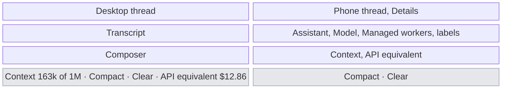
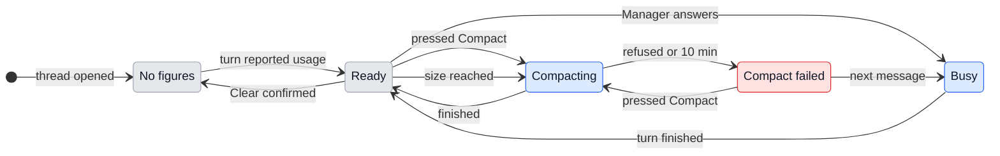

# UX: Context, Compact, Clear and cost in the Manager chat

## 1. Why

An ordinary conversation shows how large its context is, what it would cost at API prices, and offers Compact and Clear, on the desktop status bar and in the phone's conversation info. The Manager chat shows none of it. On EntechBot, Manager reached about 760,000 tokens of context and spent more than half of a Max 5x plan's day before anyone saw it. Manager compacts itself at the "Compact conversation at" size (spec 037), but the person still cannot see how close a thread is, what it has cost, or shrink it now.

### Path to the result

- **Entry and result:** the person opens a Manager thread (desktop Manager chat, or a thread on the phone) and sees its context size and cost; they can compact it now or clear it.
- **Readiness:** the thread has a Manager session. The figures appear only after the assistant reported them on a finished turn; a thread that has not answered yet has nothing to show.
- **Decisions and order:** none to set up. Compact needs no choice; Clear goes through the existing "Clear history?" confirmation.
- **Shape of the path:** the same status line as an ordinary conversation on desktop, and the same rows as the phone's conversation info, inside the thread's Details on the phone. A separate Manager-only panel was rejected: the person already knows these controls from Chat.
- **First launch and return:** nothing to configure. A thread opened later shows the figures of its last finished turn.

## 2. What is added

| Surface | What appears | When visible |
|---|---|---|
| Desktop Manager chat, below the composer (existing `ManagerChat`) | A status line: Context, Compact, Clear, API equivalent (or Billed cost) | The open thread has a Manager session |
| Phone Manager thread, Details sheet (existing) | Rows Context and API equivalent (or Billed cost); actions Compact and Clear | The open thread has a Manager session |
| Manager service | A manual compaction of one thread, the same as the automatic one, at any size | Asked from either surface |

Git, branch and changes from Chat's status bar are left out: Manager has no project of its own. Model stays where it is today (composer and Details).

## 3. States

| State | When it occurs | What the user sees | What to do |
|---|---|---|---|
| No figures | The thread has no session, or no turn has reported usage yet | No status line (desktop); no Context or cost rows (phone) | Nothing; they appear after Manager's first answer |
| Ready | The thread is idle and the assistant can compact | Context and cost; Compact and Clear enabled | Compact or Clear when wanted |
| Busy | Manager is answering in this thread, or the thread is paused, off or waiting for its limit | Compact disabled, titled "Manager can compact once it has finished." | Wait |
| Compacting | A manual or automatic compaction runs | Compact disabled, titled "Compacting..."; the thread's existing "Compacting" status | Nothing; ends by itself |
| Can't compact | The thread's assistant does not declare compaction | Compact disabled, titled "<Assistant> can't compact conversations." | Clear, or choose another assistant in Setup |
| Compact failed | A compaction the person asked for was refused or did not finish within 10 minutes | Notice above the transcript: "Could not compact. Manager's conversation is unchanged." | Compact again later, or Clear |
| Clearing | Clear was confirmed | The existing "Clear history?" dialog's own progress | Nothing |

## 4. Transitions

| From | Event | To | What the user sees |
|---|---|---|---|
| No figures | Manager's turn finished and reported usage (by itself) | Ready | The status line or rows appear |
| Ready | A message is delivered to Manager (by itself) | Busy | Compact disabled; figures stay until the turn finishes |
| Busy | The turn finished (by itself) | Ready | Updated Context and cost |
| Ready | Pressed Compact (desktop), or Compact then "Compact" in the sheet (phone) | Compacting | Status "Compacting"; Compact disabled |
| Ready | The turn finished at or above "Compact conversation at" (by itself) | Compacting | Same as above |
| Compacting | Compaction finished (by itself) | Ready | Context drops to the summary's size after the next turn reports it |
| Compacting (asked for) | The assistant refused, or 10 minutes passed (by itself) | Compact failed | "Could not compact. Manager's conversation is unchanged." |
| Compact failed | Pressed Compact | Compacting | Notice goes; status "Compacting" |
| Compact failed | A message is delivered (by itself) | Busy | Notice goes |
| Ready | Pressed Clear, then confirmed "Clear history" | No figures | The existing Clear history result: an empty thread |
| Ready | Pressed Clear, then Cancel | Ready | Nothing changes |
| Phone sheet | Pressed Cancel in "Compact this thread?" | Ready | Nothing changes |

On the phone, Compact and Clear sit below the detail rows, set off by a divider.

## 5. What stays silent

| State | Why not shown |
|---|---|
| Compaction succeeded | The Context figure drops; a message would only repeat that |
| Automatic compaction started | The thread status already says "Compacting"; no toast, sound or channel message (spec 037) |
| Usage of earlier, replaced sessions | The figures describe what Manager rereads now, not its history |
| Cost of workers Manager started | Each worker shows its own; adding them here would count them twice |
| Automatic compaction failed | Nobody asked for it; it is tried again after the next turn, and the person sees the context size anyway |

## 6. Thresholds and time

| Number | Value | Why |
|---|---|---|
| Compaction gives up | 10 minutes | The same limit as automatic compaction (spec 037); a compaction normally takes about a minute |
| When the figures update | After each finished turn | The assistant reports usage only then; polling would cost tokens, which this change exists to save |

## 7. Wording

| State | Text |
|---|---|
| Context label (both) | "Context" |
| Context value | "163k" or "163k of 1M" when the window is known (Chat's own format) |
| Context title (desktop) | "163,000 of 1,000,000 tokens in this Manager conversation. Manager compacts it at <N> tokens." or "... Automatic compaction is off." |
| Cost label | "API equivalent" or "Billed cost" (Chat's own) |
| Compact title (desktop, Ready) | "Summarise this Manager conversation now, so each answer rereads less" |
| Compact row (phone, Ready) | "Compact" / "Summarise it so far to free up its context" |
| Compact confirmation (phone) | "Compact this thread?" with "Compact" and the note "Manager writes a summary of this thread so far and goes on from it, with its saved record of the work it follows. Everything stays here to read." |
| Busy | "Manager can compact once it has finished." |
| Compacting | "Compacting..." |
| Can't compact | "<Assistant> can't compact conversations." |
| Compact failed | "Could not compact. Manager's conversation is unchanged." |
| Clear title (desktop) / row (phone) | "Clear history and Manager's context in this thread" / "Clear" with "Remove its messages and context" |

## 8. Edge cases

- **Empty:** a new thread or one whose session has not answered shows nothing.
- **Everything at once:** compaction due automatically and pressed at the same time runs once; the second request is refused quietly because one is already running.
- **Connection lost:** on a phone without a link, Compact and Clear are disabled like the other Manager actions; the figures stay as last seen.
- **Repeat:** pressing Compact twice runs one compaction; the button is disabled while it runs.
- **Stale copy:** figures always come from the last finished turn of the current session; after Clear or Restart they disappear until the new session answers.
- **Channel thread:** the same line and rows; Clear keeps what was already posted in the channel, as the Clear history dialog says today.

## 9. What is deliberately absent

| Not doing | Why |
|---|---|
| Git, branch and changes | Manager has no project folder of its own |
| A per-day or 5-hour token total for Manager | Valuable, but a separate measure (recommended separately); this change shows what Chat shows |
| A new Clear meaning "start a new thread" | The Manager chat already has New conversation; Clear here empties this thread's context |
| Confirmation for Compact on desktop | Chat does not ask on desktop either; compaction keeps the conversation's meaning |

## 10. Forks

### What Clear does in a Manager thread

| Option | Verdict |
|---|---|
| Open the existing "Clear history?" dialog for this thread | yes |
| Restart the session with the saved coordination record | no |
| Start a new thread | no |

**Why:** Clear history already exists, asks first, and empties the context, which is what Clear means in Chat. Restart stays in Setup as "Restart Session"; New conversation is already in the thread list.

### Where the phone shows it

| Option | Verdict |
|---|---|
| Rows in the thread's existing Details sheet | yes |
| A status line under the phone composer | no |

**Why:** the phone's ordinary conversations show these in their info sheet, not under the composer, where the keyboard and the bar compete for room.

## 11. Reconciliation with requirements

| Requirement | Where covered |
|---|---|
| Alex, 2026-11-19: add Context, Compact, Clear and API equivalent to Manager chats on desktop and mobile | Sections 2, 3, 7 |
| Spec 037 FR-006 (compaction at the Manager setting) | Section 4: automatic and manual compaction share one path |

**Missing from the requirements:** spec 037 has no manual compaction; this document adds it as a Manager action for one thread.
