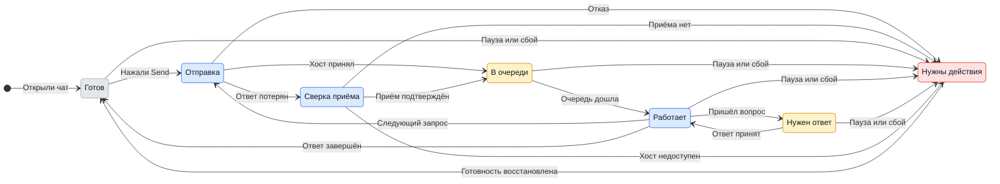

# UX: Чат с Manager в приложении

Спецификация: [021-manager-chat](../../specs/021-manager-chat/spec.md). Этот документ заменяет ограничение Telegram-only в [manager-telegram.md](manager-telegram.md) и требования обязательного Telegram в [employees-manager.md](employees-manager.md). Алекс согласовал поведение сообщением «Реализуй» 2026-11-05; реализация локальная, ограничения проверки записаны отдельно.

## 1. Зачем

В GeckIt можно открыть сессию Manager и читать её, но написать приходится в Telegram. Даже для работы за компьютером настройка требует бота. Добавляем обычный текстовый диалог с тем же Manager в приложении; Telegram остаётся дополнительным каналом.

### Путь до результата

- **Вход и результат:** на компьютере кнопка Manager в строке состояния открывает чат; Team > Manager получает Open chat. На телефоне строка Manager над Tasks и Open chat в Team открывают ту же беседу. Пользователь пишет задачу, видит ответ и отвечает на вопросы здесь же.
- **Готовность:** Manager включён, выбранный ассистент доступен, существующие проверки разрешают работу. Telegram не входит в условия готовности. Для телефона нужен доступный парный компьютер. Сохранённый выбор ассистента сам по себе не означает включённого Manager.
- **Решения и порядок:** первая настройка на компьютере: Choose the assistant → Decide how work starts → Turn Manager on. Telegram становится отдельной необязательной группой Connect Telegram ниже. Имеющийся подключённый Telegram сохраняется.
- **Форма пути:** расширяем существующий экран просмотра сессии: история и поле ввода внизу, настройки в Team по кнопке шестерёнки. На телефоне это отдельная страница с Back. Отдельный второй Manager или новая вкладка нижней навигации не нужны.
- **Первый запуск и возврат:** без настройки вход открывает Team > Manager. После включения доступна Open chat, пустая история предлагает первое сообщение. Закрытие чата не останавливает работу; повторное открытие возвращает историю и черновик. Смена ассистента и Restart session используют существующие подтверждения в Team; сами входы в чат ничего не перезапускают.

## 2. Что добавляется

### Исправления по проверке 5 ноября

Верхняя панель получает кнопку с выбранным в Team портретом Manager и подписью "Manager"; она открывает тот же чат, а до первой настройки ведёт в Team. В шапке чата повторяется тот же портрет. Старый вход в строке состояния сохраняется.

История, текущие вопросы и принятые сообщения в очереди прокручиваются вместе. Шапка и composer остаются на месте; отдельной прокрутки для карточек вопросов нет. Новое сообщение при чтении выше не сдвигает историю; "New messages" возвращает к концу вместе с ожидающими вопросами.

Сервис явно сообщает поддержку чата приложения. У старого сервиса без этого признака история доступна, а отправка и ответы отключены с текстом "Manager chat needs a service update. Finish active work, then restart GeckIt." Черновик сохраняется. Сам чат не перезапускает сервис и работающие беседы. После подключения обновлённого сервиса действия доступны автоматически. Ошибку неизвестного метода не показываем как обычную ошибку сообщения и не повторяем запись через старые методы без проверки приёма.

Повторное нажатие ответа до завершения первой попытки не отправляет второй ответ. При отказе карточка и введённый ответ сохраняются; после смены сессии ошибка прежнего ответа не относится к новой истории.

Недоступная для ответа карточка Manager поясняет "Replies are unavailable. Check Manager status below." Причина и доступное восстановление остаются возле composer, без ошибочного предложения открыть компьютер уже на компьютере.

| Поверхность | Что появляется | Когда видно |
| --- | --- | --- |
| Desktop, существующий Manager inspection | Редактируемый текстовый composer, Send, ожидающие сообщения, действующие вопросы и решения | Manager включён; история остаётся доступной после выключения |
| Desktop, строка состояния | Manager открывает чат; Set up Manager по-прежнему ведёт к настройке | Всегда, как сейчас |
| Team > Manager, desktop и phone | Open chat, обновлённые описание роли и What it does | Когда настройка уже сохранена; на телефоне без настройки объяснение про компьютер |
| Desktop, Setup в Team | Три обязательных шага; Telegram отдельной необязательной группой | Всегда |
| Phone, Tasks | Строка Manager с текущим состоянием | Включённый Manager или сохранённая история |
| Phone, страница Manager chat | История, вопросы, composer, Send, Back | После нажатия на вход в чат |
| Обе истории | Существующие атрибуции Telegram и событий; новый запрос из приложения как сообщение пользователя | После принятия сообщения хостом |

Компоновка повторяет существующий просмотр: шапка, состояние и причина недоступности при её наличии, прокручиваемая история, ожидающие сообщения, поле ввода. Реальный renderer-прототип и полноэкранные снимки связаны в [design.md](../../specs/021-manager-chat/design.md).

## 3. Состояния

| Состояние | Когда наступает | Что видит пользователь | Что ему делать |
| --- | --- | --- | --- |
| Не настроен | Manager ещё не включали | "Set up Manager" | Пройти настройку на компьютере |
| История загружается | Снимок истории ещё не получен | "Loading the Manager session..." | Подождать; закрыть чат можно |
| Ошибка чтения | Хост не вернул историю | "Could not load the Manager session." и Try again | Повторить загрузку; поле ввода пока недоступно |
| Пустой чат | История загружена и пуста | "What would you like Manager to do?" | Ввести первую задачу |
| Готов | Manager доступен | "Ready", поле "Message Manager" | Написать и нажать Send |
| Отправка | Хост ещё не подтвердил приём | "Sending..." у отправляемого текста | Подождать; повторная отправка этого запроса недоступна |
| В очереди | Хост принял, текущая работа ещё не позволяет передать запрос | "Queued" у запроса | Подождать; можно написать следующий запрос |
| Работает | Идёт координация | "Coordinating" | Читать ответ или отправить следующий запрос в очередь |
| Нужен ответ | Есть актуальное решение | "Needs your answer" и существующая карточка вопроса | Ответить на конкретную карточку |
| Пауза | Пользователь поставил Manager на паузу | "Manager paused" и Resume | Возобновить явно; черновик остаётся |
| Выключен | Manager отключён | "Manager disabled. History is kept." и Open Manager in Team | Включить в Team; историю можно читать |
| Недоступен | Ассистент, VPN или другая действующая проверка блокирует работу | "Manager unavailable", текущая причина и Try again / Open Manager in Team по причине | Устранить указанную причину; автоматическое восстановление остаётся по действующим правилам |
| Телефон без связи | Парный компьютер недоступен | "Computer disconnected. Reconnect to send." | Восстановить связь; черновик остаётся |
| Отказ при отправке | Известно, что запрос не принят | "Message was not sent. Try again." и конкретная причина | Исправить текст или повторить |
| Неизвестен результат | Ответ на отправку потерян | "Checking whether your message was received..." | Дождаться сверки с хостом; не отправлять заново вслепую |

Приоритет общей подписи: выключен → пауза → недоступен → запрос ответа → работает → готов. Отключение компьютера на телефоне блокирует отправку независимо от последнего сохранённого состояния. Pending-карточки остаются видимыми, но доступность ответа определяется текущим хостом.

## 4. Переходы

Диаграмма отражает отправку одного запроса, а не остановку уже работающего Manager при наборе следующего. held объединяет состояния, подробности которых описаны в таблицах.

| Из | Событие | В | Что видит пользователь |
| --- | --- | --- | --- |
| Доска / Team | Нажал Manager / Open chat | Чат | История, затем актуальное состояние и composer |
| Не настроен | Нажал Set up Manager | Team > Manager | Три обязательных шага; Telegram отдельно |
| Setup | Нажал Enable Manager после выбора ассистента и политики | Готов | "Ready" и Open chat; нет требования Telegram |
| История загружается | Хост вернул снимок, сам, без пользователя | Пустой чат / готов | История или приглашение написать |
| История загружается | Хост вернул ошибку, сам, без пользователя | Ошибка чтения | Ошибка и Try again |
| Ошибка чтения | Нажал Try again | История загружается | "Loading the Manager session..." |
| Готов / работает | Нажал Send с непустым текстом | Отправка | Текст и "Sending..."; запрос защищён от двойного нажатия |
| Отправка | Хост подтвердил приём, сам, без пользователя | В очереди / работает | "Queued" до передачи; composer очищен только после сохранённого приёма хостом; если последующая отправка ассистенту заблокирована VPN, принятый текст остаётся в очереди, а причина видна в чате |
| Отправка | Хост отверг запрос, сам, без пользователя | Отказ | Текст сохранён, причина, Try again |
| Отправка | Потеряна связь до ответа, сам, без пользователя | Неизвестен результат | Подпись сверки; текст сохранён |
| Неизвестен результат | Связь восстановлена, сверка нашла запрос, сама, без пользователя | В очереди / работает / готов | Единственное принятое сообщение и актуальный результат |
| Неизвестен результат | Сверка не нашла запрос, сама, без пользователя | Отказ | Текст и явный Try again |
| Неизвестен результат | Хост недоступен, сам, без пользователя | Без связи | Причина; запрос сохраняет идентичность для будущей сверки |
| Отказ | Нажал Try again после известного непринятия | Отправка | "Sending..." |
| В очереди | Дошла очередь, само, без пользователя | Работает | "Queued" убирается; текущая подпись работы |
| Работает | Пришёл ответ, сам, без пользователя | Готов | Ответ в той же истории |
| Работает | Хост запросил решение, сам, без пользователя | Нужен ответ | Карточка с актуальными допустимыми ответами |
| Нужен ответ | Ответил на карточку, хост принял | Работает | Карточка разрешена, Manager продолжает |
| Нужен ответ | Решение уже принято в Telegram, само, без пользователя | Актуальное состояние | Кнопки старой карточки больше не выполняются |
| Нужен ответ | Нужен desktop-only native UI | Нужен ответ | "Open GeckIt on your computer to answer this request." |
| Любое доступное | Нажал Pause / Disable в существующем управлении | Пауза / выключен | Соответствующая подпись, черновик сохранён |
| Пауза | Нажал Resume | Актуальное состояние | Работа продолжается по прежним правилам |
| Выключен | Включил в Team | Актуальное состояние | История сохранена; можно писать |
| Недоступен | Исправил причину и нажал Try again, либо сработало существующее восстановление | Актуальное состояние | Текущая подпись или новая точная причина |
| Телефон без связи | Соединение восстановлено, само, без пользователя | Сверка / актуальное состояние | Свежая история, сохранённый черновик; ничего не отправляется автоматически из черновика |
| Чат | Нажал Close / Back / Escape | Предыдущий экран | Доска или Team; работа продолжается |
| Предыдущий экран | Снова открыл чат | Актуальное состояние | История и черновик; фокус в поле, когда можно писать |

На desktop Enter отправляет, Shift+Enter добавляет строку; во время IME-композиции Enter не отправляет. На телефоне Return добавляет строку, Send отправляет. Tab обходит доступные элементы, закрытие возвращает фокус к точке входа. При чтении выше новые ответы не прокручивают историю вниз: появляется "New messages"; нажатие возвращает к последнему. У нижнего края история следует за ответами. Клавиатура телефона не закрывает поле и Send.

## 5. Что молчит

| Состояние | Почему не показываем |
| --- | --- |
| Telegram не подключён или временно недоступен | Это не причина блокировки чата приложения; состояние остаётся в группе Telegram в Team |
| Служебные повторы при сверке приёма | Один запрос уже виден; повторная строка создаст впечатление новой задачи |
| Транспортные heartbeat и внутренние event IDs | Пользователь не может на них повлиять; остаются в диагностике |
| Новое сообщение в уже открытом активном чате | Не добавляем повторный toast поверх самой истории |

Существующие осмысленные карточки Worker update, CLI и From Telegram сохраняются; этот документ не скрывает инструменты или результаты из инспекции.

## 6. Пороги и время

| Число | Значение | Почему столько |
| --- | --- | --- |
| Manager на парный компьютер | Один общий | Сохраняет единые решения и workers между каналами |
| Ограничение текста | Действующие 100 000 символов | Сохраняет текущую границу Manager; превышение: "That message is too long. Send a shorter request." |
| Задержки восстановления | Существующие правила Manager | Чат не вводит собственный цикл повторного запуска работы |
| Срок хранения черновика | До принятия, явной очистки или изменения пользователем | Закрытие окна и перезапуск не означают отказа от текста |

Нового таймера, ETA ответа или задержки анимации не добавляем: готовность определяется подтверждением хоста и состоянием текущей работы, а не прошедшим временем. Временная диаграмма не применима, потому что новых временных порогов нет.

## 7. Формулировки

| Место / состояние | Текст |
| --- | --- |
| Заголовок | "Manager" |
| Вход из Team | "Open chat" |
| Пустой чат | "What would you like Manager to do?" |
| Поле | "Message Manager" |
| Кнопка | "Send" |
| Роль в Team | "Coordinates work in GeckIt, Telegram and shortcuts" |
| What it does | "Send a request here, in Telegram or through a Manager shortcut. It starts conversations, follows them and brings back the results. Employees do the work." |
| Необязательный канал | "Telegram is optional. Connect it to talk to the same Manager outside GeckIt." |
| Отправка | "Sending..." |
| Очередь | "Queued" |
| Непринятый запрос | "Message was not sent. Try again." |
| Сверка | "Checking whether your message was received..." |
| Телефон без связи | "Computer disconnected. Reconnect to send." |
| Нужен компьютер для native-ответа | "Open GeckIt on your computer to answer this request." |
| Другая карточка уже разрешена | "This request is no longer pending." |
| Ниже новые сообщения | "New messages" |
| Не настроен на телефоне | "Set up Manager on your computer, then chat here." |

Остальные состояния используют точные существующие подписи из раздела 3; подробная причина ошибки поступает от действующей проверки без перефразирования.

## 8. Краевые случаи

- **Пусто:** whitespace не активирует Send. Пустая история не мешает первой отправке после включения.
- **Всё сразу:** длинная история прокручивается отдельно от composer; несколько вопросов сохраняют собственные карточки и адресатов. Длинная ошибка переносится, а не выталкивает Send за экран.
- **Обрыв:** неподтверждённый запрос сверяется по прежней идентичности до любого повтора. Черновик сам не отправляется после подключения.
- **Повтор:** двойное нажатие не создаёт второй запрос. Новая осознанная отправка того же текста после завершённой предыдущей допустима как новый запрос.
- **Устаревшая копия:** перед ответом на карточку хост проверяет, что это ещё тот же вопрос. Снимок состояния после восстановления приоритетнее сохранённой локальной копии.
- **Два канала:** входящие получают общий порядок. Ответ в Telegram виден в приложении; app-текст сам по себе не создаёт дополнительного уведомления в Telegram. Существующая доставка результатов в Telegram сохраняется.
- **Перезапуск сессии:** обычный вход не перезапускает её; после явного Restart session показывается новая текущая сессия. Старая история остаётся по действующим правилам хранения, без обещания нового объединённого архива.
- **Команды и файлы:** slash и shell-like текст - обычное сообщение. В composer нет нового режима команд, вложений, диктовки или выбора provider для отдельного сообщения.

## 9. Чего намеренно нет

| Не делаем | Почему |
| --- | --- |
| Отдельный Manager для приложения | Разделит историю и повторит назначения |
| Обязательный Telegram | Блокирует основной запрошенный путь |
| Новая карточка задачи Manager на доске | Это постоянный координатор, а workers уже представлены карточками |
| Автоматическое возобновление по введённому тексту | Pause и Disable остаются явными решениями пользователя |
| Обход native approval через сообщение "да" | Разрешение связано с актуальной карточкой и проверкой хоста |
| Новые вложения и голос в app-composer | Для первого текстового чата не нужны; существующая отправка файлов через Telegram сохраняется |
| Самостоятельный Manager на телефоне | Телефон работает с парным компьютером и его учётными данными |

## 10. Развилки

### Чат вместо режима только чтения

| Вариант | Вердикт |
| --- | --- |
| Оставить Telegram единственным вводом | Отклонён новым запросом Алекса |
| Добавить ввод в существующий просмотр Manager | Предлагается: один знакомый вход, история и настройки уже существуют |
| Создать вторую обычную беседу на доске | Нет: теряется общая роль Manager |

### Область приложения

| Вариант | Вердикт |
| --- | --- |
| Только desktop | Нет в предлагаемом объёме: на телефоне ограничение Telegram осталось бы |
| Desktop и парный phone | Предлагается; настройка и desktop-only native-вопросы остаются на компьютере |

**Статус решения:** Алекс подтвердил предложенное поведение сообщением «Реализуй» 2026-11-05 в Codex session 01a1a9ee-5726-79f2-9c18-1bc11872029e. Общий диалог, входы на компьютере и телефоне и необязательный Telegram согласованы; реализация разрешена.

## 11. Сверка с требованиями

| Требование | Где закрыто |
| --- | --- |
| FR-001, FR-002 | Путь и поверхности, разделы 1–2 |
| FR-003 | Три обязательных шага, отдельный Telegram, разделы 1, 4 |
| FR-004, FR-005 | Общая история, принятие и очередь, разделы 3–5, 8 |
| FR-006 | Карточки и ответы из другого канала, разделы 3–4, 8 |
| FR-007, FR-008 | Состояния блокировки и сверка приёма, разделы 3–4, 8 |
| FR-009 | Клавиатура, фокус и scrolling, раздел 4 |
| FR-010 | Закрытие, возврат, черновик, разделы 1, 4, 6 |
| FR-011 | Совместимость каналов и границы, разделы 5, 8–9 |
| FR-012 | Готовность парного телефона, разделы 1, 3–4 |

**Реализация:** общий текстовый чат добавлен в текущий checkout. Spec Kit design, plan, tasks и анализ выполнены. [Проверки и ограничения](../../specs/021-manager-chat/verification.md) разделяют runtime-тесты, renderer с тестовым backend и непроверенные живые интеграции; оставшаяся проверка длинной прокрутки заблокирована параллельным изменением GeckIt Browser. Библиотека проверена; подходящей записи для этого UX-документа нет.
