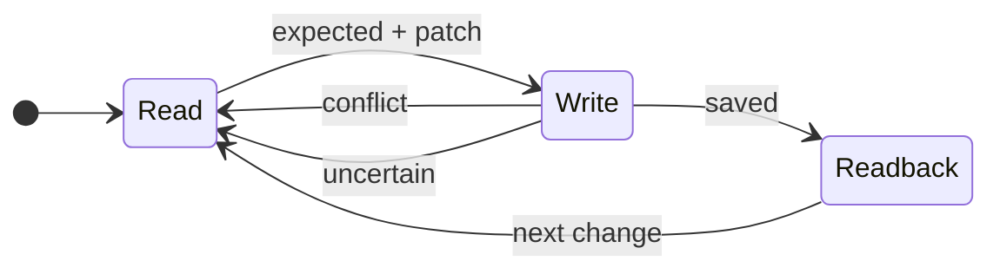

# UX: Manager CLI preferences

## 1. Зачем

Manager должен штатно читать и изменять пользовательские инструкции и имена сотрудников, сохраняя чужие изменения. Политика выбора модели должна исполняться при создании работника.

### Путь до результата

Manager читает capabilities, `settings manager` и `employees show <id>`, сохраняет прочитанное значение как expected, затем вызывает узкую команду записи. С 2026-11-05 запись настроек не требует дополнительного GeckIt confirmation; изменение имени сотрудника по-прежнему требует подтверждения. См. [agent settings and shortcuts](agent-settings-shortcuts.md). После ответа обязательно повторяет чтение. Значение считается сохранённым только по readback. При конфликте снова читает текущее значение и согласует объединение; слепого повтора нет. После обрыва сначала читает состояние. Доступен только авторизованный интерфейс текущего Manager. Пользовательские мутации выполняет Manager после доставки кода.

## 2. Что добавляется

| Поверхность | Что появляется | Когда видно |
| --- | --- | --- |
| capabilities | settings manager, settings manager-edit, employees rename, sessions start --model | Авторизованный Manager |
| settings manager | Точное поле instructions | При чтении |
| settings manager-edit | --instructions и --expected-instructions; пустая строка очищает | При записи |
| employees rename | --id, --name, --expected-name | При записи имени |
| sessions start | --model, проверенный по models выбранного provider | Только для нового работника |

Графический интерфейс не меняется; используется существующее представление activity/результатов команд.

## 3. Состояния

| Состояние | Когда | Что видит пользователь | Что делать |
| --- | --- | --- | --- |
| Прочитано | Успешное чтение | JSON текущего значения | Подготовить patch |
| Сохранено | Совпало expected | JSON сохранённого значения | Сделать readback |
| Конфликт | Значение изменилось | "Manager instructions changed. Read settings manager and merge before retrying." или "Employee name changed. Read employees show and merge before retrying." | Прочитать и объединить |
| Неверный ввод | ID, поле или модель недопустимы | Точная ошибка CLI | Исправить аргументы |
| Неопределённость | Прерван ответ | Существующая ошибка uncertain delivery | Прочитать, не повторять запись |

## 4. Переходы

| Из | Событие | В | Что видит пользователь |
| --- | --- | --- | --- |
| Read | Manager отправил patch с expected | Write | Существующая запись activity |
| Write (имя сотрудника) | Пользователь отказал | Read | Существующий отказ подтверждения, ничего не записано |
| Write | Host нашёл конфликт | Read | Ошибка конфликта; ничего не записано |
| Write | Host сохранил | Readback | JSON значения |
| Write | Ответ прерван | Read | Uncertain; требуется чтение |
| Readback | Manager повторил read | Read | Текущее значение для следующего изменения |

## 5. Что молчит

Остальные поля, память, роли, ID, назначения и модели существующих сессий не меняются. Внутренние правила Manager не являются редактируемым полем.

## 6. Пороги и время

Новых таймеров нет. Существующие лимиты транспорта и команды остаются. Модель проверяется до создания сессии, затем заново проверяются провайдер, проект и авторизация после асинхронного чтения models.

## 7. Формулировки

Успешные read/write возвращают JSON. Конфликты приведены дословно в состояниях. Неверная модель: "That model is unavailable for the selected provider. Run providers models; no replacement was selected."

## 8. Краевые случаи

Пустые instructions допустимы; имя пустым быть не может. Изменение роли во время rename сохраняется. Две записи одного имени/инструкции с одним expected: только первая проходит. Неизвестный ID и лишние поля отклоняются. Отсутствующая/disabled модель не заменяется другой. Ошибка синхронизации guide после записи явно сообщает, что durable значение уже записано и нужен readback.

## 9. Чего намеренно нет

Полной замены settings (частичные preference patches описаны в agent-settings-shortcuts.md), изменения правил Manager, ролей и памяти; прямой правки файлов; смены модели работающего сотрудника; автоматического перезапуска приложения.

## 10. Развилки

Выбраны узкие patch-команды с expected значением: они не требуют пересылки полной устаревшей конфигурации. Полный settings replace отвергнут из-за потери параллельных изменений. Текст инструкции хранится в существующем ManagerRecord, отдельного источника нет.

## 11. Сверка с требованиями

Чтение/запись, capabilities, read-modify-write, реальный context, сохранение IDs и моделей, readback, parser/dispatch и отрицательные сценарии проверяются регрессиями. Живой host остаётся на старом backend до отдельно согласованной безопасной загрузки; реальные пользовательские мутации выполняет Manager.
