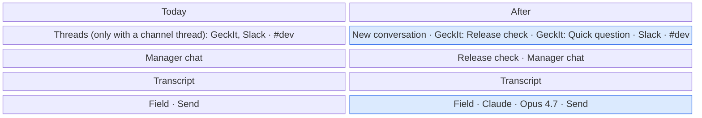
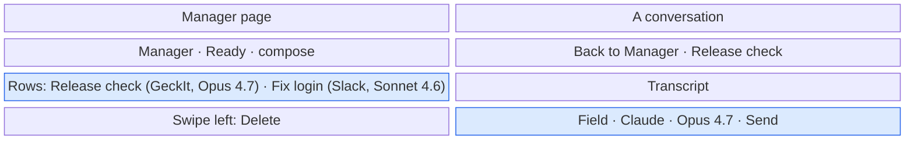
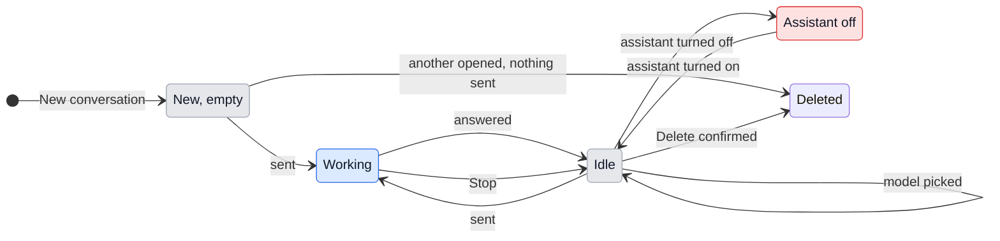

# UX: Manager conversations, each with its own assistant and model

## 1. Why

Manager has one GeckIt conversation. To start fresh, Alex clears its history; to try another model, he changes Manager settings, and every thread, Slack and Telegram ones included, moves to it at its next message (a change of assistant starts every thread over). He cannot keep a long-running coordination conversation on one model while asking something quick in another, cannot see in the conversation which model answers, and cannot change it there. Conversations on the board already work this way: New task, each with its assistant and model shown under the field, the model changed from that menu, Delete from the conversation's menu. Manager conversations get the same.

### Path to a result

- **Entry and result:** in the Manager window Alex presses New conversation, writes, and Manager answers in a conversation of its own, on the assistant and model shown under the field. He can switch between conversations, change the model of the open one, and delete one he no longer needs.
- **Readiness:** Manager on and its assistant enabled in Assistants, as today. A new conversation is ready at once: it takes the assistant and model from Manager settings at that moment. Nothing new to set up.
- **Decisions and order:** one, optional: the model, under the field, before or after the first message. The assistant is the one from Manager settings and is not chosen per conversation.
- **Shape:** the Manager window keeps its thread list and gains New conversation at its top, as Tasks has New task. A separate dialog for a new conversation (name, assistant, model) was rejected: the default is right almost always, and the model menu under the field changes it in one step without a form.
- **First run and return:** the existing GeckIt conversation stays first and keeps its history, assistant and model. Conversations survive restarts with what they were given. Changing Manager settings later changes only conversations made after it.

## 2. What is added

| Surface | What appears | When visible |
|---|---|---|
| Manager window, thread list (existing, desktop) | New conversation button at the top of the list ("New conversation", Cmd+N while the Manager window is in front). The list is shown whenever Manager is on, not only once a channel thread exists | Manager on |
| Manager window, thread list rows (existing) | GeckIt conversations as rows like channel threads: title, place "GeckIt", state dots. Newest message first, after any conversation that needs an answer | Always |
| Manager window, composer bar (the shared message box) | The assistant's name, greyed and not pressable, then the model menu, the same control as in a conversation, with the same note on its cost | A conversation is open |
| Manager window, toolbar More menu (existing) | "Delete conversation…" for every GeckIt conversation, with the existing confirmation | A GeckIt conversation is open |
| Manager window, Details popover (existing) | The assistant and model of the open conversation rather than of Manager settings | Details pressed |
| Phone, Manager page (replaces the thread toolbar and its chevron menu) | The Questions page's layout: the page title "Manager" with its state under it, the compose button ("New conversation") at the top right, then one row per conversation drawn as a Questions row (title, what it last said, when, state dot), with tags for where it is from ("GeckIt", "Slack · #dev", "Telegram · Alex") and its model ("Opus 4.7"). Conversations needing an answer first, then newest. Swipe left to delete, as on Questions | Manager on |
| Phone, a Manager conversation | Tapping a row opens it as a question opens: the same conversation screen, back to Manager, transcript, and the same message box with the assistant and model menu under the field. Manager's decisions and queued requests sit above the field as they do today | A row tapped |
| Team, Manager settings, Assistant and Model (existing) | Under the model: "New Manager conversations use this. Each conversation keeps the model it was given." | Always |

### What stays Manager-wide

One Manager: its instructions, Pause, decisions waiting for Alex and the pool of conversations it manages are shared by all its conversations. A worker reports to the conversation that started or follows it, as with channel threads. The thread list, its rows, the toolbar, Details and the transcript are the existing ones (`docs/ux/manager-threads.md`); this document adds GeckIt conversations to them and moves the assistant and model from Manager to each conversation.

### Phone: one way to open a conversation

On the phone the Manager page is a list, like Questions, and a conversation opens the way a question does, on the same screen. What differs is only what the screen is given: Manager's send (queued with a receipt, so a dropped link neither loses nor doubles a message), Stop, no assistant choice, and the Manager's decisions above the field. The phone's thread toolbar and chevron menu go; Details and More move into the conversation screen's own info and menu, as for any conversation.

## 3. States

| State | When it occurs | What the user sees | What to do |
|---|---|---|---|
| New, empty | New conversation pressed, nothing sent yet | The conversation selected in the list as "New conversation", an empty transcript with "What would you like Manager to do?", the field focused, the assistant and model under it | Write, or pick another model first |
| Working, idle, needs an answer | As in any Manager thread today | As today, per conversation | As today |
| Model changed | A model picked in the menu of a conversation that has messages | The menu shows the new model; nothing else until the next message, which starts a new run of the same conversation on that model | Nothing |
| Assistant off | The conversation's assistant was turned off in Assistants | Under the field: "Claude is turned off in Assistants. Turn it on there, or start a new conversation." Send disabled | Open Assistants, or New conversation |
| Model gone | The conversation's model is no longer offered by its assistant | The model menu shows "Default" and under the field: "Opus 4.1 is no longer available. Messages go to the default model." | Nothing, or pick a model |
| Deleting | Delete conversation confirmed | The existing deleting state of the dialog | Wait |

## 4. Transitions

| From | Event | To | What the user sees |
|---|---|---|---|
| any | pressed New conversation (or Cmd+N in the Manager window) | New, empty | A row "New conversation" at the top of GeckIt conversations, selected; empty transcript; field focused; assistant and model from Manager settings under it |
| New, empty | pressed Send | Working | The message in the transcript; the row's title becomes the first words of the message, as a task's title does |
| New, empty | opened another conversation without sending | removed | The empty row disappears; nothing was created on the computer to delete |
| New, empty | picked a model | New, empty | The menu shows it; the first message goes to that model |
| Idle or Working | picked a model | same | The menu shows it with the existing note "Another model reads the whole conversation again at your next message"; the current answer is not interrupted |
| Idle | pressed Send after a model change | Working | Nothing different: the conversation continues on the new model |
| any | Manager settings' assistant or model changed | same | Nothing in existing conversations; the next New conversation uses the new ones |
| Idle | assistant turned off in Assistants, by itself for this conversation | Assistant off | The line under the field, Send disabled |
| Assistant off | assistant turned on again | Idle | The line disappears |
| Idle | More, Delete conversation…, confirmed | removed | The existing confirmation and deleting state; the list opens the conversation above it, or the newest one |
| any | the last GeckIt conversation deleted | New, empty | A new empty conversation is opened, as today after deleting the GeckIt thread |

## 5. What stays silent

| State | Why it is not shown |
|---|---|
| Which settings a conversation was created with | The assistant and model under the field are what answers; when they were set does not change anything Alex can do |
| A model changed on another device for the same conversation | The menu updates on its own; it is the same conversation |
| A conversation's model differs from Manager settings | Expected: that is the point of keeping it per conversation |

## 6. Thresholds and time

Not applicable: nothing here waits or counts. The empty new conversation is removed when another is opened rather than after a time, because an empty conversation has nothing to lose.

## 7. Wording

| State | Text |
|---|---|
| Button | "New conversation" |
| Empty new conversation, row title | "New conversation" |
| Empty transcript | "What would you like Manager to do?" (existing) |
| Model menu cost note | "Another model reads the whole conversation again at your next message" (existing, from conversations) |
| Assistant off | "Claude is turned off in Assistants. Turn it on there, or start a new conversation." (the assistant's name in place of Claude) |
| Model gone | "Opus 4.1 is no longer available. Messages go to the default model." (the model's name) |
| Manager settings, under Model | "New Manager conversations use this. Each conversation keeps the model it was given." |
| Delete confirmation | The existing "Delete conversation?" dialog, without "A new empty GeckIt conversation will be available." unless it is the last one |

## 8. Edge cases

- **Empty:** Manager on with no GeckIt conversation (all deleted, or only channel threads): the list shows New conversation and the channel threads; opening the Manager window with none opens a new empty one.
- **Everything at once:** ten conversations: the list scrolls; conversations needing an answer stay on top, as threads do today.
- **Connection lost:** New conversation on the phone while the computer is out of reach: disabled, like Send, with the existing "Computer disconnected. Reconnect to send." line.
- **Repeat:** New conversation pressed twice: the second press selects the empty one already there rather than making another.
- **Channel threads:** Slack, Telegram and Discord threads also keep the assistant and model they started with, and their model can be changed from the Manager window the same way. A thread made by a channel after a settings change takes the new settings.
- **Existing data:** the GeckIt thread and every channel thread take the assistant and model in Manager settings at the update, so nothing changes for them on the day it ships.

## 9. What is deliberately absent

- **Choosing the assistant per conversation:** Manager's instructions, its CLI and tools are set up per assistant in Manager settings; a conversation on another assistant would need its own setup. Another assistant means changing Manager settings, then New conversation.
- **Renaming conversations:** the first message names it, as a task. Can follow if titles turn out unclear.
- **Moving a conversation's workers to another conversation:** follow and unfollow already do it.
- **A form for a new conversation:** see section 1.
- **Reasoning level menu for Codex:** follows if Manager runs on Codex and it is asked for; Manager settings has none today either.

## 10. Forks

| Question | Verdict | Reason |
|---|---|---|
| Does a conversation follow later Manager settings, or keep what it was given? | Keeps what it was given | Alex's request: each conversation has its assistant and model attached. Reverses "Manager stays one: one assistant, one model" in `docs/ux/manager-threads.md`, section "The model"; the rest of that model (one set of instructions, one Pause, one pool of workers) stands |
| Can a conversation's model be changed? | Yes, from the menu under the field, as in a conversation | The same control and cost note Alex knows; a model change resumes the same conversation |
| Can a conversation's assistant be changed? | No | Section 9 |
| Changing the assistant in Manager settings | Applies to new conversations only; existing ones keep theirs | Today it restarts every thread with a new session and loses their context. Keeping it is what "attached" means |
| Channel threads | Same rule as GeckIt conversations | One rule for all of Manager's conversations is simpler to explain than two |
| The list only when a channel thread exists | Always shown while Manager is on | New conversation needs a place, and with several GeckIt conversations the list is how to switch |
| Phone Manager page: thread toolbar with a menu, or a list like Questions | A list like Questions; a conversation opens on the same screen a question does | Alex, 2026-11-17: one way to list and open conversations on the phone. The toolbar's menu hid the other conversations behind a chevron |
| Desktop Manager window | Keeps its thread list beside the transcript | The desktop has room for both at once; Questions on the desktop is a menu, not a page, so there is nothing to match |
| Delete the last GeckIt conversation | Allowed; a new empty one is opened | Matches today's Delete conversation for the GeckIt thread |

## 11. Reconciliation with requirements

- Closes Alex's request of 2026-11-17: create and remove Manager sessions, each with the provider and model from Manager settings attached, the model displayed and changeable, as in Questions and Tasks.
- Changes `docs/ux/manager-threads.md` (section "The model", and the list being shown only with a channel thread) and the Manager settings description; both are updated with this document once approved.
- Not covered by a requirement: whether Telegram and Slack commands that start a new Manager context (their own "new" command, if any) should create a GeckIt-visible conversation. Today they clear their own thread; unchanged.

### Apple design requirements

- Clarity of the next action: New conversation is the first item in the list; the model sits where it does in conversations.
- Consistency: the same model menu, cost note, Delete dialog and Cmd+N as Tasks.
- Feedback: every action changes something visible at once (row appears, menu shows the model, row removed).
- Forgiveness: Delete keeps its confirmation; an empty new conversation is removed without asking because nothing is lost.
- Not applicable: motion and sound (no new ones).
