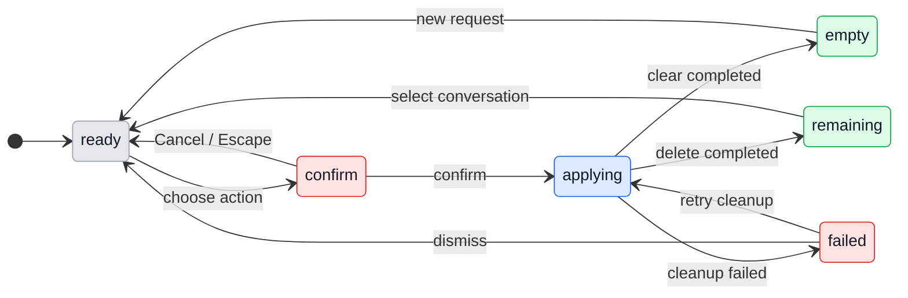

# UX: Delete or clear a Manager conversation

## 1. Why

Alex needs to remove conversations with Manager itself, or empty one conversation and its native context. Worker deletion (`ab1cc236`) is a separate function and does not fulfill this request.

### Path to a result

Open Manager, select the GeckIt, Telegram or Slack conversation in the existing thread selector, then open "Conversation actions" in that conversation. Choose "Clear history…" to retain the selected conversation/place with empty history and new native context, or "Delete conversation…" to remove that conversation. The confirmation identifies the selected title/place, explains stopped response/canceled queue and preserved work, and offers Cancel before the destructive action. Completion is an empty fresh conversation after clear; after delete it is the remaining/default conversation. A deleted default GeckIt conversation becomes a fresh empty default slot. No provider connection/setup is added. The same actions work on empty, active and inactive conversations; while disconnected they cannot be submitted. Returning after refresh/restart sees the persisted result. Failure is reported locally and does not claim success.

## 2. Surfaces

| Surface | Addition | Visible |
| --- | --- | --- |
| ManagerChat selected-thread header, desktop and phone | Conversation actions menu, Clear history… and Delete conversation… | A selected/default conversation exists |
| Existing app dialog | Target name/place, distinct consequence and Cancel/confirm | After choosing an action |
| Existing Manager empty transcript | Fresh empty history after clear; default/remaining selection after delete | After durable completion |
| Error within confirmation | Concrete failure and retained safe state | Host/runtime/provider cleanup failed |

Use GeckIt menus, dialogs, spacing, type and danger tokens; no new visual system or separate settings screen.

## 3. States

| State | When | User sees | Next action |
| --- | --- | --- | --- |
| Ready | Normal selected conversation | Conversation actions | Choose action or chat |
| Confirm clear | Clear chosen | "Clear history?" and selected object | Cancel or Clear history |
| Confirm delete | Delete chosen | "Delete conversation?" and selected object | Cancel or Delete conversation |
| Applying | Confirmed, host mutating | "Clearing history…" / "Deleting conversation…", controls disabled | Wait |
| Empty | Clear done or fresh default after delete | "What would you like Manager to do?" | Send a fresh request |
| Remaining | External thread deleted | Remaining/default conversation | Select or send |
| Failed | Cleanup unconfirmed | Error from host in dialog, no success | Dismiss or deliberately retry cleanup |

## 4. Transitions

| From | Event | To | User sees |
| --- | --- | --- | --- |
| Ready | Open menu and choose clear/delete | Confirm | Named target and consequence |
| Confirm | Cancel or Escape | Ready | Unchanged history/runtime/queue; focus returns to opener |
| Confirm | Press destructive button | Applying | Existing progress/disabled controls |
| Applying | Host persists clear and cleans native context, automatically | Empty | Empty selected conversation |
| Applying | Host persists delete and cleans native context, automatically | Remaining | Old external row absent; fallback/default empty as applicable |
| Applying | Provider/runtime/storage error, automatically | Failed | Concrete error, never "cleared"/"deleted" |
| Failed | Dismiss | Ready | Fenced state remains safe; old context is not resumed |
| Failed | Deliberately retry | Applying | Retry retired cleanup, never replay old commands |
| Empty/Remaining | Fresh request from UI or external place | Ready/working | New context answers; old messages do not return |

## 5. What stays silent

The new native session ID, durable reset generation, retired transcript cleanup and invalidation of old callbacks have no separate notifications. Existing work continues; do not send synthetic task changes. A channel's own server messages are untouched; explain that in confirmation rather than pretending to erase them.

## 6. Thresholds and time

Exactly one selected conversation per action, because this request is selective. No bulk action, retention timer or arbitrary message cutoff. Mutation uses a durable reset boundary; callbacks and external context older than that boundary cannot repopulate the thread. No automatic destructive retry.

## 7. Wording

- Action opener: "Conversation actions".
- Actions: "Clear history…", "Delete conversation…".
- Clear title/action: "Clear history?" / "Clear history".
- Delete title/action: "Delete conversation?" / "Delete conversation".
- Target: the visible conversation title and its place (GeckIt, Telegram, Slack).
- Shared consequence: "This stops Manager's response and cancels queued messages in this conversation. Working tasks, projects, employees and settings are kept."
- Clear consequence: "All messages and Manager's context in this conversation will be removed. This cannot be undone."
- Delete consequence: "This Manager conversation and its history will be removed. This cannot be undone."
- External consequence: "Messages already posted in the channel are kept. The next incoming request starts with empty Manager context."
- Default deletion consequence: "A new empty GeckIt conversation will be available."
- Incomplete cleanup menu: only "Retry clearing history…" or "Retry deleting conversation…", matching the original action; note "Finish incomplete cleanup before sending a new message.". The other action is unavailable until cleanup finishes.
- Cancel: "Cancel". Empty: "What would you like Manager to do?".

Concrete provider/storage errors are displayed verbatim; wording must match implemented host semantics.

## 8. Edge cases

- Empty conversation: both actions remain valid; no unrelated provider/session is removed.
- Active/queued: stop only selected Manager runtime, cancel its queue and pending product operations, fence in-flight completion/action/outbox callbacks before deleting backing history. Do not mutate worker native permissions.
- Previous backing sessions: all native context/history linked to the selected conversation is retired, not only the currently visible transcript; no restart reconciliation of old requests/operations.
- Clear keeps current thread/place and worker routing; future genuine task updates may arrive as new messages, without replaying old history. Shared live work metadata still exists, by request.
- Delete external: remove old incarnation, route its owned work to GeckIt and remove its follower reference; preserve workers, employee assignments and other followers. Next request from the same place creates a new empty incarnation and cannot reclaim the old routing.
- Telegram replies and Slack "earlier messages": persisted reset boundary prevents importing cleared messages or quoted history on the next request. External server messages remain outside this action's scope.
- Two devices/stale selection: host checks selected thread/session identity before mutation; stale request fails, never targets a newer incarnation. Late event cannot render into a different session.
- Failure mid-cleanup: durable retired IDs prevent resume/reconciliation; truthful error retains enough state to retry cleanup. Completed external side effects are not undone.
- Refresh/restart: no old transcript, requests, commands or outbound reply reappear.

## 9. Intentionally absent

Bulk cleanup; worker deletion; deleting external Slack/Telegram server history; erasing global project/work/employee/settings data; granting or answering native permissions. They are outside the corrected request.

## 10. Decisions

| Option | Decision and reason |
| --- | --- |
| Header menu for selected conversation | Use: target remains explicit on desktop and phone |
| One ambiguous reset/delete action | Reject: clear retains place, delete removes conversation; consequences differ |
| Restart native session while retaining old durable reconciliation | Reject: deleted messages would still influence context |
| Disable delete for default thread | Reject: old default conversation must be deletable; provide fresh empty default slot |
| Reuse deterministic external thread as old incarnation | Reject: stale events and old worker subscriptions could revive it |
| Delete worker tasks with Manager conversation | Reject: Alex explicitly requires preserving work |

## 11. Requirements

FR-001/002: two UI actions, named selected target and confirmation. FR-003: durable history/context reset. FR-004: active/queue/late-event fencing. FR-005: preserve work/configuration and other conversations. FR-006: external binding and fresh-request semantics. FR-007: isolated real UI plus disk/runtime evidence. This document precedes implementation under Alex's explicit instruction to implement both actions; no separate product decision is pending.
