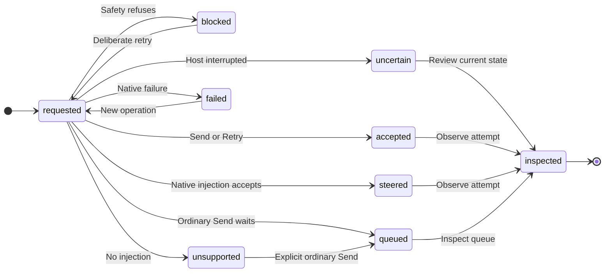

# UX: Retry paused work and steer current work through Manager

## 1. Why

Manager currently calls ordinary Send to resume VPN-paused work and reports `delivered:true` whenever that call returns. Send can return after queueing or refusing the VPN check. Alex needs a truthful result and the same deliberate retry available in the app, plus an explicit way to send a correction into current work rather than waiting behind it.

### Journey to a usable result

- **Entry/result:** Alex asks Manager to retry paused work or correct running work. Manager chooses Retry, Steer, or ordinary Send for a separate follow-up. The receipt names the exact attempt and its acceptance boundary; current session state remains separately inspectable.
- **Ready:** the worker is managed, its provider is enabled, native permissions remain satisfied, and the existing VPN policy passes. Steering additionally requires a live working driver with native injection support and no pending question/approval.
- **Decisions:** Retry resumes the held operation; it does not replace it with a new continuation prompt. Steer carries only the correction into the working runtime. Send retains ordinary queue semantics.
- **Form:** extend the existing CLI/Manager commands and reuse existing app Try again and queue Send now controls. A new global toggle or second composer would duplicate a decision already expressible per message.
- **Return/recovery:** persisted operation IDs reconcile repeated commands without replay. After an interruption, inspect current state; an uncertain mutation requires review, not automatic resend. No setup wizard or new settings are needed.

## 2. Surfaces

| Surface | Addition/change | Visible when |
| --- | --- | --- |
| Manager CLI capabilities/instructions | `sessions retry --id <id>` and `sessions steer --id <id> --text <correction>` | Capability discovery |
| Send/retry/steer receipts | Attempt ID, disposition and acceptance boundary; no unconditional delivered claim | Command result |
| Sessions list/show and worker notifications | Latest command receipt, observation timestamp and current state, without claiming causal attribution | Inspection/update |
| Existing desktop/phone Try again and queue Send now | Existing control and layout retained | Existing eligibility rules |

No new visual layout: existing conversation, queued rows, trouble area and transcript remain the design authority. Visible behavior is reviewed in the real renderer harness, both themes.

## 3. States

| State | Trigger | Visible result | Next action |
| --- | --- | --- | --- |
| Pending | Host is checking or dispatching this attempt | `pending`; no success claim | Wait or inspect current state |
| Accepted | Host dispatch accepts ordinary send/retry | `accepted`; explicitly host acceptance, not provider/model consumption | Observe current attempt |
| Queued | Ordinary Send waits behind work/held operation/concurrency | `queued` and queued message identity | Wait or explicitly Steer if eligible |
| Steered | Native injection resolves | `steered`; runtime acceptance, not model application | Observe worker output |
| Blocked | VPN check, pending native permission, inactive work or competing attempt prevents dispatch | `blocked` and specific reason | Resolve condition, then deliberate retry/new operation |
| Unsupported | Live driver lacks injection | `unsupported`; no queued substitute | Use ordinary Send deliberately |
| Failed | Native delivery throws | `failed` with reason | Inspect current state before retrying |
| Uncertain | Interrupted mutation has no definitive receipt | Existing uncertain-operation review | Inspect; never automatically replay |

## 4. Transitions

| From | Event | To | What Alex sees |
| --- | --- | --- | --- |
| Requested | Host accepts Send/Retry, automatically | Accepted | Receipt for this attempt, acceptance `host` |
| Requested | Ordinary Send finds busy/held work, automatically | Queued | Queue identity; no delivery claim |
| Requested | Native injection resolves, automatically | Steered | Receipt, acceptance `runtime` |
| Requested | VPN/native eligibility refuses, automatically | Blocked | Current reason; no false success |
| Requested | Driver has no injection, automatically | Unsupported | Capability limitation; queue unchanged |
| Requested | Native injection rejects, automatically | Failed | Reason; queue unchanged |
| Requested | Process stops before definitive result | Uncertain | Existing review action, no replay |
| Blocked/failed | Alex requests another attempt with a new operation ID | Requested | New receipt/attempt |
| Any completed operation | Same operation ID is repeated | Same historical result | Cached receipt, no second dispatch |
| Accepted/steered | Worker updates later, automatically | Current worker state | Attempt-bound update, not a rewrite of historical receipt |
| Queued | Alex cancels/edit/reorders through existing controls | Existing queue state | Existing queue behavior |

## 5. What stays silent

Native protocol IDs remain out of ordinary chat prose but are available for correlation in structured receipts. No success toast, automatic steering, auto-resend or duplicated model-consumption claim. A late command result cannot replace the newer command receipt. The latest receipt is a command snapshot, not proof that a later worker update was caused by it; compare attempt IDs and observation timestamps, and inspect current state. Stale native Codex turn-completed events are ignored.

## 6. Thresholds and time

Manager reuses its existing recovery timer: first recheck after 5 seconds, exponential backoff capped at 60 seconds, one check in flight. This avoids a permanently latched network refusal without tight polling. No new timer is added. Existing 10-second public-IP verification budget remains because network validation already has a bounded policy. One native injection at a time preserves ordering; a second request receives a specific blocked result and is not silently queued. A runtime acknowledgment promises acceptance only; tool/permission boundaries can delay model consumption indefinitely.

## 7. Wording

| Situation | Exact wording / structured value |
| --- | --- |
| Host dispatch accepted | `accepted`, acceptance `host` |
| Follow-up retained | `queued` |
| Native injection accepted | `steered`, acceptance `runtime` |
| Capability unavailable | "This assistant cannot receive a message while working." |
| Working turn ended | "The assistant is no longer working. Your message is still queued." for existing queued-row action; direct Steer explains that nothing was queued |
| VPN refused | Existing exact VPN error including mismatch/unavailable explanation |
| Pending native question | Specific existing native question/approval reason; no automatic answer |

Commands return machine-readable dispositions; Manager explains the returned disposition rather than claiming delivery. Provider-originated errors retain their native explanation.

## 8. Edge cases

Empty text is rejected before mutation. Busy Send stays queued; idle Send starts ordinary work. Retry while another retry/IP check is active returns blocked rather than pretending success. Steer while idle/failed/VPN-paused/asking is not converted to Send or Retry. Unsupported providers keep the queue untouched. Concurrent corrections are serialized or explicitly refused without reordering. A queued row is removed only after native acceptance; rejection retains its original position. Same operation ID reconciles after restart without injecting twice. A late event from an old provider turn cannot complete a newer turn. Historical receipts are immutable and current attempt metadata is persisted separately. A saved pending receipt after restart becomes uncertain without replay. Native permission requirements remain user-owned.

## 9. Deliberately absent

| Omission | Reason |
| --- | --- |
| Automatic queue-to-steer conversion | Separate work must retain existing ordering |
| Kill/restart fallback for steering | Loses context and bypasses native delivery semantics |
| Claim that accepted input was applied by model | Native protocols do not prove application |
| Live test on Alex's TwinsAI worker | Would alter unrelated active work |
| VPN bypass or automatic native approval | Existing policy and genuine permission controls remain authoritative |

## 10. Decisions

Use explicit Retry sharing the app's recovery path, rather than guessing intent from continuation text. Use explicit Steer sharing existing native injection, rather than changing ordinary Send. Keep legacy void send adapters compatible by naming host acceptance honestly; require a resolved native injection for `steered`. Expose per-attempt state rather than suppressing genuine later failures. Alex's explicit assignment authorizes this behavior and UX document; no additional approval gate is introduced.

## 11. Acceptance coverage

- Reproduce ordinary guard refusal returning a false old success; new receipt must be blocked.
- Retry uses the app path, preserves held text/permissions/queue, rechecks VPN, and reports current result.
- Manager/CLI exposes native Steer for Codex, builtin Claude and supporting libraries, with honest unsupported behavior.
- Busy/idle/failed/VPN-paused, pending permission, duplicates, stale updates, queue ordering and restart recovery have focused regression evidence.
- Browser fixtures verify existing UI controls and observable results; native protocol fixtures are identified separately from real account/provider verification.
- No live worker mutation, deployment, live restart or merge.

## Manager recovery after a changed VPN address

Alex can reconnect the VPN and leave Manager enabled. A saved public-IP lookup failure or an exact unapproved-IP refusal is eligible for guarded revalidation when the held operation is a message or continuation. Manager remains Unavailable with the exact existing VPN explanation until validation passes; other working chats are not proof that Manager is allowed to send. The existing status and error surfaces remain unchanged.

| From | Event | To | What Alex sees |
| --- | --- | --- | --- |
| VPN blocked | Recovery timer fires automatically | Checking through existing retry path | Existing VPN reason remains until a result exists |
| Checking | Current address is still unapproved or cannot be verified | VPN blocked | Current exact VPN error; no provider dispatch |
| Checking | Current VPN policy passes automatically | Working | Unavailable clears; held unsent input is dispatched once, or interrupted work receives reconciliation without replaying completed commands |
| VPN blocked/checking | Alex pauses or disables Manager | Paused/disabled | Existing pause state; pending recheck cannot dispatch afterward |
| Saved VPN hold | Host restores enabled Manager automatically | VPN blocked/checking | Same guarded recovery; no user pause is undone |
| Checking | Configuration, hook or genuine native permission blocks | Manual action needed | Existing specific reason; no automatic answer or bypass |

Transient recheck attempts stay quiet: no repeated Telegram notifications or new success toast. An exact VPN mismatch is a changeable network condition, not a permanent manual-only error. Configuration errors, arbitrary text resembling a VPN refusal, held approval answers and disabled providers remain outside automatic retry. Recovery does not restart GeckIt or any worker. Multiple queued inputs retain order; the held input is not duplicated.

Acceptance: prove mismatch-to-approved recovery, continued rejection while still mismatched, unavailable-to-mismatch-to-approved recovery, persisted manual-recovery restoration, interrupted-turn reconciliation without replay, and cancellation during validation. Prove configuration/hook/native approvals remain manual. Browser fixtures do not establish current live VPN eligibility.

## Native Codex retry visibility

Alex opens Manager inspection to find why queued Telegram work has stopped advancing. A native retry remains an active turn, so GeckIt must show the reason while Codex waits, without starting another turn or replaying a command. The existing inspection header and information area are the surfaces; no new controls or setup are needed.

| From | Event | To | What Alex sees |
| --- | --- | --- | --- |
| Coordinating | Codex reports an error with `willRetry: true`, automatically | Waiting for provider | Badge "Waiting for Codex" and "Codex is retrying automatically." followed by the native message and available additional details |
| Waiting for provider | Another retry notice arrives, automatically | Waiting for provider | Current notice replaces the previous one |
| Waiting for provider | Current turn produces output, reasoning or tool progress, automatically | Coordinating | Retry notice clears; ordinary Manager status returns |
| Waiting for provider | Native approval arrives | Needs an answer | Retry notice clears; existing approval behavior applies |
| Waiting for provider | Turn finishes, stops or fails, or connection closes | Existing completion/recovery state | Retry notice clears; terminal failures retain existing recovery behavior |
| Waiting for provider | Alex pauses/disables Manager | Existing paused/disabled state | Lifecycle status takes precedence |

A provider wait takes precedence over unrelated worker questions or historical delivery reviews in the summary badge; those decisions stay available in Telegram. A retry is not a new approval and does not mark queued messages complete. Only notices for the active turn are accepted; stale notices must not affect a newer turn. No timeout or retry schedule is invented: Codex owns its backoff, and an ETA is omitted because its error notification does not provide one. The transient notice is not restored as current state after restart. No repeated Telegram notifications are sent. Existing layout, scrolling, keyboard and theme behavior are reused.

Acceptance: a native 429 retry appears while the same turn remains busy, updates without redispatch, clears on real progress and every terminal path, ignores stale turns, and keeps genuine approvals and queued work intact. Review the actual inspection in both themes with a long native message and pending decisions. This fixes hidden retry state; it cannot remove the provider's rate limit.
