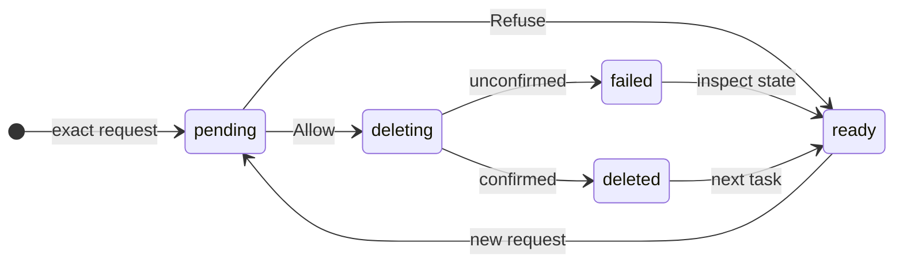

# UX: Delete one worker through Manager

## 1. Why

Manager can archive a conversation but cannot delete it. Alex needs the same removal outcome as the existing conversation Delete action, selected by exact ID and reported truthfully.

### Path to a result

Alex names the conversation in Manager chat. Manager reads fresh sessions list/show, distinguishes archive from delete and resolves ambiguity before issuing `sessions delete --id <full-managed-worker-id>`. The existing bound Allow/Refuse card is the decision. Allow stops work and cancels queued follow-ups, then asks its existing provider to delete the conversation. A confirmed result means the transcript or host-only draft is gone; project files remain. Closing chat leaves the pending decision available on return. A missing provider/SSH connection produces failure, never local substitution. An unmanaged conversation first requires the user's coordination request and `sessions attach`; the delete command itself cannot acquire ownership.

## 2. What is added

| Surface | Addition | Visibility |
| --- | --- | --- |
| Manager CLI capabilities and instructions | Exact single-worker deletion command and result boundary | When Manager uses capabilities |
| Existing Manager decision card | Deletion question, exact ID, canceled queue, files-kept consequence | After the requested command |
| Existing Manager operation result | Selected ID and confirmed success, or explicit failure | After the bound decision |

No layout changes or new controls. Existing desktop/phone/Telegram decision delivery, focus, keyboard navigation and scrolling remain the shared mechanism.

## 3. States

| State | When | User sees | Next action |
| --- | --- | --- | --- |
| Identifying | Request lacks an exact target | Manager asks which conversation | Select a single conversation |
| Pending | Bound operation awaits approval | Deletion decision | Allow or refuse |
| Deleting | User allowed | Existing operation working state | Wait |
| Deleted | Provider confirms, or host-only draft removed | JSON receipt with exact ID, deleted true and projectFilesKept true | Continue other work |
| Failed | Provider refuses or throws | Structured deleted false receipt and notice; work stopped and pending messages canceled | Inspect fresh state, fix host/provider problem before a new deliberate attempt |
| Refused | User declines | Existing refused operation state | Continue or change request |
| Invalid | Wrong ID, scope, ownership or authorization | Existing validation error | Read fresh state/select authorized worker |

## 4. Transitions

| From | Event | To | User sees |
| --- | --- | --- | --- |
| Ready | Manager requests exact worker deletion | Pending | Bound decision question |
| Pending | User clicks Allow | Deleting | Existing operation working state |
| Pending | User clicks Refuse | Ready | Refused; no session mutation |
| Deleting | Provider confirms, automatically | Deleted | Exact-ID success receipt |
| Deleting | Provider false/throws, automatically | Failed | deleted false; work stopped and queue canceled |
| Failed | Manager reads current session state | Ready | Actual retained conversation; no automatic destructive retry |
| Deleted | Next user request | Ready | Normal conversation |

## 5. What stays silent

Internal runtime teardown, row invalidation, tombstones and subscription cleanup have no separate notification; the command receipt carries their outcome. Other conversations receive no instruction.

## 6. Thresholds and time

One full ID per invocation prevents accidental bulk/prefix deletion. No new timeout or retry interval. Existing operation reconciliation handles uncertain responses; reuse the operation ID to inspect an accepted attempt. New IDs cannot be used as a blind retry.

## 7. Wording

Confirmation: "Delete this worker conversation permanently? Its running work will stop and queued messages will be canceled. Project files are kept. <literal command arguments>".

Success: structured result containing `id`, `deleted: true`, `projectFilesKept: true`.

Provider failure: structured `deleted: false`, `stopped: true`, `queueCleared: true`, `projectFilesKept: true`, and notice "Deletion was not confirmed. Running work was stopped and queued messages were canceled; the conversation is kept visible. Check the provider or host before trying again.". A terminal host operation means its attempt finished; Manager must inspect `deleted`, never equate operation done with deletion. A runtime shutdown exception is an error before provider deletion and cannot claim stopped true: "Runtime shutdown was not confirmed. Provider deletion was not attempted; queued messages were canceled. Inspect the worker before trying again.".

After provider success, a failed favorite save still reports `deleted: true` with notice "The conversation was deleted, but its favorite could not be saved. Do not repeat deletion; inspect settings and remove only this favorite.". If the provider confirmed deletion but durable local cleanup fails, the command errors with "The provider confirmed deletion, but local cleanup could not be saved. Do not repeat deletion; inspect the host notes store."; it must not invite repeating provider deletion.

Other authorization, refusal and validation strings reuse the existing command framework. Implementation must keep this document synchronized with final wording.

## 8. Edge cases

- Active runtime: end it before deleting its transcript; already completed tool side effects are not undone.
- Pending handover: await shutdown already in progress.
- Queue/drain/send race: cancel queues and invalidate active delivery before awaiting deletion; no resurrection.
- Unborn/prepared: no provider transcript required; delete host record and queued first message, releasing an allocated native thread through the existing provider adapter. Purely prepared synthetic IDs do not call provider deletion.
- Archive: archive preserves transcript and is reversible; deleting an archived worker remains permanent.
- Repeated operation: durable host record reconciles same operation; missing/partial IDs are not guessed.
- Provider refusal/SSH loss: retain visible conversation, ownership and followers; queue cancellation is explicit.
- Success: clear favorites, pending turns, ownership/followers and active rows; preserve only host audit/tombstone metadata.
- Lost response: no success claim and no blind mutation retry.

## 9. Intentionally absent

Bulk cleanup, message-history purge, cache/temporary-file cleanup and Manager-thread deletion are excluded: cleanup scope awaits Alex's answer. Provider-wide backups/index erasure, attachment/export cleanup and project-file removal are not promised by the existing provider delete contract.

## 10. Decisions

Always use existing product confirmation, including automatic delegation: transcript deletion is permanent. Cancel pending turns even if deletion fails: destructive intent must not leave autonomous queued work running. Failure retains a visible host record so the incomplete deletion can be inspected, including unsent drafts after restart. Provider errors can follow partial provider-side deletion; no transcript rollback is promised. No new UI layout or prototype is needed.

## 11. Requirements check

FR-001/002: path and decision. FR-003/004: states and failure. FR-005/006: edge cases and exclusions. FR-007: wording/instructions. FR-008: isolated CLI evidence in the feature verification record. No remaining deletion decision; cleanup scope remains outside implementation.
