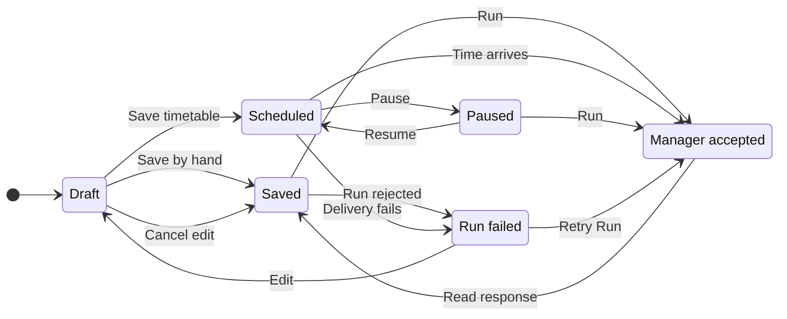

# UX: Manager shortcuts replace Voice Memos intake

## 1. Purpose and path
Alex wants to ask Manager to check recordings and create tasks through an ordinary shortcut, optionally on an explicitly chosen cron timetable. Open Shortcuts, choose New shortcut, set Target to Manager, choose a folder for context and write the prompt. Save retains the request; Run sends it to the configured Manager. On a schedule exposes the existing timetable editor. No schedule has been specified for Alex's recording request, so this implementation creates or activates none.

Manager must be enabled and usable through its existing configuration and approval rules. Saving a shortcut does not connect or enable Manager. A successful Run means the durable Manager inbox accepted the request, not that recordings have been read or tasks created. Open Manager to follow its response, prerequisites, questions and any delegated work. Manager uses its own assistant, model and mode. The folder is context, not a change of Manager's working directory or permission scope.

The existing compact form stays: target, context and prompt, then optional timing. This is one independent saved request, so there is no setup wizard. Returning to edit restores the target and schedule. Cancel preserves the saved request. Selecting Manager alone never changes its timetable. New task retains the existing employee and assistant controls.

## 2. Surfaces
| Surface | Change | When visible |
| --- | --- | --- |
| Desktop shortcut editor | Target choices New task and Manager; Manager hides worker goal, employee, assistant, model, reasoning and permission controls | Editing any shortcut |
| Phone shortcut editor | Same target and persistence rules using existing sheet components | Editing any shortcut |
| Desktop/phone shortcut list, menu bar and Team | Manager label/group distinct from employees and unassigned worker shortcuts; Run uses Manager inbox | Manager target saved |
| Manager settings | Remove Voice Memos/Automatic task sources configuration and connection controls | Always |
| Existing scheduler and CLI | Persist and display explicit Manager target; manual and cron runs use the same Manager path | Manager target chosen |

## 3. States
| State | Trigger | User sees | Next action |
| --- | --- | --- | --- |
| Draft | New shortcut or Edit | Target "Manager", prompt and folder; timing defaults to "By hand" for a new shortcut | Save or Cancel |
| Saved manual | Save without timetable | "By hand" and "Manager" | Run or Edit |
| Scheduled | Explicit timetable saved and on | Existing schedule description and next time, "Manager" | Wait, Run or pause |
| Paused | Timetable off | Existing "Paused" | Resume deliberately or Run |
| Accepted | Manager durably accepts prompt | Open Manager; normal Manager status | Read reply or answer its question |
| Unavailable | Manager disabled, paused, unconfigured or host fails delivery | Existing run failure, no success navigation | Fix Manager settings and retry |
| Saving failed | Persistence fails or host drops target | "Couldn't save the shortcut. Try again."; editor stays open | Retry or Cancel |

## 4. Transitions

| From | Event | To | User sees |
| --- | --- | --- | --- |
| Draft | Choose Manager | Draft | Worker settings disappear; folder/prompt/timing retained |
| Draft | Save succeeds | Saved / Scheduled / Paused | List reflects stored target and timing |
| Draft | Cancel / Escape | Previous saved state | Saved target/prompt/timing unchanged |
| Saved / Paused | Press Run, inbox accepts | Accepted | Manager conversation, no renamed worker task |
| Scheduled | Scheduler reaches explicit occurrence, automatically | Accepted | Normal Manager request/result in its conversation |
| Any runnable state | Manager rejects admission | Failed | Run failure; no claim of completed recording work |
| Accepted | Same shortcut still pending at next occurrence, automatically | Accepted | No duplicate queued recording processing |
| Scheduled | Pause timetable | Paused | Paused timing; no schedule catch-up on resume |

## 5. Silence
No migration popup, automatically created shortcut, invented cron expression or automatic activation. Unchanged scheduler checks stay quiet. Legacy source settings and history remain stored internally; their obsolete polling and pending automatic handoffs stop. Existing audio, Apple libraries, transcription history, saved notes and handled-recording identities are preserved. User data is never deleted to retire this integration.

## 6. Timing
Reuse the existing scheduler cadence, cron validation, start windows and no-catch-up behavior. Do not introduce a second recording timer. New shortcuts are manual until the user explicitly chooses timing. Pending Manager work prevents the same shortcut from piling up repeated requests; unrelated Manager requests retain normal inbox behavior.

## 7. Copy
- "Target": "New task" / "Manager".
- Manager summary: "Sends this prompt to Manager with {folder} as context. Manager uses its configured assistant and approvals."
- Manager row/group: "Manager".
- Team role: "Coordinates work from Telegram and shortcuts"; its description explains that Manager starts conversations and employees do the work.
- Existing "By hand", "On a schedule", "Timetable on", "Save" and "Cancel" retain their meanings.
- Manager setup remains the authority for any unavailable dependency; saved does not mean ready or executed.

## 8. Edges
Old shortcuts without a target remain worker shortcuts; no employee IDs are repurposed. Switching to Manager clears incompatible persisted worker choices. Switching back permits ordinary worker configuration. Stale hosts must not silently save a Manager request as a worker shortcut. Deleting or editing a shortcut while admission is pending must not resurrect a removed shortcut or change unrelated saved fields. Worker provider availability must not gate a Manager shortcut that uses a different configured assistant. Remote folder context must not become a remote Manager execution. Repeated/timed triggers must not overlap the same pending Manager request. Failure does not imply completion.

Legacy intake must be disabled at its execution boundary, not just hidden: no polling, startup retry, configuration-triggered tick, stale callback task claim or re-enable through an old client. Keep recording files, baseline/history, notes and unrelated Manager settings untouched. Already launched work is not restarted or silently cancelled. Manager's new user-supplied recording instructions remain subject to normal tools, source access and approvals; this feature does not grant file access or promise model compliance.

## 9. Deliberate absences
No replacement Voice Memos connector, recording deletion, history import/replay, automatic task creation from old intake, schedule selection on Alex's behalf, new provider runtime, Manager restart or changed Telegram pairing. No full redesign of Shortcuts or Team.

## 10. Decisions
The explicit target discriminant avoids conflating Manager with an employee or assistant. Manager's durable inbox is the existing coordination boundary and retains actual authorization and recovery. Keeping source data while disabling all old automatic paths prevents two systems from processing the same new recording. Existing form and tokens keep this local change consistent with GeckIt. Alex explicitly requested full implementation; this document records that authorized behavior without another design gate.

## 11. Requirements and verification
Covers target selection, persisted reload, manual/cron Manager execution, legacy retirement and data preservation. Fake native browser receipts verify UI behavior only; backend tests exercise the real engine path with controlled provider boundaries. No live schedule is created.

Verified on 2026-11-02:

- Full client suite: 103 files, 1,481 tests passed. Coverage includes disk reload, target capability/readback, manual and cron routing, pending/in-flight deduplication, target changes during admission, actual Manager inbox/session and ManagerOperations worker execution with a controlled provider, and retirement of legacy polling/queued intake without deleting history or recordings.
- Client TypeScript configurations, shortcut browser fixture typecheck, changed-file ESLint, desktop build and mobile build passed. Mobile retains its existing chunk-size advisory.
- Native Safari rendered actual desktop shortcut components in light/dark themes and actual phone components in a 390px preview in both themes. Reviewed full-window hierarchy, spacing, controls and scrolling. Target switching showed/hid worker controls; manual Save/reopen retained Manager; a paused timetable remained paused after Save; cron validation disabled invalid Save; simulated persistence failure kept the editor open; manual Run navigated after the fixture receipt. These saves/runs used a substituted native API, not the live account.
- Actual Team > Manager was reviewed in both themes on desktop and the 390px phone preview. Its shortcut section and create entry opened a manual Manager draft on both surfaces; phone Cancel dismissed it. Desktop setup was scrolled to its end with retained legacy intake settings supplied by the fixture: no Voice Memos/source controls appeared. Updated the old Manager fixture to use current Team navigation instead of its obsolete Settings section. Keyboard focus entered the editor, Shift+Tab reached Name, Tab reached Prompt, Option+Tab reached Target with visible focus, Enter opened its picker, and Escape dismissed the editor. Native automation did not reliably verify picker arrow selection or complete traversal/submit.
- The Mermaid state diagram rendered successfully with the official CLI to a temporary SVG.
- Performance review: reused existing rows, menus, sheets and application tokens; no new polling, animation, dependency or per-row subscription. Manager grouping uses the existing shortcut list. No runtime performance measurement was taken.

Live recording analysis/task creation, a paired physical phone and complete keyboard-only traversal/submit remain unverified. Active GeckIt/Manager conversations were not restarted; this session did not switch the installed backend to this working-tree implementation.

Delivery verification on current `origin/main` (`8d8477e`): the isolated Manager-only tree passed all 103 files / 1,479 tests, all four client typechecks, both browser fixture typechecks, ESLint and desktop/mobile builds. The two uncommitted start-window CLI tests and their implementation belong to another session and are excluded from this delivery; the shared checkout is preserved. Active conversations were not restarted.
