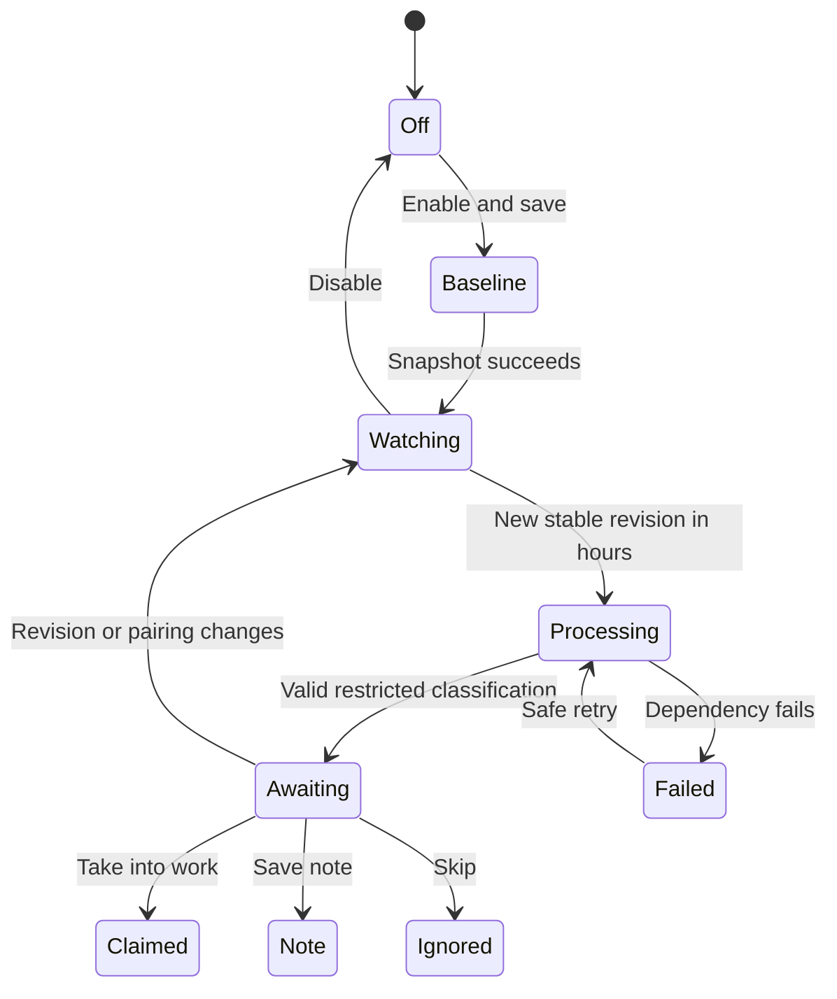
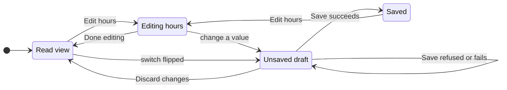

# UX: Manager task sources

## 1. Purpose and path
Record an idea on iPhone and review what to do with it in paired Telegram. Settings > Manager keeps manual coordination unchanged and adds a separate automatic intake section. First connect Apple Voice Memos without entering any technical parameters, then choose working time and explicitly enable automatic intake. Initial enumeration establishes a baseline only. Save stores configuration; automatic processing waits for enabled intake, connected Manager and paired Telegram, and current working hours. Connect and Check again only inspect local access and transcription readiness. GeckIt must remain open. Returning shows saved settings, source readiness and recent outcomes. iCloud sync, local transcription, a compatible Manager and Telegram pairing are prerequisites, not assumed successes.

## 2. Surfaces and layout
| Surface | Change | Visibility |
|---|---|---|
| Existing Settings > Manager | Automatic task sources section below setup; source connection then a compact working-hours editor and Save | Always |
| Source card | Apple Voice Memos connection, checked access/transcription status, baseline policy | When added |
| Recent intake | Title, summary/outcome/error; notes directory | When items exist |
| Existing paired Telegram | Summary, suggested classification, three action buttons | After classification |

Layout uses existing Settings labels, fields, quiet buttons and spacing tokens. Schedule/source settings are a single save group; setup/delegation remain separate. A disabled section still explains the feature and baseline. The panel scrolls with Settings; no nested long scrolling region.

## 3. States
| State | Trigger | Visible result | Next action |
|---|---|---|---|
| Off | Default or disabled | Automatic intake is off. Manual Manager work is unchanged. | Connect Apple Voice Memos and enable |
| No sources | Empty configuration | No task sources yet. | Connect Voice Memos |
| Outside hours | Current time outside intervals | Outside working hours | Wait or edit hours |
| Baseline | First scan pending | Baseline not established yet | Enable prerequisites and wait for working hours |
| Access blocked | Missing permission/path/schema | Concrete source error | Open Privacy Settings for denied access, then Check again |
| Waiting audio | Incomplete or changing file | Waiting for recording to finish syncing | Nothing |
| Transcription unavailable | No installed tool/model | Local transcription unavailable | Install via existing transcription setup |
| Classifying | Stable new audio transcribed | Reviewing recording | Nothing |
| Awaiting user | Valid analysis | Telegram card with summary and suggestion | Take into work / Save note / Skip |
| Claimed | User confirms task | Handed to Manager | Answer project clarification if needed |
| Note | User chooses note | Note saved with path | Open file normally |
| Ignored | User skips | Skipped | Nothing |
| Failed | Processing/delivery fails | Specific error, no false claim | Correct prerequisite; safe retry |

## 4. Transitions

| From | Event | To | User sees |
|---|---|---|---|
| Off | Explicit Save enabled | Baseline | Old recordings excluded |
| Watching | Timer/wake, outside hours | Watching | Outside working hours; no new reads |
| Watching | New stable item in hours, automatic | Processing | Reviewing recording |
| Processing | Validated AI response, automatic | Awaiting | Paired Telegram card |
| Awaiting | Current paired user confirms | Claimed/Note/Ignored | Durable outcome |
| Any pending | Changed revision/pairing | Superseded | Old callback has no effect |
| In progress | Restart | Same durable state | Safe recovery, no duplicate handoff |

## 5. Silence
| State | Why quiet |
|---|---|
| Repeated unchanged scan | No new user decision |
| Baseline old library | Explicitly excluded, no historical flood |
| Duplicate callback | Acknowledge existing outcome; no second action |
| Outside hours | Settings status is enough; no periodic Telegram notices |

## 6. Timing
Scan periodically only while enabled and within working hours; use one non-overlapping scan and re-evaluate wall time after wake/restart. Audio must match across separate observations at least 30 seconds apart before reading. The scan interval is 60 seconds; no overlapping scans. Failed processing retries at most three times, then an explicit Save resets safe processing attempts. A confirmed task handoff retains its deterministic outbox ID and retries after at least 60 seconds. A day with an overnight interval owns the interval's start; the following day contains its tail. Equal start/end is rejected rather than implying 24 hours. Timezone is editable and defaults to this Mac’s zone for new configuration; existing saved zones are preserved. Existing manual queue ignores this gate.

## 7. Copy
| Context | Text |
|---|---|
| Section | Automatic task sources |
| Schedule explanation | Working hours apply only to new task sources. Manual messages and queued work continue at any time. |
| Baseline | Existing recordings are excluded. Only new recordings will be reviewed. |
| Source | Voice Memos (macOS) |
| Consent | Recording transcripts are sent to your selected Manager assistant for classification. Audio transcription stays on this computer. |
| Confirmation | Take into work / Save note / Skip |
| Ambiguous task | Ask which project to use before starting a worker. |

## 8. Edges
Empty list has Connect Voice Memos without path entry. Long paths/titles wrap. No fixed footer obscures Save. Lost Telegram pairing invalidates decisions; reconnect cannot authorize old callbacks. No task before current user confirmation. An unknown schema fails closed. Old recordings syncing after baseline remain excluded by creation cutoff. Changed content invalidates old pending decisions. A handled recording UUID stays handled after later edits; edits do not silently create a second task. A decision from a previous Telegram pairing cannot be used in the current pairing. Failed local transcription sends no private audio to another service. Persist outcome before acknowledging; outbox uses deterministic Manager request identity. A confirmed task may still require ordinary delegation/native approval.

## 9. Deliberate absences
No Linear integration, official Apple API claim, background iCloud client, auto-import of history, automatic enabling, paid transcription, project guessing or source-specific polling by AI. No new mobile configuration UI; desktop settings own this computer's source.

## 10. Decisions
Use metadata database snapshot rather than folder enumeration because sidecars are not recordings. Use restricted no-tools classifier rather than full Manager tools before approval because source data is untrusted. Save notes under GeckIt's manager-notes directory with deterministic names rather than inventing a project destination. Disabled default protects existing preferences.

## 11. Requirements
FR-001/002/004/005: source/baseline/edges; FR-003/008: automatic connection/layout/timing; FR-006/010: states/consent/decisions; FR-007/009: transitions/confirmation/notes. No unresolved product decision. Live access and provider availability remain environment prerequisites, not mocked claims.

## Verification record
UX state diagram rendered successfully to `/private/tmp/geckit-intake-evidence/lifecycle.svg`. Browser fixture uses actual SettingsDialog/ManagerSettings/ManagerSources/styles; 27 configuration/theme/focus/scroll checks plus 6 help/Enter checks passed, 1280x900 and 760x700. Full-context light/dark screenshots inspected, including source access card, expanded help, validation, pending and saved-note outcomes. Fixture API does not write live settings. Final backend/native limits and complete checks are recorded in the feature quickstart.

### Recovery copy
Blocked source: "Correct the prerequisite, then Save to retry." Unsaved settings: "Save these settings. Access and the baseline are checked during working hours after enabling intake." Connection help names the relevant macOS privacy setting without exposing a technical setup form and grants no permissions. Invalid timezone/interval/source settings fail Save without changing stored settings; concurrent edits require Reload source settings. A known obsolete revision is retired immediately after callback metadata verification; it cannot remain an actionable decision until the next scan. Confirmed tasks request a registered project before delegation rather than deriving authority from memo text.

## Revision after Alex’s design review
The previous field-led setup is rejected. Apple Voice Memos is a built-in source, not a generic folder import. Settings shows a compact named source row first; Connect enables that source in the local draft and checks access without processing recordings. No path, folder picker, SQL, shell command, model file or recognition parameters appear in the normal flow. One Save persists source consent and schedule together; automatic intake stays off until explicitly enabled. Existing source IDs and explicit paths remain supported internally; opening and saving unchanged settings must preserve baseline and handled-item identities.

The connection check probes only known Apple library locations for this macOS user and checks installed local transcription prerequisites. It reads no recording content, establishes no baseline, calls no assistant and sends no Telegram message. Connected means the database is actually readable; transcription readiness is separate. Unavailable model/tool is a plain local-transcription state, never a command to build software. Existing Transcribe can prepare its local model through its ordinary UI; no automatic download occurs from a connection check.

| State | Exact wording | Next action |
|---|---|---|
| Not connected | “Record on your iPhone. Review new recordings in Telegram.” | Connect Voice Memos |
| Checking | “Checking Voice Memos…” | Wait; no progress claim beyond this check |
| Readable | “Voice Memos connected” | Enable intake and Save; working hours still apply |
| Permission denied | “Allow GeckIt in System Settings → Privacy & Security → Full Disk Access, then check again.” | Open Privacy Settings; then Check again |
| Not found | “Open Voice Memos on this Mac and turn on Voice Memos in iCloud, then check again.” | Open Apple app normally; Check again |
| Transcription missing | “Local transcription is not ready. Open GeckIt Transcribe to finish setup.” | Use existing Transcribe UI; Check again |
| Other/unsupported | Concrete truthful error, no raw command | Check again after fixing prerequisite or use macOS |

Privacy Settings opens only the existing macOS privacy pane; it grants no permission and does not imply success. Access must be checked again. New checks are non-overlapping and their stale responses cannot overwrite a newer choice or a closed component. Multiple legacy sources retain IDs and paths internally; no hidden reset or consolidation. Source checks do not run the intake pipeline outside working hours. Existing 60-second intake cadence, stability window and Telegram three-outcome authority remain unchanged.

Working hours use a compact summary, timezone and day chips beside each start/end interval; extra intervals are added only on request. Recent outcomes and note storage details are secondary disclosure, not setup controls. No new wizard, toggles for implementation details, generic source factory, or permanently expanded technical help. Keyboard reaches source actions, days, times and Save; narrow windows wrap interval controls without horizontal scrolling.

| From | Event | To | User sees |
|---|---|---|---|
| Not connected | Connect Voice Memos | Checking | Checking Voice Memos…; source added only to draft |
| Checking | Native read-only probe succeeds | Readable | Voice Memos connected; separate local transcription state |
| Checking | Native probe returns permission error | Permission denied | Exact Full Disk Access guidance and Open Privacy Settings |
| Permission denied | Open Privacy Settings | Permission denied | Same blocked status; no false connected state |
| Permission denied / missing dependency | Check again | Checking | Fresh check; previous readiness not assumed |
| Any draft | Cancel/reload or close without Save | Persisted settings | No preference or intake-history changes |

Alex explicitly authorized this revision and implementation; further design confirmation is not needed for these specified changes.

### Revision verification, 2026-10-25
- Full client typecheck and lint passed; 92 test files / 1330 tests passed. Desktop and mobile builds passed. Tests used the existing Electron dependency through a process-scoped distribution path and local fixture sockets outside the sandbox; no application was launched.
- 39 browser checks passed against actual SettingsDialog/ManagerSources/styles with a fake native API: pathless connection, explicit Save, cancellation/reopen, legacy IDs/paths, pending/stale checks, access/privacy, missing/transcription/unsupported/failure states, multiple intervals, timezone validation, focus/keyboard and history scroll. Full light/dark screens at 1280x900 and 760x700 were visually inspected, including expanded hours and history. Native API fixtures do not prove iCloud sync or live Telegram delivery.
- Actual compiled auto-detection checked only the current user's standard Apple library database header and returned access denied (EPERM). No recording rows/audio were read, no TCC/preferences/pairing changed. Full Disk Access navigation, readable real-library ingestion, local transcription and live Telegram remain unverified in the running host.
- Performance review: no background renderer polling, per-item subscriptions or animation loops added; connection checks are explicit single-flight actions, and history remains capped at 20 records.
- Before/after captures and check logs are retained outside the temporary worktree; selected final fixture screenshots are copied into the managed project's `.geckit-attachments/manager-voice-memos-connect-20261025/`.

## Revision: schedule and source layout, 2026-10-25 (second design review)

Alex rejected the PR #44 layout: heavy outlined day chips, uneven large fields and buttons, "Remove interval 1", a time zone detached from the hours, long explanations, a native blue checkbox, and a form that needed scrolling to understand. The task and backend stay the same; the screen is reorganised around three questions read top to bottom: is intake on, is the source usable, when does it run.

### Path and hierarchy
1. **Section header.** Title, one status line and the intake switch on the right, the same switch Assistants uses. The switch edits the draft; the status line says what will happen.
2. **Source row.** One row in a bordered list, like an assistant row: icon, name, one readiness line, then small text actions. With no source the row's only action is the primary "Connect Voice Memos". With a source, the row ends in a "Use Voice Memos" switch and offers "Check again", plus "Open Privacy Settings" only after an access denial.
3. **Working hours, read view.** A bordered list: one row per interval, days on the left and "09:00 – 18:00" on the right, then a "Time zone" row with the IANA name and its current GMT offset. "Edit hours" sits on the heading line.
4. **Working hours, edit view.** The same list in place. Each interval row has a compact seven-day strip, start and end time fields joined by a dash, and an icon-only remove button whose accessible name names the interval. Problems appear on the row that has them. "Add interval" adds weekdays 09:00–18:00 first, weekends after that. The time zone row is a text field with the system's zone list as suggestions, the live offset, and "Use <this Mac's zone>" when the field holds another zone.
5. **Save group.** "Save task sources" is the primary action only while something changed, next to "Discard changes" and "Unsaved changes". After a successful save it shows "Saved" and the editor closes.

Rejected: a modal or wizard for hours (one short form, no dependency between steps); a menu of every zone (more than 400 entries with no filtering in the existing Picker); a single-select segmented control for days (several days can be on at once).

### States and exact copy
| State | Trigger | Visible result | Next action |
|---|---|---|---|
| Intake off | Switch off | "Automatic intake is off. Manual Manager work is unchanged." | Turn the switch on and save |
| Intake on, unsaved | Switch turned on, not saved | "Turns on when you save." | Save task sources |
| Intake on, saved | Saved and enabled | Backend copy: "Watching for new recordings", "Outside working hours" or "Automatic intake needs attention" | None, or fix the reported item |
| Source not added | No source | "Record on your iPhone. Review new recordings in Telegram." | Connect Voice Memos |
| Not checked | Source saved, no check this window, backend not blocked | "Not checked in this window." | Check again |
| Backend blocked | Saved source reported blocked | The backend's detail, in warning colour | Check again |
| Checking / connected / access / missing / failed | As in the previous revision | Same exact copy as before; Full Disk Access denial is a warning, never "Voice Memos connected" | As before |
| No hours | Every interval removed | "No working hours. New recordings wait until you add them." | Edit hours |
| Interval invalid | No day, empty time, start equals end | "Choose at least one day." / "Enter a start and an end time." / "Start and end must differ." on the row | Fix the row; Save is refused with the existing alert |
| Overnight | End earlier than start | Read: "22:00 – 01:00 next day"; edit: "Ends at 01:00 the next day." | None |
| Unknown zone | Text is not an IANA zone | "Unknown time zone" next to the field | Pick a suggestion or "Use <zone>" |
| Unsaved | Draft differs from what was loaded or saved | Primary Save, "Discard changes", "Unsaved changes" | Save or discard |
| Saved | Save succeeded | "Saved", editor closed | None |
| Save failed | Storage error | The error as an alert; no "Saved" | Save again |
| Busy | Saving, or a check in progress | Switches and Save disabled; hours locked while saving | Wait |

### Transitions

| From | Event | To | User sees |
|---|---|---|---|
| Read view | Presses "Edit hours" | Editing hours | Same list becomes editable; button reads "Done editing" |
| Editing hours | Presses "Done editing" | Read view | Draft kept, still unsaved if changed |
| Any | Changes a day, time, zone or switch | Unsaved draft | Primary Save, "Discard changes", "Unsaved changes" |
| Unsaved draft | Presses "Discard changes" | Read view | Values as last loaded or saved; editor closed |
| Unsaved draft | Save with a row or zone problem | Unsaved draft | Inline problem plus the existing alert; nothing written |
| Unsaved draft | Save succeeds | Saved | "Saved"; editor closed; read view shows the stored values |
| Unsaved draft | Storage fails | Unsaved draft | Error alert; no "Saved" |
| Any | Settings closed without Save | Persisted settings | Nothing written |

### Silence and numbers
The offset is computed for the current date and is not refreshed while the dialog stays open across a DST change; the stored value is the IANA name, so the schedule itself is right. No toast on save, the line next to Save is enough. A new configuration takes this Mac's zone; a saved zone is never replaced unless the user picks "Use <zone>" and saves.

### Verification, 2026-10-25
Implemented in `ManagerSources.tsx` and its styles. 45 browser checks against the real SettingsDialog, ManagerSettings and ManagerSources with the fixture native API: connect, save, edit, keyboard toggling of days, inline validation, overnight hint, add and remove, unknown zone, zone suggestions, discard, preserved saved zone, save failure, disabled while checking, Full Disk Access and blocked states, no horizontal overflow and reachable history in light and dark at 1280x900, 1024x720 and 760x700. The fixture does not verify native Voice Memos access, iCloud, transcription or Telegram.
