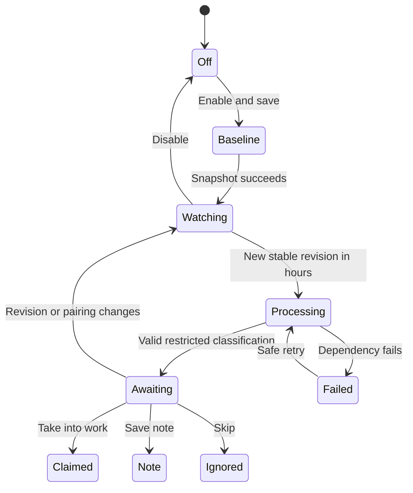

# UX: Manager task sources

## 1. Purpose and path
Record an idea on iPhone and review what to do with it in paired Telegram. Settings > Manager keeps manual coordination unchanged and adds a separate automatic intake section. First choose working time, then configure Voice Memos, then explicitly enable and Save. Initial enumeration establishes a baseline only. Save stores configuration; source checks wait for enabled intake, connected Manager and paired Telegram, and current working hours. GeckIt must remain open. Returning shows saved settings, source readiness and recent outcomes. iCloud sync, local transcription, a compatible Manager and Telegram pairing are prerequisites, not assumed successes.

## 2. Surfaces and layout
| Surface | Change | Visibility |
|---|---|---|
| Existing Settings > Manager | Automatic task sources section below setup; schedule then sources then Save | Always |
| Source card | Enable, recordings directory, status, baseline policy | When added |
| Recent intake | Title, summary/outcome/error; notes directory | When items exist |
| Existing paired Telegram | Summary, suggested classification, three action buttons | After classification |

Layout uses existing Settings labels, fields, quiet buttons and spacing tokens. Schedule/source settings are a single save group; setup/delegation remain separate. A disabled section still explains the feature and baseline. The panel scrolls with Settings; no nested long scrolling region.

## 3. States
| State | Trigger | Visible result | Next action |
|---|---|---|---|
| Off | Default or disabled | Automatic intake is off. Manual Manager work is unchanged. | Configure and enable |
| No sources | Empty configuration | No task sources yet. | Add Voice Memos |
| Outside hours | Current time outside intervals | Outside working hours | Wait or edit hours |
| Baseline | First scan pending | Baseline not established yet | Enable prerequisites and wait for working hours |
| Access blocked | Missing permission/path/schema | Concrete source error | Correct path/access, save/retry |
| Waiting audio | Incomplete or changing file | Waiting for recording to finish syncing | Nothing |
| Transcription unavailable | No installed tool/model | Local transcription unavailable | Install via existing transcription setup |
| Classifying | Stable new audio transcribed | Reviewing recording | Nothing |
| Awaiting user | Valid analysis | Telegram card with summary and suggestion | Take into work / Save note / Skip |
| Claimed | User confirms task | Handed to Manager | Answer project clarification if needed |
| Note | User chooses note | Note saved with path | Open file normally |
| Ignored | User skips | Skipped | Nothing |
| Failed | Processing/delivery fails | Specific error, no false claim | Correct prerequisite; safe retry |

## 4. Transitions

| From | Event | To | User sees |
|---|---|---|---|
| Off | Explicit Save enabled | Baseline | Old recordings excluded |
| Watching | Timer/wake, outside hours | Watching | Outside working hours; no new reads |
| Watching | New stable item in hours, automatic | Processing | Reviewing recording |
| Processing | Validated AI response, automatic | Awaiting | Paired Telegram card |
| Awaiting | Current paired user confirms | Claimed/Note/Ignored | Durable outcome |
| Any pending | Changed revision/pairing | Superseded | Old callback has no effect |
| In progress | Restart | Same durable state | Safe recovery, no duplicate handoff |

## 5. Silence
| State | Why quiet |
|---|---|
| Repeated unchanged scan | No new user decision |
| Baseline old library | Explicitly excluded, no historical flood |
| Duplicate callback | Acknowledge existing outcome; no second action |
| Outside hours | Settings status is enough; no periodic Telegram notices |

## 6. Timing
Scan periodically only while enabled and within working hours; use one non-overlapping scan and re-evaluate wall time after wake/restart. Audio must match across separate observations at least 30 seconds apart before reading. The scan interval is 60 seconds; no overlapping scans. Failed processing retries at most three times, then an explicit Save resets safe processing attempts. A confirmed task handoff retains its deterministic outbox ID and retries after at least 60 seconds. A day with an overnight interval owns the interval's start; the following day contains its tail. Equal start/end is rejected rather than implying 24 hours. Timezone is an explicit IANA name. Existing manual queue ignores this gate.

## 7. Copy
| Context | Text |
|---|---|
| Section | Automatic task sources |
| Schedule explanation | Working hours apply only to new task sources. Manual messages and queued work continue at any time. |
| Baseline | Existing recordings are excluded. Only new recordings will be reviewed. |
| Source | Voice Memos (macOS) |
| Consent | Recording transcripts are sent to your selected Manager assistant for classification. Audio transcription stays on this computer. |
| Confirmation | Take into work / Save note / Skip |
| Ambiguous task | Ask which project to use before starting a worker. |

## 8. Edges
Empty list has Add Voice Memos. Long paths/titles wrap. No fixed footer obscures Save. Lost Telegram pairing invalidates decisions; reconnect cannot authorize old callbacks. No task before current user confirmation. An unknown schema fails closed. Old recordings syncing after baseline remain excluded by creation cutoff. Changed content invalidates old pending decisions. A handled recording UUID stays handled after later edits; edits do not silently create a second task. A decision from a previous Telegram pairing cannot be used in the current pairing. Failed local transcription sends no private audio to another service. Persist outcome before acknowledging; outbox uses deterministic Manager request identity. A confirmed task may still require ordinary delegation/native approval.

## 9. Deliberate absences
No Linear integration, official Apple API claim, background iCloud client, auto-import of history, automatic enabling, paid transcription, project guessing or source-specific polling by AI. No new mobile configuration UI; desktop settings own this computer's source.

## 10. Decisions
Use metadata database snapshot rather than folder enumeration because sidecars are not recordings. Use restricted no-tools classifier rather than full Manager tools before approval because source data is untrusted. Save notes under GeckIt's manager-notes directory with deterministic names rather than inventing a project destination. Disabled default protects existing preferences.

## 11. Requirements
FR-001/002/004/005: source/baseline/edges; FR-003/008: path/layout/timing; FR-006/010: states/consent/decisions; FR-007/009: transitions/confirmation/notes. No unresolved product decision. Live access and provider availability remain environment prerequisites, not mocked claims.

## Verification record
UX state diagram rendered successfully to `/private/tmp/geckit-intake-evidence/lifecycle.svg`. Browser fixture uses actual SettingsDialog/ManagerSettings/ManagerSources/styles; 27 configuration/theme/focus/scroll checks plus 6 help/Enter checks passed, 1280x900 and 760x700. Full-context light/dark screenshots inspected, including source access card, expanded help, validation, pending and saved-note outcomes. Fixture API does not write live settings. Final backend/native limits and complete checks are recorded in the feature quickstart.

### Recovery copy
Blocked source: "Correct the prerequisite, then Save to retry." Unsaved settings: "Save these settings. Access and the baseline are checked during working hours after enabling intake." The macOS help shows an observed candidate directory, explicitly says its location can vary and grants no permissions. Invalid timezone/interval/source settings fail Save without changing stored settings; concurrent edits require Reload source settings. A known obsolete revision is retired immediately after callback metadata verification; it cannot remain an actionable decision until the next scan. Confirmed tasks request a registered project before delegation rather than deriving authority from memo text.
