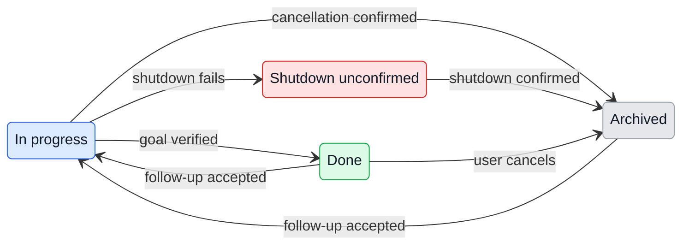

# UX: Manager task lifecycle

## 1. Purpose and path

Alex gives Manager a task and receives a verified result. Manager checks the assigned goal before moving its worker to Done. Cancellation moves the worker to Archived after canceling pending work and shutting down its runtime. The transcript remains available. For a later correction, Manager reads the last user request and recent answers before choosing the same worker or starting an independent task.

Prerequisites: enabled Manager, available assistant and registered project. Native permissions remain with Alex. The entry remains Manager chat on desktop or a connected channel, with no new setup or control. On return, durable status, attribution and history show the result; unavailable evidence keeps work open. These rules implement Alex's explicit request in session `codex:01a1c6f0-e1ba-7872-b398-2887d7893319`.

## 2. Surfaces

| Surface | Change | When |
| --- | --- | --- |
| Existing Manager instructions | Verify, close, cancel and choose continuations by context | Every turn |
| Existing board and status history | Done after verification; Archived after cancellation; In progress on follow-up | Lifecycle action |
| Existing operation result | Archive waits for shutdown; explicit failure if unconfirmed | Cancellation |

No new layout or prototype; existing status surfaces express the change.

## 3. States

| State | When | User sees | Next action |
| --- | --- | --- | --- |
| In progress | Work or verification remains | "In progress" | Wait or answer a pending permission |
| Done | Manager verified the full goal | "Done" | Read result or request correction |
| Archived | Runtime shutdown confirmed and pending work canceled | "Archived" | Read history or resume |
| Shutdown unconfirmed | Runtime teardown failed | "Runtime shutdown was not confirmed. The conversation was not archived; queued messages were canceled. Inspect the worker before trying again." | Inspect current state |

## 4. Transitions

| From | Event | To | User sees |
| --- | --- | --- | --- |
| In progress | Manager verifies concrete evidence against full goal and latest request, then marks Done automatically | Done | Card moves; result |
| Any | User cancels; Manager marks Archived; host cancels queued/held work and confirms shutdown | Archived | Card moves; history retained |
| Any | Shutdown rejects | Previous status | Explicit failure; no success claim |
| Done / Archived | Manager reads latest request/recent answers, confirms same outcome, sends follow-up; host accepts | In progress automatically | Same card and transcript |
| Done / Archived | Accepted follow-up waits for a slot | In progress automatically | Queued work; no claim of model consumption |
| Any | Independent outcome or unclear relationship | New worker | Separate card and goal |
| Shutdown unconfirmed | Manager inspects, resolves failure and deliberately retries cancellation | Archived on confirmed shutdown | Failure or confirmed status |

## 5. Silence

Runtime termination and queue cleanup need no extra progress messages. Runtime completion, a worker claim and a Goal reached badge alone do not move a card to Done. Project, employee and keyword matches alone do not establish a continuation.

## 6. Timing

No arbitrary recency window: read the last user request and recent responses to establish the relationship. Existing send queues and runtime teardown timing apply. Archive blocks dispatch during teardown. No blind retries of uncertain mutations.

## 7. Wording

Existing labels: "In progress", "Done", "Archived". Shutdown failure uses section 3's exact text. Manager describes the result or blocker in the user's language through existing voice rules; no new fixed notification.

## 8. Edges

- Missing or contradictory evidence keeps work open; delegate verification.
- Unavailable history cannot establish a continuation: clarify or create an independent worker.
- Concurrent send/queue drain cannot resurrect canceled work.
- Failed shutdown retains transcript and status; canceled messages stay canceled.
- Disabled provider or failed dispatch cannot prove resumption. Read receipt and fresh state.
- Archived remains reversible; deletion is a separate explicit request with confirmation.
- Queue cleanup includes held operations and restart recovery; project files and other workers remain.

## 9. Deliberate absences

No semantic verifier in the status API: Manager checks evidence; explicit status operations remain available. No Done on runtime ending, new cancellation CLI verb, deletion on cancellation, project-wide reuse or approval substitution.

## 10. Decisions

Use existing `sessions mark --status archived` with deletion's queue/runtime cancellation machinery, omitting provider deletion. Plain Stop remains an interruption that preserves pending messages. Existing Send already clears terminal status on dispatch, including queued work. Replace the old instruction to leave completed assigned work in In progress with verified Manager closure. Alex explicitly requested this behavior; no additional design approval is needed.

## 11. Requirements

| Requirement | Verification boundary |
| --- | --- |
| Done only after full-goal verification | Policy on initial, continuation and restored turns; real model decision checked separately |
| Cancellation stops pending work and keeps transcript | Manager operation, notes, teardown and queue assertions |
| Done/Archived follow-up resumes same task | Receipt, same ID, fresh status and history |
| Independent task starts separately | Context policy and distinct session IDs |
| Protected delivery | PR, CI, release and running version in verification report; PR alone is insufficient |
