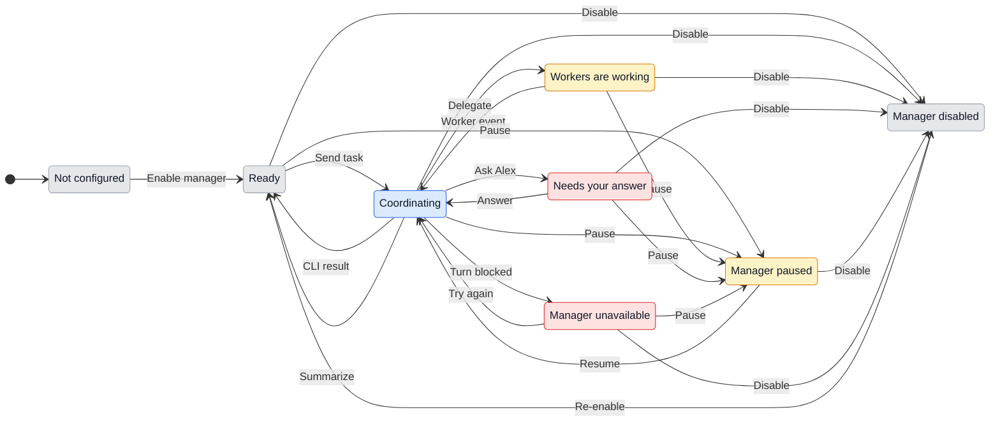
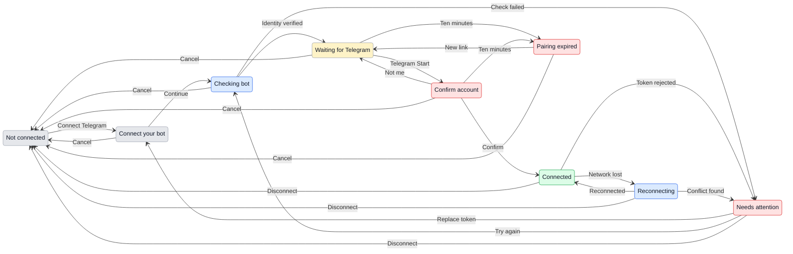
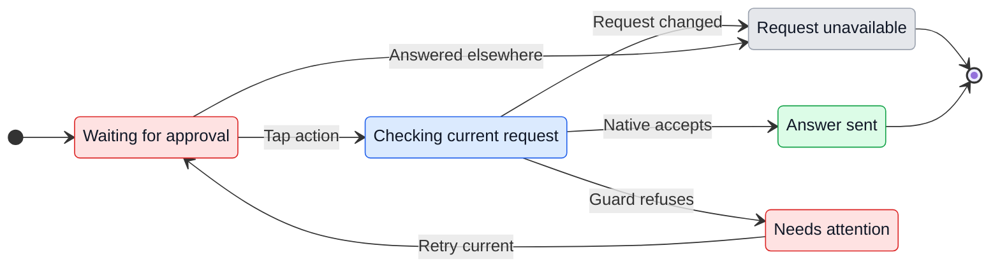
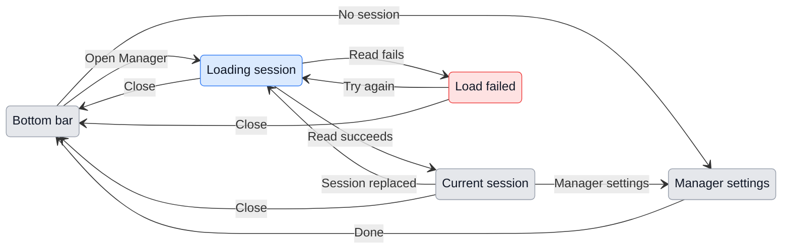
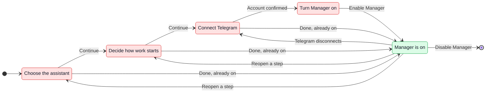
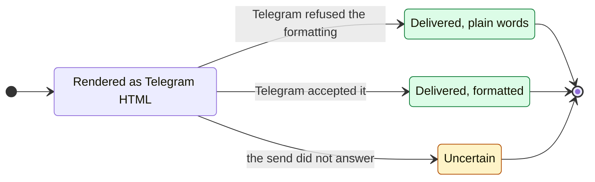
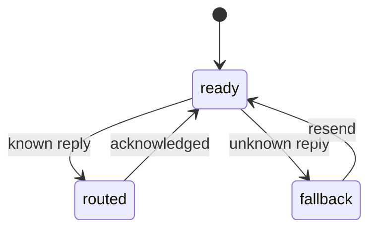

# UX: Manager through Telegram

> Current direction: [Telegram-only revision](#telegram-only-revision---2026-10-17) supersedes the Desktop/phone conversation surfaces below. Desktop retains Settings setup/status/recovery; Telegram is the sole Manager conversation. Earlier sections and prototypes record the prior design.

## 1. Why

Alex currently visits individual sessions to assign work, correct it, answer questions and collect results. Manager becomes one persistent conversation across all current and future GeckIt projects. It delegates deep work, manages GeckIt and requested project/files through its CLI, and keeps concise task state. Telegram is the sole Manager conversation; Desktop Settings handles setup and recovery. Alex requested this UX and prototype together, then authorized first-version implementation on 2026-10-17. The implementation boundary below distinguishes this version from the full direction.

### First-version implementation

Alex authorized the first implementation on 2026-10-17. The Telegram-only revision supersedes the earlier conversation flows below. Manager is a special GeckIt session with manager instructions and dedicated UX. Setup supports every enabled builtin/library provider through the existing runtime, authentication, permission handling and model catalog. Normal provider/account failures have their existing recovery; no provider is automatically installed, enabled or silently substituted. This follows Alex's enabled-provider correction documented below.

V1 defaults to "Automatic delegation" and lets Alex select "Approve new sessions". Under that policy, a bound Allow/Refuse decision precedes each new worker; ordinary worker tool permissions still apply under both policies. The dedicated composer accepts text and treats slash/shell-like input as messages, without ordinary attachment/tool-mode controls. Manager instructions require CLI administration and delegation of deep work; provider-native tools retain normal permissions. Host-validated structured requests run through GeckIt CLI and recorded outcomes feed back to the manager. Instructions are not represented as a universal tool sandbox. Unsupported management domains explain the limitation rather than claim an action ran.

Manager and project-worker providers are independent: the provider routing rule in section 8 remains authoritative. Telegram credentials and pairing confirmation remain on desktop; phone opens the same manager conversation and lifecycle controls.

## 2. What is added

| Surface | What appears | When visible |
| --- | --- | --- |
| Desktop sidebar, above Favorites | "Manager", current state and unresolved question count; opens its conversation | Always; before configuration opens setup |
| Settings > Manager, new section after Assistants | Assistant, model, All projects scope, delegation policy, role explanation, lifecycle controls and Telegram connection | Always |
| Manager conversation | Short replies, source attribution on Telegram messages, task-bound questions, Start/Refuse proposals, result/evidence links, "Managed tasks" disclosure | After enable; preserved while paused/disabled |
| Board/worker header | Existing parent link reads "From Manager" for managed work; existing task menus gain "Manage with Manager" | Manager-owned work, or attachable work |
| Manager header | Assistant, model, All projects, state, Session info, Pause/Resume and Settings; this page is the manager session | After setup |
| Session info, desktop and phone | Logical manager ID, backing session ID, assistant/model, last activity, known context usage, workers/questions and recent CLI operations; Open session and confirmed Restart session | Configured, including paused/unavailable states |
| Telegram private bot chat | Same messages, compact result updates and task-bound buttons; command menu | After pairing |
| Phone Tasks page | "Manager" row above the existing task list, opens shared conversation | Configured manager; not a new bottom tab |
| Phone Settings > Manager | Assistant/model/All projects/policy summary, Pause/Resume, "Set up on your computer" for credentials | Paired computer has this feature |

The manager has no ordinary task card and is not moved to Done. Workers remain normal board cards. Managed tasks opens a list, not a second board. A removed or deleted worker remains a historical task record without a broken navigation action.

## 3. States

### Manager

| State | When it happens | Exact label | What Alex does |
| --- | --- | --- | --- |
| Not configured | No saved manager | "Set up Manager" | Choose assistant and model |
| Ready | Enabled, no active coordinator turn | "Ready" | Send a task or inspect results |
| Coordinating | Processing a user message or actionable worker event | "Coordinating" | Nothing; Pause is available |
| Waiting | Workers own unfinished tasks, no coordinator action needed | "Workers are working" | Nothing, or ask for progress |
| Needs Alex | One or more unresolved user decisions | "Needs your answer" | Answer a bound question |
| Paused | Alex paused coordination | "Manager paused" | Resume; workers continue |
| Unavailable | Provider, VPN, account or required connection blocks a turn | "Manager unavailable" | Read the specific reason and resolve it, then Try again |
| Disabled | Alex disabled management | "Manager disabled" | Re-enable in Settings; history remains |

Display precedence: disabled, paused, unavailable, needs answer, coordinating, workers working, ready. Pending questions stay visible under paused/unavailable labels. Waiting does not keep a model turn or active-work slot open.

### Telegram

| State | When it happens | Exact label | What Alex does |
| --- | --- | --- | --- |
| Not connected | No saved token | "Telegram not connected" | Connect Telegram |
| Token entry | Setup is open | "Connect your bot" | Paste a dedicated bot token or Cancel |
| Validating | Checking bot identity | "Checking bot..." | Wait or Cancel |
| Waiting for account | Bot verified; pairing link open | "Waiting for you in Telegram" | Open Telegram, press Start |
| Candidate | Start received from pairing link | "Confirm your Telegram account" | Match identity and press Connect account or This is not me |
| Connected | Confirmed identity and receiver healthy | "Connected" | Message bot or Disconnect |
| Reconnecting | Network temporarily unavailable | "Reconnecting to Telegram" | Nothing, or Disconnect |
| Needs repair | Credential revoked, receiver conflict, blocked bot or secure storage failure | "Telegram needs attention" | Specific recovery action or Disconnect |
| Pairing expired | Pairing lifetime elapsed | "Pairing link expired" | Create new link or Cancel |

Telegram disconnection never disables desktop Manager. A paused/disabled manager can still receive a control command to resume/re-enable only as described below; disabling requires re-enable on desktop so old remote access cannot silently reopen it.

### Task and decision state

Use board words: working, queued, waiting for your answer, blocked, In review, Done. A decision is Waiting, Answered or No longer available. A delivery is Received, Queued, Delivered, Failed or Delivery uncertain. These are observable outcomes, not model predictions. Manager never marks work Done from a worker's assertion alone; Alex accepts it.

## 4. Transitions

| From | Concrete event | To | What Alex sees |
| --- | --- | --- | --- |
| Setup | Enable manager with assistant and model | Ready | Shared Manager opens; "What would you like to get done?" |
| Setup | Assistant/model unavailable | Setup | "This assistant cannot run as a manager." / "This model is unavailable. Choose another model or try again." Focus invalid selection |
| Ready/Waiting | User sends implementation request | Coordinating | User text immediately appears; receipt does not claim a worker has started |
| Coordinating | Start accepted, automatically | Workers working | "Started: <task> in <project>." with task link |
| Coordinating | All active slots occupied, automatically | Workers working | "Queued: <task>. Waiting for a slot." |
| Coordinating | Approve new sessions requires a new worker | Needs Alex | Assignment, project and goal; "Start" / "Refuse" |
| Needs Alex | Start or Refuse | Coordinating | Bound decision changes to Answered; worker starts only for Start |
| Worker question received | Native permission or unsupported form arrives, automatically | Needs Alex | "<task> needs a permission in GeckIt." / "Open GeckIt"; no proxy approval |
| Needs Alex | Telegram button, Reply or desktop answer | Coordinating | "Answer delivered to <task>." only after dispatch acknowledgement; otherwise queued/failed/uncertain |
| Needs Alex | Unthreaded answer matches several questions | Needs Alex | "Which task is this answer for?" and task choices; nothing delivered |
| Worker active | User says Stop with one unambiguous task | Coordinating | Stop request sent; "Stopped: <task>." only after confirmation; unsupported provider yields a reason and Open task |
| Any active manager state | Pause pressed | Paused | "Manager paused. Workers continue."; new dispatch held; queued inputs retained |
| Paused | Resume pressed or paired /resume | Coordinating | "Catching up..."; current worker state reconciled before new action |
| Any configured state | Disable confirmed on desktop | Disabled | "Manager disabled. Workers continue."; Telegram controls revoked |
| Disabled | Re-enable on desktop | Ready | Saved configuration review and Enable manager; no automatic replay of old instructions |
| Any configured state | Project added to GeckIt, automatically | Same lifecycle | "All projects" includes it without enrollment; no modal |
| Configured | Project removed through GeckIt | Same lifecycle | Existing removal behavior applies; files are not silently deleted |
| Settings | Select another assistant | Unsaved settings | Model list refreshes for that assistant; Provider default selected with no carry-over of incompatible model IDs |
| Settings | Save assistant/model while idle | Ready | Header identifies the selected model; existing workers keep their settings |
| Settings | Save assistant/model during active turn | Coordinating | "Model change queued for the next turn." Current and next settings shown; no hidden interruption |
| Session info | Open session | Same manager conversation | Details close; same session and history; composer focused |
| Session info | Restart session | Confirmation | "Restart manager session?" / "Task history and decisions are kept. Workers continue." Active turn adds interruption wording |
| Confirmation | Confirm restart | Coordinating | "Restoring manager session..." then current backing ID updates; task ledger remains |
| Confirmation | Cancel restart | Session info | Nothing changes; focus restored |
| Manager | Requested GeckIt CLI operation succeeds, automatically | Same lifecycle | Compact result and affected project/file/settings; operation appears in Activity |
| Manager | CLI operation unsupported/permission required | Needs Alex | Specific reason and supported recovery/native approval; no blind fallback shell |
| Token entry | Continue with empty token | Token entry | "Enter your bot token."; field focused |
| Checking | Bot identity returns, automatically | Waiting | Verified @bot handle; Open Telegram and pairing expiry |
| Waiting | Account presses Start with valid temporary link, automatically | Candidate | Name, Telegram account ID and "Connect account"; no project data sent yet |
| Candidate | This is not me | Waiting | Old link invalidated; fresh link shown; rejected account gains no access |
| Candidate | Connect account | Connected | Confirmed identity, computer name and availability note; welcome message in private chat |
| Setup dialog | Cancel or Escape | Previous saved state | Temporary token/link discarded; existing connection unchanged |
| Connected | Disconnect confirmed | Not connected | "Telegram disconnected." All pairing/actions invalidated; desktop Manager unchanged |
| Connected | Network lost, automatically | Reconnecting | Desktop shows retry state; no instant offline bot reply is promised |
| Reconnecting | Network returns, automatically | Connected | Locally accepted pending items reconcile; unsent updates delivered with task binding |
| Any delivery | Send outcome uncertain after timeout/crash, automatically | Uncertain | "Delivery uncertain. Checking before retrying."; no blind repeated task instruction |
| Reconnected | Work request over ten minutes old arrives | Needs Alex | "This request arrived late. Still do this?" / "Continue" / "Discard" |
| Decision resolved | Old button pressed | Resolved | "Already answered." or "This question is no longer available." No second action |
| Worker deleted/hidden | Session removal event, automatically | Historical task | "Deleted" / "Hidden" disposition in record; no broken Open task button |

Worker completion, question and failure wakeups enter the same serialized coordinator inbox as user input. An active turn receives or queues updates according to provider support; it is never duplicated by starting a second manager. A question arriving while paused stays visible but is not automatically acted on.

## 5. What stays silent

| Event/state | Why it stays silent |
| --- | --- |
| Worker tool calls, logs and private reasoning | Detailed execution stays in its worker |
| Every streamed worker sentence | Manager needs a result/event, not a transcript mirror |
| Normal worker heartbeats and queue position changes | Status on request and managed list is enough |
| Duplicate events and successful routine delivery retries | No second user action is needed |
| Routine discovery of newly registered projects | All projects already includes them; no enrollment notification |
| Unpaired accounts/groups | No account or task information is disclosed |
| Manager idle between events | No spinner, polling conversation or repeated "still waiting" message |

## 6. Thresholds and time

| Number | Value | Reason |
| --- | --- | --- |
| Logical managers / bot / paired accounts | One each per installation | One point of contact with unambiguous task ownership and private routing |
| Pairing expiry | Ten minutes from link creation | Allows switching devices; prevents an old shared link granting later access |
| Late work confirmation | Message older than ten minutes on receipt | A remote instruction may no longer represent intent after an outage |
| Worker concurrency | Existing user setting | Manager must not create a second execution budget; idle manager uses no slot |
| Receipt / actionable update target | Five / ten seconds under available services | Separates acceptance from potentially long work and exposes missing event handling |
| Routine completion grouping | Up to five seconds | Nearby results can become one concise update without delaying a blocking question |
| Undelivered Telegram retention | At most 24 hours | Platform limit; older unseen messages may be lost, not an app-owned durable queue |
| Unresolved decision lifetime | Until answered, superseded, task removal or access revocation | No arbitrary timeout should silently authorize work |
| Visible list size | Viewport-based scrolling | Task count must not push the composer or action buttons off screen |

No response can be sent by a local bot process while the receiving computer is asleep or GeckIt is quit. Telegram delivery acknowledgement is not proof GeckIt received a request. Locally accepted messages are durable; unseen remote messages depend on Telegram's retention. [Telegram delivery constraints](https://core.telegram.org/bots/api#getting-updates)

## 7. Exact wording

| Place/state | Text |
| --- | --- |
| Setup description | "Talk to one manager. It delegates work to separate sessions and brings back results." |
| Role summary | "Manages GeckIt through its CLI. Delegates deep work to worker sessions." |
| Scope heading / explanation | "All projects" / "Includes current and future projects in GeckIt, across all profiles." |
| Model heading / default | "Model" / "Provider default" |
| Model list loading / error | "Loading models..." / "Could not load models. Try again." |
| Model unavailable | "This model is unavailable. Choose another model or try again." |
| Session entry / view | "Session info" / "Manager session" / "Open session" / "Restart session" |
| Context not reported | "Not reported by this assistant" |
| Next-turn change | "Model change queued for the next turn." |
| Policy labels | "Automatic delegation" / "Approve new sessions" |
| Automatic policy note | "Start and follow up on requested work across all projects. Worker permissions still apply." |
| Review policy note | "Review each new worker before it starts. Follow-ups stay in the same worker." |
| Role unavailable | "This assistant cannot run as a manager." / "Choose another assistant." |
| Empty conversation | "What would you like to get done?" |
| Empty managed list | "No managed tasks yet." |
| Paused notice | "Manager paused. Workers continue." |
| Paused received message | "Saved for when you resume Manager." |
| Telegram explanation | "Use your own bot to talk to this manager from Telegram." |
| Bot setup | "Create a dedicated bot with @BotFather, then paste its token here." |
| Availability note | "Keep this computer online with GeckIt open. Messages pass through Telegram." |
| Privacy detail | "Your tasks and replies use Telegram's bot service. This is separate from GeckIt's encrypted phone connection." |
| Token help | "Stored securely on this computer. Never shared with the manager or workers." |
| Pairing description | "Open Telegram and press Start. Then confirm your account here." |
| Account fields | "Telegram account" / "Account ID" / "Connect account" / "This is not me" |
| Welcome | "Connected to <computer>. Send a task or ask for progress. This computer must be online with GeckIt open." |
| Receipt | "Received. I'll coordinate this in GeckIt." |
| Unsupported attachment | "This version accepts text. Type your request here, or open GeckIt to use attachments." |
| Bad token | "That token was not accepted. Check it with @BotFather and try again." |
| Receiver conflict | "This bot is already connected elsewhere. Use a dedicated bot or disconnect its other receiver." |
| Secure storage unavailable | "Secure storage is unavailable. Telegram was not connected." |
| Bot blocked | "Unblock the bot in Telegram, then try again." |
| Native permission | "<task> needs a permission in GeckIt." / "Open GeckIt" |
| Late request | "This request arrived late. Still do this?" / "Continue" / "Discard" |
| Stale decision | "Already answered." / "This question is no longer available." |
| Unknown answer | "Which task is this answer for?" |
| Uncertain send | "Delivery uncertain. Checking before retrying." |
| Telegram disconnect confirmation | "Disconnect Telegram?" / "This account will lose access. Manager and workers stay available in GeckIt. Telegram chat history is not deleted." |
| Disable confirmation | "Disable manager?" / "Coordination and Telegram controls will stop. Workers continue. Your task history is kept." |
| Assistant-change confirmation | "Change manager assistant?" / "The new assistant will read the saved task summaries and decisions. Workers keep their current assistants." |
| Restart confirmation | "Restart manager session?" / "Task history and decisions are kept. Workers continue." |
| Prototype status | "Design prototype. No bot or AI sessions are connected." |

Bot command menu: `/start` explains pairing status, `/help` lists text/task/decision behavior, `/status` returns current all-project summary, `/pause` pauses coordination, `/resume` resumes a paused manager, `/settings` shows connection/scope summary and directs configuration to the computer. Commands from unpaired accounts cannot reveal the scope. Natural-language Stop requires a target or clarification. Telegram management requests use the same CLI authority and native permission handoffs. Credential entry remains on the computer; pairing or manager re-enable cannot be changed silently.

## 8. Edge cases and interaction rules

- **Empty setup:** Enable manager requires a supported assistant and available model/default. Zero projects does not block setup; Manager can create or add the first project. The model list comes from the selected assistant/account; loading, refresh failure and unavailable saved choices have explicit recovery. Example model names in the prototype are not a product catalog.
- **Many tasks:** Managed tasks groups Needs your answer, Working/Queued and In review; only changed rows update. Details preserve scroll and focus. A result carries evidence and an Open task action where possible.
- **Two devices:** First validated answer wins. Other surfaces show Answered and remove live actions. A plain "yes" never answers several questions.
- **Offline:** Desktop Manager continues when only Telegram is unavailable. Failed Telegram sends remain distinguishable from task failure. Revoked credentials do not stop workers.
- **Old incoming work:** Show original text, task/project context and receipt age, then Continue/Discard. Repeated Continue cannot start it twice. Edited Telegram messages are not replacements for accepted instructions; send a correction as a new message.
- **Projects:** No per-project grants or enrollment. All registered projects, including future additions, are managed across profiles. Add/create/remove follows existing GeckIt rules, including host support. Adding an external folder uses an explicit requested path and does not grant arbitrary machine-wide file access. Project removal does not retract prior Telegram content.
- **Pause:** Stops new coordinator dispatch. A dispatched worker message may already be running; report this accurately. Resume reconciles, rather than replaying every old worker event into prompts.
- **Provider limits:** Show the existing account/VPN reason and recovery; do not silently switch assistant, clear a goal or bypass permissions. Unsupported remote stop/priority commands yield a named limitation.
- **Enabled providers only:** Both Manager and workers run through enabled GeckIt providers. All application control uses GeckIt CLI; no direct provider API or provider-binary dispatch from Manager. Disabled or missing providers cannot be enabled or installed merely to satisfy an assignment. Explicit user-requested configuration still follows existing trusted setup and credential handling.
- **Role and CLI:** Role text is visible read-only. Manager can directly manage requested GeckIt settings, sessions, projects and files through the CLI, while substantial implementation/research stays delegated. CLI capability discovery and result/permission reporting must cover the entire supported app surface. It is not restricted to the currently shipped read/start commands. Existing file protections, native approvals and destructive-action rules apply; secret entry stays outside model context.
- **Secrets:** Token is a password field during entry only. Dialog cancellation discards it. Replacement validates before replacing the saved connection. No real token or pairing link belongs in a prototype or screenshot.
- **Keyboard:** Settings section is reachable through Tab; native selects use platform keys. Tab reaches every field/action in visual order. Enter submits token or composer; Shift+Enter adds a composer line. Escape cancels a dialog and restores focus to its opener. Enter does not confirm a destructive dialog merely by opening it. Dialog Tab stays inside.
- **Focus/scroll:** Setup uses one scrolling settings body and an always-reachable Save/Enable action. Invalid input focuses its field. Manager transcript and task disclosure scroll independently of the composer. New events do not pull someone away from earlier messages; show a New updates action. Pairing step change focuses its heading; answer resolution preserves the user's reading position.
- **Session information:** The dedicated Manager conversation is the backing session, not a summary-only proxy. Header always shows assistant/model, All projects and state; Session info stays reachable when paused, blocked or disabled. Details show logical and current provider IDs, timestamps, worker/decision counts and context usage only if reported. A pending model change names current and next selection. Activity records requested CLI operations and outcome with affected object links, redacting secrets. Open session returns to this same conversation; no second active manager is created. Restart requires confirmation, preserves durable ownership/decisions and replaces runtime only. In-flight turn interruption is explicit. Settings model changes take effect next turn; changing assistant resets model picker to its Provider default before save.
- **Phone:** Existing conversation navigation, Back and keyboard behavior apply. Settings is a summary page with pause/resume and computer setup guidance, not a token form. Manager is visible only for a paired feature-capable host; older hosts keep their existing screens.
- **Links:** External result URLs may open from Telegram. A local-only task/permission says "Open GeckIt on your computer or paired phone." Do not promise Telegram will launch a custom GeckIt URL on every platform.

### Provider selection for a project

Draft routing rule added on 2026-10-17. A project is not permanently owned by one provider: its saved preference chooses new workers. The manager's own assistant/model is independent. Existing workers keep their provider, even after a preference changes.

For a new worker, resolve Alex's explicit task choice, then the saved project preference, then GeckIt's configured default. Validate that chosen provider against enabled providers, host support and required operations. A disabled, missing, signed-out, limited or unsupported chosen provider yields a task blocker, not a silent substitution. When no preference/default exists, use the sole eligible provider; when several exist, ask a task-bound question listing enabled, host-compatible choices. No candidates means Open Assistants or fix the host/configuration, then retry.

"Use Codex for GeckIt from now on" saves the project preference through GeckIt CLI, after resolving an unambiguous host-qualified project. "Use Claude for this task" is a one-task override and does not change the project preference. Ambiguous project names require clarification. A worker already running on another provider is not migrated; an explicit request to switch requires a separate replacement-worker decision with context handoff. The implementation must use real provider IDs discovered through CLI, including library IDs, rather than a fixed Claude/Codex list. Pass the chosen provider explicitly for every new worker so ordinary parent-provider inheritance cannot override the rule. Worker model selection follows that provider's own settings or an explicit supported task choice; never copy the manager's model across providers.

| From | Event | To | What Alex sees |
| --- | --- | --- | --- |
| New assignment | CLI returns a valid override/preference/default, automatically | Working or queued | "Started <task> in <project> with <assistant>." or "Queued <task> in <project> with <assistant>." only after CLI confirmation; task details record why it was selected |
| New assignment | No preference/default and several eligible providers, automatically | Needs your answer | "Which assistant should handle <task> in <project>?" with task-bound provider choices; no worker starts yet |
| Needs your answer | Alex chooses a provider for the task | Working or queued | Confirmed task and assistant; project preference stays unchanged |
| Ready or coordinating | Alex asks to save a project preference; CLI confirms | Same manager state | "New tasks in <project> will use <assistant>. Existing tasks keep their assistant." |
| New assignment | Selected provider is disabled, missing or unsupported, automatically | Task blocked | "Cannot start <task> with <assistant>: <reason>. Choose another assistant for this task, or fix its setup and retry." |
| New assignment | No eligible provider, automatically | Task blocked | "No enabled assistant supports <project> on <host>. Open Assistants to review setup, then retry." |
| Task blocked | Alex fixes the setup and presses Retry, or explicitly chooses another provider | Resolve again | Fresh CLI validation, then confirmed result or current blocker; no automatic provider enabling |
| Existing worker | Alex sends a follow-up or changes the project preference | Same worker | Follow-up goes to that worker's original provider; no migration or replacement |

Normal default resolution stays quiet until the dispatch result. The compact result names the selected assistant; selection reason is available in task/activity details. Desktop and Telegram use identical bound-choice and resolution rules. A failed preference save never produces a saved confirmation. CLI routing, persistence and these message variants are proposed acceptance behavior, not exercised by the current layout prototype.

## 9. Deliberately not included

| Not included | Reason |
| --- | --- |
| A manager per project or Telegram thread | Alex requested one point of contact |
| Shared hosted bot, groups and several installations | Introduces account/routing/hosting scope beyond the requested first design |
| Deep implementation or browser research performed in the manager | Delegating deep work keeps its context compact; requested CLI project/file management is allowed |
| Continuous polling by a model or a permanent open goal | Event-driven coordination avoids empty turns and slots held while waiting |
| Raw worker transcript sync to Telegram | Defeats compact context and increases disclosure/noise |
| Voice/files/photos in Telegram | Text and decisions establish a complete first version; attachments need separate handling |
| Replacing the board or native iPhone app | Workers and existing native permission/control surfaces remain useful |

## 10. Decisions and alternatives

| Choice | Verdict and reason |
| --- | --- |
| Dedicated Manager entry, one shared conversation | Adopt in draft: remains reachable without tying cross-project coordination to one repository card |
| Manager as a special GeckIt session | Revised at Alex's request: use the normal enabled-provider runtime with persistent manager instructions, identity and dedicated UX; no provider is excluded for lacking a separate restricted adapter |
| GeckIt CLI management with delegated deep work | Revised at Alex's request: manager can mutate app/project/file state through GeckIt; arbitrary shell and permission bypass remain outside role |
| Worker provider routing | Proposed: explicit task choice, saved project preference, then GeckIt default, using enabled compatible providers only; selected-provider failures block instead of falling through |
| Per-project selection | Replaced at Alex's request: all current/future registered projects are included automatically |
| Model selection and visible backing session | Adopt at Alex's request: provider-driven model picker and direct session access from Manager header |
| Automatic delegation across all projects | Confirmed direction in Alex's revision: automatic management across all projects; Approve new sessions remains selectable |
| User-owned dedicated bot | Settled 2026-10-19: it stays the only path. One bot serves one environment, so a shared bot cannot carry a dev and an installed GeckIt at once. The shared design and why it was dropped: [shared-telegram-bot.md](shared-telegram-bot.md) |
| Pairing with desktop account confirmation | Adopt: possession of a Start link alone does not select the account with task access |
| Same compact task record across compaction/restart | Adopt: logical continuity must survive replacement of a model transcript |

## 11. Requirement coverage

| Requirements | Covered here |
| --- | --- |
| FR-001-004 | Sections 1-3, 7-10: one manager, setup, role restriction and compatibility |
| FR-005-012 | Sections 2-4, 7-8: workers, policies, adoption, events, evidence, questions and native permissions |
| FR-013-018 | Sections 3-4, 6-8: Telegram credentials, pairing, messages, identity and delivery states |
| FR-019-025 | Sections 4-8: durable state, pause, offline/late work, revocation and quiet updates |
| FR-030-032 | Sections 2, 4, 7-10: model selection, visible manager session and full CLI management surface |
| FR-033; SC-011 | Section 8: CLI-only routing, persistent project preference, task override, existing-worker continuity and blocked recovery; real CLI acceptance pending implementation |
| FR-026-029 | Sections 2, 5, 8-10: phone/keyboard, existing limits, input trust and audit |
| SC-001-011 | Setup, delegation, role-denial, recovery, provider routing and viewport acceptance journeys in the design handoff |

**Requirements gap:** None identified. Bot ownership remains a draft assumption. Alex explicitly requested all-project management, model selection and GeckIt CLI management; the revised design still awaits review.

## Enabled-provider revision - 2026-10-17

Alex clarified that Manager is a special GeckIt session with manager instructions and UX, and explicitly requested support for all enabled providers. This supersedes the first implementation's Claude-only eligibility gate. Use the existing builtin and library session runtimes, authentication, permissions, account limits and model discovery. Manager role instructions require CLI application control and delegation; those instructions do not constitute a universal provider sandbox. Existing GeckIt permission checks remain authoritative.

| Surface | Behavior |
| --- | --- |
| Desktop Settings > Manager | Assistant lists every enabled provider, including libraries, with existing names. Changing assistant resets Model to Provider default and loads that provider's models. A disabled saved selection remains named with recovery; it is never silently substituted. |
| Existing Manager > Save changes | A different assistant requires confirmation before replacing the backing session. Cancel preserves saved configuration, current session, workers and decisions. Confirm stops any current manager turn and creates a session through the selected provider with manager instructions and durable context. |
| Conversation and Session info | Show the actual current backing provider/model. Do not label an old session with a newly configured provider. Same-provider model changes apply next turn. Provider changes replace only the backing session; logical Manager, inbox, managed workers and decisions remain. |
| Phone and Telegram | Continue the same logical Manager after replacement. Phone settings show the actual/current selection; provider configuration remains on Desktop. |

| State | Exact wording | Recovery |
| --- | --- | --- |
| Provider change confirmation | "Change manager assistant?" / "The manager session will restart with the selected assistant. Saved tasks and decisions stay. Workers keep their current assistants." | "Cancel" / "Change assistant" |
| Active turn at confirmation | "The current manager turn will stop." | Cancel or explicitly confirm interruption |
| Saved provider disabled at runtime | "The Manager assistant is disabled. Open Assistants to restore it." | Open Assistants, or select another enabled assistant |
| No enabled providers in setup | "Enable an assistant in Assistants to set up Manager." | Open the existing Assistants section |
| Saved setup selection is no longer enabled | "This assistant is disabled. Choose an enabled assistant or restore it in Assistants." | Choose another enabled assistant or restore it |
| Model discovery failure | "Could not load models. Try again." | Retry, change assistant, or retain Provider default |

| From | Event | To | What Alex sees |
| --- | --- | --- | --- |
| Setup or settings | Choose enabled assistant | Editing | Provider default, then this assistant's model list; no dispatch yet |
| Editing existing Manager | Save a different assistant | Confirming | Replacement explanation, plus active-turn interruption when applicable |
| Confirming | Cancel or Escape | Editing | Saved session/configuration unchanged; selected draft may remain for correction |
| Confirming | Change assistant | Saving | One save request; controls remain busy until completion |
| Saving | Replacement succeeds | Ready/paused | New backing assistant/session, preserved workers/decisions and existing pause state |
| Saving | Provider cannot start | Blocked/editing | Selected provider stays configured with an error and retry/change recovery; previous backing is archived, not resumed. Settings stays open; underlying conversation returns to Tasks instead of exposing the archived Manager as an ordinary chat. No substitute or success claim |
| Editing | Save model on same assistant | Same logical session | Next manager turn uses chosen model; workers unchanged |

No new timeout, notification or polling interval is introduced. Model-list loading remains local to Settings. Routine provider dispatch stays quiet; failures and actual replacement identity are visible. Empty enabled list directs setup to Assistants. Provider names/model catalogs are discovered, not fixed to Claude/Codex. The prior universal tool-denial claim is withdrawn: CLI routing is enforced in the host gateway for structured manager requests, while provider-native behavior follows the normal provider permission contract.

## Telegram-only revision - 2026-10-17

This revision supersedes the earlier Desktop/phone conversation surfaces. Alex clarified that he manages sessions directly when at his computer; Manager is useful as his remote Telegram contact. The backing session remains a special GeckIt session on any enabled provider, with CLI coordination and delegated deep work.

### Purpose and surfaces

| Surface | Behavior | Visibility |
| --- | --- | --- |
| Desktop Settings > Manager | Provider/model/delegation setup, Telegram connection, current status and pause/resume/retry/restart/disable | Existing Settings section |
| Desktop board, sidebar, top bar, search and hidden conversations | No dedicated Manager entry or backing session card; ordinary workers remain normal sessions | All Manager states, including archived backing sessions |
| Desktop/phone conversation | No Manager transcript, composer, decision feed, session dialog or Open manager/session action | Never |
| Phone settings/home/tasks | No Manager destination or controls; ordinary managed workers remain usable | All states |
| Telegram | Sole user conversation and task-bound Manager decisions | Paired private account |
| Worker origin | No link into Manager conversation; ordinary non-Manager parent navigation unchanged | Managed workers |

Desktop setup stays in Settings after Save/Enable; it never navigates into the backing session. Provider selection and confirmation semantics from the enabled-provider revision remain. Minimal status and recovery replace session inspection: no duplicate activity/task dashboard. Native worker permission flows stay available through normal worker UI.

### States, transitions and wording

The existing lifecycle diagram remains applicable: enable, pause, resume, block, retry, restart and disable retain their runtime semantics. This revision changes their surface and destinations, without new timing or automatic lifecycle transitions.

| State | Exact text | Next action |
| --- | --- | --- |
| Settings introduction | "Manage GeckIt from Telegram. The manager delegates work to separate sessions and brings back results." | Select assistant/model, save, then connect Telegram |
| Configured, disconnected | "Connect Telegram to talk to Manager." | Connect Telegram |
| Enabled | Existing Ready/Coordinating/Needs your answer status | Continue in Telegram, or pause in Settings |
| Paused | "Manager paused. Workers continue." | Resume in Settings or Telegram |
| Blocked | Existing provider/operation error | Try again or choose an enabled assistant in Settings |
| Disabled | "Manager disabled. History is kept." | Enable manager in Settings |
| Disconnect confirmation | "Disconnect Telegram? This account loses access. Workers continue; Manager settings and history are kept." | Cancel or Disconnect Telegram |
| Restart confirmation | "Restart manager session?" and "Task history is kept. Workers continue." plus "The current manager turn will be interrupted." when working | Cancel or Restart session |
| Stale direct chat request | "Use Telegram to talk to Manager." | Continue through the paired bot |

| From | Event | To | What Alex sees |
| --- | --- | --- | --- |
| Any ordinary Desktop screen | Open Settings > Manager | Setup/status | Existing Settings body; no Manager chat opens |
| Setup/status | Save changes or Enable manager succeeds | Setup/status | Saved selection/status in the same section; Connect Telegram remains available |
| Setup/status | Confirm provider replacement | Setup/status | Replacement status or explicit error; workers and decisions stay |
| Setup/status | Pause/Resume/Try again succeeds | Setup/status | Current status updates in place |
| Setup/status | Restart then Cancel | Setup/status | Existing backing session retained, focus restored |
| Setup/status | Confirm Restart session | Setup/status | Replaced runtime, retained work; no transcript navigation |
| Connected | Confirm Disconnect Telegram | Disconnected | Connection removed; settings/workers retained; no new user input until re-paired |
| Any conversation state | Current/archived Manager backing ID arrives from stale navigation | Ordinary tasks | No Manager chat or composer; no duplicate session is created |

### Quiet states, limits and edge cases

Manager transcript, context usage, CLI activity and internal backing IDs stay out of normal app navigation; Telegram is the conversation. Ordinary worker activity remains visible. No new polling, counts or timers are added. Existing pairing expiry and uncertain delivery handling remain unchanged.

Setup may be completed before pairing. A disconnected bot does not silently disable Manager or stop workers; reconnection restores the same logical manager. Repeated saves/restarts retain existing deduplication. Failed replacement stays in Settings with the selected provider and recovery. Late/stale Desktop or phone routes cannot send messages to Manager. Old backing sessions and their history remain stored, but are hidden from ordinary navigation. Existing user provider/model preferences and managed worker state are preserved.

### Decision and requirements

| Alternative | Decision |
| --- | --- |
| Desktop and phone Manager conversation | Removed at Alex's request; duplicates his direct session workflow |
| Desktop setup/status only | Retained because provider/bot setup and recovery need a trusted local surface |
| Telegram conversation | Sole Manager interaction channel |
| Phone Manager settings | Removed; phone retains ordinary worker management |

This revision replaces the Desktop/phone conversation portions of US1/US4 and FR-026/030 while retaining enabled-provider support, CLI administration, ownership, approvals, Telegram authorization and lifecycle requirements. Earlier screenshots remain historical evidence. Implementation and verification must cover all removed entry points, stale routes and retained Settings/worker flows.

## Telegram approvals and guided setup - 2026-10-19

Alex's screenshots show a managed worker waiting for a Computer Use permission while Telegram says to return to GeckIt. Approving the exact pending request remotely is part of Manager's purpose. Telegram also shows unexplained empty message space; user-facing output must omit transport-only whitespace while keeping paragraphs readable.

### Surfaces and states

| Surface | Added behavior | When visible |
| --- | --- | --- |
| Paired private Telegram conversation | Request title, worker/project context, full relevant permission detail and native-equivalent approval buttons | A current managed worker or current Manager runtime has a supported pending request |
| Existing Desktop/phone worker card | Existing controls remain authoritative and usable | Same pending request; answering elsewhere invalidates Telegram actions |
| Desktop Settings > Manager > Telegram | Guided creation of a personal bot, token entry, pairing and exact account confirmation | Personal-bot setup; shared service is not configured in this version |
| Outgoing Telegram text | Trim blank edges and excessive blank separators outside code; no empty or whitespace-only message/chunk | Every outgoing response |

No Manager conversation or session inspector is reintroduced in Desktop or phone. Approval buttons are generated by GeckIt's native request bridge, never by model-provided instructions. Existing provider authentication, enabled-provider restrictions, VPN checks and session-scoped grants remain authoritative.

| State | What Alex sees | Next action |
| --- | --- | --- |
| Permission pending | Native title/detail, task/project identity; "Decline", "Allow once", and "Allow for this session" only when the native request supports it | Choose the exact intended scope |
| Native question pending | Current native choices, without invented approval scope | Choose an available action; unsupported input directs to the ordinary worker UI |
| Unsupported form or URL | Request context and "Open GeckIt to complete this form." | Use the existing worker form; no empty acceptance is fabricated |
| Answer accepted | "Answer sent." only after the pending request was actually consumed | Continue in Telegram |
| Request changed or resolved | "This question has already been answered or is no longer available." | Use the current request instead |
| Guard or provider refusal | Reason and retry guidance; request remains pending when native runtime retains it | Resolve the cause, then retry the current action |
| Unauthorized account or group | Nothing | Paired private account must answer |

| From | Event | To | What Alex sees |
| --- | --- | --- | --- |
| Worker or Manager working | Native request arrives, automatically | Waiting | One actionable message bound to that request; no duplicate generic open-GeckIt notice |
| Waiting | Paired user taps a valid current button | Checking | Telegram acknowledges the tap; no success claim yet |
| Checking | Native runtime consumes the same request | Answered | "Answer sent."; old actions no longer apply |
| Checking | Provider/VPN guard leaves request pending | Blocked | Recovery reason; no false acceptance |
| Waiting/checking | Desktop answers, request changes, session is replaced or ownership/provider access is removed, automatically | Unavailable | Old callback has no effect; current request may be shown separately |
| Any | Bot disconnects or Manager is disabled | No Telegram access | No approval dispatch; existing worker UI remains usable |

### Quiet behavior and limits

Repeated state snapshots do not resend identical requests. No approval is inferred from a model reply such as "yes" to a different message. No model polling, new timeout or automatic approval is added. Existing native request lifetime, bot pairing expiry, delayed-input confirmation and uncertainty handling hold. Callback and request limits remain bounded by the existing Telegram bridge; request detail must not be truncated in a way that hides the operation being approved. An oversized or unsupported request uses explicit worker-UI recovery instead of ambiguous approval buttons.

Blank messages are not sent. Leading/trailing blank lines and blank-only split chunks are removed; normal paragraph boundaries and code indentation remain. Historical delivered Telegram messages are unchanged. The screenshot establishes the symptom; implementation verification must state which formatting cases were reproduced, rather than claiming every historical message was diagnosed.

### Setup direction

A shared GeckIt Telegram bot is possible, using one hosted Bot API consumer plus authenticated account-to-computer routing. Sharing the same token among independent Desktop pollers is not that architecture: each installation could receive another installation's updates, and webhook/polling modes cannot be combined. No hosted service, shared secret or public endpoint exists in the current feature. This iteration improved the personal-bot path without introducing one. A shared service was designed on 2026-10-19 and rejected the same day, because one bot serves one environment and two installations behind one bot contend for its single update stream: [shared-telegram-bot.md](shared-telegram-bot.md) keeps the design and the reasoning. The personal path below is the only path.

For the personal path, show "Connect your Telegram bot" with three ordered actions: "Create a bot", "Paste its token", "Connect your account". The first step opens the official @BotFather, explains `/newbot`, bot display name, a unique username ending in `bot`, and copying its API token. Token input is masked and remains local; cancellation clears it. Existing bot owners can go directly to token entry. After token verification, open the private pairing link and press Start, then explicitly confirm the displayed account on Desktop. Never show success before that confirmation. Back/cancel preserves an existing working connection and clears only the draft. Errors retain the relevant setup step with a retry; token-replacement recovery remains available. Keyboard focus enters the token field, Escape cancels the draft without dismissing all Settings, and cancellation restores its initiating control. Existing pairing expiry remains ten minutes; this revision adds no timer.

### Decisions and acceptance

This reverses the previous native-approval-in-GeckIt-only decision: it defeats remote Manager use. Native-equivalent approvals are supported through an authenticated, current-request-bound bridge. Typed/URL forms are not approved without their required input. A hosted shared-bot service is a separate deployment/account-routing decision, not a token embedded in distributed clients.

Acceptance: screenshot's empty-field Computer Use request can be declined, allowed once or remembered for its live session through Telegram; ordinary permission/start approvals preserve native scope; stale/cross-session/duplicate/unauthorized actions cannot approve another request; native guard refusal is observable; ordinary worker UI remains usable; whitespace-only messages and blank split chunks are absent. Guided setup uses existing GeckIt components and is verified in both themes, keyboard/focus, scrolling and narrow Desktop context. Real BotFather/account/provider verification must be distinguished from fixture checks.

Implementation evidence for this amendment: [verification](../../specs/011-manager-telegram/verification.md#telegram-approvals-formatting-and-guided-setup---2026-10-19), [rendered state diagram](../../specs/011-manager-telegram/evidence/telegram-approval-states.svg), [light guide](../../specs/011-manager-telegram/evidence/telegram-setup-guide-light.png), [compact dark guide](../../specs/011-manager-telegram/evidence/telegram-setup-guide-dark.png).

## Desktop Manager inspection - 2026-10-19

### Purpose and surfaces

Alex requested an opportunity to open the Manager session from the bottom bar to see what is happening. This deliberately reverses the earlier removal of all Desktop session inspection. Telegram remains the main task conversation. Default scope is inspection; a pending optional choice asks whether full desktop chat is wanted.

| Surface | Added behavior |
| --- | --- |
| Desktop bottom status bar | Quiet Manager button with current status, next to existing account controls; keyboard reachable |
| Manager session view | Actual current backing session transcript, including provider activity, current assistant/model/session ID, pending native cards as inspection, queue/error state; no synthetic activity summary replacing the transcript |
| Manager settings | Existing setup and lifecycle controls remain; inspection links to them |
| Board/search/history/phone | Ordinary tasks unchanged; Manager stays outside normal discovery; no phone entry |

### States and exact wording

| State | User sees | Next action |
| --- | --- | --- |
| No backing session | Bottom entry “Set up Manager” | Opens existing Manager Settings without creating a session |
| Opening | “Loading Manager session...” | Wait or close |
| Current session | Heading “Manager”, existing live status, assistant/model and session ID; actual transcript | Inspect, close, or “Manager settings” |
| Empty transcript | “No activity yet. Send a task in Telegram.” | Send through Telegram or close |
| Native question | Exact native card detail plus “Answer this request in Telegram.” | Use paired Telegram; unsupported forms retain Settings recovery guidance |
| Read failed | “Could not load Manager session.” and “Try again” | Retry or close |
| Session replaced | Current view resets to replacement session automatically; no old transcript shown as current | Inspect replacement or close |
| Disabled with retained session | “Manager disabled. History is kept.” | Inspect retained current history or open settings |

### Transitions

| From | Event | To | User sees |
| --- | --- | --- | --- |
| Bottom bar | Click Manager or press Enter | Loading/current view | Current backing identity and session content |
| Bottom bar | Click with no backing session | Settings | Existing Manager setup |
| Loading | Native read completes, automatically | Current view | Real transcript, scoped to current backing ID |
| Loading | Native read rejects, automatically | Error | Retry and Close, no stale content |
| Error | Click Try again | Loading | Fresh request; previous error clears |
| Current view | Provider emits items, automatically | Current view | Updated transcript using existing rendering and scroll behavior |
| Current view | Restart/provider change replaces session, automatically | Loading/current view | Old transcript clears; replacement is loaded |
| Any inspection state | Close or Escape | Prior screen | Board/worker selection preserved; focus returns to bottom entry |
| Current view | Click Manager settings | Settings | Existing setup/lifecycle controls |
| Settings | Click Done or press Escape | Prior screen | Existing Settings dismissal; bottom entry remains available |

### Quiet behavior, timing and edges

Opening, scrolling and closing never send prompts, start/restart work, change assistant/model or connect Telegram. Read-only cards must not render working-looking approval or send controls. Native permission state and role instructions remain authoritative. Live changes use existing session events; no polling interval is added. Keep existing transcript pagination and scrolling behavior rather than rendering unbounded history. Manager role text is stripped at the same history boundary as normal Manager output. Old async responses and closed-view responses cannot overwrite replacement identity.

Escape closes the inspection view without closing an underlying worker, stops its subscription, and restores focus. Opening Settings from inspection closes inspection first. The retained current session remains inspectable while disabled; archived backing sessions remain inaccessible. A provider-disabled session can be inspected without enabling or starting that provider. The entry is desktop-only and occupies one quiet status-bar control; compact windows retain a reachable Manager entry without forcing account-status overflow.

### Deliberately absent and requirement check

No second Manager is created. No ordinary board card, search result, phone navigation, prompt editor, model control or direct message composer is added by default. These choices retain the previous Telegram workflow while satisfying explicit Desktop visibility. Full chat is a separate optional response, not assumed from the desire to inspect. This amendment supersedes only the earlier ban on deliberate Desktop inspection; provider selection, CLI coordination, hidden ordinary discovery and Telegram approvals remain. Implementation and focused runtime/actual-renderer evidence belong to T035-T037 and verification.md.

## Guided Manager setup - 2026-10-19

### Purpose and surfaces

Settings > Manager shows every control at once: assistant, model, delegation, a separate Telegram section, and an Enable button that works while Telegram, the only way to talk to Manager, is still disconnected. That produces an enabled Manager nobody can reach, and nothing on the screen says what the parts do or in what order they matter. Alex asked for configuration that explains itself through motion and that is answered in order, with nothing skippable.

| Surface | Added behavior | When visible |
| --- | --- | --- |
| Settings > Manager | Four ordered steps: choose the assistant, decide how work starts, connect Telegram, turn Manager on. One step is open at a time; a later step is locked until the earlier ones are answered | Always |
| Settings > Manager, above the steps | A three-node picture of You in Telegram, Manager and workers, in which only the parts the open step is about are lit, and a travelling mark shows the direction that step adds, twice, and then rests | Always; the mark stops when the window is not the open step's business |
| Settings > Manager, each answered step | A collapsed line with the chosen value and a check, reopenable without losing the others | After that step is answered |
| Settings > Manager, last step | Existing status, Save changes, Pause/Resume, Try again, Restart session and Disable Manager | After Manager is on, or while it is on with an earlier step changed |
| Telegram step | Existing three-part bot setup - create a bot, paste its token, connect the account - with the part being answered marked | While Telegram is not connected, or when the step is reopened |

Nothing is added to the board, phone, or the Telegram conversation. The steps carry the existing controls; no new provider, scope or credential setting is introduced. Scope stays what it is today - current and future projects across all profiles - and is stated in the last step rather than asked as a question nobody can answer differently.

### States

| State | What Alex sees | Next action |
| --- | --- | --- |
| Step locked | Grey number, title, and one line saying which step comes first: "Choose the assistant first.", "Decide how work starts first.", "Connect Telegram first." | Answer the open step |
| Step open | Number in accent, its controls, and its own button: "Continue" for the first three, "Enable Manager" for the last | Answer it |
| Step open, not answerable | The same controls with Continue off, and the existing reason: no enabled assistant, an unavailable model, a provider error | Fix what the reason names |
| Step answered | Check instead of the number, title, and the chosen value: the assistant and model, "Automatic delegation" or "Approve new sessions", the bot and account | Leave it, or click it to change it |
| Step answered, reopened | The controls again with "Done" | Change it or press Done |
| Telegram step, not connected | The existing three-part bot setup with the current part marked | Follow it |
| Telegram step, needs attention | The existing Telegram detail and its existing recovery, with the step counted as unanswered | Fix the connection |
| Last step, before Manager is on | The whole answer in one place: assistant and model, delegation, bot and account, "All projects, current and future, across every profile" | Press "Enable Manager" |
| Manager on | "Manager is on", the existing status, and the existing lifecycle buttons | Use Telegram, or change a step |
| Manager on, Telegram disconnected later | The Telegram step counted as unanswered and open, while the last step stays reachable | Reconnect, or disable Manager |

The picture is not a state of its own: it carries no control and nothing in it can be clicked. It says what the open step is for, and with reduced motion it says the same thing standing still, because the sentence under it is the explanation and the movement only points at it.

### Transitions

| From | Event | To | What Alex sees |
| --- | --- | --- | --- |
| Step locked | Alex clicks it | Step locked | Nothing opens; the line naming the step that comes first stays |
| Choose the assistant | Alex picks an assistant | Choose the assistant | Models reload for it; Continue stays off until a model is known |
| Choose the assistant | Models fail to load, automatically | Choose the assistant | The existing "Could not load models." with Try again; Continue stays off |
| Choose the assistant | Alex presses Continue | Decide how work starts | Step one collapses to the assistant and model; step two opens; the picture lights Manager and workers |
| Decide how work starts | Alex picks Approve new sessions | Decide how work starts | The travelling mark stops at Manager and waits, and the sentence says the worker starts after Alex allows it |
| Decide how work starts | Alex presses Continue | Connect Telegram | Step two collapses to its choice; step three opens; the picture lights Telegram and Manager |
| Connect Telegram | Alex follows the existing bot setup and confirms the account | Turn Manager on | The step collapses to the bot and account; the last step opens with the whole answer |
| Connect Telegram | Pairing is cancelled or the token is refused | Connect Telegram | The existing error and the step it belongs to, unanswered |
| Turn Manager on | Alex presses Enable Manager | Manager is on | "Manager is on", the existing status and lifecycle buttons; the picture runs the whole loop |
| Turn Manager on | Saving fails, automatically | Turn Manager on | The existing error; Manager stays off |
| Manager is on | Alex clicks an answered step | That step open | Its controls return with Done; the other steps stay answered; the picture follows the open step |
| That step open, Manager on | Alex changes the assistant and saves | Manager is on | The existing change confirmation first, then the replacement session in the status |
| That step open, Manager on | Alex presses Done | Manager is on | The step collapses; an unsaved change stays in the line and in Save changes |
| Manager is on | Telegram disconnects or is revoked, automatically | Connect Telegram | The Telegram step reopens unanswered with its existing detail; the last step keeps its buttons |
| Manager is on | Alex presses Disable Manager and confirms | Turn Manager on | The existing disabled notice; the three answers stay as they were |

### What stays silent

The picture never names a state Manager is not in: it shows the open step's direction and nothing about whether a worker is busy right now. No step reports success before the thing it configures is true - a token that was accepted is not a connected account, and that distinction is already the Telegram rule. Nothing counts down the pairing link. No step is marked answered because it has a default: delegation has one, and it is still pressed through once, because a default nobody saw is not a decision. Locked steps give one line of reason and no second explanation of why order matters. Changing a step before Manager is on says nothing about saving, because nothing is saved until the last step.

### Thresholds and time

The travelling mark crosses its rail in 2.4 s and the Manager node's ring breathes in 2.2 s: slow enough to be followed without reading twice, and one pass finishes inside the time it takes to read the sentence under it. The approval variant holds the mark at Manager for 0.8 s of that pass, long enough to read as a stop rather than a stutter. A step opens and closes in 180 ms, the value already used for settling panels in this app. With reduced motion asked for, the motion is removed rather than shortened: a mark that restarts every millisecond is noise, and the sentence under the picture already carries the meaning.

The picture plays twice and then rests. Amended 2026-10-19: it used to repeat for as long as the step was open, and a picture that keeps moving above a step somebody is reading is movement, not explanation. The explanation has landed by the second pass, and the panel stays open for as long as it takes to make a bot. Two passes is one to follow and one to confirm. It replays by itself whenever it has something new to say, because opening another step or changing an answer swaps which motion applies, so the person sees it exactly when they have just done something. On the last step the Manager ring no longer breathes while the mark travels: their periods are unrelated, so two things moved out of phase forever, and the summary should have one thing moving in it.

### Exact wording

Step titles: "Choose the assistant", "Decide how work starts", "Connect Telegram", "Turn Manager on". The last becomes "Manager is on" once it is.

Sentences under the picture, one per open step: "One GeckIt session is the manager. The assistant you pick here is the one that runs it." / "Manager starts a worker session for each task and follows it up." / "Manager asks you in Telegram before each new worker starts." / "Telegram is where you talk to Manager, through a bot that is yours." / "You write in Telegram, Manager puts workers on it, and the answers come back to you."

Locked lines: "Choose the assistant first." / "Decide how work starts first." / "Connect Telegram first."

Buttons: "Continue", "Done", "Enable Manager", and the existing "Save changes", "Pause", "Resume", "Try again", "Restart session", "Disable Manager".

Last step before it is on: "All projects, current and future, across every profile."

One earlier line is superseded: the Telegram status in the disconnected state reads "Not connected" instead of "Connect Telegram to talk to Manager.", because the step it now sits inside is titled "Connect Telegram" and said it once already. Every other Manager, Telegram, model, provider, confirmation and error wording is unchanged.

Where Telegram stands is one card inside the step: a dot in the tone of the state, the state line, then the bot and the account joined on one quiet line, the account id under it, and, when the state has a reason, that reason inside the same card rather than loose under it. The step's Done sits in the same row as the step's own buttons, so one row is the place to act and the privacy note stays the last quiet thing in the step. Disconnect and Disable Manager are drawn in the danger colour, which they were not before: Done now stands beside Disconnect, and two identical-looking buttons would be a trap.

### Edge cases

No enabled assistant: step one is open with the existing "Enable an assistant in Assistants to set up Manager." and Continue off; later steps stay locked. A saved assistant that has since been disabled behaves the same with its existing sentence. Models still loading: Continue is off, with the existing "Loading models..."; the picture does not wait for it. A Manager that is already on when this ships finds its first three steps answered from what is saved, with Telegram unanswered and open if it is not connected, and the last step keeps its lifecycle buttons rather than asking to be enabled again. Escape inside the Telegram step keeps its existing meaning - it cancels that draft, not Settings. A narrow Settings column keeps the picture's three nodes on one line: the names shorten under their icons rather than wrapping the row, and a step's value shortens before its title does. Nothing in the picture is read out: it is marked as decoration, and the step titles, values and locked lines carry the same information in text.

### Deliberately not included

No progress bar or "step 2 of 4" counter: four numbered lines already say it. No wizard in its own dialog, because the steps have to stay reachable for a change later, and a modal would make an ordinary change feel like a reinstall. No tour, tooltip sequence or video. No animation of a real worker's progress in the picture: it would be a status display that lies between events. No skip link, since skipping is what this removes, and no "advanced" fold that would restore it. Scope is not made a question.

### Decisions and alternatives

Telegram before enabling: an enabled Manager with no Telegram cannot be talked to, so it is not a valid finish. The alternative - enable first, connect later - is what exists today and is the defect. Keeping the steps as a permanent shape rather than a first-run-only wizard: the same four answers are what anybody changes later, and two different layouts for the same four answers is the more expensive choice. Delegation keeps its default but is still pressed through, against the simpler rule "a step with a default is answered", because its two outcomes differ in whether Alex is asked before every worker. Motion rather than a drawing: the thing being explained is a direction - who sends what to whom - and a still picture of three boxes has to be labelled to say it.

### Requirement coverage

Covers the setup direction of the 2026-10-19 Telegram amendment - "Connect your Telegram bot" with three ordered actions, token entry, pairing, exact account confirmation, cancellation that preserves a working connection, focus and Escape - and puts it in order with the assistant, model and delegation settings it depends on. It adds no provider, credential, scope or approval behavior, and leaves Telegram approvals, inspection and worker UI unchanged. Implementation evidence: [verification](../../specs/011-manager-telegram/verification.md#guided-manager-setup---2026-10-19), [rendered state diagram](../../specs/011-manager-telegram/evidence/manager-setup-states.svg).

## Telegram messages and the Manager panel - 2026-10-19

### Purpose

Manager writes markdown, and Telegram was shown the markdown itself: stars around the words it meant to emphasise, backticks around file names, a table as rows of pipes. Nothing was unreadable, but nothing was shaped either, and the chat kept every acknowledgement as a loose line while an answered question kept its buttons. The Manager panel had the same problem one level up: a three-row list of assistant, model and session id sat above the transcript at full size, and with nothing yet loaded the window was a large empty area with "Loading Manager session..." in its top-left corner.

### What is added

| Surface | What appears on it |
| --- | --- |
| Every message GeckIt sends to Telegram | Telegram's own formatting: bold, italic, strikethrough, inline code, a code block with its language, links, quotes, bullets and checkboxes. A markdown table becomes a monospace block whose columns line up. A quote longer than ten lines arrives folded, so a long one does not fill the screen. |
| A question that has been answered | Its words stay in the chat and its buttons go, and the answer is a reply to the question. |
| An instruction that has been accepted | The acknowledgement is a reply to the instruction, not a loose line below it. |
| The bot itself | A command menu in Telegram's own list (`/status`, `/pause`, `/resume`, `/settings`, `/help`) and a short profile line before the first message. |
| `/status` | Where Manager stands, each worker with what it is doing, what waits for an answer, and how much is queued. |
| `/help` and `/settings` | The same answers, with the commands as their own lines rather than a paragraph. |
| Manager panel header | The word Manager, then where it stands as a dot in its own tone with one word beside it, and at the other end a gear and a close, both marks only. |
| Manager panel second row | Assistant, model, workers and queued on one line, the session id quietly below it. |
| Manager panel body, with nothing to show | One block in the middle of the window: a mark, what is the case, and what to do about it. |
| Manager panel transcript, where GeckIt wrote into the session itself | What GeckIt wrote, drawn as what it is: what came from Telegram, a worker's news, or the result of a GeckIt command. The JSON the manager was handed is folded away under one line. |

### States

| State | When | What is seen | What to do |
| --- | --- | --- | --- |
| Formatted | Telegram accepted the message | The message as Manager meant it | Read it |
| Plain | Telegram refused the formatting | The same words, with the markdown as written | Read it; nothing is lost |
| Question waiting | A decision reached Telegram | The question with its buttons | Tap one, or reply to it |
| Question settled | Answered here, in GeckIt, or no longer live | The question without buttons, and a reply saying so | Nothing |
| Panel loading | The Manager session is being read | A turning mark and one line, in the middle of the window | Wait |
| Panel empty | The session has nothing in it yet | A mark, "No activity yet.", and where to send a task | Send a task in Telegram |
| Panel failed | The session could not be read | A mark, the reason, and Try again | Try again |
| From Telegram | Manager was given what Alex sent | The words, marked as what came from Telegram | Read it |
| Worker news | A worker's state reached Manager | The worker's title, where it stands, what it said and its project | Read it |
| Command result | Manager ran a GeckIt command | The operation, the command as it would be typed, and what it answered, folded | Read it |
| Not what was expected | What GeckIt wrote is not the shape it should be | The text itself, under the same mark | Read it |

| From | Event | To | What Alex sees |
| --- | --- | --- | --- |
| Rendered | Telegram accepted the message | Delivered, formatted | The message, shaped |
| Rendered | Telegram refused the entities (400) | Delivered, plain words | The same message with its markdown visible, once, without a second failure |
| Rendered | The send did not answer | Uncertain | The existing uncertainty line; nothing is retried by itself |
| Question waiting | Alex taps a button, and the answer is taken | Question settled | The buttons go; "Answer sent." arrives as a reply to the question |
| Question waiting | Alex taps a button, and a guard refuses it | Question waiting | The existing recovery line; the buttons stay, because the question is still live |
| Question waiting | The decision is answered in GeckIt, automatically | Question settled | The buttons go; no new message |
| Panel loading | The session was read | Panel showing it | The transcript |
| Panel loading | The read failed | Panel failed | The reason and Try again |

### What stays silent

A message that needed no formatting is sent unchanged, with no sign that anything was rendered. The plain fallback is not announced: a reader who never sees the formatted version has nothing to act on. Clearing the buttons of a question answered in GeckIt sends no message, because the chat already carries the question. The command menu and profile line are set once per connection and are never reported; a bot whose menu could not be set still carries every message. The panel never says which parts of its header changed.

### Thresholds and timing

A message is cut at 3500 characters of rendered markup, which is what the previous plain-text cut used and stays under Telegram's own 4096 for the visible text. A quote folds past 10 lines or 600 characters, the point where it stops being a quotation and starts being the message. `/status` lists 8 workers and then says how many more there are, because a Telegram message that scrolls is not a status. The formatted send is retried as plain words exactly once; a second failure is the existing uncertainty.

### Wording

Command menu: "What Manager and its workers are doing" / "Stop starting new work" / "Start work again" / "Where the setup is changed" / "What can be done here". Profile line: "Runs GeckIt on your own computer. Send a task, answer its questions here."

The panel says "Read-only here. Send tasks and answer what it asks in Telegram." when Manager is on, and "Manager disabled. What it did is kept." when it is not. Its empty body says "No activity yet." with "Send a task in Telegram and it shows up here."; its failed body says "Could not load the Manager session." with the reason and Try again; its loading body says "Loading the Manager session...". Where Manager stands is one word or phrase beside the title: "Ready", "Coordinating", "Workers are working", "Needs your answer", "Paused", "Unavailable", "Disabled", "Not set up". The full forms stay as they are in the bottom bar.

### Edge cases

Markdown that is not closed, such as a single star, is left as it was written rather than guessed at. Marks inside a code span are not read as marks. A table whose rows have different numbers of cells is padded to the widest row. A code block cut across two messages is closed and reopened, so neither message carries an open block. A line too long for one message is cut at a space, and never between the two halves of a character. A worker title containing markdown is rendered like any other text. A narrow Manager panel keeps both marks on one line, with the facts line wrapping before the session id does; where Manager stands shortens only when even that is not enough.

### Deliberately not included

No link previews: they were already off, and a preview of a repository link would be larger than the answer. No emoji in GeckIt's own messages. No typing indicator, which would need a repeating call for the whole length of a task and would say only that Telegram is connected. No message reactions in place of an acknowledgement, because an acknowledgement that a client may not show is not one. No editing of a message's text after it is sent: only its buttons are taken away, so the chat stays a record of what was said. No formatting of what Alex writes to the bot.

### Decisions and alternatives

HTML rather than MarkdownV2: MarkdownV2 requires escaping fourteen characters inside every run of text, and one missed escape rejects the whole message; HTML needs three, and the places that need them are exactly the places a code block already marks. A refused message is sent again as plain words rather than dropped or retried with less formatting, because the words are the message and the shape is not. Buttons are cleared rather than replaced with a disabled-looking row, because Telegram has no disabled button and a dead one invites a tap. The panel keeps the session id, moved down and made quiet rather than removed, because it is what a support question asks for. The way to the settings is a gear rather than the words Manager settings: a wide button beside the title read as the thing to do in a window whose whole point is that nothing is done in it, and the panel is already titled Manager, so the word was said twice. It is not removed, because the panel is modal and the settings are otherwise behind closing it.

### What GeckIt writes into the Manager session

Manager is talked to in Telegram, so GeckIt itself writes into its session: what Alex sent, what a worker is doing, what a GeckIt command answered. All three were written for the manager to read, as a prefix line and then JSON, and the panel showed them as they were: walls of quoted keys running past the right edge. The panel now reads each one and draws what it says. What came from Telegram is the words, marked as having come from there. A worker's news is its title, where it stands as one or two marks, what it said, and the project it is in. A command result is the operation, the command as it would be typed into a terminal, and what came back, folded away. What the manager was actually handed stays, one fold below, for the cases where the shape matters. A message that is not the shape it should be is shown as the text it is rather than dropped, since what GeckIt could not read is still what Manager read.

Only GeckIt's own writing is drawn this way. Anything Alex typed, which in this session is nothing, stays as it is.

## Telegram reply context - 2026-10-20

### Purpose and path

In a paired private Telegram chat, reply to an earlier Manager message to continue its subject. Pairing and desktop confirmation remain prerequisites. No additional setup or session picker is needed. The bot remembers the exact sent chunk and its originating Manager session in protected local storage. After restart the same reply still carries that context. Manager remains the coordinator; a reply never attaches or directly controls a manual worker.

### Surfaces and states

| Surface | State | Visible result | Next action |
|---|---|---|---|
| Existing Telegram chat | Known ordinary Manager message | “Sent to Manager.” | Wait for Manager's response |
| Existing Telegram chat | Open decision | Existing decision-answer acknowledgement | Continue using current decision controls |
| Existing Telegram chat | Unknown, inaccessible/unmapped, retired decision, external or ambiguous reference | “This reply cannot be matched to a saved Manager message. Reply to a known message or send a new instruction here.” | Choose known message or send ordinary instruction |
| Existing Telegram chat | Origin no longer authorized | Existing instruction failure acknowledgement | Check /status or send a fresh instruction |

### Transitions

| From | Event | To | What user sees |
|---|---|---|---|
| Ready | User replies to saved Manager prose | Routed automatically | Existing acknowledgement |
| Ready | User replies to open decision | Existing decision flow | Existing answer result |
| Ready | User sends unknown/external reference | Fallback automatically, no dispatch | Exact fallback above |
| Fallback | User chooses known message or sends ordinary text | Ready | Existing acknowledgement |

Rendered transition evidence: [reply states](../../specs/011-manager-telegram/evidence/telegram-reply-states.svg).

### Trusted task context

Each Manager response carries the managed-worker IDs from its actual turn input: worker state events and successful single-worker CLI results with a validated `--id`. A mixed event preserves all candidate IDs and asks Manager to clarify rather than selecting the most recent worker. Replies propagate those IDs, while fresh ordinary instructions have no inferred worker. Arbitrary model prose, CLI result prose and historical transcript mentions never establish identity. Ownership is checked again after asynchronous refresh/open before accepting a reply.

### Silent states

Mapping writes and restart reads stay silent. Other accounts/chats remain ignored. Quoted text is untrusted task data, never identity or permission authority. Telegram-provided custom quote text cannot override the saved original.

### Limits and wording

Retain the latest 2,048 sent chunks to bound protected storage; older references use explicit fallback. Manager prose and its acknowledgements with known origins are mapped. Status, setup, error and other operational messages without trusted origin use fallback; open decisions keep their existing decision mapping. Each chunk is already bounded by Telegram's renderer. Existing ten-minute delayed-instruction confirmation also applies to replies and retains their saved origin. Commands retain their existing behavior, including /pause and /resume when sent as replies. No new renderer, time limit or approval action is introduced. Exact fallback: “This reply cannot be matched to a saved Manager message. Reply to a known message or send a new instruction here.”

### Edge cases and decisions

Concurrent replies use persisted message IDs, not the latest task. Split messages retain context per chunk. Retired decisions cannot become ordinary instructions. External replies and quote-only references fail safely. Unknown/deleted task origins do not create or attach sessions. Telegram message deletion is not detected: a retained known mapping can still supply context when Telegram supplies its usable message ID; inaccessible or missing references use fallback. Manager's current session receives historical owned-session context without resuming archived sessions; this preserves its coordinator role and native guard boundaries. Bot replacement/disconnect drops old mappings with existing credentials.

### Intentionally absent and requirements

No text-based worker guessing, direct worker send, session attachment, native permission acceptance, or cross-chat routing: none can be authorized by a quote. This amendment implements the explicitly requested reply-context behavior within existing Manager ownership and Telegram pairing requirements. No visible desktop/phone UI changes are applicable.

## Telegram attachment extension - 2026-10-20

The paired chat's incoming photos/documents and explicit result-file delivery are defined in [Telegram attachment UX](../../specs/014-telegram-attachments/ux.md). It extends the reply-origin rules above and supersedes the old text-only ingestion limitation for this working branch. Setup, desktop inspection, native approvals and unrelated-session ownership remain governed by this document.

## Telegram approval formatting repair - 2026-10-20

Native approval text can include a terminal report with a vertical border on every line. Render consecutive bordered lines as Telegram quotes, removing the terminal border. Consecutive rows with aligned columns use a monospace block so report labels and results retain their alignment. Real Markdown tables and fenced code retain their existing rendering. Local Markdown file references show their label and a readable code-formatted path; they are not Telegram web links.

This repairs the existing formatted-message state. Approval wording, choices, callback identity and the plain-text fallback stay as specified above. Fallback delivery preserves the diagnostic content; unsplit messages retain the original source. No approval is answered or retried by formatting it.
