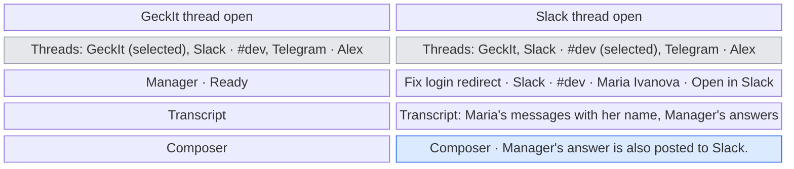
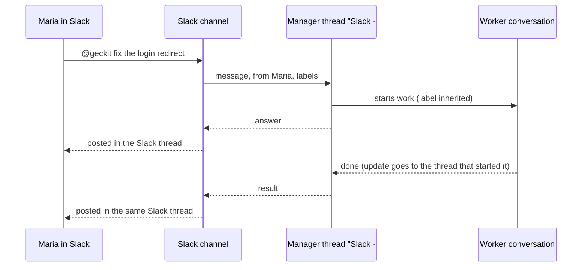
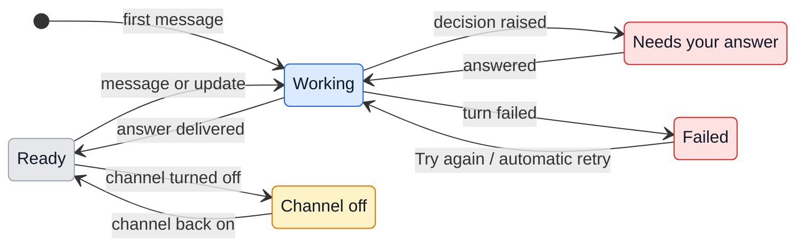

# UX: Manager threads

## 1. Why

Manager is one conversation today. Telegram, every channel and the Manager window all write into it, a message from Slack arrives as "[Via Slack · Maria]" in the middle of a desktop request, and Manager's answer goes to every place at once. Two people writing from two Slack threads read each other's answers, a Telegram group and a private chat share one context, and nothing says later which person or which thread started a piece of work. Alex wants Manager to keep one conversation per place where people write: one per Telegram chat, one per Slack thread, and the Manager window showing all of them; and a channel to label what it started, so a conversation can be traced back to the person and the thread it came from.

### Path to a result

- **Entry and result:** a person writes to the bot in Telegram or mentions it in Slack. Manager answers in that chat or thread only, starts work there if asked, and the work's updates come back to the same place. In GeckIt, the Manager window lists that thread with where it came from and who wrote, and Alex can read it, answer its questions or write into it.
- **Readiness:** Manager on, the channel on and connected ("Connected" in Settings, Channels), and the channel allowed to talk to Manager. Nothing new to set up for threads: a thread appears by itself at the first message from a new chat or Slack thread.
- **Decisions and order:** none new for Alex. How a place maps to a thread is the channel's decision (Telegram: one per chat, Slack: one per Slack thread); GeckIt keeps what the channel says.
- **Shape:** the Manager window gains a list of threads beside the transcript, the way Chat has a sidebar. The alternative, a separate Manager window per thread, was rejected: threads are many and short, and Alex looks across them.
- **First run and return:** the existing desktop conversation becomes the thread "GeckIt" and keeps its history. Threads survive restarts; a thread whose channel is off stays readable.

## 2. What is added

| Surface | What appears | When visible |
|---|---|---|
| Manager window, new list on the left | Threads: "GeckIt" first, then the others by last message. Each row: where it is from, its title, who wrote last, and a dot for working or needs your answer | Manager on, at least one channel thread exists |
| Manager window, "Work" above the transcript | Two lists for the open thread: "Started here" (workers it owns) and "Following" (workers it follows). Each row: state dot and title; a click opens the worker in Chat. Collapsible, like Tasks in Chat; shut when both lists are empty | A thread with at least one worker |
| Manager window, thread row | After its dots, the number of its workers working now: "2" | The thread owns or follows a working worker |
| Manager window, header | The thread's place and labels under its title: "Slack · #dev · Maria Ivanova", and "Open in Slack" when the channel gave a link | A channel thread is open |
| Manager window, composer | Writing into a channel thread; under it "Manager's answer is also posted to Slack." | A channel thread is open and its channel is on |
| Manager window header | All labels of the thread, as "key: value" lines, under its place line | A channel thread is open (with the window, after 021) |
| Worker's conversation info on the phone (existing) | "Reports to: Slack · Maria Ivanova", "Followed by: Telegram · Alex" and one row per label | Managed worker |
| Board card hover on the computer | The same lines as a tooltip over the "From Manager" line: the computer has no conversation info panel for workers | Managed worker |
| Board card and worker header (existing "From Manager" line) | "From Manager · Slack · Maria Ivanova" for work a channel thread started; "· +1 following" at its end when other threads follow it, hover lists them | Worker started by a channel thread |
| Search (existing) | Label values are found: a Slack thread id or a person's name finds the conversations it labels. Work Manager starts from a thread inherits the thread's labels | Always |
| Settings, Channels | Telegram (moved from the Manager settings in Team) and Slack as built-in rows; Slack's row line counts threads: "Connected · 3 threads" | Always |
| Phone, Manager page (existing) | The same list of threads above the transcript, as a menu under the title | Manager on |

The card line and Session info do not depend on the window and come with the core. The window layout is built on top of spec 021's header and transcript. The list appears once a channel thread exists; until then the window is unchanged. The composer keeps one draft for all threads: text typed in one thread stays in the field when another is opened, and the line under it says where Manager's answer goes.

### The model

Manager stays one: one assistant, one model, one set of instructions, one Pause, one list of decisions and one pool of conversations it manages. A thread is one of its conversations with the outside world, with its own context, its own queue of messages and its own place where answers go.

- Any thread can see and steer any conversation Manager manages (one shared pool). A worker's updates go to the thread that started it, its owner; a worker started from the GeckIt thread, or attached by hand in GeckIt, reports to GeckIt. A worker attached by Manager from a thread is owned by that thread.
- A thread can follow a worker it does not own: asked "keep an eye on the login fix" in Telegram, Manager subscribes its thread, and from then on the worker's updates go to the owner and to every follower. "Stop following" removes the subscription. The owner never changes: the person who asked for the work always gets its result.
- A channel decides which place is which thread by a key it chooses: Telegram uses the chat, so a private chat and each group are separate threads; Slack uses the thread, and a top-level message to the bot starts a Slack thread with its answer.
- Labels are what a channel says about a thread or a conversation it started: who started it, the chat or Slack thread id, a link back. GeckIt shows and searches them and never acts on them.

## 3. States

Manager-wide states (Off, Paused, assistant disabled) stay as they are and apply to every thread. A thread adds its own:

| State | When it happens | What Alex sees | What to do |
|---|---|---|---|
| Ready | Nothing queued, no turn running | Row without a dot; header "Ready" | Nothing, or write |
| Working | The thread's turn is running or a message waits for it | Row with the working dot; header "Working" | Nothing; Pause stops all of Manager |
| Needs your answer | A decision or card raised in this thread is open | Row with the attention dot; the card in the transcript | Answer it here, or where the channel shows it |
| Failed | This thread's turn failed (the others go on) | Header "This thread stopped: <reason>" and "Try again" | Try again |
| Channel off | The thread's channel is off, removed or no longer allowed to talk to Manager | Composer replaced by "Slack is off. Turn it on in Settings, Channels to reply in this thread." | Turn the channel on, or only read |

## 4. Transitions

| From | Event | To | What Alex sees |
|---|---|---|---|
| (none) | A channel delivers the first message for a key it has not used | Working | A new row at the top of the list, under GeckIt; nothing pops up |
| Ready | A message arrives from the channel, Alex writes in the window, or a worker this thread started changes | Working | The row's working dot |
| Working | Manager's turn ends and its answer is handed to the channel (automatic) | Ready | The answer in the transcript; the channel posts it |
| Working | Manager asks for a decision, or a worker it started asks for permission | Needs your answer | The attention dot on the row and the Manager badge count |
| Needs your answer | Alex answers in the window, or the person answers in the channel | Working | The card turns into what was chosen |
| Working | The turn fails (provider, limit, crash) | Failed | "This thread stopped: <reason>"; other threads keep working |
| Failed | Alex presses "Try again", or the automatic retry succeeds (automatic, as for Manager today) | Working | The working dot |
| Ready, Failed, Needs your answer | Alex turns the channel off, removes it, or untics "May talk to Manager" | Channel off | The composer line instead of the composer; the transcript stays |
| Channel off | The channel is on and allowed again | Ready | The composer comes back |
| Any | Alex pauses Manager | (state kept, nothing runs) | "Manager paused" across all threads, as today |
| Any | Manager follows a worker on a request in this thread (automatic, by its CLI) | (state kept) | Manager's answer says so; the worker's Session info lists the thread under "Followed by" |
| Any | Manager stops following on a request, the worker is removed, or the thread's channel is removed (automatic) | (state kept) | The thread leaves "Followed by"; nothing else |
| Any | Alex presses Restart session in Session info of a thread | Working | That thread's history is kept as previous; a fresh backing session reconciles from the durable record |

## 5. What stays silent

- A new thread does not notify anyone in GeckIt: the person who wrote is already talking to it in the channel. Only "Needs your answer" counts toward the badge, as today.
- Labels that are not text a person reads (ids, timestamps) are not on the card or the row; they are in Session info and found by Search.
- Which thread an update was routed to is not shown on the worker; the "From Manager · Slack · Maria" line is enough to find it.
- Alex's own message written into a channel thread is not posted to the channel; only Manager's answer is (Alex's decision, 2026-11-05).

## 6. Thresholds and time

| Value | Why |
|---|---|
| At most 8 labels per thread or conversation, key up to 40 characters, value up to 300 | Enough for who, where, thread id, link and a few custom fields; keeps Session info one screen and notes small |
| No limit on Manager turns at once: every thread answers in parallel | A turn is short coordination; a cap would make a person in Slack wait only because others write at the same time (Alex, 2026-11-05). The plan's use is bounded where the cost is, the work turns start |
| Manager turns do not take "working at once" slots | They are short coordination turns; the slots are for the work they start, as today |
| The list shows threads with a message in the last 30 days; older ones under "Older" at the bottom | A month covers an ongoing Slack discussion; the list stays short without losing anything |

## 7. Wording

- List heading: "Threads"
- Main thread row: "GeckIt"
- Channel thread row, first line: its title (the channel's, or the first message shortened); second line: "Slack · Maria Ivanova" (place and who wrote last)
- Header labels line: "Slack · #dev · Maria Ivanova"
- Link: "Open in Slack" (the channel's name)
- Composer note: "Manager's answer is also posted to Slack."
- Channel off: "Slack is off. Turn it on in Settings, Channels to reply in this thread."
- Not allowed: "Slack may no longer talk to Manager. Allow it in Settings, Channels to reply in this thread."
- Failed: "This thread stopped: <reason>" and the button "Try again"
- Card parent line: "From Manager · Slack · Maria Ivanova", with followers: "From Manager · Slack · Maria Ivanova · +1 following"
- Work section: "Work", lists "Started here" and "Following"
- Worker's Session info: "Reports to: Slack · Maria Ivanova", "Followed by: Telegram · Alex, GeckIt"
- Settings row: "Connected · 3 threads"
- Older group: "Older"
- A message by someone other than Alex, in the transcript: their name above it, as the channel gave it

## 8. Edge cases

- **Existing history:** the current Manager session becomes the GeckIt thread. Telegram's private chat gets a new thread at its next message; its earlier messages stay in the GeckIt thread's history. From then on an answer Manager gives in the GeckIt window is no longer repeated in Telegram, and the other way round.
- **A worker in the shared pool steered by two threads:** both can; its updates still go to the thread that started it. A thread asking about another's work reads it through the CLI like any managed conversation.
- **The starting thread is gone or closed** (its channel removed, off or no longer allowed to talk to Manager): the worker's updates go to GeckIt; followers whose channel is on keep getting them. When the channel comes back, updates go to the starter again.
- **Telegram and GeckIt's own decisions:** the paired Telegram chat is Alex's own remote, so it keeps receiving the decisions raised in the GeckIt thread, as before threads, besides those raised in its own thread. Decisions from a Slack thread go to that Slack thread and the window only.
- **Slack, the first and the next messages:** the first message in a channel thread mentions the bot; later replies in a thread the bot already knows reach Manager without a mention. In a direct message each top-level message starts a Slack thread, and Manager answers in it.
- **A decision raised in a Slack thread** is shown in that thread and in the window; whichever answers first wins, the other sees "This request is no longer pending."
- **Two messages in one thread at once:** queued in the thread, one turn at a time, as Manager does today.
- **Many threads at once:** all run; each row shows its working dot.
- **A follower asks to follow twice, or the owner asks to follow:** nothing changes; the owner already gets every update.
- **One update, owner and followers:** each thread gets it once, in its own queue; a decision the update raises is still one decision, answered once.
- **Channel restarts or reconnects:** the key maps to the same thread, nothing new is created.
- **A channel sends a label too long or too many:** the extra is cut and the channel's log says so; the message still goes through.
- **Restart Manager (provider or model change):** each thread gets a fresh backing session at its next message, with the same reconciliation Manager does today.
- **Telegram group with several people:** one thread; each message carries who wrote it.

## 9. What is deliberately not there

- A Manager per channel with its own settings: rejected, Alex wants one Manager with many conversations.
- Separate pools of conversations per thread: rejected by Alex on 2026-11-05; one pool, updates routed to the starter.
- Labels as permissions (for example "only Maria may stop this"): a channel decides who may write before the message reaches GeckIt; labels are for reading and tracing.
- Posting Alex's own desktop message into Slack or Telegram: rejected on 2026-11-05.
- Merging or moving threads.
- A separate board for Manager's workers: they already stand on the board with everything else, and a second board would show the same cards twice.
- The example Slack library going away: it stays in `examples/` for authors; the built-in Slack is separate.

## 10. Forks

| Question | Verdict | Why |
|---|---|---|
| Can Alex write into a channel thread from the window? | Yes, the answer goes to the channel | Alex, 2026-11-05 |
| Shared or per-thread pool of workers? | Shared, updates to the starter | Alex, 2026-11-05 |
| Another thread wants a worker's updates: take ownership or follow | Follow; the owner keeps getting them | Taking over would stop the person who asked from getting the result (Alex, 2026-11-05) |
| Limit Manager turns at once | No limit | Alex, 2026-11-05: a cap of 3 had no reason a person waiting in Slack would accept |
| Slack mapping: per Slack thread or per channel | Per Slack thread; a top-level message starts one | Alex: "один thread, это одна сессия менеджера" |
| Telegram mapping: one for everything or per chat | Per chat (private chat and each group) | Alex: "в Telegram одна сессия на один чат" |
| Who keys and labels threads: GeckIt or the channel | The channel, through its API | Each place has its own idea of a thread; GeckIt cannot know it |
| One error blocks all of Manager or only the thread | Only the thread; Manager-wide states stay global | A failing Slack thread must not stop Telegram |

## 11. Requirements

- Several Manager conversations, one per place a channel defines: covered by the model and sections 3-4.
- All shown in the Manager window: section 2; layout waits for 021.
- Telegram one per chat, Slack one per thread: section 10.
- Channels label conversations with who started them and custom fields such as a Slack thread id, to trace and debug later: sections 2, 5, 6.
- Slack built in, turned on with its values in Settings: section 2.
- Not covered: Slack and Telegram parity for files and voice in channel threads; Telegram's existing attachment handling keeps working in its threads, Slack's built-in sends text only in the first version.
- Not covered yet: Telegram groups. Telegram pairs one private chat today, so it has one thread; a group needs its own access rules before it can be its own thread. The thread key is already the chat, so a group becomes a thread of its own once access allows it.
