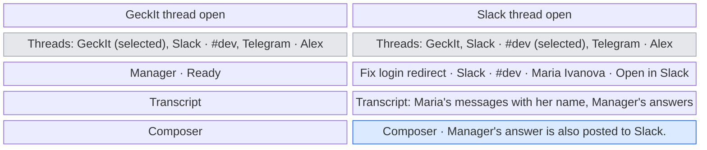
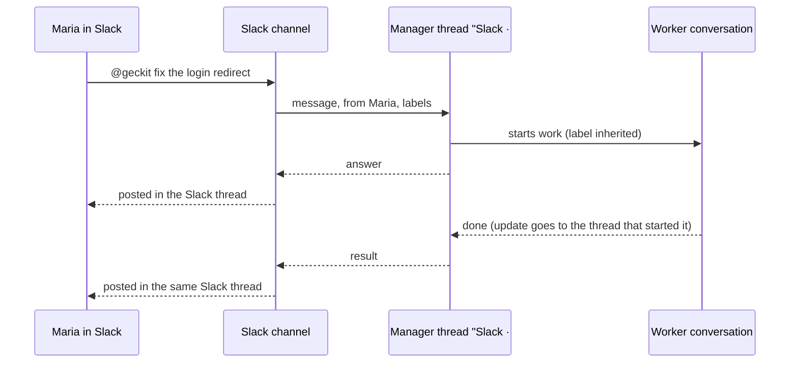
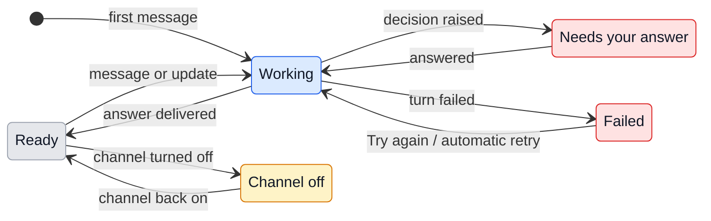

# UX: Manager threads

## 1. Why

Manager is one conversation today. Telegram, every channel and the Manager window all write into it, a message from Slack arrives as "[Via Slack · Maria]" in the middle of a desktop request, and Manager's answer goes to every place at once. Two people writing from two Slack threads read each other's answers, a Telegram group and a private chat share one context, and nothing says later which person or which thread started a piece of work. Alex wants Manager to keep one conversation per place where people write: one per Telegram chat, one per Slack thread, and the Manager window showing all of them; and a channel to label what it started, so a conversation can be traced back to the person and the thread it came from.

### Path to a result

- **Entry and result:** a person writes to the bot in Telegram or mentions it in Slack. Manager answers in that chat or thread only, starts work there if asked, and the work's updates come back to the same place. In GeckIt, the Manager window lists that thread with where it came from and who wrote, and Alex can read it, answer its questions or write into it.
- **Readiness:** Manager on, the channel on and connected ("Connected" in Settings, Channels), and the channel allowed to talk to Manager. Nothing new to set up for threads: a thread appears by itself at the first message from a new chat or Slack thread.
- **Decisions and order:** none new for Alex. How a place maps to a thread is the channel's decision (Telegram: one per chat, Slack: one per Slack thread); GeckIt keeps what the channel says.
- **Shape:** the Manager window gains a list of threads beside the transcript, the way Chat has a sidebar. The alternative, a separate Manager window per thread, was rejected: threads are many and short, and Alex looks across them.
- **First run and return:** the existing desktop conversation becomes the thread "GeckIt" and keeps its history. Threads survive restarts; a thread whose channel is off stays readable.

## 2. What is added

| Surface | What appears | When visible |
|---|---|---|
| Manager window, new list on the left | New conversation at the top, then the threads: those needing an answer first, then by last message. Each row: where it is from, its title, who wrote last, and a dot for working or needs your answer (see `manager-conversations.md`) | Manager on |
| Manager window, "3 tasks" in the thread's subtitle | A button that opens the list of the workers the open thread tracks, as a popover. Each row: state dot, title and when anything last happened in it ("now", "12m", "3:40 PM", "Yesterday", as on the board), and under them its status and where it stands ("In progress · Waiting for your answer", "Blocked · Tests fail on CI"); a click opens the worker in Chat, and an unlink icon ("Stop tracking") at its end, shown on hover or keyboard focus and always on the phone. The button carries the attention dot while one of them needs an answer; absent when the thread tracks none | A thread with at least one worker |
| Manager window, the unlink icon ("Stop tracking") on a worker row | This thread lets the worker go, as `sessions unfollow` does: no confirmation, the row leaves the list, and no thread gets its updates until one follows it | The open thread tracks that worker |
| Manager window, thread row | After its dots, the number of its workers working now: "2" | The thread tracks a working worker |
| Manager window, toolbar | One line above the transcript: the thread's title, under it its place and who wrote ("Slack · Maria Ivanova") or "Manager chat" for GeckIt, and the tasks button. At its end, icon buttons: Open in Slack (when the channel gave a link), Details, More, then Manager settings and Close. Manager's name and state stand above the thread list, level with it; with no thread list they start the toolbar | Manager window open |
| Manager window, composer | Writing into a channel thread; under it "Manager's answer is also posted to Slack." | A channel thread is open and its channel is on |
| Manager window, Details popover | The assistant, its model and how many workers Manager manages, then the thread's labels as "key: value" lines. Ids are here rather than in the toolbar | Details pressed |
| Manager window, a band under the toolbar | Only when there is something to say: Manager off, paused or unavailable, the thread's error, a retry notice, the channel off, with their buttons | One of these holds |
| Worker's conversation info on the phone (existing) | "Reports to: Slack · Maria Ivanova" and one row per label; no "Reports to" while no thread tracks it | Managed worker |
| Board card hover on the computer | The same lines as a tooltip over the "From Manager" line: the computer has no conversation info panel for workers | Managed worker |
| Board card and worker header (existing "From Manager" line) | "From Manager · Slack · Maria Ivanova" for work a channel thread tracks | Worker started by a channel thread |
| Search (existing) | Label values are found: a Slack thread id or a person's name finds the conversations it labels. Work Manager starts from a thread inherits the thread's labels | Always |
| Settings, Channels | Telegram (moved from the Manager settings in Team) and Slack as built-in rows; Slack's row line counts threads: "Connected · 3 threads" | Always |
| Phone, Manager page (existing) | The phone's own navigation bar, as on a conversation: "‹ Tasks" back in the accent colour, "Manager" centred with its state under it, settings at the end. Under it the thread toolbar, whose title is the open thread's name with a chevron that opens the thread menu | Manager on |

The card line and Session info do not depend on the window and come with the core. The window layout is built on top of spec 021's header and transcript. The list is shown whenever Manager is on (`manager-conversations.md`). The composer keeps one draft for all threads: text typed in one thread stays in the field when another is opened, and the line under it says where Manager's answer goes.

### Reply formatting skills (2026-11-13)

Before composing a channel reply, Manager reads the skill for the thread's destination: `send-slack-reply`, `send-telegram-reply` or `send-discord-reply`. Opening that thread in GeckIt does not change its destination. Employee creation and configuration load `manage-employees`, including its setup reference.

Slack receives native `mrkdwn`, including single-asterisk bold and Slack links. Telegram receives the Markdown supported by GeckIt's HTML renderer; the assistant does not send raw HTML or MarkdownV2 escapes. Discord receives native Markdown and keeps replies within its message limit, with balanced formatting inside each message. Replies lead with the result, blocker or question. Each paragraph has one subject and each list item has one point; tables become labeled entries. Code fences enclose literal code only.

These skills guide generated text and do not change channel transport, routing, permissions or the GeckIt transcript renderer. No new notification or setup state appears. GeckIt's own Manager chat keeps ordinary Markdown. An authorized live message is required to verify final channel rendering; installation and renderer fixtures alone do not establish it.

### The model

Manager stays one: one set of instructions, one Pause, one list of decisions and one pool of conversations it manages. A thread is one of its conversations with the outside world, with its own context, its own queue of messages and its own place where answers go. Each thread also keeps the assistant and model it was given when it was made; Manager settings choose them only for new threads (`manager-conversations.md`).

- Any thread can see and steer any conversation Manager manages (one shared pool). A worker's updates go to the thread that started it, its owner; a worker started from the GeckIt thread, or attached by hand in GeckIt, reports to GeckIt. A worker attached by Manager from a thread is owned by that thread.
- Exactly one thread tracks a worker and gets its updates, at first the thread that started or attached it. Asked "keep an eye on the login fix" in Telegram while a Slack thread tracks it, Manager's follow is refused and it says which thread tracks the work and that it must unfollow there first. Once that thread unfollows (asked "stop tracking it" there), no thread gets the worker's updates until another follows it, and the one that follows becomes its tracking thread. A thread never unfollows a worker for another thread.
- Watching needs no product confirmation, as of 2026-11-06. When someone asks Manager to keep an eye on an existing task, Manager attaches it if it does not manage it yet (`sessions attach`: the task becomes managed and reports to the asking thread), or follows it when no thread tracks it (`sessions follow`), and stops with `sessions unfollow`; none of these raises a card. Attaching also lets Manager send to, steer and stop that task, as it can any managed task. Status updates, including Done, also apply without a product card; [technical status history](task-status-history.md) records the executor and known host/transport provenance. Starting work under "Approve each new worker", answering a worker's question, adding or removing projects and files, and renaming an employee keep their cards, and a provider's own permission requests are untouched.
- A channel decides which place is which thread by a key it chooses: Telegram uses the chat, so a private chat and each group are separate threads; Slack uses the thread, and a top-level message to the bot starts a Slack thread with its answer.
- Labels are what a channel says about a thread or a conversation it started: who started it, the chat or Slack thread id, a link back. GeckIt shows and searches them and never acts on them.

## 3. States

Manager-wide states (Off, Paused, assistant disabled) stay as they are and apply to every thread. A thread adds its own:

| State | When it happens | What Alex sees | What to do |
|---|---|---|---|
| Ready | Nothing queued, no turn running | Row without a dot; header "Ready" | Nothing, or write |
| Working | The thread's turn is running or a message waits for it | Row with the working dot; header "Working" | Nothing; Pause stops all of Manager |
| Needs your answer | A decision or card raised in this thread is open | Row with the attention dot; the card in the transcript | Answer it here, or where the channel shows it |
| Failed | This thread's turn failed (the others go on) | Header "This thread stopped: <reason>" and "Try again" | Try again |
| Channel off | The thread's channel is off, removed or no longer allowed to talk to Manager | Composer replaced by "Slack is off. Turn it on in Settings, Channels to reply in this thread." | Turn the channel on, or only read |

## 4. Transitions

| From | Event | To | What Alex sees |
|---|---|---|---|
| (none) | A channel delivers the first message for a key it has not used | Working | A new row at the top of the list, under GeckIt; nothing pops up |
| Ready | A message arrives from the channel, Alex writes in the window, or a worker this thread started changes | Working | The row's working dot |
| Working | Manager's turn ends and its answer is handed to the channel (automatic) | Ready | The answer in the transcript; the channel posts it |
| Working | Manager asks for a decision, or a worker it started asks for permission | Needs your answer | The attention dot on the row and the Manager badge count |
| Needs your answer | Alex answers in the window, or the person answers in the channel | Working | The card turns into what was chosen |
| Working | The turn fails (provider, limit, crash) | Failed | "This thread stopped: <reason>"; other threads keep working |
| Failed | Alex presses "Try again", or the automatic retry succeeds (automatic, as for Manager today) | Working | The working dot |
| Ready, Failed, Needs your answer | Alex turns the channel off, removes it, or untics "May talk to Manager" | Channel off | The composer line instead of the composer; the transcript stays |
| Channel off | The channel is on and allowed again | Ready | The composer comes back |
| Any | Alex pauses Manager | (state kept, nothing runs) | "Manager paused" across all threads, as today |
| Any | Manager follows a worker no thread tracks, on a request in this thread (automatic, by its CLI) | (state kept) | Manager's answer says so; the worker's "Reports to" names this thread and it joins the thread's Work |
| Any | Manager unfollows on a request in the tracking thread (automatic) | (state kept) | The worker leaves the thread's Work and loses "Reports to"; no thread gets its updates |
| Any | Manager is asked to follow a worker another thread tracks | (state kept) | Manager says which thread tracks it and that it must unfollow there first; nothing changes |
| Any | Alex presses Restart session in Session info of a thread | Working | That thread's history is kept as previous; a fresh backing session reconciles from the durable record |

## 5. What stays silent

- A new thread does not notify anyone in GeckIt: the person who wrote is already talking to it in the channel. Only "Needs your answer" counts toward the badge, as today.
- Labels that are not text a person reads (ids, timestamps) are not on the card or the row; they are in Session info and found by Search.
- Which thread an update was routed to is not shown on the worker; the "From Manager · Slack · Maria" line is enough to find it.
- Alex's own message written into a channel thread is not posted to the channel; only Manager's answer is (Alex's decision, 2026-11-05).

## 6. Thresholds and time

| Value | Why |
|---|---|
| At most 8 labels per thread or conversation, key up to 40 characters, value up to 300 | Enough for who, where, thread id, link and a few custom fields; keeps Session info one screen and notes small |
| No limit on Manager turns at once: every thread answers in parallel | A turn is short coordination; a cap would make a person in Slack wait only because others write at the same time (Alex, 2026-11-05). The plan's use is bounded where the cost is, the work turns start |
| Manager turns do not take "working at once" slots | They are short coordination turns; the slots are for the work they start, as today |
| The list shows threads with a message in the last 30 days; older ones under "Older" at the bottom | A month covers an ongoing Slack discussion; the list stays short without losing anything |

## 7. Wording

- List heading: "Threads"
- Main thread row: "GeckIt"
- Channel thread row, first line: its title (the channel's, or the first message shortened); second line: "Slack · Maria Ivanova" (place and who wrote last)
- Toolbar subtitle: "Slack · Maria Ivanova"; GeckIt's: "Manager chat"
- Tasks button: "1 task", "3 tasks"; popover title "Tracked by this thread"
- Worker row action: an unlink icon, tooltip "Stop tracking", named "Stop tracking <task title>"; while it works, a spinner in its place; if it fails, the reason under the list
- Toolbar buttons (tooltips and names): "Open in Slack" (the channel's name), "Details", "More"
- Details rows: "Assistant", "Model" ("Default" when none was chosen), "Managed workers", then the labels
- Composer note: "Manager's answer is also posted to Slack."
- Channel off: "Slack is off. Turn it on in Settings, Channels to reply in this thread."
- Not allowed: "Slack may no longer talk to Manager. Allow it in Settings, Channels to reply in this thread."
- Failed: "This thread stopped: <reason>" and the button "Try again"
- Card parent line: "From Manager · Slack · Maria Ivanova"
- Work section: "Work", the workers this thread tracks
- Worker's Session info: "Reports to: Slack · Maria Ivanova"
- Follow refused: "Slack · Maria Ivanova already tracks this worker, and only one thread can track a worker. Ask there to unfollow it first."
- Settings row: "Connected · 3 threads"
- Older group: "Older"
- A message by someone other than Alex, in the transcript: their name above it, as the channel gave it

## 8. Edge cases

- **Existing history:** the current Manager session becomes the GeckIt thread. Telegram's private chat gets a new thread at its next message; its earlier messages stay in the GeckIt thread's history. From then on an answer Manager gives in the GeckIt window is no longer repeated in Telegram, and the other way round.
- **A worker in the shared pool steered by two threads:** both can; its updates still go to the thread that started it. A thread asking about another's work reads it through the CLI like any managed conversation.
- **The starting thread is gone or closed** (its channel removed, off or no longer allowed to talk to Manager): the worker's updates go to GeckIt, which tracks it meanwhile. When the channel comes back, updates go to that thread again.
- **Telegram and GeckIt's own decisions:** the paired Telegram chat is Alex's own remote, so it keeps receiving the decisions raised in the GeckIt thread, as before threads, besides those raised in its own thread. Decisions from a Slack thread go to that Slack thread and the window only.
- **Slack, the first and the next messages:** a Manager thread starts when someone on the allow list mentions the bot, at the top of a channel or anywhere in a thread that began without it; the Slack thread's first message is its key, so a mention halfway down still gives the whole thread one Manager thread. Later replies reach Manager only when they mention the bot (since 2026-11-10); replies without a mention wait and come with the next mention as earlier messages, and the one exception is a reply that answers an open question with one of its choices ("allow"). In a direct message every message reaches Manager. In a direct message each top-level message starts a Slack thread, and Manager answers in it.
- **Slack, what Manager reads:** with each message sent to Manager, the Slack messages it has not seen go first, oldest first, under "Earlier in this Slack thread:", each as "Name (2026-11-06 14:02 UTC): text", files as their names and links, then "Message to you:" and the message itself. On the first mention that is the whole thread before it; afterwards, what people wrote since the last message Manager got, including replies without a mention and people not on the allow list: two replies without a mention and then a mention bring both replies. The bot's own answers are left out, since Manager wrote them. A message that looks like it holds a token or key is replaced by "(left out: looks like it contains a token or key)". Past 30,000 characters the oldest go first, and a line says how many were left out. A mention with no words asks Manager to read the thread. If Slack refuses to give the thread (a missing scope), Manager is told so and gets the message alone.
- **Slack, people not on the allow list:** their replies in a known thread are read as context and never answered; only when one of them mentions the bot does it say "You are not on the list of people who may use this bot." A message reaches Manager once, though Slack reports a mention in a known thread twice.
- **A decision raised in a Slack thread** is shown in that thread and in the window; whichever answers first wins, the other sees "This request is no longer pending."
- **Two messages in one thread at once:** queued in the thread, one turn at a time, as Manager does today.
- **Many threads at once:** all run; each row shows its working dot.
- **The tracking thread asks to follow again:** nothing changes; it already gets every update.
- **Stop tracking from the window while another thread already took the worker:** nothing changes, and the reason is said under the list.
- **Tracking again after Stop tracking:** ask Manager in any thread to follow it; the window has no Follow button, since a worker no thread tracks is not in any list.
- **A thread asks to unfollow a worker it does not track:** nothing changes; Manager says which thread tracks it.
- **No thread tracks a worker:** its updates wake no thread; a question it raises for a native permission still shows in GeckIt's Manager chat.
- **Channel restarts or reconnects:** the key maps to the same thread, nothing new is created.
- **A channel sends a label too long or too many:** the extra is cut and the channel's log says so; the message still goes through.
- **Restart Manager (provider or model change):** each thread gets a fresh backing session at its next message, with the same reconciliation Manager does today.
- **Telegram group with several people:** one thread; each message carries who wrote it.

## 9. What is deliberately not there

- A Manager per channel with its own settings: rejected, Alex wants one Manager with many conversations.
- Separate pools of conversations per thread: rejected by Alex on 2026-11-05; one pool, updates routed to the starter.
- Labels as permissions (for example "only Maria may stop this"): a channel decides who may write before the message reaches GeckIt; labels are for reading and tracing.
- Posting Alex's own desktop message into Slack or Telegram: rejected on 2026-11-05.
- Merging or moving threads.
- A separate board for Manager's workers: they already stand on the board with everything else, and a second board would show the same cards twice.
- The example Slack library going away: it stays in `examples/` for authors; the built-in Slack is separate.

## 10. Forks

| Question | Verdict | Why |
|---|---|---|
| Can Alex write into a channel thread from the window? | Yes, the answer goes to the channel | Alex, 2026-11-05 |
| Shared or per-thread pool of workers? | Shared, updates to the starter | Alex, 2026-11-05 |
| Another thread wants a worker's updates: take ownership or follow | Only one thread tracks a worker; another follows it only after the tracking thread unfollows it | Alex, 2026-11-10: one thread should track a worker; the other thread untracks first. Replaces 2026-11-05, when followers got updates beside the owner |
| Limit Manager turns at once | No limit | Alex, 2026-11-05: a cap of 3 had no reason a person waiting in Slack would accept |
| Slack mapping: per Slack thread or per channel | Per Slack thread; a top-level message starts one | Alex: "один thread, это одна сессия менеджера" |
| Slack: a mention in a thread that began without the bot | One Manager thread for the whole Slack thread, with everything written before the mention | Alex, 2026-11-06: the whole information from the thread is sent |
| Stop tracking in the window: confirm first? | No | The same as unfollow, which has no card (2026-11-06); nothing is lost, the worker goes on and can be followed again |
| Product card before attaching or following an existing task | None for attach, follow and unfollow | Alex, 2026-11-06 via Telegram: turn off confirmations for following and the like; asking to watch a Slack task needed an extra attach card |
| Telegram mapping: one for everything or per chat | Per chat (private chat and each group) | Alex: "в Telegram одна сессия на один чат" |
| Who keys and labels threads: GeckIt or the channel | The channel, through its API | Each place has its own idea of a thread; GeckIt cannot know it |
| One error blocks all of Manager or only the thread | Only the thread; Manager-wide states stay global | A failing Slack thread must not stop Telegram |

## 11. Requirements

- Several Manager conversations, one per place a channel defines: covered by the model and sections 3-4.
- All shown in the Manager window: section 2; layout waits for 021.
- Telegram one per chat, Slack one per thread: section 10.
- Channels label conversations with who started them and custom fields such as a Slack thread id, to trace and debug later: sections 2, 5, 6.
- Slack built in, turned on with its values in Settings: section 2.
- Not covered: Slack and Telegram parity for files and voice in channel threads; Telegram's existing attachment handling keeps working in its threads, Slack's built-in sends text only in the first version.
- Not covered yet: Telegram groups. Telegram pairs one private chat today, so it has one thread; a group needs its own access rules before it can be its own thread. The thread key is already the chat, so a group becomes a thread of its own once access allows it.

## 12. Keeping Manager cheap (2026-11-19)

Spec: `specs/037-manager-token-economy/`. Why: on 2026-11-19 a headless GeckIt spent the five-hour window of a Claude Max 5x plan with nobody writing. Every turn of Manager rereads its whole conversation, which had grown to about 760,000 tokens, and it was woken every 20 seconds by a worker polling a search, and again by itself at the limit reset.

### What wakes Manager about a worker

A worker it tracks wakes it when the worker finishes a turn, fails, asks a question Manager must answer, is blocked, becomes unread, or its goal result changes, and when one of its background commands asks for a decision. A background command that starts or ends while the worker keeps working wakes nothing; the worker's own finish reports the commands' final state. An update names each background command by its description or the first 120 characters of its command, never the whole command or its output.

### Grouping

Worker updates that wait in a thread's queue are delivered together as one turn, oldest first, one line per worker with its latest state. A message from a person, a channel, a schedule or a CLI result is never merged into the group and keeps its own turn and reply.

### Compaction

Setting, in the Manager page's Setup, below the assistant:

| Element | Wording |
|---|---|
| Label | Compact conversation at |
| Control | A menu: Off, 100,000, 160,000, 240,000, 400,000 and 600,000 tokens; a value set another way (CLI, configuration import) is listed too. On the phone the row is "Compact At" and opens the same choices as a sheet titled "Compact Conversation At". |
| Note | Manager summarises its conversation when it reaches this size, so each answer rereads less. Default 240,000 tokens. |
| Assistant without compaction | <Assistant name> can't compact conversations. Manager's conversation keeps growing. |
| Invalid value | Choose 0 (off) or a number from 50,000 to 2,000,000. |

When a thread's turn ends with its context at or above the setting, and the thread is idle, GeckIt asks the assistant to compact that conversation. While it runs, the thread's state reads Compacting, "Summarising its conversation to keep it short.", and messages for the thread wait. After it, the next message Manager receives starts with its saved record of operations, decisions and tracked workers, as after a restart. A failed compaction says nothing, leaves the thread working, and is not tried again until another turn has ended. Nothing is posted to a channel.

### After a usage limit

At the reset time, Manager does not wake by itself. Messages people sent during the limit are answered then, as the limit reply promised, in one turn that also reconciles the interrupted work. When nobody wrote, the state reads Limit reset, "Limit reset. Continues with the next message.", worker updates wait, and Manager continues with the next message or Retry. Manager does not schedule its own continuation for the reset. Nothing is posted to a channel at the reset.
