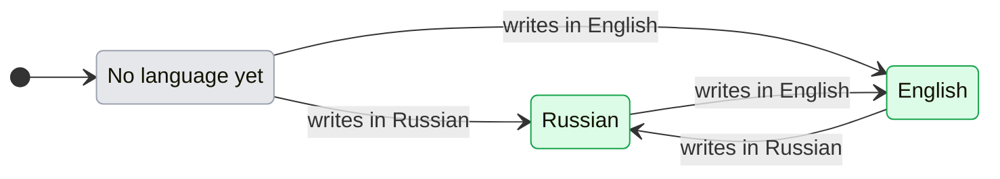

# UX: Manager speaks like a person in Telegram, Slack and Discord

## 1. Why

On 2026-11-10 Alex asked Manager in Telegram "Что ты делаешь?" and got back "Manager is working on it.": English in a Russian chat, and Manager naming itself in the third person, like a robot. Every line GeckIt itself writes into a Manager conversation (the status message, confirmations, errors, /status, /help) was English and spoke of "Manager". Alex wants the conversation to feel natural: Manager speaks in the first person, in the language he writes in, and uses a name only where one is needed, taken from Manager's settings.

## 2. The path

- **Entry and result:** the person writes to Manager in Telegram, Slack or Discord. Everything GeckIt says back on Manager's behalf in that conversation is in the first person and in the language of their last message, from the next line on. Manager's own answers come from the model, which already answers in the person's language.
- **Readiness:** nothing to set up. A thread with no message yet speaks English.
- **Decisions:** none for the person.
- **Form:** no new message, setting or screen; the same lines, reworded.

## 3. What is added

| Surface | What changes |
|---|---|
| Status message in Telegram, Slack, Discord (`docs/ux/channel-status.md`) | First person and the thread's language; a worker line says what it is doing in words |
| Telegram replies GeckIt writes: answer received, paused, resumed, button no longer works, file and reply problems, Manager off, late message, links | First person, the person's language |
| Telegram /status, /help, /settings and the message on pairing | First person, the person's language |
| Telegram command menu | "What I and my workers are doing", "Where my setup is changed" (English; Telegram shows it before any message) |
| Slack and Discord replies when the person is not allowed, a message holds a token, or Manager is not available there | First person, the language of that message |

## 4. States

| State | When | What the person sees | What to do |
|---|---|---|---|
| No language yet | No message from a person in this thread | English lines | Nothing |
| Russian | The last message with words in this thread was mostly Cyrillic | Russian lines | Nothing |
| English | The last message with words was mostly Latin | English lines | Nothing |

| From | Event | To | What the person sees |
|---|---|---|---|
| No language yet | The person writes a message with words, by them | Russian or English | The reply to this very message is already in that language |
| Russian | The person writes in English | English | Next lines in English |
| English | The person writes in Russian | Russian | Next lines in Russian |
| Any | A command such as /status, a link, an emoji, a file without a caption | Same | Nothing changes |
| Any | A worker event or a scheduled message reaches Manager, by itself | Same | Nothing changes |
| Any | GeckIt restarts | Same | The language is kept with the thread |

## 5. What stays silent

- The language is never announced or asked for.
- Manager does not name itself in these lines. A name is needed nowhere in them: the chat or thread already shows the bot's name. Manager's settings have no name of their own today (only the portrait and instructions), so no line invents one.
- Raw commands, tool names and technical errors from the host stay out of the status (`docs/ux/channel-status.md`).

## 6. Numbers

- Russian when Cyrillic letters are at least a quarter of all letters: a Russian message often carries English names, paths and code; a quarter keeps "Почини build в client/src" Russian, while an English message with one Russian word stays English. Links, `code`, /commands, [bracketed] markers and one-line JSON are not counted.
- Two languages: Russian and English are the languages Alex and his team write in. Any other language falls back to English.

## 7. Wording

Russian uses "ты" in imperatives, as Alex writes to Manager, and avoids gendered past forms for Manager ("Сообщение получено", not "Получил").

| Moment | English | Russian |
|---|---|---|
| Answer to a question taken | "Got your answer, carrying on." | "Ответ получен, продолжаю." |
| /pause | "Paused. I won't start new work; what is already running goes on." | "Пауза. Новую работу не начинаю, начатая продолжается." |
| /resume | "Back at it." | "Снова в работе." |
| Manager off | "I am turned off in GeckIt. Turn me on in Settings, Manager, then send it again." | "Меня отключили в GeckIt. Включи меня в Settings, Manager и отправь ещё раз." |
| Message not taken | "I couldn't take this message. Check /status or GeckIt, Settings, Manager, then send it again." | "Не получилось принять это сообщение. Проверь /status или GeckIt: Settings, Manager, и отправь ещё раз." |
| Old button pressed | "That button no longer works. Send /status or ask me for the current question." | "Эта кнопка уже не действует. Отправь /status или спроси меня, какой вопрос сейчас открыт." |
| Request already closed | "That request is already closed. /status shows what is open now." | "Этот запрос уже закрыт. /status покажет, что сейчас открыто." |
| Late message | "**This message reached me more than 10 minutes late.** Run it now?" with Run now / Discard | "**Это сообщение дошло до меня с опозданием больше 10 минут.** Выполнить сейчас?" with Выполнить / Отменить |
| Reply to an unknown message | "I can't tell which of my messages this answers. Reply to one of my messages or write a new one." | "Не понимаю, на какое моё сообщение этот ответ. Ответь на одно из моих сообщений или напиши заново." |
| Paused while answering an approval | "I'm paused. Send /resume, then answer this approval." | "Я на паузе. Отправь /resume, потом ответь на этот запрос." |
| /status, Manager free | "Free. Send me a task." | "Задач нет, можно давать новую." |
| /status, working | "Working." | "Работаю." |
| Slack or Discord, Manager not allowed there | "I can't answer in Slack yet. Allow me in GeckIt, Settings, Channels." | "Пока не могу отвечать в Slack. Разреши мне это в GeckIt: Settings, Channels." |

The full list, with every other reply, is `client/src/main/manager-voice.ts`; both languages are one table there, so a line cannot exist in one language only.

## 8. Edge cases

- **Mixed message** ("Почини build и запусти tests"): Russian, by the quarter rule.
- **Reply quoting an English message:** the quoted part is not counted, only what the person wrote.
- **A file with a caption:** the caption counts; without one the language stays.
- **Two Telegram chats are not possible;** each Slack and Discord thread keeps its own language.
- **Errors carried from the host** ("I can't go on: Usage limit reached"): the reason stays as GeckIt reports it, the sentence around it is in the person's language.

## 9. Not done on purpose

- A language setting: the person already says which language they use by writing in it.
- A model call to translate host lines: costs plan usage and can change what a line means.
- A Manager name setting: not asked for in these lines and none exists; first person needs no name.
- Translating the desktop app: its interface stays English.

## 10. Forks

| Question | Verdict | Why |
|---|---|---|
| Where the language lives | With the Manager thread, set when a person's message reaches it | One source for Telegram, Slack, Discord and the status message |
| Telegram's app language (`language_code`) or the message text | The message text | Alex may keep Telegram in English and write in Russian |
| First person or a name | First person, no name | Alex, 2026-11-10: "Должно быть от первого лица" |

## 11. Requirements

Closes Alex's Telegram request of 2026-11-10 (message 2516): natural, first-person Manager lines in the person's language, no "Manager ..." in the third person. Worker progress wording is in `docs/ux/channel-status.md`.
