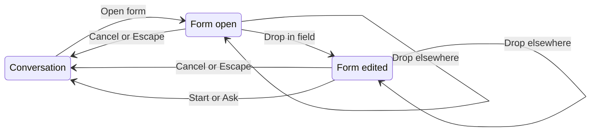
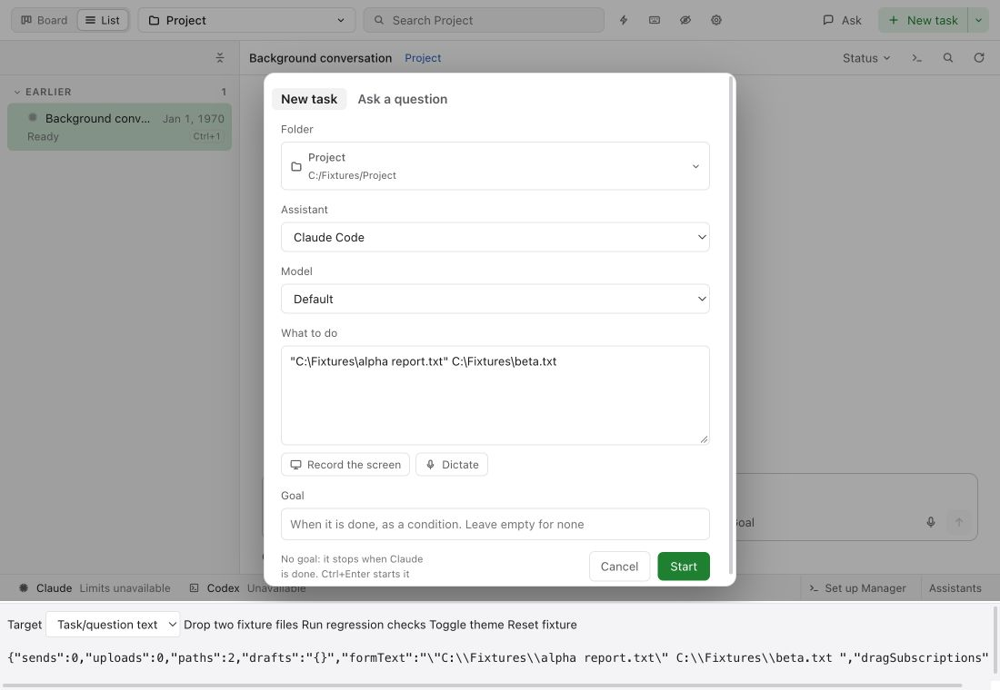

# UX: File drops belong to the open new-task form

## 1. Why

Dropping a file into "What to do" currently also reaches the conversation behind the form. A path intended for a new task must not alter that conversation's draft, attachments, queued messages or sent messages.

### Path to the result

Open "New task" while a conversation is visible, choose its folder, and drop one or more files into "What to do". Existing text gains the file paths; supported pictures remain form attachments. Review the form and press "Start" to create that task. Only that explicit action starts work. The existing single form, folder defaults, quoting, image limits and host-copy readiness remain unchanged. A general question uses the same isolation. Cancel, Escape or clicking the backdrop closes the form without sending its contents anywhere. Closing deliberately clears the form draft under existing behavior; restart recovery remains separate from the conversation draft.

Alex explicitly requested these interaction rules and their regression checks. There is no new setup, surface or visual design to approve.

## 2. What appears

| Surface | Change | When visible |
| --- | --- | --- |
| New task / Ask a question description | Existing local file-drop feedback and draft content only | A file is dragged into or dropped on the description |
| Open conversation behind the form | No file-drop feedback, draft edits or attachments from that drop | Either form is open |
| Rest of the form and backdrop | File drops are ignored and browser file navigation is prevented | Either form is open |

## 3. States

| State | When | What the person sees | Action |
| --- | --- | --- | --- |
| Conversation | Neither form is open | Existing conversation and its composer | Drop files as before, or open "New task" |
| Form empty or restored | A form opens | "What to do" or "Question", with the existing draft if any | Write or drop files in that field |
| Form receiving | Files are dragged over the description | Existing field highlight, without a background conversation highlight | Drop there or move away |
| Form edited | Description accepts the drop | Paths or picture previews in this form only | Review, "Start" / "Ask", or "Cancel" |
| Closed | Cancel, Escape or backdrop click | Unchanged background conversation draft and attachments | Continue that conversation or reopen the form |

Existing upload progress and failure states stay owned by the form and keep their current wording. An unfinished host copy still prevents starting the form; this fix adds no new upload behavior.

## 4. Transitions

| From | Event | To | What the person sees |
| --- | --- | --- | --- |
| Conversation | Open "New task" or "Ask a question" | Form open | Existing form |
| Form open / edited | Drop files on its description | Form edited | Paths or supported pictures added once to the form |
| Form open / edited | Drop on another form control, backdrop or background | Same state | Nothing changes; no browser navigation |
| Form edited | Drop more files | Form edited | Additional form content under the existing limits |
| Form open / edited | Press Cancel or Escape, or click backdrop | Conversation | Background draft and attachments unchanged; no deferred delivery |
| Conversation | Reopen form | Form open / edited | Fresh form after deliberate close; no replay to the conversation |
| Form edited | Press Start / Ask, and the request succeeds | Conversation | New task / question opens through the existing flow |
| Conversation | Drop files with both forms closed | Conversation | Existing composer paths or attachments; sending remains explicit |

## 5. What stays quiet

| State | Why |
| --- | --- |
| A drop blocked from the background | This enforces the modal boundary; it needs no notification |
| A drop outside the description while the form is open | No destination was selected; no upload or message is started |
| Closing a form | No success notice or pending-drop replay is appropriate |

## 6. Time

No new timer, debounce or replay queue. Each drop is handled at its destination immediately. Existing picture limits and host upload timing are unchanged.

## 7. Wording

| Surface | Existing wording retained |
| --- | --- |
| Task title and field | "New task", "What to do" |
| Question title and field | "Ask a question", "Question" |
| Actions | "Start", "Ask", "Cancel" |

No new user-facing strings are introduced.

## 8. Edge cases

- Multiple files stay in their existing drop order, with existing path quoting and supported-image limits. Paths with spaces are data.
- A drop on the goal, folder control or backdrop cannot leak into the conversation.
- Moving between child elements cannot make the background a second drop target.
- Repeated open / drop / cancel cycles and switching task / question cannot accumulate hidden conversation content.
- Closing before a form-owned asynchronous image conversion or host copy finishes cannot send that result to the conversation.
- Plain text editing, paste and normal conversation drops retain their existing behavior.

## 9. Not included

| Option | Reason |
| --- | --- |
| Sending dropped files automatically | A drop edits a draft; Start / Ask / Send remains explicit |
| Reading a path shown in a screenshot | The path is evidence, not an accessible input file or permission |
| A new native drag subscription | This checkout uses Electron's DOM drag events and `webUtils.getPathForFile`, with no Tauri drop channel |
| Redesigning the form or changing its existing draft cleanup on Cancel | This repair isolates existing behavior |

## 10. Decisions

| Option | Decision |
| --- | --- |
| Isolate description events and gate the background while either form is open | Yes; field and modal boundaries both own their responsibilities |
| Stop only textarea bubbling | Insufficient; drops on other modal surfaces must also be kept out of the background |
| Disable all conversation drops permanently | No; ordinary drops with no form open must keep working |

## 11. Requirements

| Requirement | Proof to collect |
| --- | --- |
| Form drops only edit that form | Failing-before/passing-after regression and rendered browser interaction |
| Cancel / close never sends a deferred drop | Repeated close/reopen checks and unchanged conversation draft/send counters |
| No-modal conversation drop still works | Same fixture with the form closed |
| Multiple files and both form kinds | Regression cases using safe synthetic files |
| Windows boundary stated accurately | Browser/fixture proof is separate from unavailable real Windows Explorer/Electron verification |

Verification evidence is recorded in the PR and its linked task record. This repair adds no product feature-list entry.

### Verification on 2026-10-22

Before the fix, a browser drop of two synthetic files into the actual NewTask description changed both the form and the background conversation draft. The file-path boundary ran four times; send and upload counters stayed at zero. This demonstrates a draft leak, without evidence of automatic provider delivery.

After the fix, [all 26 browser regression assertions passed](new-task-file-drop/browser-regression.json), with zero sends or uploads. The fixture uses actual Chat, useChat, NewTask, Composer and preload code, replacing Electron IPC and file-path lookup with safe synthetic records. [Fixture instructions](../../client/test/browser/new-task-drop/README.md) describe reproduction.

Rendered task and question forms were inspected in light and dark themes at 1100 x 760 and the 760 x 520 minimum window size, including modal scrolling to the action row, description focus, Tab to the next control, Escape, Cancel and reopening. The background composer stayed empty. The fixture reserves 98 pixels for its evidence toolbar, so the scroll check is stricter than the app's available content height. No layout or wording changed.

This checkout uses Electron DOM drag events and `webUtils.getPathForFile`, not Tauri native drag subscriptions. Real Windows Explorer-to-Electron dragging has not been verified. No real user file, provider session or upload was used.

Performance review found no problems: the production change adds only event propagation control and modal-state guards. It adds no rows, formatting, filtering, callbacks passed to memoized rows, animation, timers or subscriptions. The 11 unrelated checklist items are unchanged; no performance measurement is claimed. Desktop and phone builds are checked separately.
