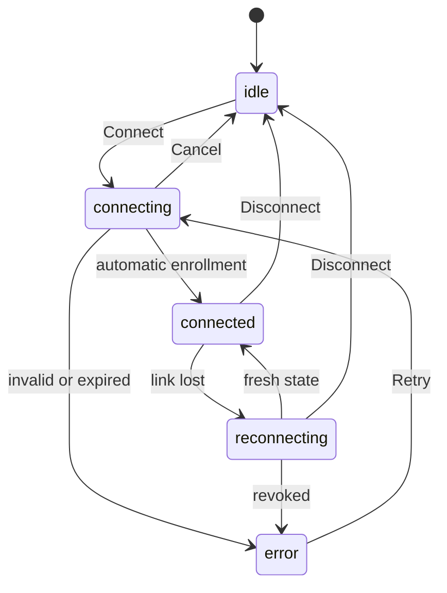

# Connect to a GeckIt server

## Purpose and path
Run `geckit pair` on the server, paste its code into Servers, press Connect. The command starts the service if absent and enables remote access. Code possession grants the whole server immediately, including projects added later. No registered project is required. A returning device chooses its saved server. Full connections open the ordinary GeckIt workspace, including new tasks, replies, approvals, Manager and settings. A compact computer selector in the normal toolbar identifies the active computer. Choosing This computer returns to local work; each computer keeps its conversation and text drafts.

## Surfaces and layout
The existing Servers form contains a command with Copy, followed by Connection code and Connect. No device-name field or approval step. After connection, the ordinary Chat workspace fills the window with its normal toolbar. The computer selector replaces the old Servers icon; no second desktop header or reduced history viewer. Its menu offers This computer, saved computers and Connect computer. Mobile uses one compact computer row above the normal phone workspace. Existing observation grants ask for a fresh pairing code to open this workspace; they never silently gain control. Native actions act on their named computer or report unavailability; remote paths are never sent to local filesystem operations.

## States and exact wording
| State | Text | Action |
|---|---|---|
| idle | Connect to a server | Paste code / choose saved server |
| connecting | Connecting… | Wait or Cancel |
| connected | Connected | Use workspace / Switch computer |
| reconnecting | Reconnecting… | Wait or Disconnect; an action taken now waits up to a minute for the link, then fails with "The link to the computer is down. Try again when it is back." |
| expired | Code expired. Create a new code on the server. | Run geckit pair again |
| reused | Code already used. Create a new code on the server. | Run geckit pair again |
| revoked | Device access revoked. Pair again with a new code. | Obtain new code |
| incompatible | Server version is not compatible with this client. | Update server/client |
| invalid | This is not a connection code. Copy the whole code the server printed. | Correct code |
| uncertain write | Connection lost. Check the server before retrying this action. | Reconnect, inspect result; no automatic replay |

## Transitions

Connection automatically advances to the workspace when fresh authenticated server data arrives. Cancel closes the attempt and ignores late responses. Reconnection never replays a mutation; the workspace remounts with fresh server data. Forget removes the client copy; `geckit devices revoke ID` revokes server access.

## What stays silent
Service startup, enabling access, SDP, ICE and internal RPC. No project scope ceremony or separate approval confirmation. Do not announce every streamed event.

## Time and limits
Codes last five minutes, enough to copy between devices. Single use means only the enrolling device may recover a lost acknowledgement. Reconnect uses existing 2/5/10/30 second backoff. On disconnect, writes already sent fail explicitly and are never replayed; a write made while the link is down waits for it, up to a minute, and is sent once. Observation compatibility keeps 300ms snapshot coalescing. Full workspaces load an authenticated snapshot on connect/reconnect, then receive normal typed events without repeating board snapshot queries.

## Edges
Empty server connects and can add projects. Empty code disables Connect. Enter submits; Tab and focus work; Escape returns Local when outside a child workspace dialog. Long names truncate and workspaces scroll at desktop and phone sizes. Two servers with the same paths and IDs live in isolated renderer contexts. Revocation stops current and future calls. Failed calls display failure and leave the connection usable. Copy/open-link use the client's native capability; server folder navigation and all core mutations target the server.

## Decision reversal
Alex explicitly replaced the initial read-only scope on 2026-11-06. Code possession now suffices to enroll with full control; a second phrase/approval and project restrictions contradict the requested workflow. Existing scoped grants do not silently gain control. Cryptographic identities, encrypted trust, expiry, single use and per-device revoke remain.

## Requirements
FR-001/002: single command and immediate enrollment. FR-003: shared clients; a phone paired the old way reads only and is asked to pair again (docs/ux/unified-client-interface.md, section 3). FR-004/005: isolated normal workspace and full core API. FR-006: states above. FR-007: existing encrypted direct/relay transport. Verification: docs/reports/simple-remote-control.md.

## Computer switching, 2026-11-06 correction
Alex rejected a separate server UI. Keep the existing board, list, conversations, Manager and settings. One compact toolbar selector shows the computer name, chevron and connection dot; its menu marks the current computer. The selector stays reachable above the conversation backdrop, so switching does not require closing a chat. Local work stays mounted in its controller; remote drafts and the selected conversation are stored under the server identity. During reconnection the current computer remains identified and offers This computer. Pairing is the only separate setup screen. Escape closes a menu or dialog first; it must not unexpectedly switch computers while composing.

The workspace keeps the client window's titlebar inset when switching computers, independently of the server OS. macOS window buttons retain their reserved space; phone and framed desktop windows keep their existing layout. The workspace frame has an accessible name without a hover tooltip covering the toolbar. The computer selector alone identifies the active server.

## Computers dialog, 2026-11-07 redesign
Alex rejected both the narrow page with numbered steps and a full-window list: a list of one to three computers left the window empty. Computers is a dialog over the board, sized to its content, never a page; only an opened remote workspace fills the window. The sidebar's computer menu opens it: Connect Computer… on the connect view, Manage Computers… (shown once one is saved) on the list. The menu lists the computers with a check on the one shown, then Connect Computer… and Manage Computers… set off by a line, as a native menu's sections are. The list, titled Computers with no close button, holds the saved computers only (the board under it is this computer) as one grouped list, as macOS lists known networks: each row is the computer's name with its own hostname when renamed, Saved, or Needs a new code for an observation-only grant, and an info button for its details. Pressing a row opens that computer (pairs it again when it needs a code); it then says Connecting… with Cancel, and success replaces the board with that workspace. Below the list: Connect Computer… on the left and Done, the default, on the right. Connect Computer: the command with Copy, Connection code, optional Name, Cancel and Connect. Details: the computer's name as title, Name, kept on this computer, empty meaning its own name; Remove Computer… on the left asks once (Remove <name>? This computer forgets it. To use it again, run geckit pair there and paste a new code.) with Cancel focused, then Cancel and Save. Escape goes back one view, and from the list closes the dialog.

## Naming while connecting
The optional name belongs to the submitted connection attempt. Typing or clearing it does not restart an existing saved connection, and clearing the form after successful pairing does not close the newly opened workspace. The name stays on this device across reconnects.

## Original desktop connection storage, 2026-11-13 correction
The desktop development window reads and updates the same original file-origin connection store as the built app in its data directory. Existing saved computers, labels and the device's signing identity remain available without pairing again. Opening the computer selector shows those saved computers; Manage computers opens their existing rows. Signing, saving, renaming and forgetting use that same store, so reopening the window or switching between development and built renderers retains the result. Browser and phone clients keep their own origin-local storage. This recovery adds no screen, message or permission step. Alex authorized reading the original storage after all three saved connections were found there.

## Connected computer version, 2026-11-17 repair

After selecting a remote computer, Settings > Version identifies that computer's running GeckIt service as "GeckIt <version>". Phone Settings > About shows the same version beside the existing host label. This repairs missing information in the existing workflow and adds no controls or layout. Read fresh server metadata whenever either version surface opens; cached platform/home data must not supply a stale or local version.

The existing remote guidance stays "Update the GeckIt service on the server." Remote workspaces do not show the local desktop's Check for Updates or Restart to Update actions. A server predating version metadata, or one whose metadata cannot currently be read, shows "GeckIt version unavailable" on desktop and "Version unavailable" on phone. Do not infer a version from the client, a release channel or protocol number. Closing and reopening Settings retries the metadata read; reconnection retains the ordinary connection feedback and request timeout.

| From | Event | To | What the user sees |
|---|---|---|---|
| Workspace | Open Settings > Version or phone About | Reading metadata | Existing surrounding Settings and connection feedback; no fabricated version |
| Reading metadata | Server answers, automatically | Version known | "GeckIt <version>" on desktop; "<version>" on phone |
| Reading metadata | Older server answers without version or metadata read fails, automatically | Version unavailable | "GeckIt version unavailable" on desktop; "Version unavailable" on phone |
| Known or unavailable | Close Settings | Workspace | Ordinary workspace |
| Workspace | Reopen Settings | Reading metadata | Fresh metadata request |

What stays silent: metadata transport details and client build number. What is deliberately absent: a second version screen, notifications, new timers and remote restart controls. No new thresholds. The server remains responsible for its own update procedure. Apple UX checks: the existing entry point, hierarchy and local feedback remain; no destructive action or permission is added; absent metadata is explicit; wording names the missing value. Existing reconnect feedback handles a lost link.
