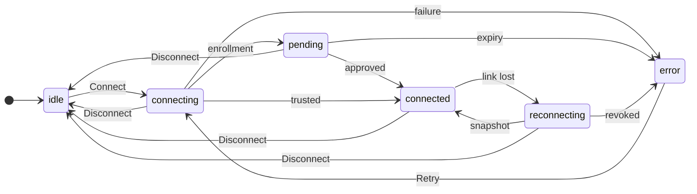

# UX: Connect to a GeckIt server

## 1. Зачем
Desktop и mobile должны показывать работу конкретного headless сервера без переноса его файлов на клиент и без прав управления задачами.

### Путь до результата
Уже сопряжённый legacy phone открывает Connect to a server в списке Hosts. Переход перезагружает только mobile WebView, сохраняет legacy pairing и прекращает его reconnect-loop. Local возвращает прежний режим; новый deep-link не должен снова перехватывать этот возврат. Два React root на одном контейнере не создаются.
В desktop пользователь открывает Servers из верхней панели. На mobile на экране сопряжения выбирает Connect to a server; старый Scan остаётся для прежнего phone pairing. CLI на сервере выдаёт код и QR. Одна форма принимает код или ссылку и имя устройства. После защищённого соединения пользователь сверяет verification phrase с CLI; оператор подтверждает запрос. Только после этого загружаются проекты, сессии и Manager. Сохранённый сервер ещё не означает подключённый: готовность подтверждается полученным snapshot. При возврате выбирается сохранённый сервер, новое сопряжение не нужно. Данные прошлого соединения не выдаются за актуальные. Форма остаётся одной: код и имя независимы, подтверждение зависит от ответа сервера.

## 2. Что добавляется
| Поверхность | Что появляется | Когда видно |
|---|---|---|
| Desktop Chat top bar | Servers, возврат к Local | Всегда |
| Mobile pairing | Connect to a server, Scan server QR | До legacy подключения |
| Общий Servers | Сохранённые серверы, код, имя устройства, Connect | При выборе Servers |
| Remote board | Имя сервера, Read only, проекты, сессии, Manager | После snapshot |
| История | Пагинация текста без интерактивных approvals/файловых действий | При открытой сессии |
| Серверный CLI | Приглашение, QR, pending/approve, devices/revoke | По команде оператора |

## 3. Состояния
| Состояние | Когда | Что видно | Что делать |
|---|---|---|---|
| idle | Не выбран сервер | “Connect to a server” | Ввести код / выбрать сохранённый |
| connecting | Идёт dial | “Connecting…” | Ждать или Disconnect |
| pending | Запрос принят | “Confirm this device on the server” + phrase | Сверить phrase и подтвердить CLI |
| connected | Snapshot принят | “Connected · Read only” | Открыть проект / сессию / Manager |
| disconnected | Отключено явно | “Disconnected” | Connect |
| reconnecting | Связь потеряна | “Reconnecting…” | Ждать / Disconnect |
| expired | Приглашение истекло | “Code expired. Create a new code on the server.” | Новый код |
| reused | Код уже использован | “Code already used. Create a new code on the server.” | Новый код |
| revoked | Сервер отозвал устройство | “Device access revoked. Pair again with a new code.” | Новый код |
| incompatible | Другая major protocol | “Server version is not compatible with this client.” | Обновить приложение |
| error | Ошибка сети / неверный код | “Could not connect. Check the code and server, then try again.” | Попробовать снова |

## 4. Переходы

| Из | Событие | В | Что видит пользователь |
|---|---|---|---|
| idle/error | Нажал Connect | connecting | Connecting… |
| connecting | Сервер принял enrollment, сам | pending | Confirm this device on the server + phrase |
| pending | Оператор подтвердил, сам | connected | Connected · Read only + данные |
| connecting | Сервер признал устройство, сам | connected | Connected · Read only + данные |
| connected | Пропала связь, сам | reconnecting | Reconnecting…, данные скрыты |
| reconnecting | Новый snapshot, сам | connected | Обновлённые данные |
| connecting/pending/reconnecting | Истекло время / сервер отказал, сам | error | Точный текст состояния из раздела 3 |
| Любое | Disconnect / Back | idle | Список сохранённых серверов; новые запросы отменены |
| idle/error/disconnected | Forget | idle | Сервер удалён только с клиента; CLI revoke нужен для отзыва |

## 5. Что молчит
ICE candidates, SDP, адрес TURN и внутренние RPC не показываются. Никаких уведомлений на каждое событие. Скрытые поля и чужие проекты не передаются клиенту.

## 6. Пороги и время
| Число | Значение | Причина |
|---|---|---|
| Invitation TTL | 5 минут | Достаточно перенести код между устройствами, ограничивает украденное приглашение |
| Dial | 45 секунд | Существующий mobile transport допускает медленный signaling |
| Reconnect | 2, 5, 10, 30 секунд | Быстрое восстановление смены сети без нагрузки на спящий сервер |
| History page | 100 элементов | Не загружать всю историю сразу |
| Snapshot invalidation | coalesce 300 мс | События потока не перерисовывают весь board на каждый токен |

## 7. Формулировки
Тексты состояний в разделе 3 являются точными строками. Действия: “Servers”, “Local”, “Connect”, “Disconnect”, “Forget”, “Manager”, “Load earlier”, “Scan server QR”. Пустые данные: “No conversations in this project.”; история: “No messages yet.”. Устройство не подтверждено: данные не видны.

## 8. Краевые случаи
Пустой код блокирует Connect. QR содержит то же приглашение. Неверная ссылка не открывается внешним браузером. Double submit не создаёт второго enrollment. Отмена закрывает channel; ответ старой попытки игнорируется. Несколько серверов с одинаковыми путями и ID используют отдельные пространства имён. Длинные имена и история прокручиваются; Tab и Enter работают в форме, Escape возвращает Local на desktop; фокус возвращается в Servers. После потери связи скрывается содержимое; свежий snapshot заменяет данные целиком. Revoke обрывает соединение и не даёт автоматическому retry обойти запрет. Никаких интерактивных ссылок локального filesystem, approvals или команд из истории.

## 9. Чего намеренно нет
Управление задачами, approvals, native permissions, терминал, открытие удалённых файлов/URL на клиенте, смешанный локальный/удалённый board: следующий этап или вне scope. Не мигрируем общий legacy phone key в device trust.

## 10. Развилки
Общий viewer для desktop/mobile принят: одинаковые read-only полномочия и протокол. Legacy phone остаётся отдельным рабочим сценарием. Пользователь одобрил архитектуру и реализацию; этот документ конкретизирует её состояния. QR раскрывает только временное приглашение. CLI подтверждение обязательно: украденный код сам не даёт доступ. Сохранённое доверие хранится отдельно от приглашения.

## 11. Сверка с требованиями
FR-001/002: серверный код, pending, revoke. FR-003: общий viewer и legacy entry. FR-004/005: board/history/Manager только чтение. FR-006: таблицы состояний/переходов. FR-007: transport остаётся вне пользовательских решений. Неуточнённых продуктовых развилок нет; недоступные live проверки записываются в evidence.

## 12. Проверка реализации
[Отчёт и границы проверки](../reports/remote-clients.md). [Отрисованная диаграмма состояний](../design/remote-clients-states.svg). Desktop1440x900 и mobile390x844 осмотрены в обеих темах; реальные WebRTC/CLI проверки отделены от mock native/legacy UI boundary. Физические устройства, native QR/deep-link и внешний TURN остаются release checks.
