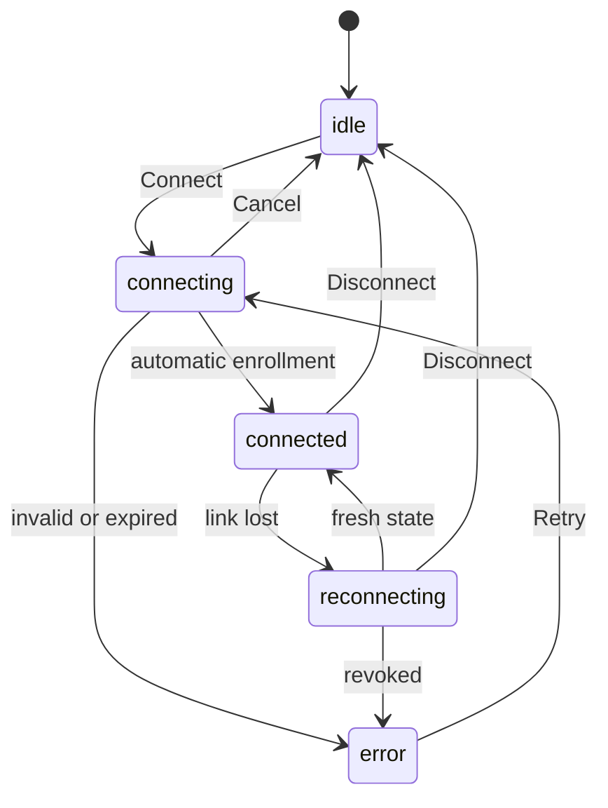

# Connect to a GeckIt server

## Purpose and path
Run `geckit pair` on the server, paste its code into Servers, press Connect. The command starts the service if absent and enables remote access. Code possession grants the whole server immediately, including projects added later. No registered project is required. A returning device chooses its saved server. Full connections open the ordinary GeckIt workspace, including new tasks, replies, approvals, Manager and settings. A compact computer selector in the normal toolbar identifies the active computer. Choosing This computer returns to local work; each computer keeps its conversation and text drafts.

## Surfaces and layout
The existing Servers form contains a command with Copy, followed by Connection code and Connect. No device-name field or approval step. After connection, the ordinary Chat workspace fills the window with its normal toolbar. The computer selector replaces the old Servers icon; no second desktop header or reduced history viewer. Its menu offers This computer, saved computers and Connect computer. Mobile uses one compact computer row above the normal phone workspace. Existing observation grants ask for a fresh pairing code to open this workspace; they never silently gain control. Native actions act on their named computer or report unavailability; remote paths are never sent to local filesystem operations.

## States and exact wording
| State | Text | Action |
|---|---|---|
| idle | Connect to a server | Paste code / choose saved server |
| connecting | Connecting… | Wait or Cancel |
| connected | Connected | Use workspace / Switch computer |
| reconnecting | Reconnecting… | Wait or Disconnect; writes disabled |
| expired | Code expired. Create a new code on the server. | Run geckit pair again |
| reused | Code already used. Create a new code on the server. | Run geckit pair again |
| revoked | Device access revoked. Pair again with a new code. | Obtain new code |
| incompatible | Server version is not compatible with this client. | Update server/client |
| invalid | This is not a connection code. Copy the whole code the server printed. | Correct code |
| uncertain write | Connection lost. Check the server before retrying this action. | Reconnect, inspect result; no automatic replay |

## Transitions

Connection automatically advances to the workspace when fresh authenticated server data arrives. Cancel closes the attempt and ignores late responses. Reconnection never replays a mutation; the workspace remounts with fresh server data. Forget removes the client copy; `geckit devices revoke ID` revokes server access.

## What stays silent
Service startup, enabling access, SDP, ICE and internal RPC. No project scope ceremony or separate approval confirmation. Do not announce every streamed event.

## Time and limits
Codes last five minutes, enough to copy between devices. Single use means only the enrolling device may recover a lost acknowledgement. Reconnect uses existing 2/5/10/30 second backoff. On disconnect pending writes fail explicitly and are never queued for replay. Observation compatibility keeps 300ms snapshot coalescing. Full workspaces load an authenticated snapshot on connect/reconnect, then receive normal typed events without repeating board snapshot queries.

## Edges
Empty server connects and can add projects. Empty code disables Connect. Enter submits; Tab and focus work; Escape returns Local when outside a child workspace dialog. Long names truncate and workspaces scroll at desktop and phone sizes. Two servers with the same paths and IDs live in isolated renderer contexts. Revocation stops current and future calls. Failed calls display failure and leave the connection usable. Copy/open-link use the client's native capability; server folder navigation and all core mutations target the server.

## Decision reversal
Alex explicitly replaced the initial read-only scope on 2026-11-06. Code possession now suffices to enroll with full control; a second phrase/approval and project restrictions contradict the requested workflow. Existing scoped grants do not silently gain control. Cryptographic identities, encrypted trust, expiry, single use and per-device revoke remain.

## Requirements
FR-001/002: single command and immediate enrollment. FR-003: shared clients and preserved legacy phone entry. FR-004/005: isolated normal workspace and full core API. FR-006: states above. FR-007: existing encrypted direct/relay transport. Verification: docs/reports/simple-remote-control.md.

## Computer switching, 2026-11-06 correction
Alex rejected a separate server UI. Keep the existing board, list, conversations, Manager and settings. One compact toolbar selector shows the computer name, chevron and connection dot; its menu marks the current computer. The selector stays reachable above the conversation backdrop, so switching does not require closing a chat. Local work stays mounted in its controller; remote drafts and the selected conversation are stored under the server identity. During reconnection the current computer remains identified and offers This computer. Pairing is the only separate setup screen. Escape closes a menu or dialog first; it must not unexpectedly switch computers while composing.

The workspace keeps the client window's titlebar inset when switching computers, independently of the server OS. macOS window buttons retain their reserved space; phone and framed desktop windows keep their existing layout. The workspace frame has an accessible name without a hover tooltip covering the toolbar. The computer selector alone identifies the active server.
