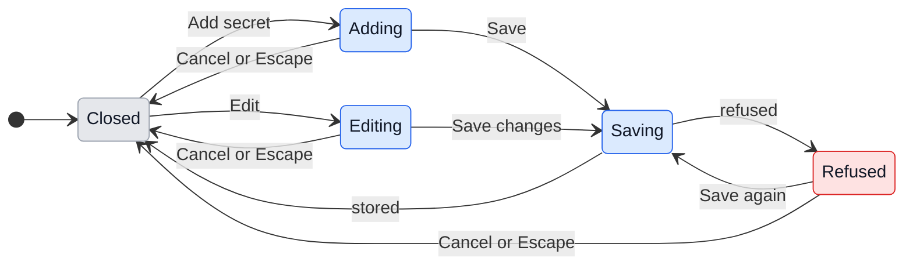

# Secrets: a link to enter one, a broker to use it

Spec: [specs/029-secrets-broker/spec.md](../../specs/029-secrets-broker/spec.md). Layout prototype: not made yet (see design handoff).

## Why

Today the only way to give a conversation an API key or a password is to paste it into the chat, where it stays in the model's context, the transcript and the provider's history. A secret should reach the computer without passing through the conversation, and be used there without the AI ever holding it.

## Path to a result

- **Entry**: the agent needs a secret it does not have. It runs `geckit secrets request` and puts the link in its reply. Alex can also add a secret ahead of time, change one or remove one in Settings > Secrets (see [Managing secrets in Settings](#managing-secrets-in-settings)).
- **Result**: the agent is told the secret is ready, uses it by name, and gets results.
- **Readiness**: a secret is ready when the computer has collected and stored it, not when the page says Saved. The page says Saved when the relay has the sealed value; the conversation is told "ready" only after the broker stored it.
- **Shape**: one web page, one message in the conversation, one Settings section. No wizard.

## The message in the conversation

The agent's reply carries the link on its own line:

> I need an OpenAI key for the cover images. Enter it here, the link works for 15 minutes:
> https://geckit-signal.web.app/s/#…

GeckIt's chat also shows a notice under the reply: **Secret requested: openai-key** · HTTP API · api.openai.com · link valid until 14:17.

## The page

States, in order:

| State | What it shows |
| --- | --- |
| Loading | GeckIt mark and "Checking the link…" |
| Ready | Title **Enter a secret for GeckIt**. Under it: "Do not forward this link." Then a card: **openai-key** (large), the note, for a Website secret with a username "Signs in as alex@example.com", "Asked by alex-mbp for *time2you: cover images*", "Used for: HTTP API on api.openai.com". Field **Value** (**Password** for Website), hidden, with a show/hide eye button. Group **Keep it**: This task (selected), One use, 15 minutes, 1 hour, 1 day, Keep. Button **Save**. Footnote: "The value is encrypted for alex-mbp on this page. GeckIt's AI never sees it." |
| Saving | Button reads "Saving…", fields disabled |
| Saved | Check mark, **Saved for alex-mbp**, "You can close this page." |
| Already used | **This link was already used.** "Ask the agent for a new one if you need to change the secret." |
| Expired | **This link has expired.** "Nothing was saved from it. Ask the agent for a new link." |
| Not valid | **This link is not valid.** (bad fragment, card signature fails, unknown request) |
| Offline | **No connection.** "Your value was not sent." Button **Try again**; the typed value stays in the field. |

- Kinds read: Website, HTTP API, Command, SSH key. Places read as a comma list; for Website the origin without `https://`.
- For SSH key the value field is a multi-line text area.
- **Save** is disabled while the value is empty. Enter in the single-line field saves.
- Focus starts in Value. Tab order: Value, eye, lifetime options, Save.
- Phone widths first: the page is one column, 16 px side padding, the Save button full width at the bottom. Light and dark follow the system.
- The page never shows the value after Saved, and the browser is asked not to remember it (`autocomplete="off"`, `type=password`).

## On the computer

- When a value is saved, GeckIt shows a notice (desktop notification and the conversation's notice line): **openai-key was entered** · from iPhone, Telegram browser · 14:05. The device is the page's user agent, shortened.
- The conversation then gets: `openai-key is ready (http, api.openai.com), expires 15:05.`

## Settings > Secrets

A section after Web Browser.

- List, one row per secret: name, kind and places (for Website with a username: "Website on github.com as alex@example.com"), "expires 15:05" / "until this task is done" / "after one use" / "kept", last use ("used 2 min ago by *time2you: cover images*"). Badges: **Given to a program** for Command secrets; **Not cleaned from output** for short values.
- In the section header, right of the title, as **New profile** in Web Browser: button **Add secret**. Header text: "Keys and passwords conversations use without seeing them. The value never reaches the conversation."
- Row menu: **Edit**, **History** (the last 20 uses: time, task, place, result), **Remove**.
- **Remove** asks: "Remove openai-key? Conversations that use it will be refused until it is entered again." Buttons **Remove**, **Cancel**.
- Footer line: the store in use ("Stored in the macOS Keychain on this computer", "Stored in files sealed with Windows DPAPI on this computer", "Stored in the system keyring on this computer", "Stored in an encrypted file on this computer"). When the broker is not running: "Secrets are unavailable: <reason>." with **Try again**; **Add secret** and **Edit** are hidden then.
- Empty state: "No secrets yet. Add one here, or a conversation sends you a link when it needs a key or a password."
- There is no Show value, here or anywhere.

## Managing secrets in Settings

### Why

A secret today enters only through a conversation's link. Alex cannot put in a key he already knows will be needed, cannot fix a wrong host or program without removing the secret and waiting for a new link, and cannot replace a rotated key without asking an agent to request it. Each of these costs a conversation turn and a trip through the browser for something he could type where he already is.

### Path to a result

- **Entry and result**: Settings > Secrets, **Add secret** or a row's **Edit**. At the end the secret is in the list with its places, and the next conversation that uses it by name works without a link.
- **Readiness**: the secret is ready when its row shows the new places and lifetime; that happens only after the broker stored it. There is no half-saved secret: Cancel or a refusal leaves the store as it was.
- **Decisions and order**: name, then what it is used for (kind), then where (places, whose hint depends on the kind), then the value, then how long to keep it. Note is optional. Kind decides the hint under Places and whether Value is one line or a text area.
- **Shape**: one inline form in place of the row (Edit) or at the top of the list (Add). Not a separate sheet: a secret has six fields, and the list next to the form shows the names already taken.
- **Return**: closing Settings or pressing Cancel drops the form and the typed value; nothing is kept. A secret can be edited again at any time.

### The form

| Field | Add | Edit |
| --- | --- | --- |
| **Name** | text, lowercase letters, digits and hyphens | shown, not editable |
| **Used for** | Website, HTTP API, Command, SSH key; HTTP API selected | shown, not editable |
| **Where** | text, comma list | text, filled with the current places |
| **Username** (Website only, after Where) | text, optional, placeholder "alex@example.com", hint "Optional. The username or email it signs in as. Not secret: conversations see it and type it themselves." | text, filled |
| **Note** | text, placeholder "Optional" | text, filled |
| **Value** (labelled **Password** for Website) | hidden, eye button; text area for SSH key | hidden, empty, placeholder "Leave empty to keep the current value" ("password" for Website) |
| **Keep it** | One use, 15 minutes, 1 hour, 1 day, Keep; Keep selected | the same, the current one selected; This task is added only when the secret is already This task |

Hints under **Where**, one per kind, followed by "Separate several with commas.": Website "Sites, such as https://github.com"; HTTP API "Hosts, such as api.openai.com or *.stripe.com"; Command "Programs, such as psql"; SSH key "Hosts, such as github.com". The placeholder is the first example alone.

Where is forgiving: for HTTP API and SSH key a scheme, user and path are dropped (`https://api.openai.com/v1` is kept as `api.openai.com`, `git@github.com` as `github.com`); for Website `https://` is added when missing and the path dropped.

Hint under **Value**: "Encrypted before it leaves this window. GeckIt's AI never sees it."

Buttons: **Cancel**, **Save** (Add) or **Save changes** (Edit). Save is disabled while Name, Where or, for Add, Value is empty. Enter in a one-line field saves; Escape cancels. Focus starts in Name (Add) or Where (Edit) and returns to **Add secret** or the row's menu button when the form closes.

The value is sealed inside the Settings window to a one-time key of the broker, as the web page does, so the app and service carry only the sealed value. Name, Where and a taken name are checked in the window first; a refusal there keeps the typed value. Once the checks pass the field is cleared and the value sent, so a refusal from the broker asks for the value again.

A changed lifetime counts from the moment of saving: an Edit to 1 hour means one hour from now.

### States

| State | When | What Alex sees | What to do |
| --- | --- | --- | --- |
| Closed | default | the list and **Add secret** | press Add secret or Edit |
| Adding | pressed Add secret | the empty form under the list | fill and Save, or Cancel |
| Editing | picked Edit | the row replaced by the filled form | change and Save changes, or Cancel |
| Saving | pressed Save | button "Saving...", fields disabled | nothing, it passes |
| Refused | a check in the window or the broker refused | the form stays, one line in red above the buttons; Value is kept after a check in the window and empty after a broker refusal | correct and Save again, or Cancel |
| Saved | the broker stored it | the form closes, the row shows the new state | nothing |

### Transitions

| From | Event | To | What Alex sees |
| --- | --- | --- | --- |
| Closed | pressed **Add secret** | Adding | the empty form at the top of the list, focus in Name; Add secret disabled |
| Closed | picked **Edit** in a row menu | Editing | the row becomes the form, focus in Where |
| Adding / Editing | pressed Save, or Enter in a one-line field, and the checks in the window passed | Saving | "Saving...", fields disabled, Value cleared |
| Adding / Editing | pressed Save and a check in the window failed | Refused | the refusal; Value kept |
| Saving | the broker stored it | Closed | the row with the new places and lifetime; focus on its menu button |
| Saving | a check or the broker refused | Refused | the refusal under the form, see Wording |
| Refused | edited a field and pressed Save | Saving | "Saving..." |
| Adding / Editing / Refused | pressed Cancel or Escape | Closed | the list as before, nothing changed; focus on Add secret or the row's menu button |
| any | the broker stopped | Closed | "Secrets are unavailable: ..." with Try again; the typed form is dropped |
| Editing | the secret was removed or expired meanwhile | Refused | "There is no secret openai-key." |

### Wording

| State | Text |
| --- | --- |
| Name invalid | "Name the secret with lowercase letters, digits and hyphens, such as openai-key." |
| Name taken (Add) | "A secret named openai-key already exists. Edit it instead." |
| Where empty | Save disabled, no text |
| Website place wrong | "github.com is not a site: give it as https://github.com." |
| HTTP place wrong | "api openai is not a host: give it as api.example.com or *.example.com." |
| Lifetime This task on a new secret | "A secret added in Settings belongs to no conversation, so it cannot be kept until a task is done." (not reachable from the form) |
| Command place wrong | "psql -h x is not a program: give its name, such as psql, or its full path." |
| SSH place wrong | "git@github.com is not an SSH host pattern." |
| Store locked | "The credential store is locked; unlock it and try again." |
| Secret gone (Edit) | "There is no secret openai-key." |
| Other refusal | the broker's own sentence, which never contains a value |

### What stays silent

| State | Why not shown |
| --- | --- |
| Saved | the row itself changes; a toast would repeat it |
| Sealing the value | it takes milliseconds and Alex cannot act on it |
| A secret added in Settings has no task | it is visible as its lifetime; "no task" means nothing to Alex |

### What is deliberately absent

| Not doing | Why |
| --- | --- |
| Show or copy a value | the broker has no way to read a value back (FR-011) |
| Rename | conversations and saved commands use the name; a rename breaks them silently. Remove and add instead |
| Change the kind in Edit | a Website value is a password, a Command value is given to a program: the same value under another kind is a different secret. Remove and add instead |
| This task when adding | a secret added in Settings belongs to no conversation, so it would never end |
| A link from Settings to enter the value on the phone | Settings is on the computer where the value is typed; the link stays the conversation's way |
| Adding or editing on the phone | the phone does not show Settings > Secrets |

### Forks

**Add in Settings or only through a link.** Verdict: add in Settings. The first design kept secrets tied to a request so each had a purpose and places; the form now asks for the same places and a note, so that purpose is kept, and Alex no longer has to start a conversation to store a key he already holds. This reverses "There is no Add button" in the earlier design.

**Edit without retyping the value.** Verdict: yes, Value empty keeps the current one. Fixing a host is the common edit, and asking for the key again for that would push Alex back to the link.

**Inline form or a sheet.** Verdict: inline, as Web Browser profiles add and edit in place; see Shape.

**Where the Add button sits.** Verdict: in the section header, not under the list. Web Browser's New profile already sits there, and under a long list the button would scroll out of sight.

### Username for Website secrets

A site sign-in needs a username or email as well as the password. The username is not secret, so it is kept in the open beside the secret: given by the agent with `geckit secrets request ... --user <account>`, typed by the person on the link page or in Settings, and shown in the Settings row and in `secrets list` after `as`. When the agent gave one, the link page says "Signs in as ...". When it did not, the page has an optional field "Username or email" above Password, with the hint "Optional. Not secret: the conversation sees it and types it in." The relay carries it back in the open beside the sealed password, and the service hands it to the broker on save; the notice the conversation gets says "as <user>". A username the agent gave cannot be changed on the page, only in Settings. The agent types it itself with an ordinary `browser type`, then the password with `browser type --secret`. Only Website secrets keep one.

| Not doing | Why |
| --- | --- |
| Hide the username like the password | the broker types secrets only into password fields (FR-012); typing into other fields would loosen that rule for a value that is not secret |
| Seal the username with the password | the conversation has to read and type it; sealing it would need a second channel for the same value |
| Two-step codes | they change every time and are entered by the person at sign-in |

### Reconciliation with requirements

| Requirement | Where |
| --- | --- |
| FR-027 list, inspect, remove in Settings | Settings > Secrets |
| FR-011 no read-back | Value never shown; What is deliberately absent |
| FR-017, FR-020 values only in the store | the value is sealed in the window to the broker's key |

**Missing in the requirements:** none; FR-027 now covers adding and editing in Settings.

## What stays silent

- Uses that succeed are not announced; they appear in History.
- Expiry is not announced. A conversation that needs an expired secret asks again, and Alex sees a new link.

## Wording rules

- "Secret" everywhere, never "credential", "token" or "password" as the general term.
- Lifetime choices are exactly: This task, One use, 15 minutes, 1 hour, 1 day, Keep.
- The same text on macOS, Windows and Linux, except the store's name in the Settings footer.
